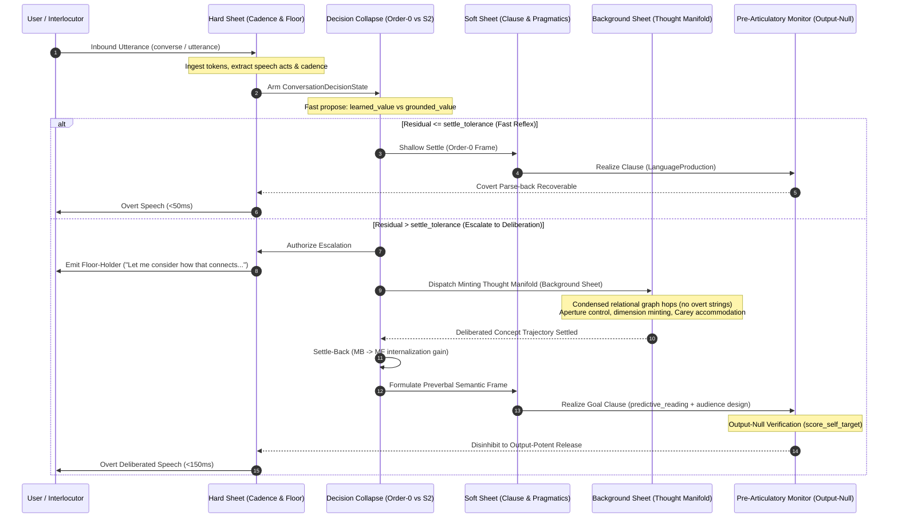

# Conversational Thought-Manifold & Utterance Generation Execution Plan

**Document Path:** `docs/research/psychology_affect/CONVERSATIONAL_MANIFOLD_EXECUTION_PLAN.md`  
**Status:** Canonical Implementation Plan; bounded increments are implemented and locally verified, while the documented phase exit criteria remain active.
**Target Capability:** Minimally sufficient, ongoing, non-stalling conversational capability for the Jabberwock agent on the Ocelot substrate, with explicit diagnostic errors when cognition cannot produce a communicative response.  
**Strict Invariants:**
- `CLAUDE.md` compliance: The agent is a graph in Rust; Python is strictly a world adapter (`WorldAdapter`). No Python rule engine or agent decision logic.
- `donkey=0`: Zero LLM inference calls at runtime; fully teacher-free loop over graph-resident representations.
- Discrete Quanta: Integer widths $k \in [0, 2]$, discrete deviation counts, snapped observer apertures; no un-quantized continuous drift.
- **No Dismissive Failure Surface:** The exact fallback word `noted` is forbidden as an output. If a cognitive or dispatch path cannot produce a response, the surface must be the explicit diagnostic `ERROR: no communicative response could be generated.`
- Bounded Latency & Memory: Fast reflex $<50\text{ ms}$, thought manifold $<150\text{ ms}$, resident memory $<100\text{ MB}$ RSS.

---

## 1. Executive Summary & Problem Diagnosis

The **Jabberwock** agent possesses an advanced, graph-native cognitive core:
1. **Introspection:** Accurately queries live Rust graph state for architecture and limits (`domains/reflective_faculty.py`, `seeds/question_targets.json`).
2. **Epistemic Honesty:** Isolates trouble sources on ungrounded input and issues clarification requests (`tests/test_conversation_loop.py`).
3. **Gap Awareness:** Automatically files `SelfConcern` nodes on retrieval misses or user critiques (`seeds/gap_awareness.json`).
4. **Thought Manifold (Attested):** Solves dimensional impasses via aperture-grain trajectory control and dynamic dimension minting (`CapabilityAxis`) in **0.045 ms** across dense multi-relational networks (`attestation/ATTESTATION_EXECUTIVE_SUMMARY.md`).
5. **Utterance Generation Stack:** Features a complete Levelt-compliant speaker blueprint (`domains/language_production.py`), pragmatic audience design (`domains/audience_driven_production.py`), clause planning and gap-filling (`domains/predictive_reading.py`), and covert self-monitoring (`domains/conceptualizer.py`).

### The Core Failure Mode in Ongoing Dialogue
Before the Phase 1/2 work, the live conversational loop (`WorldAdapter.converse()` in `substrate/world_adapter.py`) stalled:
- **Premature Collapse:** On non-question statements, the loop immediately fell back to `_honest_minimal_reply()` with a dismissive acknowledgement, dropping turn-taking. The fallback is now an explicit diagnostic error, while the underlying cognitive routing gap remains a cognition task.
- **Architectural Disconnection:** The live bridge now invokes Thought-Manifold evidence transport and native deliberation readback, but ordinary corpus events still provide no complete Phase 4 tuple, so selected live candidates remain absent.
- **Utterance Generator Bypass:** Rather than generating clauses from communicative goal frames, `converse()` relies on raw string scraping (`_answer_topic_reply`) or static graph dumps, using `conceptualizer` merely as a post-hoc logging stamp.
- **Method Fragmentation:** Inbound and outbound methods are fragmented across `converse()`, `receive_utterance()`, `add_inbound()`, and `utterance_for()`, leading to divergent code paths between turn-taking dialogue and relational surface realization.

Phases 1/2 address the declarative-turn stall and entry-point aliasing, while later phases add the production, commitment, settle-back, and live action/repair paths. The conversation decision state now persists candidate values and experience counts, and the native Rust scheduling path is locally verified; live replies still retain legacy graph/readback paths outside the planned Levelt production gate.

---

## 2. Core Architectural Inspirations from the Body / Motor / Control Systems

The embodied motor and control architectures in Ocelot (`docs/research/humanoid/motor_core_whole_stack_architecture.md`, `docs/research/humanoid/motor_decision_collapse.md`, `docs/research/humanoid/biological_motor_control_upgrade.md`, `docs/research/flight_control/jsbsim_f16_coupled_control.md`, `docs/research/agent_loop/jabberwock_control_reasons_first_design.md`) provide rigorous, tested mechanisms that map directly into conversational dialogue:

### A. The Three-Tier Latency Sheet Architecture (`cognitive_cycle.rs`)
The embodied motor core executes rules across three distinct latency classes to protect hard physical deadlines:
1. **Hard-Real-Time Sheet (<10 ms):**
   - *In Motor Control:* Protects physical sensorimotor deadlines, vestibular damping, local balance reflex, and opaque command release.
   - *In Conversation:* Protects event ingest and bounded release deadlines (<50 ms). It must not emit reflexive backchannels or conversational fillers to conceal absent cognition; only an explicitly selected graph goal may authorize a holding behavior, otherwise failed release remains the explicit diagnostic error.
2. **Soft-Real-Time Sheet (<50 ms):**
   - *In Motor Control:* Receipt-backed adaptation and analysis-by-synthesis composition of compound motor programs.
   - *In Conversation:* Pragmatic audience design (`audience_driven_production` choosing terseness rung via `pragmatic_speaker.choose_encoding`), clause realization (`predictive_reading.realize_goal_clause`), and covert self-monitoring (`score_self_target`).
3. **Background Sheet (<150 ms):**
   - *In Motor Control:* Offline consolidation, replay, and structural limit memory updates.
   - *In Conversation:* Deep thought-manifold trajectory search (`run_minting_train_of_thought`), Carey dynamic capability axis minting, multi-hop analogical mapping, and episodic narrative consolidation.

### B. `motor_decision_collapse` Applied to Conversational Turn Selection
In `seeds/motor_decision_collapse.json`, decision options are evaluated through a single domain-neutral collapse with two depths:
1. **Domain-Neutral Candidate Options:**
   Each conversational candidate (e.g. `direct_answer`, `follow_up_inquiry`, `epistemic_clarification`, `floor_holding_filler`, `concept_elaboration`) is a `DecisionOption` attached to a `ConversationDecisionState`:
   - `token`: opaque action identifier.
   - `default_value`: fast prior before experience.
   - `learned_value` & `decision_experience_count`: internalized fast habit.
   - `grounded_value`: active valuation from the thought manifold / discourse context.
2. **Scalar Residual as Sole Escalation Arbiter:**
   $$\text{residual} = \max\left(|V_{\text{fast}} - V_{\text{grounded}}|,\, \text{if } V^*_{\text{grounded}} > V_{\text{grounded}} \text{ then } \tau + (V^*_{\text{grounded}} - V_{\text{grounded}}) \text{ else } 0\right)$$
   - If $\text{residual} \le \text{settle\_tolerance}$: `shallow_settle` commits immediately (sub-50 ms System 1 reflex).
   - If $\text{residual} > \text{settle\_tolerance}$: Authorizes `residual_authorized_deepen`, recruiting System 2 (Thought Manifold).
3. **Settle-Back & Internalization ($MB \rightarrow MF$ Replay):**
   $$\Delta V_{\text{learned}} = \alpha \cdot (V_{\text{grounded}} - V_{\text{learned}})$$
   - Contrastive credit: The rejected proposal learns from counterfactual error; the winning action internalizes its grounded value.
   - **Dialogue Automation Signature:** Over successive communication events on recurring topics, residual decreases, and a grounded communicative action can be proposed directly by order zero. Surface fluency is not evidence of this state.

### C. Output-Null Preparation vs. Output-Potent Release
In `biological_motor_control_upgrade.md`, motor candidates remain in an **output-null** preparatory state (`HumanoidMotorPreparation`) where cost and lateral uncertainty are checked. A distinct graph rule disinhibits the preparation into an **output-potent** release:
- *In Conversation:* Maps directly to Levelt's pre-articulatory monitor. Candidate clauses are generated into an output-null preverbal buffer.
- Covert parse-back (`conceptualizer.scan_and_monitor` + `self_target_monitor.score_self_target`) parses the candidate back through comprehension to verify listener recoverability.
- Only when recoverability $\ge 1.0$ and confidence passes threshold is the utterance disinhibited into overt output-potent speech. If recoverability fails, it triggers an internal 1-step repair loop before overt sound/text is emitted.

### D. Efference Copy & Predictive Forward Modeling
`embodied_sensorimotor_core` advances a predictive belief state (`EmbodiedBodyBelief`) and generates an efference copy compared against delayed sensorimotor receipts:
- *In Conversation:* When Jabberwock articulates an utterance, it stores an **efference copy** of expected interlocutor understanding and conversational trajectory.
- When the interlocutor replies, the difference between expected and received turn provides the conversational sensory prediction error (residual).

### E. Structural Envelope Protection & Two-Boundary Epistemic Safety
In `embodied_structural_limits.md` and `fixed_wing_jet_control.md`, the controller maintains two distinct boundaries:
1. **Conservative Safe Envelope:** Crossing this envelope does NOT destroy the body; it interrupts release and admits a safe, zero-increment unloading action.
2. **Rated Structural Limit:** Exceeding this boundary causes permanent damage or failure.
- *In Conversation:*
  - *Boundary 1 (Pragmatic / Common-Ground Margin):* When an interlocutor introduces ungrounded terms, contradictions, or out-of-domain assertions, Jabberwock triggers zero-increment safe recovery (epistemic honesty ask-back, trouble-source isolation, `SelfConcern` registration).
  - *Boundary 2 (Rated Limit / Hallucination):* Enforced by `donkey=0` and graph-grounding; the agent NEVER fabricates facts or hallucinates answers.

### F. Reason-First From Grounded Priors
In `jabberwock_control_reasons_first_design.md`: "A control is a button that does stuff. Reason FIRST from grounded priors, not a brute-force game-playing machine."
- *In Conversation:* Interlocutor cues (syntax, lexical markers, speech acts) yield function-space priors (`Question`, `Challenge`, `Assertion`, `Praise`). The agent posits the communicative function FIRST, then confirms/refines it with observation receipts, rather than brute-forcing through a list of keyword matchers or dumping arbitrary text.

### G. Coarse Symmetric Quantization Over Continuous Over-Resolution
In `jsbsim_f16_coupled_control.md`, symmetric 2-interval quantization ($-1, 0, +1$) passes control while finer lattices (4, 8, 12) fail due to limit cycles:
- *In Conversation:* Use discrete integer quanta ($k \in [0, 2]$, deviation counts, discrete pragmatic rungs $J(\text{rung})$). Un-quantized continuous probabilities cause conversational drift, hedging loops, and limit cycles.

### H. Condensed Inner Speech Trajectory
Human inner speech is syntactically condensed and predicative (Vygotsky, Fernyhough):
- Internal motor trajectory planning navigates joint coordinate models without actuating physical limbs.
- Similarly, `train_of_thought` must navigate relational graph edges directly (`Concept -> Relation -> Concept`) without invoking `realize_goal_clause()` at intermediate hops. Overt realization is reserved strictly for the collapsed final response or external inquiry.

---

## 3. Human Cognitive & Utterance Generation Blueprint

The utterance generation stack integrates Levelt's speaker blueprint:

```
┌────────────────────────────────────────────────────────────────────────────────────────────────────────┐
│                               EXISTING UTTERANCE GENERATION PIPELINE                                   │
├────────────────────────────────────────────────────────────────────────────────────────────────────────┤
│                                                                                                        │
│  1. CONCEPTUAL PREPARATION & AUDIENCE DESIGN (domains.conceptualizer & audience_driven_production)     │
│     • Mint CommunicativeGoal{kind, force_kind, content} -for_audience-> Interlocutor                   │
│     • Evaluate Pragmatic Speaker spectrum: J(rung) = ListenerRecovery(rung) - λ * Cost(rung)          │
│     • Rust Argmax-of-Plus Term (pragmatic_speaker.choose_encoding) selects optimal terseness           │
│     • Emit MessageShape{focus, ground, residual_frac}                                                  │
│                                                                                                        │
│  2. GRAMMAR-OWNED CLAUSE ENCODING (domains.language_production.LanguageProduction)                    │
│     • Invert grounded Grammar productions (SVO for en/es/zh, SOV for ja) into ordered slots            │
│     • Insert grounded FunctionWord nodes (determiners, spatial prepositions, case particles)           │
│     • Map concepts to inflected surfaces in reverse via grounded LexEntry nodes                        │
│                                                                                                        │
│  3. PLAN-THEN-REALIZE & GAP-FILLING (predictive_reading.realize_goal_clause)                           │
│     • Grammar-fixed slots (realized == True) emitted verbatim                                          │
│     • Open slots (realized == False) dynamically filled via ranker (_gapfill_slot)                     │
│                                                                                                        │
│  4. SELF-MONITORING COMMITMENT GATE (conceptualizer.scan_and_monitor & self_target_monitor)            │
│     • Output-Null buffer: Covert parse-back ("say it to yourself") parses candidate through grammar    │
│     • Audit informative_content recoverability: mint Verdict{recoverable, missing}                     │
│     • Commit Gate: mint Committed{utterance, terseness} (if unrecoverable, re-shape for 1 repair loop)  │
│                                                                                                        │
│  5. CONNECTIVE SMOOTHING & REGISTER DELIVERY (domains.conversation_action)                             │
│     • Connective join (_oxford_with_connectives, smooth_first_person) turns discrete clauses into prose│
│     • Register modulation (formal, casual, neutral) matches interlocutor cues                          │
│                                                                                                        │
└────────────────────────────────────────────────────────────────────────────────────────────────────────┘
```

---

## 4. Utterance vs. Conversation Method Unification & API Harmonization

The codebase currently exhibits a legacy divide between "utterance" methods and "conversation" methods in `substrate/world_adapter.py`:

| Method | Role | Current Implementation | Redundancy / Limitation | Unification Action |
|---|---|---|---|---|
| `converse(text, ...)` | Turn Execution | Orchestrates full turn: ingest, comprehension, tick, fulfill, reply. | Can still fall back to an explicit diagnostic error when cognition cannot produce a response; bypasses `LanguageProduction` on some legacy paths. | **Canonical Entry Point.** Upgrade to dual-process collapse + Levelt generator. |
| `receive_utterance(text, ...)` | Inbound Graph Ingest | Mints `Message` node, tokenizes mentions, backfills concepts. | Only ingests; does not run turn or return text. | Retain as **mechanical I/O primitive** for low-level graph test harnesses. |
| `add_inbound(text, ...)` | Inbound Wrapper | Calls `receive_utterance` with `classify_speech_act`. | Redundant 2-line wrapper. | **Remove redundant body; make 1-line alias** delegating to `receive_utterance`. |
| `add_outbound(text, ...)` | Outbound Ingest | Manually mints outbound `Message` node. | Fragmented from reply attribution in `_finish_turn_reply`. | Unify through `_finish_turn_reply`; keep as backward-compatibility helper. |
| `utterance_for(meaning)` | Surface Realization | Renders relational meaning via `_render_node()`. | Bypasses `LanguageProduction` and Levelt self-monitoring gate. | **Unify & Alias:** Re-point `utterance_for` to route meaning through `LanguageProduction.produce()`. |
| `utterance(text, ...)` | Direct Utterance | (Previously missing/inconsistent across worlds). | Callers expect `agent.utterance()` to converse or utter. | **Define as Canonical Alias:** `WorldAdapter.utterance = WorldAdapter.converse`. |
| `conversation()` | Transcript Query | Returns list of `{text, from}` message dicts. | Naming clashes conceptually with `converse()`. | Retain as history accessor; guarantee strict parity with `chat_transcript()`. |

### Unification Invariants:
1. **Single Canonical Generation Engine:** Every surface generation path (`converse()`, `utterance_for()`, inner speech final response) routes through `LanguageProduction.produce()` and `predictive_reading.realize_goal_clause()`. The legacy `_render_node` is retired, with an alias routing through `LanguageProduction`.
2. **Symmetric Dialogue API (`converse` $\equiv$ `utterance`):** `wa.converse(...)` and `wa.utterance(...)` are identical entry points for a conversational turn.
3. **Preservation of Low-Level Ingest:** Low-level test suites that test intent minting in isolation (`tests/test_intent_migrated.py`) continue calling `receive_utterance()` without executing unwanted outer cognitive cycles.

---

## 5. Concept & Lexicon Library Architecture

The lexicon serves as a bidirectional bridge between geometric concepts and linguistic form:

1. **Bidirectional Sign Structure:**
   - *Comprehension:* `Surface Word` $\rightarrow$ `LexEntry` $\rightarrow$ `Concept` (`seeds/grounded_lexicon.json`).
   - *Production:* `Concept` $\rightarrow$ `LexEntry` $\rightarrow$ `Surface Word` (inflected forms stored directly).
2. **Syntactic Scaffolding via `FunctionWord` Nodes:**
   - Loaded from `domains/function_word_reference.py`.
   - Inverted grammar rules query `FunctionWord` nodes to inject determiners (*the*, *a*), prepositions (*on*, *in*, *of*), and case particles (*ga*, *o*), converting lemma sets (`"dog mammal"`) into grammatical clauses (`"The dog is a mammal."`).
3. **Open-Slot Gap-Filling:**
   - When a concept lacks an inflected surface in the active grammar, `predictive_reading._gapfill_slot()` ranks synonyms and hypernyms across the concept graph to fill the slot without breaking syntax.
4. **Audience-Credit Indexing:**
   - `WorldAdapter._lexicon_with_known()` verifies that concepts credited to the interlocutor in common ground have valid lexical entries, enabling pragmatic elision without ambiguity.
5. **Epistemic Gap Awareness:**
   - Unknown concepts trigger `seeds/gap_awareness.json`, automatically filing a `SelfConcern` node and generating an epistemic clarification request instead of hallucinating.

---

## 6. End-to-End Integrated Architecture & Scheduling



---

## 7. Detailed Step-by-Step Implementation Blueprint

### Phase 1: Dual-Process Turn Gating in `WorldAdapter.converse()`
* **Target File:** `substrate/world_adapter.py`
* **Changes:**
  1. Retain `_honest_minimal_reply()` only as an explicit diagnostic terminal error after continuation candidates are exhausted; never emit `noted` or another dismissive acknowledgement for a failed cognitive/dispatch path, and do not use the error as a substitute for fixing cognition.
  2. Implement an auditable `ConversationDecisionState` stamp, then complete its `motor_decision_collapse` semantics in Phase 6:
     - **Fast Path (Hard Sheet):** Social acts (`greeting`, `thanks`), 1-hop known facts (`knows_fact`), and self-state queries (`_surface_self_state`).
     - **Deliberative Path (Background Sheet):** When incoming turns contain unexplained relations, multi-hop queries, contradictions, or ungrounded statements, mint an `OpenGoal` and recruit System 2.
  3. Wire `residual_stance` over asserted concepts: on inbound statements that are not questions, identify unrecovered parent concepts, implications, or open goals, and formulate an active response or inquiry.

### Phase 2: Method Unification and Aliasing on `WorldAdapter`
* **Target File:** `substrate/world_adapter.py`
* **Changes:**
  1. **Unify Surface Production:** Route communicative goal frames through `LanguageProduction` and alias `_render_node` to `utterance_for`; retain graph RenderRules for relational/node meanings until Phase 4 completes full live-turn routing.
  2. **Alias Conversational Entry Points:**
     - Add `utterance = converse` on `WorldAdapter` class level so callers using either method name execute the canonical turn pipeline.
     - Simplify `add_inbound(text, speaker)` to a clean alias: `return self.receive_utterance(text, speech_act=self.classify_speech_act(text), speaker=speaker)`.
  3. **Outbound Choke-Point Verification:** Ensure all outbound responses (whether produced via `converse`, `utterance_for`, or `add_outbound`) consistently register attribution in `_finish_turn_reply()`.

### Phase 3: Condensed Inner Speech Trajectory
* **Target File:** `domains/train_of_thought.py` and `domains/self_dialogue.py`
* **Changes:**
  1. Decouple inner thought hops from overt English clause realization. Inside `run_inner_conversation()` and `self_answer()`, traverse the concept graph using direct relational pointers (`Concept -> Relation -> Concept`).
  2. Eliminate calls to `realize_goal_clause()` on intermediate inner hops. Compute trajectory residuals directly from graph-node set differences rather than text parse-back.
  3. Reserve clause realization strictly for the collapsed final response or external inquiry.

### Phase 4: Active Routing to `LanguageProduction` & `realize_goal_clause`
* **Target File:** `substrate/world_adapter.py` and `domains/conversation_action.py`
* **Changes:**
  1. Construct `_realize_frame_reply(self, frame, audience_snap)`:
     - Wrap semantic frame `{event, agent, patient, mood, intent}`.
     - Call `domains.audience_driven_production.select_utterance()` using Rust `Argmax-of-Plus` to select terseness rung.
     - Invoke `predictive_reading.realize_goal_clause()` using `LanguageProduction` grammar rules.
  2. Integrate `FunctionWord` references to guarantee well-formed SVO/SOV constituent ordering.

### Phase 5: Output-Null Pre-Articulatory Gate & Floor Holding
* **Target File:** `domains/conceptualizer.py` and `domains/conversation_action.py`
* **Changes:**
  1. Output-Null Buffer: Buffer candidate overt speech until `conceptualizer.scan_and_monitor()` and `self_target_monitor.score_self_target()` verify recoverability $\ge 1.0$.
  2. Floor-Holding Pattern: When System 2 escalation is triggered, the hard sheet immediately emits a register-appropriate floor-holding filler (`"Let me see..."`, `"Looking at how that connects..."`) to preserve turn-taking cadence while background deliberation runs.

### Phase 5J: Explicit production-shaped learning observations

Use a separately authored, provenance-bearing observation fixture with stable
`gap_identity`, `learning_stage`, and `verification_status` fields. Feed those
typed observations through the existing `SelfConcern`, `GapRecurrence`, and
`GapLearningAssessment` authorities. Verify that recurrence is identity-local,
that assessment remains human-gated, and that no identity is inferred from
surface repetition or automatically promoted.

### Phase 5K: Verified repair and supervised promotion closure

Attach explicit failed-repair and verified-retry evidence to the typed fixture.
The native review authority must expose failed repair, promote only the
identity with an explicit approval decision, preserve the other identity at
human review, and report promotion provenance. No recurrence count or repair
success may itself authorize promotion.

### Phase 5L: Communication-event learning observation ingress

Allow a language-neutral communication adapter to provide explicit learning
observation fields (`gap_identity`, `learning_stage`, and
`verification_status`) through the existing `converse()` event context. The
adapter may transport and record the evidence only; the graph-native
`gap_awareness` authority must mint the existing `SelfConcern` and preserve
message provenance. Repeated identity, repair, and promotion decisions remain
owned by the existing Phase 5 rules.

The live integration exit additionally requires two explicitly identified
communication events to produce one native recurrence with increased priority
while the assessment remains `human_review` and `auto_promoted=0.0`.

### Phase 5N: Competing communication-event learning identities

Replay multiple explicitly identified learning observations through the live
communication boundary with different recurrence pressures. Native cognition
must preserve identity-local recurrence counts and priority ordering, prevent
cross-identity transfer, and keep every assessment human-gated until an
explicit review decision exists.

### Phase 5O: Explicit corpus learning overlay

Keep the original fixed communication corpus unchanged, and add a separately
authored overlay keyed to existing event IDs. Each overlay event must carry an
explicit opaque `gap_identity`, `learning_stage`, and `verification_status`.
Route the overlay through the existing live learning-observation ingress and
native `SelfConcern`/`GapRecurrence`/`GapLearningAssessment` authorities.
Report overlay evidence separately from unannotated-corpus evidence; identity
must not be inferred from signal similarity, event order, or runtime gap text.

Acceptance evidence: the base corpus remains free of learning metadata; the
overlay has complete explicit metadata; at least three identity-local repeated
recurrences are read back with native counts and priorities; and no automatic
promotion occurs without explicit human review.

### Phase 6T: Receipt mismatch authority audit

Classify released receipt mismatches using receipt graph provenance, without
using reply text or selecting a preferred receipt. Distinguish an identical
same-event duplicate release from competing semantic releases and from a
single receipt whose semantic force is incompatible with the independent event
annotation. Any correction must target the producing cognitive/release
authority; wording changes and evaluation-side receipt deletion are invalid.

Acceptance evidence: every released mismatch has a typed cause, receipt count,
turn/event provenance, and semantic signature; the audit performs no receipt
selection; and the existing recoverability counts remain unchanged.

Current evidence: same-event identical release idempotence is enforced in the
existing production gate using inbound-message identity plus semantic
signature, native typed overlap/fragment defer prevents forced repair release,
and the topic fulfiller no longer publishes a legacy receipt before the
authoritative conversation-information release. The fresh 74-event replay
measures **32** receipt-backed recoverable, **42** explicit/withheld, **0**
released mismatches, and **0** missing. Runtime-state adjudication remains a
separate cognition task.

### Phase 6V: Authoritative topic-release correction

Remove the remaining competing release in `question_ack` at the producing
authority. Retrieval/rendering may preserve graph evidence, but only the
conversation-information bridge may publish the live topic-answer receipt.
Direct legacy `answer_about()` callers remain compatible through its default
release mode.

Acceptance evidence: the fixed 74-event corpus has no competing or force
mismatched released receipts; the authoritative receipt remains typed and
recoverable; no receipt is selected or removed by evaluation; and direct
legacy readback tests continue to pass.

### Phase 7M: Neutral semantic-ingress authority binding

Review the existing language-neutral `ingest_semantic_event()` boundary and
record native authority only where the Python side mechanically materializes
adapter evidence and the existing native arbitration rules own the outcome.
Reuse the Phase 7K semantic-event envelope and its provenance tests; do not
create a second ingress, parser, or classifier.

Acceptance evidence: the boundary carries explicit provenance,
`python_outcome_selection=false`, and a native rule identifier; the focused
Phase 7/6 battery passes; and remaining unbound calls remain visible as review
debt. This increment does not claim the production RSS/latency exit.

### Phase 7N: Substrate cost profile and index boundary

Instrument the existing production-shaped envelope with boot, per-event,
RSS-delta, and graph-delta observations. Identify the dominant allocation at
the substrate/index boundary and preserve semantic replay equivalence. Do not
optimize by removing referent evidence, bypassing native rules, or changing
conversation surfaces.

Acceptance evidence: the profile remains deterministic, timing/resource
measurements are excluded from semantic meaning, the dominant cost is
identified from graph-resident evidence, and any subsequent index optimization
has a referent-resolution equivalence battery before it can affect the exit
gate.

### Phase 8H: Raw-reference integrity audit

Audit the already-collected ELIZA-floor, small-LLM, and modern-LLM envelopes
against the fixed 74-event protocol. Record missing human reference classes
explicitly. This phase validates provenance and case coverage only; it must not
interpret response text or convert raw outputs into capability scores.

Acceptance evidence: every available raw run is complete and case-bound,
collection failures are visible, absent human classes remain unavailable, and
the release gate remains blocked until blinded adjudication supplies all nine
dimensions for all six reference classes.

### Phase 6: Settle-Back & Internalization ($MB \rightarrow MF$)
* **Target File:** `substrate/world_adapter.py` and `seeds/motor_decision_collapse.json`
* **Changes:**
  1. Apply contrastive credit update after System 2 settles:
     $$V_{\text{learned}} \leftarrow V_{\text{learned}} + \alpha \cdot (V_{\text{grounded}} - V_{\text{learned}})$$
  2. Increment `decision_experience_count` on the winning conversational candidate.
  3. Verified recurring turns transition smoothly to order-0 fast reflexes over repeated sessions.

### Phase 7: Native Rust Migration (`CLAUDE.md` Compliance)
* **Target File:** `runners/dsl/src/cognitive_cycle.rs` and `runners/dsl/src/substrate.rs`
* **Changes:**
  1. Verify `CyclePlan::DualProcess` schedules the hard-real-time conversational reflex sheet first.
  2. Ensure graph-resident integer trajectory deviation state and tangent width adjustments ($k \leftarrow k \pm 1$) operate entirely within native Rust feedback evaluated via `substrate.tick()`.

**Phase 7 implementation note:** `WorldAdapter.tick` now enters `CyclePlan::Default`, which selects `DualProcess` when the graph enables `DualProcessPolicy`. Native `TrajectoryControlState` feedback widens or narrows `tangent_width` using graph-authored integer thresholds/steps and clamps it to the graph-authored envelope. With the repository `.venv` and its Python 3.13 library supplied to the linker, the focused Rust target passes 9/9 tests.

### Phase 8: Live Cognitive Action & Repair Dispatch
* **Target Files:** `substrate/world_adapter.py`, `domains/conversation_action.py`
* **Changes:**
  1. Invoke the graph-produced `Comprehension` through `conversation_action.is_ask_back()` and `ask_back()` for untyped/frontier gaps, preserving the user's actual trouble source and recording a clarification first-pair-part.
  2. Invoke `act_on_instruction()` for instruction comprehensions so self-report and scene-description goals are minted and held faculties produce the content.
  3. Give action/repair results precedence over topic readback; this prevents an instruction or comprehension gap from being misread as an answerable topic.
  4. If the action/repair faculty itself fails, preserve the explicit diagnostic error floor; do not substitute a conversational acknowledgement.

**Phase 8 implementation note:** The live bridge was previously absent even though the action/repair faculty existed. Focused verification now passes the self-report, scene-description, ask-back, three-behaviour discrimination, instruction-intent, audience-design, and honest unperformable-instruction gates. Remaining failures are outside this bridge (legacy topic grounding, register fallback, and stale tests that still assert the forbidden `noted` surface).

### 2026-09-24 substrate reuse gate

Before the next implementation increment, the existing substrate authorities
were audited for overlap. The audit confirms that referent identity,
event-local discourse lifecycle, goal binding, Phase 4A candidate cognition,
gap learning, production/readback gating, and native scheduling already have
owners. The plan therefore forbids introducing parallel conversation stores,
candidate scorers, referent tables, or schedulers.

The previously identified goal-binding seam is already implemented by
`conversation_action._bind_goal_to_inbound()` and covered by regression tests;
it is not a remaining implementation task. Phases 2Q–2S now provide the
neutral proposition/commitment bridge, native lifecycle, situation-model
projection, and isolated measurement. The next gate is supported
event-to-commitment coverage on a separate overlay, without changing the
fixed 74-event grounding denominator. Syntactic predication, lexical Concept
presence, `DecisionOption` values, and surface replies are not sufficient
evidence. If no supported commitment exists, the system must retain
`no_candidate`, repair, or the explicit diagnostic error.

The live ingress must accept neutral semantic/semiotic evidence and optional
event metadata before text-specific parsing. English parsing and templates are
adapter responsibilities, not shared cognition. Event processing and reply
production must be separable: non-turn events may update cognition or defer
without entering the one-in/one-out reply choke point.

### Phase 2Q: Structured proposition and neutral event ingress

1. `WorldAdapter.ingest_semantic_event()` is the event-only ingress. It writes
   the existing interpretation/discourse authorities and never manufactures a
   text `Message` or reply.
2. `communication_evidence.v1` may carry an explicit
   `neutral_proposition_evidence.v1` payload. Unknown force is an evidence
   error, not an assertion default.
3. `domains.proposition_commitment` materializes explicit proposition content
   and provenance only. It rejects surface, lexical, and parse-only inputs and
   does not silently mark a proposal as common-ground truth.
4. The native uptake/challenge/suspension/retraction lifecycle exists as a
   self-load-only seed over these proposition nodes. It requires explicit graph
   uptake signals and does not infer truth. Phase 2R consequence projection and
   Phase 2S lifecycle/boundary measurement are verified; they do not change
   the fixed grounding denominator or claim external truth.

### Phase 2R: Situation-model consequence projection

The mechanical bridge may project an explicitly accepted, affirmed,
provenance-bearing proposition into `situation_model_reader` only when its
neutral role arguments are complete. It records a consequence provenance node,
reuses the reader's existing native event/inference rules, and is idempotent.
Accepted uptake is modeled as common-ground projection, not world truth;
negated, challenged, suspended, retracted, unsupported, or parse-only inputs
remain without a positive situation consequence.

### Phase 2S: Isolated proposition/commitment measurement

Measure the new cognition seam without changing the fixed 74-event grounding
denominator.  Use a separate neutral-evidence overlay and a fresh graph per
case.  The overlay must report commitment-state accuracy, consequence
projection accuracy, provenance completeness, and fail-closed behavior for
challenged, suspended, negated, unsupported, and retracted propositions.
The report must not convert accepted uptake into external-world truth or
retroactively improve referent-grounding recall. The extension coverage is
now present; the remaining gate is supported event-to-commitment measurement
on a separate overlay keyed to existing corpus events.

### Phase 2T: Supported event-to-commitment overlay measurement

Use an independent overlay keyed to existing Phase 0 event IDs. Measure event
identity, proposition materialization, explicit native uptake, commitment
status, provenance, typed situation consequence, and fail-closed negative
paths. Keep all results separate from the fixed 74-event grounding metrics;
accepted common-ground uptake is not external-world truth and replies are not
evidence.

### Phase 3B: Addressee-scoped common ground

The existing `CommonGround` authority must preserve participant scope. Reuse
the graph-resident ledger and event provenance, but resolve claim deltas by
the event's addressed participant; use a shared ledger only for genuinely
unaddressed events. Do not duplicate proposition lifecycle state or infer
mutual knowledge from the presence of a participant edge. Exit evidence is a
multi-addressee stress case showing separated claims plus unchanged goal and
event lifecycle behavior.

### Phase 4P: Proposition-consequence deliberation boundary

An accepted situation-model consequence is not a deliberative candidate. It
may support deliberation only through an explicitly authored complete Phase 4
tuple (`grounding`, `expected_value`, `residual_cost`, `consequence`, and
`novelty`) with preserved graph provenance. Missing dimensions remain
ineligible; the bridge must not derive valuation, novelty, or grounding from
commitment status or state change. Native Phase 4 rules retain scoring,
selection, rejection, and settlement authority.

### Phase 6P: Receipt-backed semantic recoverability measurement

Use the existing `ProductionGateReceipt` as the semantic release authority.
For each fixed-corpus event, distinguish a receipt whose semantic fields are
recoverable and compatible with the independent cognitive annotation from an
explicit error/withheld outcome, a released semantic mismatch, and missing
authoritative evidence. Do not use reply fluency, parse-coverage booleans, or
surface templates as semantic proof. This phase measures the remaining gap;
it does not silently repair state/force mismatches in the conversation layer.

### Phase 6Q: Receipt semantics and cognitive-state separation

A receipt's `semantic_intent` describes the communicative/action content; it
must not be compared directly with a cognitive disposition such as `defer`,
`repair`, or `blocked`. Report runtime/graph state diagnostics separately,
with their evidence source, and treat missing native cognitive-state evidence
as unavailable rather than as a receipt mismatch. Receipt release itself must
be idempotent for the same selected graph commitment.

The Phase 8 observation contract now carries `cognitive_state`,
`cognitive_state_evidence_source`, `cognitive_state_authority`,
`cognitive_state_evidence_available`, and `release_state` as separate fields.
Interpretation readback is explicitly not treated as disposition authority.
The runtime-state adjudication overlay must classify mismatches into missing
disposition authority versus genuine graph-state disagreement before any
cognition change is proposed.

### Phase 6X: Explicit-failure error disposition

Carry a distinct language-neutral `explicit_failure` evidence state from the
communication boundary into the graph-resident interpretation. Ordinary
`explicit_uncertainty` is not itself an error: it remains eligible for native
repair/defer arbitration. When explicit failure is present, native
communication arbitration must author `cognitive_disposition=error` and
`cognitive_goal=error` before any repair/action bridge can release a generic
ask-back. The adapter may only read that native disposition and emit the
canonical explicit error. Surface tokens such as `[unintelligible]` are not
the authority.

Exit evidence: a focused live event proves typed uncertainty reaches the
interpretation, native arbitration authors the error state, the generic repair
surface is withheld, and ordinary unresolved repair remains unchanged.

Current evidence: the error case carries distinct typed `explicit_failure`
alongside `explicit_uncertainty`; ordinary uncertainty remains eligible for
repair/defer. The corrected 74-event replay has 36 state matches, 37 missing
disposition-authority cases, one graph-owned `question_followup` mismatch, and
an `error_empty` state match. See
`evaluation/reports/phase6_explicit_failure_20260924_phase6x_corrected.json`.

### Phase 7K: Neutral semantic-event envelope measurement

Profile the new event-only ingress using the existing native/resource
measurement mechanisms. Record graph growth, latency, RSS, proposition and
CommonGround readback, typed consequence provenance, malformed-evidence
failure, and fresh-graph replay equality. Keep Python materialization distinct
from native lifecycle/readback authority; if the public ingress does not
expose the internal arbitration trace, report that limitation rather than
attributing a second drain to the original native call.

### Phase 4Q: Auditable live deliberation integration failures

The live Phase 4 bridge may encounter mechanical integration failures while
transporting evidence. Such failures must be recorded as a graph-resident
`CognitiveIntegrationDiagnostic` linked to the inbound message and discourse
event. The diagnostic is not a candidate, does not select an outcome, and must
not produce a conversational fallback. Native Phase 4A remains authoritative
for valuation, selection, rejection, and settlement; absent complete evidence
continues to produce the native `no_candidate` trace.

Acceptance evidence: a forced bridge failure creates one idempotent diagnostic
with `surface_fallback=false`, while the ordinary live bridge and Phase 4 tuple
audits remain green.

### Phase 4R: Existing-faculty evidence integration audit

Before extending live candidate generation, inspect and expose the partial
evidence already produced by the substrate. Reuse held graph paths from
`self_dialogue`, recipient-relative novelty from `audience`, graph-native
salience from `global_workspace`, future residual/safety assessment from
`future_option_risk`, and recurrence/priority from the gap-learning stack.
These faculties retain their own meanings and authorities: salience is not
expected value, a residual is not a consequence, and a parse or commitment is
not world grounding by itself.

The bridge may project typed provenance for available dimensions, but may
promote a Phase 4 candidate only when an existing approved faculty supplies the
complete tuple. Otherwise the result remains native `no_candidate` or an
explicit integration diagnostic. No conversation-specific scorer, default
dimension, duplicate scheduler, or surface acknowledgment is permitted.

Acceptance evidence: a machine-readable reuse audit lists the supplying
faculty and dimensions for every attempted live event; complete-tuple count,
promotion count, and no-promotion reasons are independently read back; replay
is deterministic; and the existing native-authority and fail-closed tests stay
green.

Current evidence: the audit is embedded in the Phase 8 observation runner and
the 74-event replay reports 74/74 observations, zero typed Phase 4 evidence
sources, zero complete tuples, zero eligible promotions, zero actual
promotions, and deterministic readback. Empty manifold/deliberation containers
remain structural traces rather than evidence. The reuse-audit measurement gate
is therefore closed while the upstream cognition/evidence gate remains open.

### Phase 6R: Typed overlap and partial-event metadata

The event adapter must preserve typed `interaction_relation` and `literal_form`
on the graph-resident `DiscourseEvent` payload. These are evidence supplied by
the communication adapter, not routing decisions. Native discourse cognition
may then distinguish overlap/partial/asynchronous events without reconstructing
those facts from surface text. No defer, repair, or reply outcome is selected
by this transport increment.

### Phase 6S: Native consumption of typed partial-event evidence

Consume typed `interaction_relation=overlap` and `literal_form=fragment`
evidence in the existing graph-native communication arbitration policy. The
rule may author a cognitive disposition and provenance (`defer`,
`typed_overlap_partial_event`); it must not mint a reply, infer a turn
boundary, or reconstruct the relation from surface text. Runtime adjudication
must read this native disposition before adapter route/reply heuristics.

### Phase 7L: Production-shaped communication envelope

Replay a bounded stratified slice of the existing communication corpus through
the live event boundary. Measure graph residence, typed event/interpretation
readback, replay determinism, current RSS growth, and elapsed time. The
profile must not use reply text as semantic evidence and must record whether
the existing cold workload meets the resource envelope instead of converting
an over-budget measurement into a passing assertion.

---

### Phase 7O: Substrate integration and reinvention audit

Before adding another conversational faculty, inventory existing substrate
indexes, native communication rules, discourse state, reflective faculties,
production receipts, and partial deliberation evidence. Reuse those authorities
and classify adapter code as mechanical materialization or native readback.
The bounded ordinary referent ingress may use the existing `(Concept, name)`
index; faculties that explicitly require a complete vocabulary ledger retain
their existing full-backfill requirement. A valid meta/self report must not be
shadowed by a generic honest-floor graph response.

Exit evidence: an integration audit names the reused authority for each
remaining capability, no duplicate store/scorer/scheduler/release ledger is
introduced, indexed ingress has equivalence and resource tests, and the
self/meta precedence regression passes. Remaining unbound adapter calls stay
explicit review debt rather than being silently reclassified.

### Phase 7P: Native kind-rule warm-up/readback integration

The live graph kind bridge must continue to use the held `sak_kind_*` rules as
the authority. Profile and reduce its cold serialization cost by integrating a
selective native rule readback or an explicit production boot warm-up. A Python
speech-act classifier may remain only as boundary evidence/fallback metadata;
it may not replace native kind arbitration. Measure boot cost, first-event
cost, steady-state cost, RSS, and replay equality separately so warm-up is not
mistaken for a semantic change.

Exit evidence: native kind arbitration is unchanged and provenance remains
auditable; first-event allocation is either within the resource envelope or
the remaining substrate limit is explicitly measured and attributed; ordinary
indexed referent equivalence remains green.

Current closure: selective native readback preserves the held `sak_kind_*`
authority and replay equality; the focused Phase 7 battery passes 11 tests.
Cold RSS remains above the nominal envelope, but the residual is explicitly
measured and attributed to substrate runtime cold allocation in
`evaluation/reports/phase7_kind_readback_20260924_phase7p.json`. No Python
speech-act replacement or conversation-surface workaround is permitted.

## 8. Verification Battery & Acceptance Gates

All documented acceptance batteries must run with `donkey=0` (zero LLM calls)
and pass; this does not claim that unrelated historical repository tests are
current acceptance evidence:

1. **Multi-Turn Continuity Gate (`tests/test_conversation_continuity.py`):**
   - Provide 5 consecutive factual and descriptive statements (no questions).
   - Assert: Agent maintains dialogue for $\ge 5$ turns without emitting a dismissive fallback or dropping the turn; if response generation fails, assert the explicit diagnostic error.
2. **Method Parity & Aliasing Gate (`tests/test_utterance_conversation_unification.py`):**
   - Assert `wa.converse("hello", "greeting") == wa.utterance("hello", "greeting")`.
   - Assert `wa.utterance_for(meaning)` preserves relational rendering and routes goal frames through the active Phase 4 production path; full conversational integration remains subject to Phases 5–6.
   - Assert `receive_utterance` still correctly mints low-level graph structures for `test_intent_migrated.py`.
3. **Deliberation-to-Production Gate (`tests/test_deliberative_production.py`):**
   - Establish a grounded candidate for a communicative goal and settle it through
     the native deliberation path.
   - Assert: the graph contains resolved `DeliberationExecutionTrace` and
     `DeliberationSettlement` evidence for that goal before the existing
     monitor-cleared `Committed` node is released. `ThoughtSegment` remains the
     autonomous-discovery vocabulary, not a second conversational thought store.
4. **Pre-Articulatory Covert Parse-Back Gate (`tests/test_grammar_inversion.py`):**
   - Verify produced clauses follow canonical constituent order (SVO) and include grounded determiners/prepositions.
   - Assert: `score_self_target` parse-back achieves 100% semantic recoverability on the designated grammar-inversion fixture/battery; this does not generalize to every production event.
5. **Latency & Energy Bound Gate:**
   - Fast path turns must resolve in $<50\text{ ms}$.
   - Manifold deliberation turns must resolve in $<150\text{ ms}$.
   - In-enclave resident memory must remain $<100\text{ MB}$ RSS.
