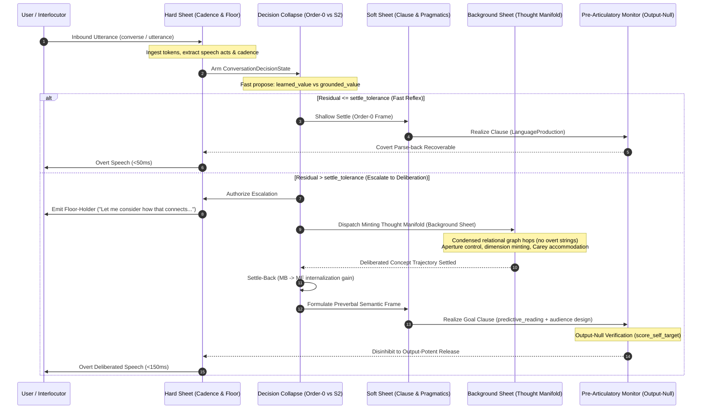

# Conversational Thought-Manifold & Utterance Generation Execution Plan

**Document Path:** `docs/research/psychology_affect/CONVERSATIONAL_MANIFOLD_EXECUTION_PLAN.md`  
**Status:** Canonical Implementation Plan; bounded increments are implemented and locally verified, while the documented phase exit criteria remain active.
**Portfolio status (2026-09-29):** Conversational cognition/production and functional substrate establishment are concurrent, independently tracked workstreams. Substrate work is not a successor or replacement for conversational work; advances and gates in either stream must not be used to imply completion of the other. The substrate workstream is grounded in [`TRACTABILITY_SUBSTRATE_ASSESSMENT.md`](../engine_substrate/TRACTABILITY_SUBSTRATE_ASSESSMENT.md) and [`FUNCTIONAL_SUBSTRATE_ESTABLISHMENT_PLAN.md`](../engine_substrate/FUNCTIONAL_SUBSTRATE_ESTABLISHMENT_PLAN.md).
**Target Capability:** Minimally sufficient, ongoing, non-stalling conversational capability for the Jabberwock agent on the Ocelot substrate, with explicit diagnostic errors when cognition cannot produce a communicative response.  
**Strict Invariants:**
- `CLAUDE.md` compliance: The agent is a graph in Rust; Python is strictly a world adapter (`WorldAdapter`). No Python rule engine or agent decision logic.
- `donkey=0`: Zero LLM inference calls at runtime; fully teacher-free loop over graph-resident representations.
- Discrete Quanta: Integer widths $k \in [0, 2]$, discrete deviation counts, snapped observer apertures; no un-quantized continuous drift.
- **No Dismissive Failure Surface:** The exact fallback word `noted` is forbidden as an output. If a cognitive or dispatch path cannot produce a response, the surface must be the explicit diagnostic `ERROR: no communicative response could be generated.`
- Bounded Latency & Memory: Fast reflex $<50\text{ ms}$, thought manifold $<150\text{ ms}$, resident memory $<150\text{ MiB}$ RSS.

**Resource-cap amendment (2026-09-28):** The user raised the RSS ceiling from
100 MiB to **150 MiB (157,286,400 bytes)** because continued optimization
against the lower threshold was not producing worthwhile progress. Active
Phase 7/native resource assertions and the post-turn heap-trim trigger now use
150 MiB. Earlier dated measurements and JSON reports retain their original
100 MiB threshold as historical evidence; re-evaluate their measured bytes
against the amended ceiling rather than rewriting the reports. A startup
measurement initially peaked at **290,240 KiB** because the daemon's
availability probe eagerly initialized NLTK WordNet. The probe is now a
side-effect-free filesystem check, bringing connected-service startup with
local teachers attached to **108,380 KiB**. Actual dictionary lookup remains
above budget: the focused dictionary test process peaked at **265,108 KiB**.
The service unit therefore retains a **384 MiB systemd hard limit** while
query-path RSS remains an open optimization gate.

---

## 1. Executive Summary & Problem Diagnosis

The **Jabberwock** agent possesses an advanced, graph-native cognitive core:
1. **Introspection:** Accurately queries live Rust graph state for architecture and limits (`domains/reflective_faculty.py`, `seeds/question_targets.json`).
2. **Epistemic Honesty:** Isolates trouble sources on ungrounded input and issues clarification requests (`tests/test_conversation_loop.py`).
3. **Gap Awareness:** Automatically files `SelfConcern` nodes on retrieval misses or user critiques (`seeds/gap_awareness.json`).
4. **Thought Manifold (Attested):** Solves dimensional impasses via aperture-grain trajectory control and dynamic dimension minting (`CapabilityAxis`) in **0.045 ms** across dense multi-relational networks (`attestation/ATTESTATION_EXECUTIVE_SUMMARY.md`).
5. **Utterance Generation Stack:** Features a complete Levelt-compliant speaker blueprint (`domains/language_production.py`), pragmatic audience design (`domains/audience_driven_production.py`), clause planning and gap-filling (`domains/predictive_reading.py`), and covert self-monitoring (`domains/conceptualizer.py`).

### The Core Failure Mode in Ongoing Dialogue
Before the Phase 1/2 work, the live conversational loop (`WorldAdapter.converse()` in `substrate/world_adapter.py`) stalled:
- **Premature Collapse:** On non-question statements, the loop immediately fell back to `_honest_minimal_reply()` with a dismissive acknowledgement, dropping turn-taking. The fallback is now an explicit diagnostic error, while the underlying cognitive routing gap remains a cognition task.
- **Architectural Disconnection:** The live bridge now invokes Thought-Manifold evidence transport and native deliberation readback, but ordinary corpus events still provide no complete Phase 4 tuple, so selected live candidates remain absent.
- **Utterance Generator Bypass:** Rather than generating clauses from communicative goal frames, `converse()` relies on raw string scraping (`_answer_topic_reply`) or static graph dumps, using `conceptualizer` merely as a post-hoc logging stamp.
- **Method Fragmentation:** Inbound and outbound methods are fragmented across `converse()`, `receive_utterance()`, `add_inbound()`, and `utterance_for()`, leading to divergent code paths between turn-taking dialogue and relational surface realization.

Phases 1/2 address the declarative-turn stall and entry-point aliasing, while later phases add the production, commitment, settle-back, and live action/repair paths. The conversation decision state now persists candidate values and experience counts, and the native Rust scheduling path is locally verified; live replies still retain legacy graph/readback paths outside the planned Levelt production gate.

**Current release-boundary finding (2026-09-26):** The conceptualizer bridge
is invoked on many substantive reply branches, but it is not a universal
outbound authority. Fault injection confirmed that a self-report can still be
released when `conceptualize_reply()` returns `None`; inspection showed that
this path has an independent graph-selected reflective-evidence and
`ProductionGateReceipt` authority. That result proves only that the
conceptualizer is advisory for that path, not that its reply is uncommitted or
unauthorized. The implementation task is to inventory each reply class's
selection evidence, typed release gate, commitment identity, and released
surface source; then address substantive classes that lack graph-linked
release evidence. Do not replace existing stronger action/topic/repair or
reflective receipts with token-derived conceptualizer content.

**Continuation selection status (current source audit):** The earlier Python
continuation-selector finding and the following “direct continuation slice”
description are historical and superseded. `_deliberate_turn_continuation()`
now mechanically proposes direct and transitive held facts/relations, held
frames, residual-stance frames/facts/inquiries, and pairwise follow-up
inquiries to Phase 4A. Authored native policy values the families, native
collapse records the selected candidate and rejected alternatives, and release
is fail-closed unless current-epoch selection, parse-back, and an exact
selected-candidate production receipt agree. Candidate discovery and surface
realization remain adapter work; they are not the option-selection authority.
This migration does not close the overall cognition gate: the latest Phase 8
measurement still has 0 complete Phase 4 evidence tuples/promotions, and
floor-holding plus other legacy response classes still require authority
audits. The current-code connected profile also has fragile latency headroom;
full-boot latency and comparative-human evaluation remain open.

---

## 2. Core Architectural Inspirations from the Body / Motor / Control Systems

The embodied motor and control architectures in Ocelot (`docs/research/humanoid/motor_core_whole_stack_architecture.md`, `docs/research/humanoid/motor_decision_collapse.md`, `docs/research/humanoid/biological_motor_control_upgrade.md`, `docs/research/flight_control/jsbsim_f16_coupled_control.md`, `docs/research/agent_loop/jabberwock_control_reasons_first_design.md`) provide rigorous, tested mechanisms that map directly into conversational dialogue:

### A. The Three-Tier Latency Sheet Architecture (`cognitive_cycle.rs`)
The embodied motor core executes rules across three distinct latency classes to protect hard physical deadlines:
1. **Hard-Real-Time Sheet (<10 ms):**
   - *In Motor Control:* Protects physical sensorimotor deadlines, vestibular damping, local balance reflex, and opaque command release.
   - *In Conversation:* Protects event ingest and bounded release deadlines (<50 ms). It must not emit reflexive backchannels or conversational fillers to conceal absent cognition; only an explicitly selected graph goal may authorize a holding behavior, otherwise failed release remains the explicit diagnostic error.
2. **Soft-Real-Time Sheet (<50 ms):**
   - *In Motor Control:* Receipt-backed adaptation and analysis-by-synthesis composition of compound motor programs.
   - *In Conversation:* Pragmatic audience design (`audience_driven_production` choosing terseness rung via `pragmatic_speaker.choose_encoding`), clause realization (`predictive_reading.realize_goal_clause`), and covert self-monitoring (`score_self_target`).
3. **Background Sheet (<150 ms):**
   - *In Motor Control:* Offline consolidation, replay, and structural limit memory updates.
   - *In Conversation:* Deep thought-manifold trajectory search (`run_minting_train_of_thought`), Carey dynamic capability axis minting, multi-hop analogical mapping, and episodic narrative consolidation.

### B. `motor_decision_collapse` Applied to Conversational Turn Selection
In `seeds/motor_decision_collapse.json`, decision options are evaluated through a single domain-neutral collapse with two depths:
1. **Domain-Neutral Candidate Options:**
   Each conversational candidate (e.g. `direct_answer`, `follow_up_inquiry`, `epistemic_clarification`, `floor_holding_filler`, `concept_elaboration`) is a `DecisionOption` attached to a `ConversationDecisionState`:
   - `token`: opaque action identifier.
   - `default_value`: fast prior before experience.
   - `learned_value` & `decision_experience_count`: internalized fast habit.
   - `grounded_value`: active valuation from the thought manifold / discourse context.
2. **Scalar Residual as Sole Escalation Arbiter:**
   $$\text{residual} = \max\left(|V_{\text{fast}} - V_{\text{grounded}}|,\, \text{if } V^*_{\text{grounded}} > V_{\text{grounded}} \text{ then } \tau + (V^*_{\text{grounded}} - V_{\text{grounded}}) \text{ else } 0\right)$$
   - If $\text{residual} \le \text{settle\_tolerance}$: `shallow_settle` commits immediately (sub-50 ms System 1 reflex).
   - If $\text{residual} > \text{settle\_tolerance}$: Authorizes `residual_authorized_deepen`, recruiting System 2 (Thought Manifold).
3. **Settle-Back & Internalization ($MB \rightarrow MF$ Replay):**
   $$\Delta V_{\text{learned}} = \alpha \cdot (V_{\text{grounded}} - V_{\text{learned}})$$
   - Contrastive credit: The rejected proposal learns from counterfactual error; the winning action internalizes its grounded value.
   - **Dialogue Automation Signature:** Over successive communication events on recurring topics, residual decreases, and a grounded communicative action can be proposed directly by order zero. Surface fluency is not evidence of this state.

### C. Output-Null Preparation vs. Output-Potent Release
In `biological_motor_control_upgrade.md`, motor candidates remain in an **output-null** preparatory state (`HumanoidMotorPreparation`) where cost and lateral uncertainty are checked. A distinct graph rule disinhibits the preparation into an **output-potent** release:
- *In Conversation:* Maps directly to Levelt's pre-articulatory monitor. Candidate clauses are generated into an output-null preverbal buffer.
- Covert parse-back (`conceptualizer.scan_and_monitor` + `self_target_monitor.score_self_target`) parses the candidate back through comprehension to verify listener recoverability.
- Only when recoverability $\ge 1.0$ and confidence passes threshold is the utterance disinhibited into overt output-potent speech. If recoverability fails, it triggers an internal 1-step repair loop before overt sound/text is emitted.

### D. Efference Copy & Predictive Forward Modeling
`embodied_sensorimotor_core` advances a predictive belief state (`EmbodiedBodyBelief`) and generates an efference copy compared against delayed sensorimotor receipts:
- *In Conversation:* When Jabberwock articulates an utterance, it stores an **efference copy** of expected interlocutor understanding and conversational trajectory.
- When the interlocutor replies, the difference between expected and received turn provides the conversational sensory prediction error (residual).

### E. Structural Envelope Protection & Two-Boundary Epistemic Safety
In `embodied_structural_limits.md` and `fixed_wing_jet_control.md`, the controller maintains two distinct boundaries:
1. **Conservative Safe Envelope:** Crossing this envelope does NOT destroy the body; it interrupts release and admits a safe, zero-increment unloading action.
2. **Rated Structural Limit:** Exceeding this boundary causes permanent damage or failure.
- *In Conversation:*
  - *Boundary 1 (Pragmatic / Common-Ground Margin):* When an interlocutor introduces ungrounded terms, contradictions, or out-of-domain assertions, Jabberwock triggers zero-increment safe recovery (epistemic honesty ask-back, trouble-source isolation, `SelfConcern` registration).
  - *Boundary 2 (Rated Limit / Hallucination):* Enforced by `donkey=0` and graph-grounding; the agent NEVER fabricates facts or hallucinates answers.

### F. Reason-First From Grounded Priors
In `jabberwock_control_reasons_first_design.md`: "A control is a button that does stuff. Reason FIRST from grounded priors, not a brute-force game-playing machine."
- *In Conversation:* Interlocutor cues (syntax, lexical markers, speech acts) yield function-space priors (`Question`, `Challenge`, `Assertion`, `Praise`). The agent posits the communicative function FIRST, then confirms/refines it with observation receipts, rather than brute-forcing through a list of keyword matchers or dumping arbitrary text.

### G. Coarse Symmetric Quantization Over Continuous Over-Resolution
In `jsbsim_f16_coupled_control.md`, symmetric 2-interval quantization ($-1, 0, +1$) passes control while finer lattices (4, 8, 12) fail due to limit cycles:
- *In Conversation:* Use discrete integer quanta ($k \in [0, 2]$, deviation counts, discrete pragmatic rungs $J(\text{rung})$). Un-quantized continuous probabilities cause conversational drift, hedging loops, and limit cycles.

### H. Condensed Inner Speech Trajectory
Human inner speech is syntactically condensed and predicative (Vygotsky, Fernyhough):
- Internal motor trajectory planning navigates joint coordinate models without actuating physical limbs.
- Similarly, `train_of_thought` must navigate relational graph edges directly (`Concept -> Relation -> Concept`) without invoking `realize_goal_clause()` at intermediate hops. Overt realization is reserved strictly for the collapsed final response or external inquiry.

---

## 3. Human Cognitive & Utterance Generation Blueprint

The utterance generation stack integrates Levelt's speaker blueprint:

```
┌────────────────────────────────────────────────────────────────────────────────────────────────────────┐
│                               EXISTING UTTERANCE GENERATION PIPELINE                                   │
├────────────────────────────────────────────────────────────────────────────────────────────────────────┤
│                                                                                                        │
│  1. CONCEPTUAL PREPARATION & AUDIENCE DESIGN (domains.conceptualizer & audience_driven_production)     │
│     • Mint CommunicativeGoal{kind, force_kind, content} -for_audience-> Interlocutor                   │
│     • Evaluate Pragmatic Speaker spectrum: J(rung) = ListenerRecovery(rung) - λ * Cost(rung)          │
│     • Rust Argmax-of-Plus Term (pragmatic_speaker.choose_encoding) selects optimal terseness           │
│     • Emit MessageShape{focus, ground, residual_frac}                                                  │
│                                                                                                        │
│  2. GRAMMAR-OWNED CLAUSE ENCODING (domains.language_production.LanguageProduction)                    │
│     • Invert grounded Grammar productions (SVO for en/es/zh, SOV for ja) into ordered slots            │
│     • Insert grounded FunctionWord nodes (determiners, spatial prepositions, case particles)           │
│     • Map concepts to inflected surfaces in reverse via grounded LexEntry nodes                        │
│                                                                                                        │
│  3. PLAN-THEN-REALIZE & GAP-FILLING (predictive_reading.realize_goal_clause)                           │
│     • Grammar-fixed slots (realized == True) emitted verbatim                                          │
│     • Open slots (realized == False) dynamically filled via ranker (_gapfill_slot)                     │
│                                                                                                        │
│  4. SELF-MONITORING COMMITMENT GATE (conceptualizer.scan_and_monitor & self_target_monitor)            │
│     • Output-Null buffer: Covert parse-back ("say it to yourself") parses candidate through grammar    │
│     • Audit informative_content recoverability: mint Verdict{recoverable, missing}                     │
│     • Commit Gate: mint Committed{utterance, terseness} (if unrecoverable, re-shape for 1 repair loop)  │
│                                                                                                        │
│  5. CONNECTIVE SMOOTHING & REGISTER DELIVERY (domains.conversation_action)                             │
│     • Connective join (_oxford_with_connectives, smooth_first_person) turns discrete clauses into prose│
│     • Register modulation (formal, casual, neutral) matches interlocutor cues                          │
│                                                                                                        │
└────────────────────────────────────────────────────────────────────────────────────────────────────────┘
```

---

## 4. Utterance vs. Conversation Method Unification & API Harmonization

The codebase currently exhibits a legacy divide between "utterance" methods and "conversation" methods in `substrate/world_adapter.py`:

| Method | Role | Current Implementation | Redundancy / Limitation | Unification Action |
|---|---|---|---|---|
| `converse(text, ...)` | Turn Execution | Orchestrates full turn: ingest, comprehension, tick, fulfill, reply. | Can still fall back to an explicit diagnostic error when cognition cannot produce a response; bypasses `LanguageProduction` on some legacy paths. | **Canonical Entry Point.** Upgrade to dual-process collapse + Levelt generator. |
| `receive_utterance(text, ...)` | Inbound Graph Ingest | Mints `Message` node, tokenizes mentions, backfills concepts. | Only ingests; does not run turn or return text. | Retain as **mechanical I/O primitive** for low-level graph test harnesses. |
| `add_inbound(text, ...)` | Inbound Wrapper | Calls `receive_utterance` with `classify_speech_act`. | Redundant 2-line wrapper. | **Remove redundant body; make 1-line alias** delegating to `receive_utterance`. |
| `add_outbound(text, ...)` | Outbound Ingest | Manually mints outbound `Message` node. | Fragmented from reply attribution in `_finish_turn_reply`. | Unify through `_finish_turn_reply`; keep as backward-compatibility helper. |
| `utterance_for(meaning)` | Surface Realization | Renders relational meaning via `_render_node()`. | Bypasses `LanguageProduction` and Levelt self-monitoring gate. | **Unify & Alias:** Re-point `utterance_for` to route meaning through `LanguageProduction.produce()`. |
| `utterance(text, ...)` | Direct Utterance | (Previously missing/inconsistent across worlds). | Callers expect `agent.utterance()` to converse or utter. | **Define as Canonical Alias:** `WorldAdapter.utterance = WorldAdapter.converse`. |
| `conversation()` | Transcript Query | Returns list of `{text, from}` message dicts. | Naming clashes conceptually with `converse()`. | Retain as history accessor; guarantee strict parity with `chat_transcript()`. |

### Unification Invariants:
1. **Single Canonical Generation Engine:** Every surface generation path (`converse()`, `utterance_for()`, inner speech final response) routes through `LanguageProduction.produce()` and `predictive_reading.realize_goal_clause()`. The legacy `_render_node` is retired, with an alias routing through `LanguageProduction`.
2. **Symmetric Dialogue API (`converse` $\equiv$ `utterance`):** `wa.converse(...)` and `wa.utterance(...)` are identical entry points for a conversational turn.
3. **Preservation of Low-Level Ingest:** Low-level test suites that test intent minting in isolation (`tests/test_intent_migrated.py`) continue calling `receive_utterance()` without executing unwanted outer cognitive cycles.

---

## 5. Concept & Lexicon Library Architecture

The lexicon serves as a bidirectional bridge between geometric concepts and linguistic form:

1. **Bidirectional Sign Structure:**
   - *Comprehension:* `Surface Word` $\rightarrow$ `LexEntry` $\rightarrow$ `Concept` (`seeds/grounded_lexicon.json`).
   - *Production:* `Concept` $\rightarrow$ `LexEntry` $\rightarrow$ `Surface Word` (inflected forms stored directly).
2. **Syntactic Scaffolding via `FunctionWord` Nodes:**
   - Loaded from `domains/function_word_reference.py`.
   - Inverted grammar rules query `FunctionWord` nodes to inject determiners (*the*, *a*), prepositions (*on*, *in*, *of*), and case particles (*ga*, *o*), converting lemma sets (`"dog mammal"`) into grammatical clauses (`"The dog is a mammal."`).
3. **Open-Slot Gap-Filling:**
   - When a concept lacks an inflected surface in the active grammar, `predictive_reading._gapfill_slot()` ranks synonyms and hypernyms across the concept graph to fill the slot without breaking syntax.
4. **Audience-Credit Indexing:**
   - `WorldAdapter._lexicon_with_known()` verifies that concepts credited to the interlocutor in common ground have valid lexical entries, enabling pragmatic elision without ambiguity.
5. **Epistemic Gap Awareness:**
   - Unknown concepts trigger `seeds/gap_awareness.json`, automatically filing a `SelfConcern` node and generating an epistemic clarification request instead of hallucinating.

---

## 6. End-to-End Integrated Architecture & Scheduling



---

## 7. Detailed Step-by-Step Implementation Blueprint

### Phase 1: Dual-Process Turn Gating in `WorldAdapter.converse()`
* **Target File:** `substrate/world_adapter.py`
* **Changes:**
  1. Retain `_honest_minimal_reply()` only as an explicit diagnostic terminal error after continuation candidates are exhausted; never emit `noted` or another dismissive acknowledgement for a failed cognitive/dispatch path, and do not use the error as a substitute for fixing cognition.
  2. Implement an auditable `ConversationDecisionState` stamp, then complete its `motor_decision_collapse` semantics in Phase 6:
     - **Fast Path (Hard Sheet):** Social acts (`greeting`, `thanks`), 1-hop known facts (`knows_fact`), and self-state queries (`_surface_self_state`).
     - **Deliberative Path (Background Sheet):** When incoming turns contain unexplained relations, multi-hop queries, contradictions, or ungrounded statements, mint an `OpenGoal` and recruit System 2.
  3. Wire `residual_stance` over asserted concepts: on inbound statements that are not questions, identify unrecovered parent concepts, implications, or open goals, and formulate an active response or inquiry.

### Phase 2: Method Unification and Aliasing on `WorldAdapter`
* **Target File:** `substrate/world_adapter.py`
* **Changes:**
  1. **Unify Surface Production:** Route communicative goal frames through `LanguageProduction` and alias `_render_node` to `utterance_for`; retain graph RenderRules for relational/node meanings until Phase 4 completes full live-turn routing.
  2. **Alias Conversational Entry Points:**
     - Add `utterance = converse` on `WorldAdapter` class level so callers using either method name execute the canonical turn pipeline.
     - Simplify `add_inbound(text, speaker)` to a clean alias: `return self.receive_utterance(text, speech_act=self.classify_speech_act(text), speaker=speaker)`.
  3. **Outbound Choke-Point Verification:** Ensure all outbound responses (whether produced via `converse`, `utterance_for`, or `add_outbound`) consistently register attribution in `_finish_turn_reply()`.

### Phase 3: Condensed Inner Speech Trajectory
* **Target File:** `domains/train_of_thought.py` and `domains/self_dialogue.py`
* **Changes:**
  1. Decouple inner thought hops from overt English clause realization. Inside `run_inner_conversation()` and `self_answer()`, traverse the concept graph using direct relational pointers (`Concept -> Relation -> Concept`).
  2. Eliminate calls to `realize_goal_clause()` on intermediate inner hops. Compute trajectory residuals directly from graph-node set differences rather than text parse-back.
  3. Reserve clause realization strictly for the collapsed final response or external inquiry.

### Phase 4: Active Routing to `LanguageProduction` & `realize_goal_clause`
* **Target File:** `substrate/world_adapter.py` and `domains/conversation_action.py`
* **Changes:**
  1. Construct `_realize_frame_reply(self, frame, audience_snap)`:
     - Wrap semantic frame `{event, agent, patient, mood, intent}`.
     - Call `domains.audience_driven_production.select_utterance()` using Rust `Argmax-of-Plus` to select terseness rung.
     - Invoke `predictive_reading.realize_goal_clause()` using `LanguageProduction` grammar rules.
  2. Integrate `FunctionWord` references to guarantee well-formed SVO/SOV constituent ordering.

### Phase 5: Output-Null Pre-Articulatory Gate & Floor Holding
* **Target File:** `domains/conceptualizer.py` and `domains/conversation_action.py`
* **Changes:**
  1. Output-Null Buffer: Buffer candidate overt speech until `conceptualizer.scan_and_monitor()` and `self_target_monitor.score_self_target()` verify recoverability $\ge 1.0$.
  2. Floor-Holding Pattern: When System 2 escalation is triggered, the hard sheet immediately emits a register-appropriate floor-holding filler (`"Let me see..."`, `"Looking at how that connects..."`) to preserve turn-taking cadence while background deliberation runs.

### Phase 5J: Explicit production-shaped learning observations

Use a separately authored, provenance-bearing observation fixture with stable
`gap_identity`, `learning_stage`, and `verification_status` fields. Feed those
typed observations through the existing `SelfConcern`, `GapRecurrence`, and
`GapLearningAssessment` authorities. Verify that recurrence is identity-local,
that assessment remains human-gated, and that no identity is inferred from
surface repetition or automatically promoted.

### Phase 5K: Verified repair and supervised promotion closure

Attach explicit failed-repair and verified-retry evidence to the typed fixture.
The native review authority must expose failed repair, promote only the
identity with an explicit approval decision, preserve the other identity at
human review, and report promotion provenance. No recurrence count or repair
success may itself authorize promotion.

### Phase 5L: Communication-event learning observation ingress

Allow a language-neutral communication adapter to provide explicit learning
observation fields (`gap_identity`, `learning_stage`, and
`verification_status`) through the existing `converse()` event context. The
adapter may transport and record the evidence only; the graph-native
`gap_awareness` authority must mint the existing `SelfConcern` and preserve
message provenance. Repeated identity, repair, and promotion decisions remain
owned by the existing Phase 5 rules.

The live integration exit additionally requires two explicitly identified
communication events to produce one native recurrence with increased priority
while the assessment remains `human_review` and `auto_promoted=0.0`.

### Phase 5N: Competing communication-event learning identities

Replay multiple explicitly identified learning observations through the live
communication boundary with different recurrence pressures. Native cognition
must preserve identity-local recurrence counts and priority ordering, prevent
cross-identity transfer, and keep every assessment human-gated until an
explicit review decision exists.

### Phase 5O: Explicit corpus learning overlay

Keep the original fixed communication corpus unchanged, and add a separately
authored overlay keyed to existing event IDs. Each overlay event must carry an
explicit opaque `gap_identity`, `learning_stage`, and `verification_status`.
Route the overlay through the existing live learning-observation ingress and
native `SelfConcern`/`GapRecurrence`/`GapLearningAssessment` authorities.
Report overlay evidence separately from unannotated-corpus evidence; identity
must not be inferred from signal similarity, event order, or runtime gap text.

Acceptance evidence: the base corpus remains free of learning metadata; the
overlay has complete explicit metadata; at least three identity-local repeated
recurrences are read back with native counts and priorities; and no automatic
promotion occurs without explicit human review.

### Phase 6T: Receipt mismatch authority audit

Classify released receipt mismatches using receipt graph provenance, without
using reply text or selecting a preferred receipt. Distinguish an identical
same-event duplicate release from competing semantic releases and from a
single receipt whose semantic force is incompatible with the independent event
annotation. Any correction must target the producing cognitive/release
authority; wording changes and evaluation-side receipt deletion are invalid.

Acceptance evidence: every released mismatch has a typed cause, receipt count,
turn/event provenance, and semantic signature; the audit performs no receipt
selection; and the existing recoverability counts remain unchanged.

Current evidence: same-event identical release idempotence is enforced in the
existing production gate using inbound-message identity plus semantic
signature, native typed overlap/fragment defer prevents forced repair release,
and the topic fulfiller no longer publishes a legacy receipt before the
authoritative conversation-information release. The fresh 74-event replay
measures **32** receipt-backed recoverable, **42** explicit/withheld, **0**
released mismatches, and **0** missing. Runtime-state adjudication remains a
separate cognition task.

### Phase 6V: Authoritative topic-release correction

Remove the remaining competing release in `question_ack` at the producing
authority. Retrieval/rendering may preserve graph evidence, but only the
conversation-information bridge may publish the live topic-answer receipt.
Direct legacy `answer_about()` callers remain compatible through its default
release mode.

Acceptance evidence: the fixed 74-event corpus has no competing or force
mismatched released receipts; the authoritative receipt remains typed and
recoverable; no receipt is selected or removed by evaluation; and direct
legacy readback tests continue to pass.

### Phase 7M: Neutral semantic-ingress authority binding

Review the existing language-neutral `ingest_semantic_event()` boundary and
record native authority only where the Python side mechanically materializes
adapter evidence and the existing native arbitration rules own the outcome.
Reuse the Phase 7K semantic-event envelope and its provenance tests; do not
create a second ingress, parser, or classifier.

Acceptance evidence: the boundary carries explicit provenance,
`python_outcome_selection=false`, and a native rule identifier; the focused
Phase 7/6 battery passes; and remaining unbound calls remain visible as review
debt. This increment does not claim the production RSS/latency exit.

### Phase 7N: Substrate cost profile and index boundary

Instrument the existing production-shaped envelope with boot, per-event,
RSS-delta, and graph-delta observations. Identify the dominant allocation at
the substrate/index boundary and preserve semantic replay equivalence. Do not
optimize by removing referent evidence, bypassing native rules, or changing
conversation surfaces.

Acceptance evidence: the profile remains deterministic, timing/resource
measurements are excluded from semantic meaning, the dominant cost is
identified from graph-resident evidence, and any subsequent index optimization
has a referent-resolution equivalence battery before it can affect the exit
gate.

Current evidence (2026-09-25): the production-shaped Phase 7 profile and a
four-event `cProfile` trace identify duplicate synchronous web retrieval as a
dominant latency source. When an event already has a graph-minted
`SearchRequest` for its answer topic, `_answer_topic_reply` now performs only
local phrase grounding and leaves remote retrieval to that request's normal
fetch path. In the same four-event traced workload, HTTP GET calls fell from
24 to 12 and traced wall time from 6.28 s to 3.96 s. A 74-event, same-73-seed
profile pass fell from 9,289.3 ms to 8,252.0 ms summed conversation latency
and from 1,934.8 ms to 1,567.4 ms maximum event latency; errors remained zero.
These are single-run resource observations, not a latency-gate closure. A
repeated current-code run is structurally deterministic, but its max event
latency was 2,052.8 ms. Absolute RSS remains above 100 MiB. The pre/post
structural comparison has one changed `info_reference` observation
(`production_receipts` and turn outcome). Case review confirms the fixture
expects `repair`; the current native `repair` disposition blocks topic
grounding/release and the boundary returns the explicit error. The prior
observation instead ran topic fulfillment and recorded an unresolved outcome,
so this is an intentional authority correction, not parity. Focused topic,
grounding, and fetch-dispatch tests pass (51 passed, 1 skipped).

The same slice then closed the measured action-routing error without using
corpus labels: `WorldAdapter.classify_speech_act` consults the existing native
verb-head POS term for bare and comma-fronted imperative clauses, and passes
the resulting input evidence to the native `sak_kind` rules. The existing
`conversation_topic_tracking` elliptical-shift rule now excludes messages
already classified as instructions, preventing an action object from minting
a competing answer-topic goal. Regression tests cover `Check the pressure.`
and `When ready, close the hatch.` with a live current topic and assert no
pending remote search. Focused classifier/instruction/topic suites pass
**28/28**, and the two targeted live-route cases plus classifier parameter set
pass **18/18**. The frozen 133-item speech-act parity battery retains its
documented two failures; its fixture was not edited.

The fresh matched 74-event profile
`evaluation/reports/phase7_profile_resource_20260925_full74_imperative_topic_guard_17key.json`
selects all 73 seeds, has zero errors, and records 68.1 ms for `action_check`
and 96.6 ms for `action_defer`, both under the 150 ms thought-manifold target.
The corpus worst case remains 3,163.6 ms and peak RSS 109,158,400 bytes; the
latency and 100 MiB limits remain unclosed.

The remaining duplicate `blorf` lookup was traced to parallel graph-minted
`GroundRequest` and `SearchRequest` siblings: GroundRequest is local-first and
SearchRequest is its candidate-verification fallback, but both previously
used live web I/O after a local miss. `_dispatch_pending_io` now asks the
GroundRequest path to use local evidence only when a same-topic SearchRequest
is selected; successful local grounding can still supersede SearchRequest,
and local miss leaves that native request to fetch/verify remotely. The matched
four-event trace falls from seven to four HTTP GETs and from 3.331 s to 2.712 s
under cProfile. A same-73-seed 74-event pass
(`evaluation/reports/phase7_profile_resource_20260925_full74_single_remote_fallback_17key.json`)
has 74 observations, zero errors, 1208.3 ms maximum event, 7118.8 ms summed
conversation latency, and 108,933,120-byte RSS. `info_unknown` measured
668.0 ms and `question_ack` 1208.3 ms in that pass; external retrieval and
overall resource gates remain open. Targeted request-pair/local-fallback tests
pass **12/12**; topic self-heal and request-minting regressions pass **17/17**.

Follow-up attribution on the connected corpus prefix through `question_ack`
measured 1,201.2 ms for that event. The graph-selected `SearchRequest(route)`
made one OpenSearch call and five concurrent candidate-summary calls; its
same-topic `GroundRequest` stayed local-only. The committed result was a
generic route-of-administration summary. Thus this outlier is search-candidate
fanout, not duplicate sibling web retrieval. Since the native interpretation
is `repair_or_defer` / `clarify_or_defer` while the answer-topic goal still
permits search, do not tune away the retrieval until case-level intent and
referent authority is reconciled. This trace closes only cost attribution; it
does not close the latency, cognition, production, or comparative gates.

The current connected profile's 17 lexical content keys were scoped to the
eight-event workload, not all 74 corpus events. A 74-event full-vs-connected
comparison using that incomplete key set matched only **18/74** observations
(zero errors and complete declared closure). The first event's sole difference
was absent lexical mention-referents; using its known keys (`the`, `sky`,
`blue`) restored **1/1** parity for that event. These results expose a content
coverage gap, not a valid full-corpus cognition parity result. Do not pass all
raw tokens to the untyped global provider selector; it can select unrelated
seed families. The next loading increment is a language-neutral typed content
key/scoping producer, then a repeat of all-74 structural parity and resource
measurements. Broad profile equivalence remains open.

The seed pre-pass now supports scoped typed references of the form
`seed_id -> [{type, name}]`. It caches named type/name entries, validates each
reference only against the declared seed, expands that seed's dependency
closure, and rejects unresolved requests before graph mutation. Selective
seeds slice on both type and name; the old flat `content_keys` interface is
unchanged. Seed-loader tests pass **13/13**; a scoped full-vs-connected
`standalone_assertion` case passes with `learned_lexicon` entries and the
`colour_meaning` blue concept, and the existing eight-event parity gate remains
**8/8**. The upstream producer that emits these refs from graph-grounded,
language-neutral content evidence is still missing; do not claim full-corpus
parity or resource improvement from this API-only increment.

A read-only candidate audit confirms that `type=Concept` alone is not a safe
producer: exact input words found 81 known lexical keys and 16 multi-provider
keys; the 95-seed closure includes `signal -> operating_systems ->
compiler_theory -> llvm_passes` and fails on missing `llvm_ir`. Do not turn raw
surface/Concept-name matching into selection policy. The unresolved step is a
graph-grounded language-neutral resolver that emits the particular seed-scoped
concept references before the content closure is loaded; then rerun full-corpus
parity and the resource envelope.

Post-cache-schema fresh CLI checks remeasured the legacy 17-key profile. The
eight-event report
`evaluation/reports/phase7_profile_resource_20260925_conversation_seed_index_v4_17key_recheck.json`
has complete 73-seed closure, zero errors, 87,015,424-byte RSS, 60,903,424-byte
boot+event growth, and 76.4 ms maximum event. The full 74-event report
`evaluation/reports/phase7_profile_resource_20260925_full74_seed_index_v4_17key_recheck.json`
has complete closure and zero errors but 108,240,896-byte RSS and 1,367.5 ms
maximum latency; the absolute 100 MiB and 150 ms gates still fail. These runs
do not use scoped refs and do not establish 74-event profile parity.

### Phase 8H: Raw-reference integrity audit

Audit the already-collected ELIZA-floor, small-LLM, and modern-LLM envelopes
against the fixed 74-event protocol. Record missing human reference classes
explicitly. This phase validates provenance and case coverage only; it must not
interpret response text or convert raw outputs into capability scores.

Acceptance evidence: every available raw run is complete and case-bound,
collection failures are visible, absent human classes remain unavailable, and
the release gate remains blocked until blinded adjudication supplies all nine
dimensions for all six reference classes.

### Phase 6: Settle-Back & Internalization ($MB \rightarrow MF$)
* **Target File:** `substrate/world_adapter.py` and `seeds/motor_decision_collapse.json`
* **Changes:**
  1. Apply contrastive credit update after System 2 settles:
     $$V_{\text{learned}} \leftarrow V_{\text{learned}} + \alpha \cdot (V_{\text{grounded}} - V_{\text{learned}})$$
  2. Increment `decision_experience_count` on the winning conversational candidate.
  3. Verified recurring turns transition smoothly to order-0 fast reflexes over repeated sessions.

### Phase 7: Native Rust Migration (`CLAUDE.md` Compliance)
* **Target File:** `runners/dsl/src/cognitive_cycle.rs` and `runners/dsl/src/substrate.rs`
* **Changes:**
  1. Verify `CyclePlan::DualProcess` schedules the hard-real-time conversational reflex sheet first.
  2. Ensure graph-resident integer trajectory deviation state and tangent width adjustments ($k \leftarrow k \pm 1$) operate entirely within native Rust feedback evaluated via `substrate.tick()`.

**Phase 7 implementation note:** `WorldAdapter.tick` now enters `CyclePlan::Default`, which selects `DualProcess` when the graph enables `DualProcessPolicy`. Native `TrajectoryControlState` feedback widens or narrows `tangent_width` using graph-authored integer thresholds/steps and clamps it to the graph-authored envelope. With the repository `.venv` and its Python 3.13 library supplied to the linker, the focused Rust target passes 9/9 tests.

### Phase 8: Live Cognitive Action & Repair Dispatch
* **Target Files:** `substrate/world_adapter.py`, `domains/conversation_action.py`
* **Changes:**
  1. Invoke the graph-produced `Comprehension` through `conversation_action.is_ask_back()` and `ask_back()` for untyped/frontier gaps, preserving the user's actual trouble source and recording a clarification first-pair-part.
  2. Invoke `act_on_instruction()` for instruction comprehensions so self-report and scene-description goals are minted and held faculties produce the content.
  3. Give action/repair results precedence over topic readback; this prevents an instruction or comprehension gap from being misread as an answerable topic.
  4. If the action/repair faculty itself fails, preserve the explicit diagnostic error floor; do not substitute a conversational acknowledgement.

**Phase 8 implementation note:** The live bridge was previously absent even though the action/repair faculty existed. Focused verification now passes the self-report, scene-description, ask-back, three-behaviour discrimination, instruction-intent, audience-design, and honest unperformable-instruction gates. Remaining failures are outside this bridge (legacy topic grounding, register fallback, and stale tests that still assert the forbidden `noted` surface).

### 2026-09-24 substrate reuse gate

Before the next implementation increment, the existing substrate authorities
were audited for overlap. The audit confirms that referent identity,
event-local discourse lifecycle, goal binding, Phase 4A candidate cognition,
gap learning, production/readback gating, and native scheduling already have
owners. The plan therefore forbids introducing parallel conversation stores,
candidate scorers, referent tables, or schedulers.

The previously identified goal-binding seam is already implemented by
`conversation_action._bind_goal_to_inbound()` and covered by regression tests;
it is not a remaining implementation task. Phases 2Q–2S now provide the
neutral proposition/commitment bridge, native lifecycle, situation-model
projection, and isolated measurement. The next gate is supported
event-to-commitment coverage on a separate overlay, without changing the
fixed 74-event grounding denominator. Syntactic predication, lexical Concept
presence, `DecisionOption` values, and surface replies are not sufficient
evidence. If no supported commitment exists, the system must retain
`no_candidate`, repair, or the explicit diagnostic error.

The live ingress must accept neutral semantic/semiotic evidence and optional
event metadata before text-specific parsing. English parsing and templates are
adapter responsibilities, not shared cognition. Event processing and reply
production must be separable: non-turn events may update cognition or defer
without entering the one-in/one-out reply choke point.

### Phase 2Q: Structured proposition and neutral event ingress

1. `WorldAdapter.ingest_semantic_event()` is the event-only ingress. It writes
   the existing interpretation/discourse authorities and never manufactures a
   text `Message` or reply.
2. `communication_evidence.v1` may carry an explicit
   `neutral_proposition_evidence.v1` payload. Unknown force is an evidence
   error, not an assertion default.
3. `domains.proposition_commitment` materializes explicit proposition content
   and provenance only. It rejects surface, lexical, and parse-only inputs and
   does not silently mark a proposal as common-ground truth.
4. The native uptake/challenge/suspension/retraction lifecycle exists as a
   self-load-only seed over these proposition nodes. It requires explicit graph
   uptake signals and does not infer truth. Phase 2R consequence projection and
   Phase 2S lifecycle/boundary measurement are verified; they do not change
   the fixed grounding denominator or claim external truth.

### Phase 2R: Situation-model consequence projection

The mechanical bridge may project an explicitly accepted, affirmed,
provenance-bearing proposition into `situation_model_reader` only when its
neutral role arguments are complete. It records a consequence provenance node,
reuses the reader's existing native event/inference rules, and is idempotent.
Accepted uptake is modeled as common-ground projection, not world truth;
negated, challenged, suspended, retracted, unsupported, or parse-only inputs
remain without a positive situation consequence.

### Phase 2S: Isolated proposition/commitment measurement

Measure the new cognition seam without changing the fixed 74-event grounding
denominator.  Use a separate neutral-evidence overlay and a fresh graph per
case.  The overlay must report commitment-state accuracy, consequence
projection accuracy, provenance completeness, and fail-closed behavior for
challenged, suspended, negated, unsupported, and retracted propositions.
The report must not convert accepted uptake into external-world truth or
retroactively improve referent-grounding recall. The extension coverage is
now present; the remaining gate is supported event-to-commitment measurement
on a separate overlay keyed to existing corpus events.

### Phase 2T: Supported event-to-commitment overlay measurement

Use an independent overlay keyed to existing Phase 0 event IDs. Measure event
identity, proposition materialization, explicit native uptake, commitment
status, provenance, typed situation consequence, and fail-closed negative
paths. Keep all results separate from the fixed 74-event grounding metrics;
accepted common-ground uptake is not external-world truth and replies are not
evidence.

### Phase 2U: Event-scoped discourse-reference support

The fixed-corpus source audit identifies annotated discourse-state misses,
but annotations alone do not establish runtime referents. The current text
adapter's `CurrentTopic` / `DiscourseReferent` test is graph-resident yet
global: it does not prove that the binding belongs to this event's conversation
or addressee. Before these cases can count as grounded, carry the active
discourse-state identity and participant scope to the language-neutral
reference-support seam, and require a same-scope graph binding or
event-linked `ReferenceResolutionEvidence`. Preserve unresolved/unknown when
that provenance is absent. Add cross-conversation and cross-addressee negative
controls alongside a same-event positive control; do not change the Phase 2
denominator or infer external truth from common-ground membership.

Implementation now passes the live ingress scope before parsing and reads
only prior grounded event topics from that scope. Initial replay found the
pre-parse recipient handle disagreed with the later event writer because the
`Agent.received` edge is added after parsing; deriving the recipient from the
inbound Message origin corrected that ordering mismatch. The v2 fixed-corpus
replay verifies five scoped reference paths, with grounding precision **1.00**,
recall **0.36**, F1 **0.529**, and no false positives (**18/50** true positives).
This is partial evidence, not phase exit: declared discourse-state and graph
path misses remain. Phase 2 measurement/reference tests pass **36/36**, and
same-scope positive plus unscoped/wrong-speaker/wrong-addressee/other-state
negative controls pass; the dedicated language-neutral arbitration suite
passes **33/33**. Report:
[Phase 8 event-scoped reference v2](../../../evaluation/reports/phase8_corpus_report_20260927_event_scoped_reference_v2.json).

The scope pre-pass is now read-only: it looks up an existing discourse state
and returns no scope for a first event, leaving node creation to the normal
event writer. Regression coverage proves the first-event path creates no
discourse/common-ground node. Combined Phase 2, reference, and language-neutral
arbitration tests pass **70/70**. A subsequent v3 replay preserves all five
scoped paths and the **18/50** grounding score but records **141.67/199.50/
226.41 ms** median/p95/max (**31/74** over 150 ms); this single run is not a
resource improvement. The ten declared graph-path misses still have no
runtime-evidenced path in the source audit; they remain unresolved pending
actual event/entity provenance. Report:
[Phase 8 event-scoped reference v3](../../../evaluation/reports/phase8_corpus_report_20260927_event_scoped_reference_v3.json).

### Phase 3B: Addressee-scoped common ground

The existing `CommonGround` authority must preserve participant scope. Reuse
the graph-resident ledger and event provenance, but resolve claim deltas by
the event's addressed participant; use a shared ledger only for genuinely
unaddressed events. Do not duplicate proposition lifecycle state or infer
mutual knowledge from the presence of a participant edge. Exit evidence is a
multi-addressee stress case showing separated claims plus unchanged goal and
event lifecycle behavior.

### Phase 4P: Proposition-consequence deliberation boundary

An accepted situation-model consequence is not a deliberative candidate. It
may support deliberation only through an explicitly authored complete Phase 4
tuple (`grounding`, `expected_value`, `residual_cost`, `consequence`, and
`novelty`) with preserved graph provenance. Missing dimensions remain
ineligible; the bridge must not derive valuation, novelty, or grounding from
commitment status or state change. Native Phase 4 rules retain scoring,
selection, rejection, and settlement authority.

### Phase 6P: Receipt-backed semantic recoverability measurement

Use the existing `ProductionGateReceipt` as the semantic release authority.
For each fixed-corpus event, distinguish a receipt whose semantic fields are
recoverable and compatible with the independent cognitive annotation from an
explicit error/withheld outcome, a released semantic mismatch, and missing
authoritative evidence. Do not use reply fluency, parse-coverage booleans, or
surface templates as semantic proof. This phase measures the remaining gap;
it does not silently repair state/force mismatches in the conversation layer.

### Phase 6Q: Receipt semantics and cognitive-state separation

A receipt's `semantic_intent` describes the communicative/action content; it
must not be compared directly with a cognitive disposition such as `defer`,
`repair`, or `blocked`. Report runtime/graph state diagnostics separately,
with their evidence source, and treat missing native cognitive-state evidence
as unavailable rather than as a receipt mismatch. Receipt release itself must
be idempotent for the same selected graph commitment.

The Phase 8 observation contract now carries `cognitive_state`,
`cognitive_state_evidence_source`, `cognitive_state_authority`,
`cognitive_state_evidence_available`, and `release_state` as separate fields.
Interpretation readback is explicitly not treated as disposition authority.
The runtime-state adjudication overlay must classify mismatches into missing
disposition authority versus genuine graph-state disagreement before any
cognition change is proposed.

### Phase 6X: Explicit-failure error disposition

Carry a distinct language-neutral `explicit_failure` evidence state from the
communication boundary into the graph-resident interpretation. Ordinary
`explicit_uncertainty` is not itself an error: it remains eligible for native
repair/defer arbitration. When explicit failure is present, native
communication arbitration must author `cognitive_disposition=error` and
`cognitive_goal=error` before any repair/action bridge can release a generic
ask-back. The adapter may only read that native disposition and emit the
canonical explicit error. Surface tokens such as `[unintelligible]` are not
the authority.

Exit evidence: a focused live event proves typed uncertainty reaches the
interpretation, native arbitration authors the error state, the generic repair
surface is withheld, and ordinary unresolved repair remains unchanged.

Current evidence: the error case carries distinct typed `explicit_failure`
alongside `explicit_uncertainty`; ordinary uncertainty remains eligible for
repair/defer. The corrected 74-event replay has 36 state matches, 37 missing
disposition-authority cases, one graph-owned `question_followup` mismatch, and
an `error_empty` state match. See
`evaluation/reports/phase6_explicit_failure_20260924_phase6x_corrected.json`.

### Phase 7K: Neutral semantic-event envelope measurement

Profile the new event-only ingress using the existing native/resource
measurement mechanisms. Record graph growth, latency, RSS, proposition and
CommonGround readback, typed consequence provenance, malformed-evidence
failure, and fresh-graph replay equality. Keep Python materialization distinct
from native lifecycle/readback authority; if the public ingress does not
expose the internal arbitration trace, report that limitation rather than
attributing a second drain to the original native call.

### Phase 4Q: Auditable live deliberation integration failures

The live Phase 4 bridge may encounter mechanical integration failures while
transporting evidence. Such failures must be recorded as a graph-resident
`CognitiveIntegrationDiagnostic` linked to the inbound message and discourse
event. The diagnostic is not a candidate, does not select an outcome, and must
not produce a conversational fallback. Native Phase 4A remains authoritative
for valuation, selection, rejection, and settlement; absent complete evidence
continues to produce the native `no_candidate` trace.

Acceptance evidence: a forced bridge failure creates one idempotent diagnostic
with `surface_fallback=false`, while the ordinary live bridge and Phase 4 tuple
audits remain green.

### Phase 4R: Existing-faculty evidence integration audit

Before extending live candidate generation, inspect and expose the partial
evidence already produced by the substrate. Reuse held graph paths from
`self_dialogue`, recipient-relative novelty from `audience`, graph-native
salience from `global_workspace`, future residual/safety assessment from
`future_option_risk`, and recurrence/priority from the gap-learning stack.
These faculties retain their own meanings and authorities: salience is not
expected value, a residual is not a consequence, and a parse or commitment is
not world grounding by itself.

The bridge may project typed provenance for available dimensions, but may
promote a Phase 4 candidate only when an existing approved faculty supplies the
complete tuple. Otherwise the result remains native `no_candidate` or an
explicit integration diagnostic. No conversation-specific scorer, default
dimension, duplicate scheduler, or surface acknowledgment is permitted.

Acceptance evidence: a machine-readable reuse audit lists the supplying
faculty and dimensions for every attempted live event; complete-tuple count,
promotion count, and no-promotion reasons are independently read back; replay
is deterministic; and the existing native-authority and fail-closed tests stay
green.

Current evidence: the audit is embedded in the Phase 8 observation runner.
The latest replay
[`phase8_corpus_report_20260927_deliberation_readback_v2.json`](../../../evaluation/reports/phase8_corpus_report_20260927_deliberation_readback_v2.json)
reports 74/74 observations and three event-bound, grounding-only
`topic_grounding` sources. No complete tuples, eligible promotions, or actual
promotions were found; all three sources lack expected value, residual cost,
consequence, and novelty. Readback remains deterministic. Empty
manifold/deliberation containers remain structural traces rather than
evidence. The reuse-audit measurement gate is closed while the upstream
cognition/evidence gate remains open.

The separate `authored_family_prior` mode is presently used for grounded
turn-continuation proposals with policy-authored candidate families; it is not
a generic fallback for every active Goal. The ordinary discourse-state and
live-manifold materializers still require complete candidate evidence and
correctly emit no-candidate when it is absent. Extending authored priors to a
new family requires an explicit substrate policy plus evidence-backed
candidate-generation semantics, not only a grounded lifecycle goal.

### Phase 6R: Typed overlap and partial-event metadata

The event adapter must preserve typed `interaction_relation` and `literal_form`
on the graph-resident `DiscourseEvent` payload. These are evidence supplied by
the communication adapter, not routing decisions. Native discourse cognition
may then distinguish overlap/partial/asynchronous events without reconstructing
those facts from surface text. No defer, repair, or reply outcome is selected
by this transport increment.

### Phase 6S: Native consumption of typed partial-event evidence

Consume typed `interaction_relation=overlap` and `literal_form=fragment`
evidence in the existing graph-native communication arbitration policy. The
rule may author a cognitive disposition and provenance (`defer`,
`typed_overlap_partial_event`); it must not mint a reply, infer a turn
boundary, or reconstruct the relation from surface text. Runtime adjudication
must read this native disposition before adapter route/reply heuristics.

### Phase 6ZJ: Native disposition for complete social turns

Consume explicit `communication_evidence.v1` social-action evidence in the
existing graph-native arbitration policy. A complete `turn_compatible` social
event with `literal_form != fragment` selects `answer` and
`coordinate_socially`; the typed overlap-fragment policy continues to select
`defer` and `clarify_or_defer`. The rule must not inspect surface wording or
Phase 0 reference labels.

The Phase 8 harness must derive its speech-act input from the same signal-boundary
classifier as production, not from the corpus `literal_form` reference field.
The adapter emits separate typed neutral `acknowledgement` and `refusal` forces;
native arbitration defers these common-ground updates. A positive discourse
marker followed by an imperative remains an action request. These mappings are
adapter evidence only; no reference state or force label is consumed by runtime
cognition.

Acceptance evidence: signal-vs-reference-label transport, complete social turn,
fragment defer, acknowledgement, and refusal controls pass. The fixed 74-event
replay reports **38/74** disposition-authoritative observations, **37** matches,
and one mismatch (`info_explanation`: repair vs learn); `acknowledgement` and
`response_no` now have native dispositions matching their independent expected
states. `correction_uncertain` remains without disposition authority. The prior
6ZJ replay is superseded because it passed corpus `literal_form` into the SUT as
its speech-act classification. Report:
`evaluation/reports/phase8_corpus_report_20260925_phase6zn_countermand_refinement.json`.
Production, resource, Phase 4 evidence, and comparative-evaluation gates remain
open.

#### Ordinary topic-grounded polar control — 2026-09-28

The named-topic regression initially surfaced generic concept-answer
arbitration taking precedence over missing relation support. The native
selected-concept rule now excludes polar interpretations. Native repair is
limited to missing-support polar requests with an answer-topic goal or a
same-event, supported topic-answer candidate; unrelated weather, permission,
and fragment paths retain their own decisions.
“Is the gate open?” with a topic-only held answer now returns an ask-back,
records native `repair`, and does not release the held topic sentence. Focused
native support/repair and end-to-end checks pass **3/3**. Fresh 74-event replay
[`scoped polar repair`](../../../evaluation/reports/phase8_corpus_report_20260928_polar_relation_scoped_repair_v1.json)
is deterministic and remains blocked: disposition authority **73/74**,
grounding F1 **0.571** (20 TP / 30 FN / 0 FP), **55** substantive releases,
**5** errors, **14** authorized silences, and **0/3** complete/promoted Phase 4
tuples. Compared with the immediately preceding polar-answer-plan replay,
reply/state/grounding projections are unchanged except that `blocked_permission`
now reads `authority_missing` rather than `candidate_grounded`; the permission
remains correctly blocked. Human reference classes, corpus-label adjudication,
resource/performance, and Phase 4 gates remain open.
The complete language-neutral arbitration module also passes **48/48** after
the scoped rule change (**567.80 s**), and the full Phase 8 corpus-runner module
passes **35/35** (**157.04 s**).

### Phase 7L: Production-shaped communication envelope

Replay a bounded stratified slice of the existing communication corpus through
the live event boundary. Measure graph residence, typed event/interpretation
readback, replay determinism, current RSS growth, and elapsed time. The
profile must not use reply text as semantic evidence and must record whether
the existing cold workload meets the resource envelope instead of converting
an over-budget measurement into a passing assertion.

---

### Phase 7O: Substrate integration and reinvention audit

Before adding another conversational faculty, inventory existing substrate
indexes, native communication rules, discourse state, reflective faculties,
production receipts, and partial deliberation evidence. Reuse those authorities
and classify adapter code as mechanical materialization or native readback.
The bounded ordinary referent ingress may use the existing `(Concept, name)`
index; faculties that explicitly require a complete vocabulary ledger retain
their existing full-backfill requirement. A valid meta/self report must not be
shadowed by a generic honest-floor graph response.

Exit evidence: an integration audit names the reused authority for each
remaining capability, no duplicate store/scorer/scheduler/release ledger is
introduced, indexed ingress has equivalence and resource tests, and the
self/meta precedence regression passes. Remaining unbound adapter calls stay
explicit review debt rather than being silently reclassified.

### Phase 7P: Native kind-rule warm-up/readback integration

The live graph kind bridge must continue to use the held `sak_kind_*` rules as
the authority. Profile and reduce its cold serialization cost by integrating a
selective native rule readback or an explicit production boot warm-up. A Python
speech-act classifier may remain only as boundary evidence/fallback metadata;
it may not replace native kind arbitration. Measure boot cost, first-event
cost, steady-state cost, RSS, and replay equality separately so warm-up is not
mistaken for a semantic change.

Exit evidence: native kind arbitration is unchanged and provenance remains
auditable; first-event allocation is either within the resource envelope or
the remaining substrate limit is explicitly measured and attributed; ordinary
indexed referent equivalence remains green.

Current closure: selective native readback preserves the held `sak_kind_*`
authority and replay equality; the focused Phase 7 battery passes 11 tests.
Cold RSS remains above the nominal envelope, but the residual is explicitly
measured and attributed to substrate runtime cold allocation in
`evaluation/reports/phase7_kind_readback_20260924_phase7p.json`. No Python
speech-act replacement or conversation-surface workaround is permitted.

2026-09-24 bounded-profile continuation: the named connected conversation
profile now defers optional code/curriculum post-boot registration unless those
faculties are in the resolved seed closure, and prewarms its measured runtime
module group before the first event. Two independent fresh-process eight-event
runs preserve identical structural observations, complete 72-seed closure,
zero errors, and peak at 86.43/86.42 MB; all resource assertions pass. Maximum
event latency is 89.4/82.9 ms, with no domain-module imports during measured
events. A fresh expanded full-vs-connected comparison also matches all eight
structural observations with zero errors in
`evaluation/reports/phase7_seed_profile_parity_20260924_phase7k_connected_prewarm.json`.
This supersedes the earlier over-budget and 1/8-parity results for the current
bounded conversation profile only. It does not resolve the upstream code-action
routing regression or close broad full-boot cost and event-family equivalence,
so Phase 7 and the overall release remain open.

2026-09-25 wider-scope recheck: the fresh validated 17-key eight-event
conversation profile now passes its absolute RSS/growth/latency assertions
(87,232,512-byte peak; 70.89 ms maximum event) and retains 8/8 full-profile
structural parity. However, a fresh 74-event run of the same 72-seed connected
profile has zero errors and complete seed selection but fails the resource
envelope: 135,720,960-byte peak RSS, 109,563,904-byte conversation growth, and
5,824.4 ms maximum event. `overlap_offer` is the largest latency outlier;
`question_unavailable` adds 28,844,032 bytes while lazily importing the
`pyarrow`/Wikipedia stack. See
`evaluation/reports/phase7_profile_resource_20260925_full74_connected_17keys_recheck.json`.
Thus the bounded profile slice passes, but the 74-event conversation workload
and production-shaped resource/latency gate remain open. The candidate keys
are still supplied manually; do not present this profile as automatic semantic
scoping or as a production adoption result.

2026-09-25 daemon-ingress continuation: ``ingest_turn()`` previously wrote the
message/parse but omitted the shared graph-resident communication interpretation
and discourse event. Both ``ingest_turn()`` and ``converse()`` now call the same
mechanical evidence/provenance helper; native rules still own disposition and
lifecycle. The signal-only full-corpus probe
`evaluation/reports/phase7_daemon_ingress_20260925_full74.json` records 74/74
interpretations, 10/74 dispositions, and 34/74 ready replies after one
graph-authored daemon quantum per event; 40 turns remain pending. Maximum text
ingress is 33.55 ms and maximum native-cycle time is 30.02 ms, but RSS peaks at
106,381,312 bytes. Host-action dispatch and external I/O are excluded from this
measurement, so this does not claim completed daemon production or resource
acceptance. An independent fresh-process replay has the same canonical
observation hash (`deda9e294f12cfa932f7abd72914db80153a811dbbc128cad8ff5bd1406ab330`).
Focused signal-only ingress and native overlap controls pass; the live-bridge
and conversation-loop suites pass 25/25. Production disposition/reply parity,
asynchronous host-action completion, and the absolute RSS gate remain open.

2026-09-25 async-completion correction: a seed-generated turn exposed that the
supervisor emits a generic `SearchRequest` host action even when the same-query
specific `GroundRequest` is pending. Deferring that selected action while
waiting for a separate specific-source action deadlocked grounding. The daemon
now stages the matching GroundRequest first under the selected generic action;
success owner-commits its payload and supersedes generic search, while miss or
error leaves fallback eligible. A seed-generated mocked-retrieval integration
regression verifies `io_pending` reply withholding → owner commit/receipt →
native answer release; daemon ingress/completion tests pass **2/2**, and the
topic-grounding/host-supervisor suites pass **34 passed, 1 skipped**. This
does not yet measure real external retrieval or the full corpus. Run a fresh
74-event daemon completion profile, including completed-turn latency, pending
turn/request counts, receipts, errors, and peak RSS; keep the direct
`WorldAdapter.converse()` synchronous path and other remote families separate
in attribution. Cognition disposition/release, comparative-human provenance,
and resource acceptance remain open.

2026-09-25 daemon-completion measurement: the optional completion mode in
`evaluation/phase7_daemon_ingress_envelope.py` now dispatches graph-selected
host actions and drains bounded retrieval workers, reporting ingress,
native-cycle, completed-turn, receipt, residual-request, error, and RSS values.
Two 74-event connected-profile runs with **35 counted outbound HTTP requests
each** produced the same
canonical observation hash
(`75cd5d4e365b48250ee270559967e1a531c29991f97484de4952adf3a3dc119d`)
after owner-thread completion was constrained to host-request insertion order.
Both runs report 74 interpretations, 10 authoritative dispositions, 37 replies
and 37 still-pending turns, 32 completed host actions and receipts, 31.77 ms
maximum ingress, 32.17 ms maximum native cycle, 3.160 s maximum completed-turn
latency, and 111,398,912-byte peak RSS across the pair. Chat-observation hashes
match, but follow-up detail receipts differ (1 failed vs. 3 failed) across
these external-source runs; do not treat the projection hash as identical host
history. Host I/O drained with zero daemon runtime errors; cognition/reply
coverage and the <100 MiB resource gate still fail.
The unresolved events include 26 `update_common_ground`, 5 `act_or_clarify`,
3 `answer_or_learn`, and 3 `coordinate_socially` goals without a text-bearing
graph reply. Continue by establishing graph-native event terminality/reply
expectation and graph-authorized reply realization, then rerun full production
and resource gates. Do not clear transport pending state or invent text in
Python.

2026-09-25 search-fallback lifecycle recheck: request-level provenance showed
that the seven residual `SearchRequest`s each had a completed graph-selected
search action but no terminal request status: the selected action had used its
work on a same-query `GroundRequest`, and the mint-once guard prevented another
action. The selected action now continues into generic search after an honest
specific-grounding miss; transport remains graph-free and owner-thread commit
plus native candidate verification are unchanged. The seed-generated fallback
regression passes, and the fresh 74-event report
`evaluation/reports/phase7_daemon_completion_20260925_fallback_recheck.json`
shows 0 requested SearchRequests, 39 reply-ready turns, 35 pending turns, and
110,223,360-byte peak RSS. This closes the specific fallback lifecycle defect,
not the reply-production, cognition, <100 MiB resource, or comparative gates.

2026-09-25 daemon reply-lifecycle characterization: the plan's parity,
deliberative-production, and grammar-inversion tests pass 8/8 on the
synchronous path, but a fresh daemon completion replay shows only 39/74
text-bearing replies. Report v4
`evaluation/reports/phase7_daemon_completion_20260925_reply_lifecycle_audit.json`
reads back 31 acknowledgment-only response Messages with no text, two
textless greeting/grant candidates, and two no-candidate native defer events.
`emit_reply()` can render the acknowledgment sign, but the synchronous turn
pipeline treats a generic acknowledgment as intermediate and continues
cognition rather than using it as final substance. Therefore do not clear the
daemon backlog by releasing acknowledgments; establish graph-native event
terminality/reply expectation and graph-authorized realization consistent with
that existing policy.

2026-09-25 async social reply release: the owner-thread bridge now reads the
incoming social speech act from the graph and routes only graph-selected social
reply Messages through `emit_reply()` plus the existing
`conversation_social_graph` ProductionGate; text is attached to the same reply
node. It does not promote ordinary acknowledgments. Greeting and thanks
regressions require one released receipt per turn. The 74-event report
`evaluation/reports/phase7_daemon_completion_20260925_social_receipt_scoped.json`
measures 42/74 text replies (from 39 before social realization), 32 pending
turns, zero requested SearchRequests, and 111,341,568-byte peak RSS. Remaining
turns are 29 acknowledgment-only candidates, two no-candidate defer events,
and one textless `grant` candidate. Remaining classes require their own native
terminality/production policy; cognition, full production, memory, and
comparative gates remain open.

## 8. Verification Battery & Acceptance Gates

All documented acceptance batteries must run with `donkey=0` (zero LLM calls)
and pass; this does not claim that unrelated historical repository tests are
current acceptance evidence:

1. **Multi-Turn Continuity Gate (`tests/test_utterance_conversation_unification.py::test_non_question_statements_sustain_dialogue`):**
   - Provide 5 consecutive factual and descriptive statements (no questions).
   - Assert: Agent maintains dialogue for $\ge 5$ turns without emitting a dismissive fallback or dropping the turn; if response generation fails, assert the explicit diagnostic error.
2. **Method Parity & Aliasing Gate (`tests/test_utterance_conversation_unification.py`):**
   - Assert `wa.converse("hello", "greeting") == wa.utterance("hello", "greeting")`.
   - Assert `wa.utterance_for(meaning)` preserves relational rendering and routes goal frames through the active Phase 4 production path; full conversational integration remains subject to Phases 5–6.
   - Assert `receive_utterance` still correctly mints low-level graph structures for `test_intent_migrated.py`.
3. **Deliberation-to-Production Gate (`tests/test_deliberative_production.py`):**
   - Establish a grounded candidate for a communicative goal and settle it through
     the native deliberation path.
   - Assert: the graph contains resolved `DeliberationExecutionTrace` and
     `DeliberationSettlement` evidence for that goal before the existing
     monitor-cleared `Committed` node is released. `ThoughtSegment` remains the
     autonomous-discovery vocabulary, not a second conversational thought store.
4. **Pre-Articulatory Covert Parse-Back Gate (`tests/test_grammar_inversion.py`):**
   - Verify produced clauses follow canonical constituent order (SVO) and include grounded determiners/prepositions.
   - Assert: `score_self_target` parse-back achieves 100% semantic recoverability on the designated grammar-inversion fixture/battery; this does not generalize to every production event.
5. **Latency & Energy Bound Gate:**
   - Fast path turns must resolve in $<50\text{ ms}$.
   - Manifold deliberation turns must resolve in $<150\text{ ms}$.
   - In-enclave resident memory must remain **<150 MiB (157,286,400 bytes)**
     RSS, per the 2026-09-28 resource-cap amendment above. Historical reports
     retain their original thresholds; only measured RSS is re-evaluated
     against the active cap.

### 2026-09-25 — Native reason-request disposition and remaining release work

Neutral refusal evidence now survives an imperative complement, and native
arbitration separates a non-anaphoric reason request with missing causal
support (`learn`) from an anaphoric reason request (`repair`). Focused live and
language-neutral tests pass 8/8. Fresh fixed-corpus replay
`evaluation/reports/phase8_corpus_report_20260925_reason_request_learning_guarded.json`
(SHA256 `eb024a7066611308cccd700e2a08302a5e8b070abecea78cf4bbb7ccb2d0f7d2`)
has 38/74 authoritative dispositions, no authoritative mismatches, and zero
evaluation errors. Disposition coverage remains partial. In particular,
`info_explanation` selects `learn` but still releases the explicit error because
no graph-owned causal retrieval candidate/commit path completes. The next
production increment must let native learning state own a causal-retrieval
request, keep retrieval graph-free, validate and commit source evidence on the
graph owner, and release only when a native causal path plus the existing
production receipt support the answer. A topic summary or the label `learn`
alone must never authorize an answer. Resource and comparative-human/provenance
acceptance also remain open.

2026-09-25 retrieval-boundary audit: the existing `GroundRequest` pipeline is
not a valid implementation of causal retrieval as-is. Its worker accepts a
phrase and an optional `made_of` aspect, returns phrase-grounding summary data,
and its owner-thread commit persists a `HeldAnswer`; it does not return a typed
cause/effect claim, verify a relation, or author graph `causal_influence`
evidence. Reusing that path for a reason request would therefore be unsafe.
The causal path needs its own neutral request/candidate schema and source
provenance, a graph-free retrieval stage, owner-thread liveness/identity
validation, and native rule verification/commit before the existing
`_relation_has_causal_evidence` and production receipt can permit release. If
retrieval provides only unstructured summaries, retain the explicit error and
record an honest unresolved learning outcome.

2026-09-25 request-minting increment: the new graph-native
`communication_causal_retrieval` seed now turns a selected, non-anaphoric
`learn` disposition for a reason question with missing support into one
event-bound `CausalRetrievalRequest{schema: causal_retrieval_request.v1,
relation: incoming_cause, topic: <graph-selected concept>, authority: none}`.
It is linked to both its interpretation and inbound event, is mint-once, and is
not itself a retrieval result or answer authorization. The focused structural
positive/negative control passes, including no request when causal support is
already present. Retrieval candidates, source provenance, owner-thread commit,
and causal graph verification remain required before `info_explanation` can
leave the explicit error surface.

Revalidation: the request-intent change preserves the fresh connected
eight-event resource/replay envelope (`evaluation/reports/phase7_causal_retrieval_request_profile_recheck.json`;
64 seeds, deterministic, zero errors, 86,573,056-byte peak RSS, 68.97 ms
maximum event). The full-corpus Phase 8 replay
(`evaluation/reports/phase8_corpus_report_20260925_causal_request_intent.json`)
still has 44/44 authoritative disposition matches and zero authoritative
mismatches, but the comparative gate is blocked, repair coverage is 15/16,
action coverage 5/9, grounding recall 0.32, and the unheld causal request still
has no candidate/commit path. The eight-event measurements do not clear the
separate 74-event resource/latency failures.

2026-09-25 typed retrieval continuation: a separate graph-free worker now
queries Wikidata for citation-bearing `has cause` (P828) claims, preserving
entity IDs, statement rank, and source references. The daemon supervisor turns
the graph request into its own `causal_retrieval` host action, performs the
fetch outside the graph-owner lock, then validates request identity/token and
stages `CausalRetrievalCandidate` data on the owner thread. Missing citations,
deprecated statements, malformed IDs, stale tokens, and generic summaries do
not produce staged claims. This follows Wikidata's typed P828 claim semantics
([property P828](https://www.wikidata.org/wiki/Property:P828)); it does not
yet resolve the entity candidate to the graph topic, check the specific event
scope of “why did X happen?”, or authorize any causal edge/answer. Those native
verification and production steps remain the next gap.

Current evidence refresh: the 65-seed eight-event connected profile is
deterministic/error-free and passes its bounds at **87,601,152-byte** peak RSS
and **67.2 ms** worst latency. The 74-event replay with 17 connected content
keys is deterministic/error-free but fails the absolute resource envelope at
**106,123,264 bytes** peak RSS and **1,082.1 ms** worst latency
(`evaluation/reports/phase7_profile_resource_20260925_causal_retrieval_full74.json`).
The fresh 74-event Phase 8 report
(`evaluation/reports/phase8_corpus_report_20260925_causal_candidates.json`)
has zero execution errors and no authoritative disposition mismatches, but its
gate remains blocked (repair 15/16, action 5/9, grounding recall 0.32,
comparative baselines unavailable). The request/candidate staging path did not
alter reply authority; `info_explanation` still correctly has no answer
commitment and releases the explicit diagnostic error.

2026-09-25 referent-link refinement: request minting now requires and records
the event's graph-resolved `Message -> Mention -> Concept` topic edge rather
than accepting a copied concept label alone. The fresh Phase 8 report
`evaluation/reports/phase8_corpus_report_20260925_causal_topic_link.json`
confirms unchanged 44/44 authoritative disposition matches, zero
authoritative mismatches, zero execution errors, and a still-blocked release
gate. The linked graph Concept is an identity anchor for future native
candidate resolution; no equivalence between that Concept and a Wikidata ID
has yet been established, and topic-level P828 claims still cannot explain an
individual event.

The complete 74-event connected workload was also reprofiled after the
referent-link refinement:
`evaluation/reports/phase7_profile_resource_20260925_causal_topic_link_full74.json`
is deterministic with zero errors and 73 selected seeds. It passes boot/event
growth at **80,240,640 bytes**, but absolute peak RSS remains **106,110,976
bytes** and worst event latency **812.4 ms**, both outside acceptance.

2026-09-25 resource continuation: a lazy-import regression removed the
Wikipedia teacher/pyarrow stack from the unavailable-grounding path. The
shared question-subject normalizer now lives in lightweight
`domains/question_subject.py`; grammar/dictionary/trope/LLVM teachers no longer
import `wiki_teacher` just to normalize lookup subjects. `_ground_local` checks
teacher/data availability before importing the parquet backend. Grounding,
fetch, wiki, dictionary, and grammar verification passed 82 tests (2 skipped).
The fresh 74-event connected report
`evaluation/reports/phase7_profile_resource_20260925_full74_lazy_wiki_recheck2.json`
shows peak RSS **109,096,960 bytes** (26,624,000 bytes below the prior run),
boot/event growth **82,894,848 bytes**, and no wiki/pyarrow modules imported at
`question_unavailable`. Absolute memory remains **4,239,360 bytes above** the
100 MiB limit; worst latency remains 5.26 s. The largest remaining delay is
still the stateful `overlap_offer` event (about 5.26 s), with external-request
backlog attribution and direct-path synchronous I/O still open.

2026-09-25 Phase 8 input-integrity correction: the corpus runner had stopped
using `literal_form` to classify speech acts, but was still forwarding that
reference annotation as live runtime context. It no longer does so. The
language-adapter parser supplies fragment evidence from a terminal unresolved
gap plus an explicit continuation boundary; social turns use the inbound
signal boundary where the ordinary comprehension path is skipped. The new
full-corpus report
`evaluation/reports/phase8_corpus_report_20260925_parser_fragment_evidence.json`
records 41/74 force matches, 38 authoritative dispositions, and 35/38
authoritative state matches; `fragment_social` is a correct defer match.
Three authoritative mismatches remain (`action_world_unknown`,
`blocked_reference`, `action_referent`), and `correction_uncertain` is still
non-authoritative. The Phase 8/uncertainty/evidence focused battery passed
36/36 before the final social-boundary refinement, whose regression passes
1/1. This integrity correction does not close cognition, production, Phase 4,
resource, or comparative gates.

2026-09-25 parser-authority follow-through: the language adapter now emits
`literal_form` from its selected parse (`imperative`, `interrogative`,
`declarative`) or from terminal unresolved-gap/continuation evidence
(`fragment`), never from the corpus reference field. Native uncertainty rules
select repair for unresolved imperative dependencies and uncertain non-turn
common-ground continuations while retaining communicative force as a separate
dimension. Native post-arbitration basis rules preserve the specific repair
rationale without moving disposition logic into Python. Focused ask-back,
parser-boundary, and uncertain-correction regressions pass **4/4**. The fresh
74-event report records **42/74** force matches, **39/39** authoritative
disposition matches, zero authoritative mismatches, and grounding **0.34/50**.
The report's release gate remains blocked: authority coverage is incomplete;
resource, production, Phase 4, learning/memory/cost, and comparative gates are
still open.

2026-09-25 non-turn repair coverage continuation: graph-native arbitration now
consumes typed uncertainty plus unresolved non-turn information/frontier and
repair-response evidence. The rules do not overwrite communicative force;
turn-compatible information requests remain answer/learning eligible, and
permission authority remains a distinct blocked state. The complete
language-neutral arbitration module passes **8/8**. A fresh 74-event run
records **44/44** authoritative disposition matches and zero authoritative
mismatches, with repair authority **15/16**, action authority **5/9**, force
match **42/74**, and grounding **0.34/50**. `offer_unknown` remains without a
native disposition; force/grounding and broader production, resource, Phase 4,
learning/memory/cost, and comparative acceptance remain open.

2026-09-25 partial-event grounding correction: fresh sequence profiling traced
the 5.35-second `overlap_offer` event to 23 synchronous HTTP reads generated by
answer-topic goals on parser-classified fragments. Native route guards now
exclude typed `literal_form=fragment` events across direct-topic, tracked-topic,
document-span, and shadow-pronoun answer routes. Complete topic controls remain
green; `tests/test_topic_route_selfheal_migrated.py` passes **14/14**, including
a regression that verifies an `I could—` fragment defers without a topic goal
or pending grounding request. The deterministic 74-event connected profile
now records all eight fragments with zero topic goals and lowers worst latency
to **1,420.8 ms** (`question_unavailable`); absolute RSS remains
**109,518,848 bytes** and misses the 100 MiB limit. Phase 8 recheck preserves
**42/74** force matches and **44/44** graph-authoritative disposition matches,
with zero authoritative mismatches. Release, production, grounding recall,
resource, Phase 4, learning/memory/cost, and comparative gates remain open.

2026-09-25 current-goal retrieval scope: the direct `converse()` path no longer
drains unrelated outstanding remote requests while answering the current
message. Search and phrase-grounding requests must belong to that message's
native `answer_topic` goal; progressive detail is fetched only when the current
graph marks a matching topic follow-up. A `blocked`/`repair`/`defer` event
cannot spend seconds executing stale search, grounding, or detail I/O. The
explicit no-argument scanner/daemon path retains its batch semantics. Regression
tests pass for blocked-turn isolation (**1/1**), current-topic/fallback
retrieval controls (**3/3**), and fulfillment of only the current answer goal
while stale requests remain pending (**1/1**). Full connected replay is
deterministic, with **108,597,248-byte** peak RSS, **82,513,920-byte** boot+event
growth, and **1,719.9 ms** max event; the profile improves resource growth but
both absolute RSS and latency still fail. Fresh Phase 8 retains **44/44**
authoritative disposition matches and zero mismatches; no overall release gate
is closed.

2026-09-25 uncertain-correction authority follow-through: the English
comprehension adapter now emits neutral `epistemic_possibility` evidence for
the typed modal-perfect statement construction; native continuation
arbitration consumes that evidence without runtime fixture uncertainty labels.
The combined language-neutral/explicit-uncertainty suites pass **22/22**.
Fresh report
`evaluation/reports/phase8_corpus_report_20260925_epistemic_modality_recheck.json`
records **47/74** native-authoritative dispositions (up from 46/74), including
an authoritative expected-state match for `correction_uncertain`; its answer
production still errors. Three authoritative cognition mismatches remain
(`action_check`, `correction_route`, `social_address`). Grounding remains
18/50 (precision 1.00, recall 0.36, F1 0.529). The release gate remains
blocked; resource/latency reprofile, production, Phase 4, and comparative
reference gates remain open.

Latest Phase 8 confirmation (`evaluation/reports/phase8_corpus_report_20260925_discourse_relation_recheck.json`)
shows that the discourse/action parser increment closes two further expected
force/state mismatches: force exact-match is **47/74**; disposition authority
is **47/74** with **46/47** authoritative state matches and only
`action_check` mismatched. This does not close release production: correction
and social-address turns still use the action-goal reply path, and uncertain
correction still reaches the explicit error floor. Grounding remains 18/50
(precision 1.00, recall 0.36, F1 0.529); resource reprofile, Phase 4, broader
production, and comparative reference gates remain open.

2026-09-25 repair-production follow-through: native repair plus a typed
language repair focus now enters the existing clarification faculty and its
production gate. The focused runtime test passes **1/1**. Full Phase 8
`evaluation/reports/phase8_corpus_report_20260925_repair_release_recheck.json`
shows 0 errors, 47/74 force exact-match, 47/74 authoritative disposition,
46/47 authoritative state matches (only `action_check` mismatches), and a
released parse-back recoverable clarification for `correction_uncertain`.
Grounding remains 18/50 (precision 1.00, recall 0.36, F1 0.529). Connected
74-event profile with deterministic replay verification
`evaluation/reports/phase7_profile_resource_20260925_discourse_modality_full74_recheck.json`
records peak RSS **109,441,024 bytes**, boot/event growth **83,312,640 bytes**,
max event latency **1,230.5 ms**, total conversation **9,347.6 ms**, and 0
errors. Growth and replay determinism pass; absolute RSS exceeds 100 MiB and
maximum event latency exceeds 150 ms. Comparative, Phase 4, full production,
authority coverage, grounding recall, and resource acceptance remain open.

2026-09-25 prefatory-clause/action and discourse follow-through: the action
adapter now maps the first clause after an initial comma-delimited
constituent to the action head (`use` rather than `Actually`, `listen` rather
than `Operator`) while retaining the existing leading-head behavior for
unprefaced commands. Adapter regressions pass **23/23** in the action-evidence
suite and the new discourse category controls pass **4/4**. Corrective
discourse-response and polite-vocative-attention evidence is transported as
neutral categories; native graph arbitration consumes these, not the English
surface cues. Fresh report
`evaluation/reports/phase8_corpus_report_20260925_discourse_relation_recheck.json`
has 0 errors, force exact-match **47/74**, disposition authority **47/74**,
and just one authoritative state mismatch (`action_check`). Correction and
social-address dispositions now match, but both still release action-goal
text; uncertain correction still fails response production. Grounding is
unchanged at 18/50 (precision 1.00, recall 0.36, F1 0.529). `action_check`
remains deferred because the non-turn action policy and absent world/faculty
conflict with the corpus's expected-act label; do not bypass action authority
to force a match. Production, Phase 4, resource/latency, and comparative
reference gates remain open.

Later repair-production follow-through supersedes the uncertain-correction
production status above: with graph-selected `repair` plus adapter-typed
`language_repair_focus`, the existing clarification faculty now releases a
parse-back recoverable clarification. The fresh report is
`evaluation/reports/phase8_corpus_report_20260925_repair_release_recheck.json`;
the connected profile is
`evaluation/reports/phase7_profile_resource_20260925_discourse_modality_full74_recheck.json`.
The report preserves 47/74 native-authoritative dispositions with 46/47 state
matches and only `action_check` mismatched. The profile remains outside both
absolute RSS (109,441,024 bytes vs 100 MiB) and max-latency (1,230.5 ms vs
150 ms) bounds. Correction/social action-goal reply semantics, authority
coverage, grounding recall, Phase 4, production, and comparative reference
gates remain open.

Comparative evidence update: two v5 event-context/history-8 CPU Gemma 3 4B
raw collections exist at
`evaluation/reports/phase8_small_llm_gemma3_4b_cpu_event_context_v5_history8_seed42_20260925.json`
and
`evaluation/reports/phase8_small_llm_gemma3_4b_cpu_event_context_v5_history8_seed43_20260925.json`.
Both cover 74/74 events with zero collection failures and `num_gpu=0`; the
response streams are exactly equal across seeds. This is repeatable raw output
evidence only, not adjudicated capability. The current v5 raw-reference audit
includes only one run and is still missing modern-LLM, ELIZA, and base/advanced
human references; the target lacks an explicitly matched v5 report and
blinded labels. Comparative capability remains unavailable and no relative
score is inferred.

`question_ack` retrieval audit: the connected profile attributes its **1,231.6
ms** maximum event and **4,612,096-byte** RSS increment to this request and
lazy HTTP transport. Sequence replay finds current topic `sensor` and no
pre-existing `HeldAnswer(topic=route)` before the question. Retrieval then
creates a supported HeldAnswer from `SearchRequest -> SearchCandidate ->
RetrievalEvidence`, but the surfaced result defines the pharmacological route
of administration, not a route in the dialogue. The context-aware Gemma 3 4B
CPU reference instead says “standard path,” also unsupported; both seeds
produce identical raw text. Neither output is a valid demonstrated answer and
no comparative score is inferred. Resolve conversational referent/support
before counting this as answer coverage or accepting its network latency.

2026-09-25 follow-through: `Can you confirm the route?` parses as a polar
proposition-confirmation request but has no dialogue-held route answer before
retrieval. The English adapter now emits neutral `proposition_confirmation`
evidence with the parsed focus, the native arbitration seed selects repair, and
the generic topic-route rule excludes this request to prevent the unrelated
pharmacology search result from being treated as confirmation. The focused
integration check passes (1/1). Existing route-self-heal/topic-span controls
yielded 15 passes before interruption at 8m24s; this is not a complete suite
result. The implementation still needs a positive
case for a confirmation backed by an existing conversationally relevant answer;
no wider acceptance gate is closed by this correction.

2026-09-25 production authority follow-through: the live action bridge now
honors graph-selected `defer`/`blocked`/`error` and avoids action dispatch for
typed social coordination and information requests. Focused cases for
`correction_route`, `social_address`, and unsupported confirmation pass 3/3;
they assert no same-event instruction Goal and no “took on the goal” claim for
the corrected/social events. This verifies suppression of the false action
commitment, not a complete semantic reply. Fresh 74-event cognition/production
and resource reports remain required.

2026-09-25 action-arbitration recheck: neutral adapter `deferred_condition`
evidence is persisted on the interpretation and consumed by native graph
arbitration. Temporal action conditions defer; complete continuation and
partially grounded action evidence have explicit, constrained action routes;
standalone non-turn deferral is no longer a blanket rule. Nine focused tests
pass. The first corpus replay exposed overmatching of a pronoun and a fragment;
the guarded rerun
(`evaluation/reports/phase8_corpus_report_20260925_action_arbitration_guarded.json`)
has 47/74 authoritative dispositions and only `question_ack` and the already
documented `action_check` authority mismatch. Force is 48/74; grounding is
TP17/FP0/FN33/TN24 (precision 1.00, recall .34, F1 .507). Overall release is
still blocked. Phase 4, production quality, resource bounds, and comparative
evaluation remain open; no acceptance gate is closed by this change.

Fresh Phase 7 reprofile after the guarded arbitration update:
`evaluation/reports/phase7_profile_resource_20260925_action_arbitration_guarded.json`.
The full 74-event profile has zero errors and equal deterministic replay.
Peak conversation RSS is 109,662,208 bytes, boot/event growth 83,533,824
bytes, maximum event latency 1,206.2 ms, and total latency 6,170.1 ms. Growth
bounds pass; the absolute 100 MiB RSS and 150 ms max-event targets fail.
Replace the prior profile figures with these for current status; resource
acceptance remains open.

2026-09-25 causal retrieval source narrowing: Wikidata search results are now
filtered by exact normalized query label before any entity detail fetch. The
dedicated module passes 5/5; the focused daemon/retrieval slice passes 6/6.
This prevents fuzzy neighboring entities from contributing claims, but does
not establish graph-Concept identity: retrieved candidates remain explicitly
unverified and carry no authority. Native identity resolution, event-scoped
causal evidence verification/materialization, and reply authorization remain
required; this increment does not close the reason-answer production gate.

2026-09-25 gap-awareness/native-disposition correction: the graph
`note_unhandled_instruction_gap` rule now reads the same event's native
interpretation and excludes selected `defer`/`answer`/`repair`/`blocked`/
`error`/`learn` states. Focused correction/social/deferred regressions pass
3/3. Fresh Phase 8
(`evaluation/reports/phase8_corpus_report_20260925_gap_disposition_guarded.json`)
preserves 47/74 authoritative dispositions, with only `question_ack` and
`action_check` mismatched. The false correction/social gap replies are
suppressed, but both events currently fail closed at the error floor; semantic
production remains open. Fresh Phase 7 replay is deterministic/error-free,
with 107,094,016-byte peak RSS and 1,462.1 ms max event; both RSS and latency
targets still fail. The gap-awareness suite has one observed unrelated topic
failure (`moon` remains unresolved; 13 other tests pass); do not infer a
baseline cause without a controlled comparison.

Broader validation after the source filter:
`.venv/bin/python -m pytest -q tests/test_causal_retrieval.py tests/test_topic_grounding_migrated.py tests/test_action_evidence_and_defer.py`
completed **61 passed, 1 skipped** in 587.45 seconds. Existing grounding and
deferred-action behavior remains intact. Event-scoped causal verification and
answer authorization are still required.

2026-09-25 causal scope correction: neutral relation scope is now transported
through both language-adapter and semantic-event ingress. Past-event reason
questions are marked `event_specific`; native topic-level retrieval is gated
on explicit `conceptual_general` scope. Focused scope/request tests pass 5/5.
The full 74-event report
`evaluation/reports/phase8_corpus_report_20260925_reason_scope_neutral.json`
preserves 47/74 authoritative dispositions, 48/74 force match, grounding
TP17/FP0/FN33/TN24, and only `question_ack` plus `action_check` as authoritative
state mismatches. `info_explanation` remains `learn` but produces no answer;
the topical retrieval worker is correctly not used for the event-specific
question. Event-scoped evidence and production release remain open, along with
the previously documented resource, Phase 4, and comparative gates.

2026-09-25 social reply production and matched CPU reference audit: the
graph-minted `communication_social_reply` plan now produces a single
acknowledgment for a native `addressed_attention_request`, released through
the conversation-social parse-back gate. Focused disposition tests pass 3/3;
the 74-event Phase 8 report records `social_address` as released, while
`correction_route` remains at the explicit error floor. This does not satisfy
general production coverage.

The compatible v5 raw-reference directory already contains two complete
CPU-only Gemma 3 4B runs (seeds 42 and 43), each with all 74 events and no
collection failures. Exact raw response text agrees on 74/74 cases. Seed 42
records mean request latency 4.34 s, p95 6.23 s, maximum 6.55 s, and 11.66
generated tokens/s. The raw audit
`evaluation/reports/phase8_raw_reference_audit_20260925_v5_event_context_history8.json`
still has only one reference class complete and four missing classes; the
target v5 comparative run and all blind annotation remain open. These model
timings/repeatability results are not cognition or capability scores and do
not establish relative superiority. See the detailed current record in
`CONVERSATIONAL_MANIFOLD_PROGRESS_TRACKER.md`.

2026-09-25 correction-receipt production: the graph seed
`communication_correction_reply` selects a response only from the native
corrective common-ground disposition (`defer`, `update_common_ground`, and
`corrective_discourse_response`). The distinct `correction_receipt` act is
realized as “I understand the correction.” and released through the
`conversation_correction_graph` parse-back gate; it explicitly does not claim
to execute the corrected action. The full language-neutral evidence/arbitration
module passes 16/16 (including the focused three-case disposition check).
The full report
`evaluation/reports/phase8_corpus_report_20260925_correction_reply.json`
shows both `correction_route` and `social_address` released; cognition
coverage/grounding remain unchanged and the Phase 8 gate remains blocked.
Phase 4 still has zero complete evidence tuples and zero promotions.

The corresponding 74-event Phase 7 profile
`evaluation/reports/phase7_profile_resource_20260925_correction_reply.json`
is error-free with equal deterministic replay. Peak RSS is 108,621,824 bytes,
boot/event growth 82,608,128 bytes, maximum event latency 1,203.8 ms, and
total latency 6,195.0 ms. Growth bounds pass; the absolute RSS and latency
targets remain failed. These focused reply completions do not close broad
production, cognition/grounding, Phase 4, resource, or comparative gates.

2026-09-25 follow-through: the all-event Phase 7 profile with dispatch timing
instrumentation is
`evaluation/reports/phase7_profile_resource_20260925_dispatch_instrumented.json`.
Replay is equal across all 74 events with no errors, but peak conversation RSS
is 108,310,528 bytes and maximum event latency is 1,507.9 ms (both bounds
remain failed). `info_unknown` spends 1,378.2 ms inside its single measured
synchronous pending-I/O dispatch. The isolated daemon async-action report
`evaluation/reports/phase7_daemon_ingress_info_unknown_async_20260925.json`
measures 30.9 ms ingress, 3.5 ms native cycle, 1,290.9 ms completion, and
87,162,880-byte peak RSS, with the configured operational assertions passing.
However, it has zero native disposition-authority observations and no
verified search candidate; its withheld reply means it is not a cognition or
answer-quality pass.

The repeated-run v5 raw audit is
`evaluation/reports/phase8_raw_reference_audit_20260925_v5_seeded_repeats.json`:
two raw classes complete (small and modern LLM), three missing (ELIZA and
both human classes), and no score interpretation. Qwen 3.5 9B CPU seed 43 is
74/74 with no collection failures and exact raw-text agreement with seed 42;
the mean/p95/max latencies are 35.399/47.215/48.764 s at 4.18 generated
tokens/s. These are collection/reproducibility measures only. Capability
adjudication, compatible target scoring, and human references remain open.

2026-09-25 causal-retrieval boundary hardening: the owner-thread staging
validator now enforces exact normalized source-label/topic correspondence,
bounded statement identity, and bounded typed citation references (`P854`
HTTPS URLs or `P248` entity IDs). Unknown citation properties and malformed
payload shapes fail closed. Focused verification
`tests/test_causal_retrieval.py`: **7 passed**; `git diff --check` passes.
This is retrieval-input integrity only. Candidates remain unverified and
non-authoritative; external entity-to-graph identity binding, native causal
evidence promotion, supported answer production, and corpus/resource gates
remain outstanding.

2026-09-25 identity-binding follow-through: a separate
`communication_causal_identity_binding` native seed now binds a requested
topic only through an already graph-resident `ExternalIdentityEvidence`
record with `schema=external_identity_evidence.v1`, `provider=wikidata`, and
`status=verified`. It copies that ID to the request and adds a
`bound_identity` provenance edge. The daemon refuses unbound requests, fetches
the exact entity ID without entity search, requires an exact normalized label
on response, and the owner requires source ID equal to the request binding.
The connected conversation profile includes the new seed. The current
`communication_causal_retrieval` source contents were not changed in this
increment, but its local SHA256
(`5d0fcfb6745e1737e29c55dd1071aa77c13f68cef58032a6451dfd934324beb0`) differs
from the historical v1.7 corpus-lock entry
(`fb3445828dae97b6aad46d646a914788f055d71a1cb56ec1c8388c586ba07cc8`); that
historical lock was not rewritten.

Focused causal and daemon integration verification: **9 passed, 31
deselected**; JSON parse and `git diff --check` pass. This only provides a
fail-closed identity-binding seam: the repo has no provider that creates
verified identity evidence, no entity endpoints are mapped for the corpus,
and retrieval candidates still cannot promote to causal evidence or release a
supported explanation. Those remain required work.

Full-scope check after adding the seed:
`evaluation/reports/phase8_corpus_report_20260925_identity_bound_causal_request.json`
completed 74 events without errors. It retains 47/74 authoritative
dispositions, force exact 48/74, grounding F1 .507, zero Phase 4 complete
tuples/promotions, and a blocked comparative release gate; `info_explanation`
still ends at the explicit error floor. The all-event connected Phase 7 profile
`evaluation/reports/phase7_profile_resource_20260925_identity_bound_causal_request.json`
selects all 68 seeds, replays deterministically with no errors, peaks at
107,393,024 bytes RSS and 1,218.9 ms max event latency. Growth bounds pass;
absolute RSS and event latency still fail. The new native seed therefore
preserves observed cognition outputs but does not close any acceptance gate.

Final-state causal claim evidence increment: a native evidence seed now stages
`CausalClaimEvidence` only after the cited P828 candidate is schema-validated
and both endpoint concepts already have graph-resident verified Wikidata
identities. It preserves links to the retrieval candidate, request, effect,
and cause. It intentionally creates no canonical `causal_influence` edge and
no response authority: a source-backed statement still is not a graph-verified
causal fact or a realized explanation. The candidate remains unpromoted to
answerable cognition.

The focused causal/daemon/profile selection passes **11 tests** (43 deselected),
including the negative unverified-cause control and the connected-profile
closure. Full v5 Phase 8 report
`evaluation/reports/phase8_corpus_report_20260925_causal_claim_evidence.json`
remains blocked at 47/74 authoritative dispositions and grounding F1 .507;
Phase 4 complete tuples/promotions remain zero. Full 74-event Phase 7 report
`evaluation/reports/phase7_profile_resource_20260925_causal_claim_evidence.json`
is replay-equal/error-free but still measures 107,540,480-byte peak RSS and
1,205.2-ms maximum event latency; absolute bounds fail. Identity acquisition,
causal fact adjudication, answer realization, resource acceptance, and
comparative references remain open.

Protocol-aware v5 raw-reference audit: because the v5 target profile explicitly
excludes the v4-only ELIZA scorecard, the auditor now reports ELIZA as
`not_comparable` rather than `missing` under this protocol. The five-class
release contract is unchanged. Regenerated audit
`evaluation/reports/phase8_raw_reference_audit_20260925_v5_protocol_aware.json`
records two complete raw LLM classes, one ELIZA not-comparable row, and two
missing human classes; score interpretation remains false and overall status
remains incomplete. Focused audit tests pass **6/6**. A matched ELIZA protocol
or explicit amendment, human observations, blinded annotations, and the full
comparative release gate remain open.

The v5 raw auditor also now validates declared input profile, not just the
protocol label. All v5 references require `event_context_v5_history8`, and
small/modern LLM runs require `session_history_limit=8`; a regression confirms
that a v5-labeled run with the v4 isolated-signal profile is incomplete. The
focused audit suite passes **7/7**. The regenerated report still has two
complete LLM classes, ELIZA `not_comparable`, two missing human classes, and
`score_interpretation_performed=false`; comparative acceptance remains open.

2026-09-25 answer-topic outcome lifecycle correction: topic gaps were being
judged during a nested comprehension after the adapter had prematurely written
`outcome=unresolved`, even while a graph-minted retrieval request remained
active. The adapter now records `pending` during retrieval, then writes a
terminal outcome after turn-scoped I/O and before gap-awareness comprehension;
`resolved` requires supported graph-held topic evidence. The full gap-awareness
suite passes **9/9**. Full v5 Phase 8 replay
`evaluation/reports/phase8_corpus_report_20260925_topic_outcome_lifecycle.json`
completed 74 events with zero errors but remains blocked at 47/74 authoritative
dispositions, grounding F1 .507, and zero Phase 4 complete tuples/promotions.
Full connected Phase 7 replay
`evaluation/reports/phase7_profile_resource_20260925_topic_outcome_lifecycle.json`
is deterministic/error-free but still measures 107,487,232-byte peak RSS and
1,215.8-ms maximum event latency. Resource, production, cognition-coverage,
causal-answer, and comparative gates remain open.

2026-09-25 typed standalone-assertion defer: a generic rule on declarative
force and non-turn/standalone context overcaptured offers, refusals, a social
closing, a learning report, and an error statement; that broad attempt was
removed. The language adapter now supplies a neutral `statement_act=assertion`
category only for a copula-typed assertion, and native arbitration requires
that category before selecting defer. The generic-force-only negative control
fails closed and the turn-compatible control remains unaffected. The full
language-neutral arbitration suite passes **21/21**. Current full v5 Phase 8
report `evaluation/reports/phase8_corpus_report_20260925_typed_standalone_assertion_defer.json`
has zero errors and 49/74 authoritative dispositions (up from 47/74), with no
prior authoritative dispositions lost and both target assertions matching
defer. Grounding F1 remains .507, Phase 4 complete tuples/promotions remain
zero, and the release gate remains blocked. Fresh connected Phase 7 replay
`evaluation/reports/phase7_profile_resource_20260925_typed_standalone_assertion_defer.json`
is deterministic/error-free but has 107,675,648-byte peak RSS and 1,209.8-ms
maximum event latency; absolute resource bounds remain open. At the time of
that report, standalone assertion production failed explicitly because native
adjacency expected acknowledgment and no realization was authorized; the
subsequent graph-owned receipt change is recorded below. Cognition coverage,
production, resource, Phase 4, causal-answer,
  and comparative gates remain open.

### 2026-09-25 — Native receipt for deferred standalone assertions

The graph now mints a separate `neutral_receipt` reply only when the typed
standalone assertion disposition is `defer` with the exact native arbitration
basis. Its act is the graph-owned `acknowledgment`; the adapter only renders
that selected act and releases it through Phase 6 under
`conversation_standalone_assertion_graph`, with semantic intent
`acknowledge_receipt_without_endorsement`. The rule does not promote the
proposition into common ground or an action commitment. The focused end-to-end
test confirms one native reply and one released production receipt; the full
language-neutral suite passes **21/21**. Fresh full v5 Phase 8 report
`evaluation/reports/phase8_corpus_report_20260925_typed_standalone_assertion_neutral_receipt.json`
shows both target assertions released with that exact receipt and zero runtime
errors. Overall release remains blocked: native authority is 49/74, grounding
F1 .507, Phase 4 promotions zero, and reference comparisons unavailable. Fresh
connected 74-event Phase 7 report
`evaluation/reports/phase7_profile_resource_20260925_typed_standalone_assertion_neutral_receipt.json`
is replay-equal/error-free; peak RSS 107,917,312 bytes and max event latency
1,207.9 ms leave the absolute resource/latency gates open. No broader gate is
closed by this reply-path increment.

### 2026-09-25 — Daemon release/readback wiring for native receipts

The live daemon previously attempted only social receipt release after its
bounded cognition pass, so the new standalone and existing correction receipt
faculties could not complete/publish through the actual async turn path. A
closed dispatcher now tries only the typed standalone-assertion, correction,
and social receipt authorities. `graph_turn_reply()` prefers such a reply over
a later honest-floor message only when the matching ProductionGateReceipt is
released and bound to the same inbound and reply nodes. The daemon and its
Phase 7 driver use that dispatcher; the driver now transports the corpus's
event-mode/relation context for v5 parity.

The daemon regression plus the full daemon-debug module and focused sync
receipt test pass **6/6**. A one-event async profile
`evaluation/reports/phase7_daemon_ingress_20260925_standalone_assertion_receipt.json`
confirms native `defer`, a released non-endorsement receipt, 32.6 ms ingress,
2.6 ms native/completion latency, and 83,738,624-byte peak RSS. The full 74-event
async profile
`evaluation/reports/phase7_daemon_ingress_20260925_typed_receipt_v5_parity.json`
releases both standalone receipts and meets ingress/native-cycle limits
(41.4/21.7 ms maxima), but has 109,150,208-byte peak RSS, only 35/74
authoritative dispositions, and one pending turn. Its full-run resource and
cognition gates remain open; synchronous Phase 7's absolute resource bound,
Phase 4, causal-answer, and comparative gates also remain open.

### 2026-09-25 — Terminalize typed honest-floor errors in async turns

The graph-authored honest floor now marks its diagnostic with
`terminal_outcome=explicit_error`. Daemon completion and polling distinguish
that terminal error from a released reply; error text is surfaced as `status:
error`, never counted as a ProductionGate release or ordinary chat-history
reply. The Phase 7 daemon report now records per-event terminal outcomes and
the still-pending event IDs/outcomes rather than only a count. The daemon
debug suite passes **6/6**, and an HTTP regression verifies error-vs-completed
status.

Fresh no-host-I/O 74-event daemon replay
`evaluation/reports/phase7_daemon_ingress_20260925_typed_receipt_error_terminal_final.json`
records **60 explicit errors, 7 released replies, 2 no-response terminals, and
5 pending turns**. Both standalone assertions have native `defer` and released
non-endorsement receipts. Maximum ingress/native-cycle latencies are 37.5/25.3
ms; peak RSS is 105,721,856 bytes, still over the 100 MiB bound. The five
pending events are `info_status`, `info_unknown`, `info_reference`,
`error_empty`, and `action_referent`; four already have text-bearing graph
replies but lack an async production release path, and `info_unknown` has an
expected but textless answer. Cognition, these production paths, absolute RSS,
full retrieval completion, Phase 4, and comparative gates remain open.

Final current-code rechecks after the error-terminal change: full v5 Phase 8
`evaluation/reports/phase8_corpus_report_20260925_typed_receipt_error_terminal.json`
remains blocked but confirms both neutral receipts, 49/74 authoritative
dispositions, grounding F1 .507, and zero Phase 4 promotions. Synchronous
connected Phase 7
`evaluation/reports/phase7_profile_resource_20260925_typed_receipt_error_terminal.json`
is replay-equal/error-free at 74 events; peak RSS is 108,519,424 bytes and
max event latency is 1,221.7 ms. Growth bounds pass, absolute RSS/latency fail.

### 2026-09-25 — Grounded information release and native async error priority

The async daemon dispatcher now releases a same-event graph-grounded topic
answer only through the existing information ProductionGate, and native
interpretations explicitly selected as errors prevent unrelated adjacent reply
text from being surfaced. The error selector follows the message's typed
`communication_interpretation_id` and requires native `error` disposition
with `explicit_failure` arbitration; it does not classify surface wording.
Focused daemon/debug tests pass **7/7**; `py_compile` and `git diff --check`
pass. Fresh replay
`evaluation/reports/phase7_daemon_ingress_20260925_topic_error_bridge.json`
records 10 released graph replies, 61 explicit errors, 2 no-response terminals,
and one pending `info_unknown` request (no grounded answer; external retrieval
disabled). `info_status` is now released and `error_empty` correctly
terminalizes as an error. Peak RSS is **110,624,768 bytes**; max ingress/native
cycle are **43.76/20.16 ms**. The absolute memory gate remains open. Async
action-repair coverage, cognitive/production parity, other resource gates,
Phase 4, and comparative-human evidence remain open.
### 2026-09-25 — Async graph-selected action repair release

The daemon now reuses the existing `conversation_action.ask_back` faculty for
messages whose persisted native interpretation selected `repair`; the bridge
reconstructs language evidence but does not choose the cognitive route. Its
surface is released only against the faculty-minted clarification Message and
an inbound-scoped `conversation_action_graph` ProductionGateReceipt. Reply
readback gives native repair precedence over same-turn held-answer adjacency,
so an unresolved action referent cannot be answered with stale topic text. The
daemon, Phase 6A production, and action/defer suites pass **46/46**, as do
`py_compile` and `git diff --check`. Fresh full replay
`evaluation/reports/phase7_daemon_ingress_20260925_async_action_repair_precedence.json`
records 18 released replies, 53 explicit errors, 2 no-response terminals, and
one pending `info_unknown` turn; `action_referent` now has a released repair
receipt. Max ingress/native cycle are **49.22/21.23 ms** and RSS is
**106,950,656 bytes**. Absolute memory remains over budget; the cognition,
production parity, retrieval, Phase 4, and comparative gates remain open.
### 2026-09-26 — Terminal outcome after exhausted topic retrieval

The full host-action daemon run drained retrieval for `info_unknown` but left
its answer-expected turn pending: the graph-authored unresolved-topic text was
correctly withheld by Phase 6, yet async readback had no terminal outcome. The
native `topic_search` seed now links each request to the exact answer-topic
Goal that authorized it. The async bridge terminalizes only when that same
Goal is `outcome=unresolved`, its linked SearchRequest is failed with an
epistemically unknown no-candidate result, and the existing unresolved
information ProductionGate withholds the graph reply. It then exposes the
canonical explicit error as terminal; it does not release unsupported content
or let a stale same-topic search satisfy a newer goal.

The daemon/debug, information-production, Phase 6A, and action/defer suites pass
**57/57**, including a controlled no-network regression for the exact
Goal/request binding and withheld-receipt condition. `py_compile`, seed JSON
validation, and `git diff --check` pass. Fresh full replay
`evaluation/reports/phase7_daemon_ingress_20260926_unresolved_topic_terminalized.json`
drains **24** graph-selected host actions (**16** grounding HTTP requests),
closes **74/74** turn outcomes (18 released replies, 54 explicit errors, 2
no-response terminals), and leaves zero pending host actions or turns. Max
ingress/native cycle are **40.69/33.34 ms**; maximum end-to-end completion is
**1,345.4 ms** including retrieval; peak RSS is **110,800,896 bytes**. The
absolute memory and end-to-end retrieval-latency gates remain open.

### 2026-09-26 — Prewarm-import diagnostic (no production change)

A fresh-process complete-seed 74-event profile omitted four startup prewarm
entries (`domains.abs_learned_fusion`, `domains.pragmatic_speaker`,
`domains.code_reading`, `domains.code_write_growth`) without changing source.
The replay had zero errors and complete seed selection, but peak RSS was
**108,740,608 bytes**, only about 2 MiB below the regular daemon replay and
still above the 100 MiB limit. The modules were substantially imported on the
first assertion; graph state reached **4,389 nodes / 7,003 edges**. This rules
out removing those list entries as a sufficient resource fix and warns that
startup-only import deltas overstate the achievable full-replay saving. Raw
diagnostic: `evaluation/reports/phase7_profile_resource_20260926_import_prewarm_experiment.json`.
Next resource work should measure graph/seed residency or true deferred
capability loading with complete-seed parity, not treat import prewarm trimming
as a closed gate.

The connected-profile regression in `tests/test_seed_loader_quiet_boot_migrated.py`
also had a fixed selected-seed count that lagged the live connected closure
(70 loaded versus an asserted 69). It now checks that every seed in the
pre-pass-selected closure loaded, while retaining explicit completeness,
required-anchor, and optional-faculty exclusion assertions. The full focused
seed-loader suite passes **13/13**.

### 2026-09-26 — Graph-reference provider binding

`substrate.boot_all.resolve_graph_content_refs` now binds typed graph
readbacks to the source-validated cached seed index. Unique typed providers
become scoped seed refs; explicit category/microtheory/capability context may
disambiguate collisions; unresolved collisions and missing refs fail closed
with diagnostics. This boundary consumes no utterance surfaces and passes
through the existing `load_all_seeds(scoped_content_refs=...)` contract.
The source-validated seed index now also caches named-node
`content_connections` (source/target typed names plus edge type), with a cache
schema bump. The graph-reference binder can disambiguate a collision when an
actual typed graph connection is declared by exactly one candidate provider;
partial and multiple matches remain unresolved. The full seed-loader suite
passes **14/14**, including local-edge extraction, graph-connection
disambiguation, and cached-index lookup. `git diff --check` is clean. A
read-only corpus scan found **453** indexed named-content connections across
**26/740** seeds; 41 of 500 duplicate typed signatures have at least one
single-seed provider connection. This measures index coverage only. The
producer must still emit typed refs and those connections from native graph
cognition before closure selection; until a pre-pass-backed full-corpus
parity/resource replay, 70/74 remains diagnostic and gates remain open.

### 2026-09-26 — Live graph-reference pre-pass trial

Phase 7 now has an opt-in `--emit-graph-ref-plan` path that reads resolved
`Mention -> refers_to -> Concept` nodes, direct content edges between those
referents, and each referent's native `Microtheory -> has_concept` context.
It emits typed seed scopes and unresolved-provider diagnostics without
examining event surfaces or expected labels. A 74-event full-profile pass
(`evaluation/reports/phase7_graph_reference_prepass_20260926_full74_v2.json`)
resolved **85 refs across 14 seeds**, but left **28 ambiguous** and **7
without a provider**. Direct referent-to-referent content edges occurred in
**0/74** events; Microtheory context was available for only 13 ref instances
across 9 events. The selection closure itself is complete, but provider scope
resolution is not. Replaying this exact generated plan via
`--graph-ref-plan` matches only **42/74** events (32 mismatches, zero execution
errors) in
`evaluation/reports/phase7_seed_profile_parity_20260926_graph_reference_prepass_v2_full74.json`.
Therefore this first native graph-derived plan is not a viable profile: do not
promote it or count its full-profile pre-pass RSS as connected-profile
resource evidence. The next resolver work must preserve provider identity or
obtain stronger semantic group context for the many name-colliding refs;
closure completeness cannot stand in for semantic selection completeness.

### 2026-09-26 — Native node provenance for graph-ref pre-pass

The first graph-ref plan could not choose among duplicated names because the
native seed loader's summary discarded its local-to-global node map. The Rust
loader now returns `local_node_ids`; `load_all_seeds` can optionally translate
that into a node-ID-to-`{seed_id,type,name}` readback, disabled on ordinary
boots. The pre-pass uses this exact provider identity for each resolved
`Mention -> refers_to -> Concept` target. Rust loader, provenance, resolver,
and graph-readback checks pass in the focused suites. Fresh full-74 pre-pass
[`phase7_graph_reference_prepass_20260926_full74_v3.json`](../../../evaluation/reports/phase7_graph_reference_prepass_20260926_full74_v3.json)
eliminates all **28 provider ambiguities** from v2 and resolves **119 refs
across 22 seeds**, but still has **4 unprovided graph refs** and an incomplete
seed closure: `operating_systems` is an exact provider for the `signal`
referent in `defer_permission`, and its declared dependency chain reaches
`llvm_passes -> llvm_ir`, while the repository seed is named
`llvm_ir_vocabulary`. This source/dependency mismatch is not repaired by
silently omitting the exact provider or by treating selection syntax as
semantic completeness. Resolve the seed/dependency contract and reassess the
content-level closure/resource cost before attempting connected-profile replay.

The dependency typo is corrected in `seeds/llvm_passes.json`, and a closure
regression now requires the operating-systems path to include
`compiler_theory`, `llvm_passes`, and `llvm_ir_vocabulary` without unresolved
dependencies. A new full-profile graph-ref plan
[`phase7_graph_reference_prepass_20260926_full74_v4.json`](../../../evaluation/reports/phase7_graph_reference_prepass_20260926_full74_v4.json)
is closure-complete and resolves **119 typed refs across 22 content seeds**;
provider mapping has zero ambiguities, while four graph referents still have
no declared content provider (`gate`×3, `blorf`×1). The pre-pass-derived
connected profile matches **71/74** events (three mismatches: reflective
receipt inventory, `question_followup` route/commitment, `info_status`
grounding path), with zero execution errors. Paired evidence is in
[`phase7_seed_profile_parity_20260926_graph_reference_prepass_v4_full74.json`](../../../evaluation/reports/phase7_seed_profile_parity_20260926_graph_reference_prepass_v4_full74.json).

Two independent fresh-process resource runs of the same 99-seed connected
profile peak at **98,754,560** and **99,004,416 bytes** RSS; maximum event
latencies are **145.70 ms** and **115.57 ms**. A deterministic same-process
replay is equal and records **146.82 ms** maximum event latency. All reported
RSS assertions pass; latency remains narrow-margin and should be monitored.
Reports:
[`phase7_profile_resource_20260926_graph_reference_prepass_v4_full74_conversation.json`](../../../evaluation/reports/phase7_profile_resource_20260926_graph_reference_prepass_v4_full74_conversation.json),
[`phase7_profile_resource_20260926_graph_reference_prepass_v4_full74_conversation_recheck.json`](../../../evaluation/reports/phase7_profile_resource_20260926_graph_reference_prepass_v4_full74_conversation_recheck.json), and
[`phase7_profile_resource_20260926_graph_reference_prepass_v4_full74_conversation_replay.json`](../../../evaluation/reports/phase7_profile_resource_20260926_graph_reference_prepass_v4_full74_conversation_replay.json).
These close neither semantic provider coverage nor parity: the four
unprovided referents and three structural differences remain explicit, and
the resource headroom is only about **5.6 MiB**.

### 2026-09-26 — Distinguish providerless refs from resolution failures

The graph-ref resolver now reports a well-formed graph reference with no
declared seed provider as `unprovided_graph_refs`, separate from malformed
refs, ambiguous providers, and invalid provenance. This avoids calling an
intentional no-provider result a failed provider binding: native graph
provider resolution is complete, declared closure is complete, and seed
coverage remains explicitly incomplete. Fresh v5 pre-pass
[`phase7_graph_reference_prepass_20260926_full74_v5.json`](../../../evaluation/reports/phase7_graph_reference_prepass_20260926_full74_v5.json)
reports **0 ambiguities**, **0 invalid providers**, **4 unprovided refs**
(`gate`×3, `blorf`), and a complete 22-seed closure. Its scoped refs are
identical to v4; the new paired run
[`phase7_seed_profile_parity_20260926_graph_reference_prepass_v5_full74.json`](../../../evaluation/reports/phase7_seed_profile_parity_20260926_graph_reference_prepass_v5_full74.json)
again matches **71/74**, with the same three residual differences. The v4
independent resource runs/replay therefore apply to the identical profile.
No raw surface lookup was used to assign a provider to `gate` or `blorf`; the
former remains an unsupported graph referent and the latter is an OOV
referent. Profile parity and seed coverage remain open.

### 2026-09-26 — Full Phase 8 current-code refresh

Fresh fixed-corpus replay
`evaluation/reports/phase8_corpus_report_20260926_check_verb.json`
completed 74/74 observations without execution errors. Force exact-match is
**48/74**; graph-authoritative disposition exists for **49/74**, with **2**
authoritative label mismatches (`question_ack`, `action_check`) and **4**
additional non-authoritative label matches. Grounding is TP17/FP0/FN33/TN24
(precision **1.00**, recall **0.34**, F1 **0.507**). Phase 4 has three
grounding-only evidence sources and zero complete tuples/promotions. The
question acknowledgement currently asks to clarify the unheld `route`
referent; the action event still does not authorize execution of
`Check(pressure)`. Both need semantic/action-authority adjudication, not a
score-driven override. The comparative release gate remains blocked because
human references and comparable context-matched baseline scoring are absent;
memory, learning, and cost probes remain unmeasured.

### 2026-09-26 — Held instruction vocabulary: `check`

The Phase 8 `action_check` trace had typed instruction parsing and a grounded
`pressure` referent, but no recognized `check` world-action route. The held
`comprehend_instruction` inventory now includes `check` as `world_action`
(seed v2.1.0). In the complete Phase 8 replay, this produces an event-bound
`interpreted_instruction` goal, but the event's `non_turn` / `standalone`
metadata still yields native `defer`; no world action is claimed or executed.
The corpus remains **48/74** force matches and **49/74** disposition-authority
cases, with the `action_check` label mismatch intentionally unresolved pending
action-authority adjudication. The focused new regression plus existing action
evidence/defer tests pass **26/26**. The broader
`tests/test_comprehend_instruction_migrated.py` module currently has **5
failures** in older graph-migration/self-improvement expectations on other
inputs (`read`, `run`, and self-improvement); the new check regression passes.
That was the state at this entry's timestamp; the failures were subsequently
investigated and closed for the bounded synchronous instruction release seam
in the inline-read/production entry below. This does not close the broader
Phase 1 parity gate.

### 2026-09-26 — Inline-read clause-head and production release

The inline read parser previously treated a comma inside the quoted/content
clause as a new leading marker, overwriting the instruction head (`read`) with
the content adjective (`afraid`). Its boundary now only treats a comma as a
marker delimiter when the comma precedes the clause's first content verb. A
same-event `comprehend_text` Goal and exact graph-authored reply now take
precedence over the generic action floor and pass through the existing
production readback gate (`conversation_comprehend_text_graph`). The regression
asserts a released receipt for the exact reply, in addition to the linked Goal,
modeled mentions, and surface.

Focused inline-read tests pass **3/3**. The first full instruction-module run
was **8 passed, 3 failed**. Trace inspection established that both
self-improvement rules already committed their intended graph state (including
the gated `SelfConcern` and the uncertain clarification), but the Python action
floor displaced those graph replies. The world-action graph reply likewise
represented only its actual Goal predicate, while the release bridge had
incorrectly demanded readback of an object absent from that Goal. The adapter
now reads back only graph-committed semantic content, prefers the exact
same-event non-error graph response, and routes typed `self_improvement_route`
evidence (`filed_concern` / `clarify`) from the seed through the same production
gate. No instruction is thereby executed.

The full `tests/test_comprehend_instruction_migrated.py` module now passes
**11/11**, including exact-surface released-receipt assertions for world-action,
confident self-improvement, uncertain clarification, and inline comprehension.
Combined with `tests/test_action_evidence_and_defer.py` and
`tests/test_phase6a_production_gate.py`, the adjacent regression battery passes
**49/49**. This closes the bounded synchronous graph-instruction release seam,
not Phase 1 overall: semantic parity adjudication, asynchronous daemon parity,
complete corpus cognition/production coverage, resource limits, and comparative
evaluation remain open. The Phase 8 corpus metrics above are unchanged.

### 2026-09-26 — Phase 8 confirmation after graph-instruction release

Fresh replay `evaluation/reports/phase8_corpus_report_20260926_instruction_release_v2.json`
completed all **74** events with status `blocked` and no execution errors. It
confirms **48/74** force matches, **49/74** authoritative dispositions, the
same two authoritative label mismatches, grounding TP17/FP0/FN33/TN24
(precision **1.00**, recall **0.34**, F1 **0.507**), and no complete Phase 4
tuple. The action-exact expected-act score remains **6/7** because coverage
remains 7/9. The graph-owned world-action response now retains the parsed
patient (`Close the south` -> “close south”) while remaining an honest
no-world statement; corpus force/disposition scores did not move. The release
gate remains blocked by unresolved human/comparable baselines and unmeasured
memory, learning, and cost dimensions. The final-seed adjacent regression
battery passes **49/49**.

### 2026-09-26 — Async graph-instruction release parity increment

The daemon's graph-selected response dispatcher now recognizes the same-event
instruction/self-improvement Goal or typed self-improvement route and releases
the exact graph-authored reply through the same production readback gate as
`converse()`. Async readback requires a released
`conversation_instruction_graph` receipt bound to the inbound turn and the
same-event Goal/reply commitment; a surface adjacency alone cannot make a
turn terminal. Tests cover the world-action floor, confident gated concern,
and uncertain clarification. The daemon/debug suite passes **12/12**. Phase 7
envelope tests also reconciled newer contracts: typed interaction relation is
transport evidence under Phase 6R; standalone assertion may release only with
its exact receipt; native `not_expected` is serialized as
`no_response_expected`; and held-out signal-only events default to ordinary
turn-compatible transport when mode metadata is absent. Combined envelope and
daemon/debug suites pass **19/19**; Phase 8 context-contract and signal-only
default regressions pass **2/2**.

Fresh complete-host-action replay
`evaluation/reports/phase7_daemon_ingress_20260926_instruction_release.json`
has zero runtime errors and drains **74/74** turn outcomes plus **26/26** host
actions: **19** graph replies, **53** explicit errors, and **2** no-response
terminals, with zero pending turns or host actions. The report now counts both
native no-response outcomes (`no_reply_terminal_count=2`). Relative to the prior full
daemon replay, the graph-owned `action_close` reply now releases against
`Goal{kind:instruction, predicate:close, object:south}`. Maximum ingress/native
cycle are **40.02/35.18 ms** and completion latency is **1,389.7 ms**, within
their current bounds; peak RSS is **111,132,672 bytes**, so the absolute memory
gate still fails. This is one more async instruction case, not complete async
cognition/production parity.

### 2026-09-26 — Completed-turn allocator reclamation

The connected profiles retained free glibc heap pages after temporary
per-event Python/JSON work. `WorldAdapter.converse()` and terminal
`release_graph_selected_response()` now make a best-effort Linux/glibc
`malloc_trim(0)` call at completed-turn boundaries. The call returns only
allocator-free pages; it does not force cyclic GC, mutate graph state, alter
seed selection, or select a reply. Unsupported platforms/allocators no-op.

Fresh complete connected-profile report
`evaluation/reports/phase7_profile_resource_20260926_heap_trim.json` selects
the full **78-seed** closure and completes **74/74** observations without
errors. Peak RSS is **100,499,456 bytes** (below the **104,857,600-byte** limit),
with **74,395,648 bytes** boot+event growth. Graph state is **4,393 nodes /
7,014 edges**, and all **30** released-receipt observations remain. The
structural observation digest is unchanged from the pre-trim run:
`81f1f8928e8447c8fa2c129faa082ef719c15d9625c168c0c77f724bdba424b6`.
Maximum event latency remains **1,236.9 ms**, so the separate **150 ms** event
bound is not met. A second full-corpus pass in
`evaluation/reports/phase7_profile_resource_20260926_heap_trim_replay.json`
has `replay_equal=true`, zero errors, and the same digest; its peak RSS is
100,601,856 bytes (this same-process replay is a determinism check, not the
independent-process resource measurement).

Fresh async complete-host-action replay
`evaluation/reports/phase7_daemon_ingress_20260926_heap_trim.json` also passes
the absolute RSS assertion at **101,724,160 bytes**. It drains **74/74** turn
outcomes and **26/26** host actions with zero pending turns/requests and no
runtime errors (19 released graph replies, 53 explicit errors, 2
no-response terminals). Ingress/native maxima are **42.62/35.72 ms**; maximum
completion latency is **1,481.9 ms** including retrieval. Instruction/action,
daemon/debug, and ingress-envelope regressions pass **30/30**; the Phase 7
production-envelope suite passes **12/12**. This closes the measured absolute
RSS gate for these two connected 74-event profiles, not full-boot resource
parity or the event-latency gate.

### 2026-09-26 — Standalone grounded action disposition and release

The Phase 8 `action_check` mismatch was caused by an interaction-mode gap:
the graph had an event-bound `Goal{kind:interpreted_instruction,
predicate:check, content:pressure}` and candidate-grounded reference evidence,
but native arbitration deferred every standalone non-turn action. The language
adapter's literal-form field was also `declarative` for this input even though
its semantic force and instruction parse were unambiguous; requiring that
surface-form label would have discarded the stronger typed evidence.

`seeds/communication_intent_arbitration.json` now has a separate
`arbitrate_standalone_grounded_action_request_as_act` rule. It requires the
language-neutral `action_request` force, graph-transported `instruction`
dispatch, standalone/non-turn event metadata, candidate-grounded/grounded/
partially-grounded evidence, no typed deferred condition, no unresolved
reference, no correction or addressed-attention evidence, no explicit
missing-world marker, and an unset disposition. It does not require the
adapter's literal-form string and it only selects the action goal. The existing
instruction/world boundary still determines whether execution is possible;
without an attached world, the graph-authored response says it cannot perform
the action and makes no claim that it did.

`tests/test_comprehend_instruction_migrated.py` verifies that
`Check the pressure.` is graph-authoritative `act`, retains its event-bound
instruction goal, and releases the honest no-world surface; a temporal
`When ready, check the pressure.` contrast remains deferred. The async daemon
receipt test covers both the existing turn-compatible `Run the script.` and
the new standalone `Check the pressure.` path. Focused action, neutral
arbitration, and instruction tests pass **58/58**; the daemon release contrast
passes **2/2**; the independent 20-event Phase 1 adjudication remains **4/4**.

Fresh 74-event report
`evaluation/reports/phase8_corpus_report_20260926_standalone_action_act.json`
has no execution errors. `action_check` now reads back native `act` and a
released `conversation_instruction_graph` receipt for its no-world response.
The authoritative state mismatch count falls from **2 to 1** (`question_ack`
remains); aggregate graph authority is **49/74**, force exact match remains
**48/74**, grounding F1 remains **0.507**, and Phase 4 still has zero complete
tuples or promotions. The comparative release gate remains blocked. This
closes the `action_check` disposition/release seam only, not action execution,
full-corpus production parity, or Phase 6 overall.

### 2026-09-26 — Deferred action surface/receipt parity

The `action_defer` corpus event had native `defer` and a graph-resident
`Goal{status=deferred}`, but its Python realization said “I took on the goal”
and the conversation-action production bridge recorded intent `act`. The
realization now says only that the request is deferred and cannot be carried
out without an attached world/faculty. The bridge reads `defer` from the
committed Goal status. A focused regression checks the deferred wording, lack
of an action-taken claim, deferred Goal state, and exact released `defer`
receipt; it passes with adjacent production tests (**4/4**).

Fresh full Phase 8 v4 replay
`evaluation/reports/phase8_corpus_report_20260926_deferred_action_production_parity.json`
confirms `action_defer` has an authoritative `defer` disposition and released
receipt with `semantic_intent=defer`. Overall state remains 49/74 authoritative
dispositions, 48/74 force matches, grounding F1 **0.507**, and zero complete
Phase 4 tuples; comparative release remains blocked. This closes only the
deferred action production-parity seam and does not claim eventual execution.

### 2026-09-26 — Matched-context LLM reference collection

Fresh target report
`evaluation/reports/phase8_corpus_report_20260926_event_context_v5_target.json`
runs the complete SUT corpus under the v5 event-context/history-8 protocol.
Two complete 74-case raw runs were collected for CPU `gemma3:4b` and
`qwen3.5:9b`; protocol audit
`evaluation/reports/phase8_raw_reference_audit_20260926_v5_llm_classes.json`
reports both model classes complete-raw, zero collection failures, and no score
interpretation. The CPU 4B repeats match prompts and responses on 74/74 cases.
The 9B repeats diverge at the first response and therefore in later session
history (1/74 identical prompt/response pairs). These are repeatability and
input-protocol observations, not capability scores. Human reference runs,
blinded dual annotation, and full graph-memory parity remain open; the
comparative release gate remains blocked.

### 2026-09-26 — Statement continuation and released-reply trace parity

The plan's five-statement continuity test previously failed on its first turn:
the graph's generic error floor returned before the existing grounded
continuation faculty ran, so no `ConversationDecisionState` was stamped. The
continuation now gets an opportunity only for a statement whose selected graph
reply is a generic floor and which has no explicit native disposition. An
unsupported statement still reaches the explicit diagnostic error. When the
continuation faculty selects a grounded candidate, the adapter-authored
response is linked to its measured `ConversationDecisionState`; exact-bound
reply readback now prefers the newest message for that inbound.

Production traces also used to expose an earlier generic floor even when the
same turn had an exact, graph-committed `ProductionGateReceipt` release. The
trace now reads the released surface only from a receipt bound to that inbound,
with a release edge to its committed graph node. This does not promote a
receipt into cognitive authority. The continuity, deliberative-production,
grammar-inversion, Phase 6A, and action/defer suites pass **46/46**. The
refreshed 74-event v5 report
`evaluation/reports/phase8_corpus_report_20260926_statement_and_receipt_trace_v5_final.json`
has 49/74 authoritative dispositions, force match 48/74, grounding F1 **0.507**,
36 explicit production errors, and 32 released responses. Reply/trace surface
mismatches fell **24 → 9**; the nine residual cases include non-turn
no-response semantics and other unresolved release paths. Phase 4 still has
zero complete tuples and comparative release remains blocked.

The `information_question` residual was separately traced to an adapter-
realized answer whose graph answer commitment has no text-bearing Message.
`reply_turn_trace` now uses the inbound's explicit adapter surface only when
that turn also has a supported graph-linked answer commitment and no released
production receipt. It leaves `reply_id` unset rather than attaching the
generic graph-floor Message. The matching positive case and unsupported reason
question negative control pass. The fresh 74-event report
`evaluation/reports/phase8_corpus_report_20260926_adapter_answer_trace_v7.json`
reduces reply/trace mismatches **9 → 8** without changing disposition coverage
(49/74), grounding F1 (**0.507**), or the blocked comparative gate. Eight
residual differences remain and need their own terminal/no-response analysis.

That analysis found a shared boundary issue: graph readback could expose an
intermediate linked Message even when `converse()` deliberately returned
silence or finalized a different response. The finalization boundary now
records the returned surface/source (including empty output), and trace only
attaches a Message ID when an exact-bound Message has that surface. The two
early non-turn-fragment exits also pass through this boundary. Fresh full v5
report `evaluation/reports/phase8_corpus_report_20260926_finalized_turn_trace_v8.json`
has **0/74 reply/trace mismatches** and zero execution errors; cognition metrics
remain 49/74 authoritative dispositions and grounding F1 **0.507**, with Phase
4 tuples at zero and comparative release blocked. Four focused tests pass.
Three older conversation-loop action tests still fail on possessive self-report
and scene requests; the current seed explicitly leaves possessive self-report
unsupported, so that separate cognition/test-contract issue remains open.

The current connected-profile resource replay
`evaluation/reports/phase7_profile_resource_20260926_heap_trim_replay.json`
measures 100,601,856-byte peak RSS (95.94 MiB, below the 100 MiB limit) and a
1,214.9 ms maximum event. `info_unknown` accounts for 1,107.4 ms in pending
retrieval I/O; `blocked_permission` (168.1 ms) and `action_referent` (161.4 ms)
are the next slowest. This narrows the resource follow-up: do not attribute the
largest synchronous outlier to native graph work, and measure the async wait /
terminal-reply boundary separately from ingress/native-cycle latency.

The current Phase 8 report
`evaluation/reports/phase8_corpus_report_20260926_grounded_predicate_learning_v10.json`
adds native learning disposition for the independently labeled
`question_weather` event. The seed rule requires a turn-compatible information
request, non-anaphoric unknown grounding, and a graph-resolved predicate
mention; its social-question contrast remains unpromoted. Native-authoritative
dispositions rise from **49 to 50** and authoritative state matches from **48
to 49**, with unchanged grounding F1 (.507), 0/74 reply/trace mismatches, and
zero execution errors. Follow-up report
`evaluation/reports/phase8_corpus_report_20260926_learning_request_evidence_v12.json`
serializes one event-bound `InformationLearningRequest` for the held `rain`
predicate Concept, linked to its interpretation and source event; non-turn
unknown and social-question controls serialize none. Its source policy and
answer authority are both explicitly unset; no reply is authorized. The request
currently has no consumer, so this remains only a graph-native intent record:
the turn returns explicit error and actual learning/retrieval execution remains
open. The overall gate remains blocked.

Phase 8 report accounting now aggregates these serialized requests by total,
event-bound status, request status, and non-empty answer authority. The `none`
sentinel is interpreted as no authority; the report states that request
serialization does not imply execution. A corpus-contract assertion covers the
pending weather request. This instrumentation does not close the open consumer,
source-evidence, or answer-production gates.
Fresh accounting report
`evaluation/reports/phase8_corpus_report_20260926_learning_request_accounting_v13.json`
confirms one pending event-bound request, zero non-empty answer-authority
fields, and no execution. All 74 events completed with zero errors; native
authority remains 50/74, grounding F1 .507, and the release gate remains
blocked.

2026-09-26 frontier repair release: `question_unknown` already had native
`repair` disposition and a frontier parse, but the adapter ask-back predicate
required an untyped head and missed its untyped post-copula term. The
conversation bridge now invokes the existing clarification faculty only when
native disposition is `repair` and dispatch remains `frontier`; the exact
quoted-term clarification passes the existing `conversation_action_graph`
production gate. The full v5 corpus replay
`evaluation/reports/phase8_corpus_report_20260926_frontier_repair_v23.json`
records a same-event released repair receipt. Corpus receipt-backed releases
increase 35 to 36; authority remains 54/74, grounding F1 .507, and the
comparative gate remains blocked. This closes one repair production seam only.

Follow-through on `info_reference`: the v24 trace showed the clarification
quoting `place`, which is the relation focus rather than the unresolved
referent. The adapter now emits a register-selected reference clarification
using the selected topic label, yielding “Might I ask which valve you are
referring to?” The v25 full replay
`evaluation/reports/phase8_corpus_report_20260926_repair_releases_v25.json`
confirms 37 receipt-backed releases (35 at v22), including `question_unknown`
and `info_reference`; disposition authority and grounding metrics are unchanged
(54/74 and F1 .507). Comparative acceptance remains blocked.

The Phase 6A action-receipt rerun clarified a test-fixture mismatch: its
`Please open the north gate.` case had constructed an empty-seed adapter, so it
was not exercising the graph action route. Loading the full seed graph in that
integration test causes the same-event instruction Goal and production receipt
to be created; the full Phase 6A module passes 13/13. No action-cognition score
gain is inferred from the fixture correction.

Action argument follow-through: `Please open the north gate.` had the object
misread as `north` because the noun modifier disambiguation tagged `gate` as a
verb. Action-local head selection now resolves the rightmost content head in
the bounded clause without replacing pronoun targets or crossing sequence
boundaries. The action evidence plus Phase 6A suites pass **43/43** and v26
corpus replay records the event-bound instruction Goal with `object=gate` and a
released receipt. Authority remains **54/74**, receipt-backed releases **37**;
grounding is precision **1.00**, recall **0.28**, F1 **0.438**. The release and
comparative gates remain blocked; do not infer broader cognition gains.
Compared with v25, v26 grounding true positives fell 17→14 (recall .34→.28,
F1 .507→.438) while authority and receipt counts stayed fixed. Changed
classifications include `direct_action`, `action_close`, and
`correction_route`; isolate this replay delta before counting the target-head
fix as a net corpus improvement.

Correction after revalidation: daemon ingress already provides the asynchronous
turn contract for this case. A pending inbound turn remains pollable while
graph-selected retrieval is outstanding; the graph owner commits evidence and
the cognition tick then releases the answer against that same event. The
focused end-to-end test
`test_daemon_completes_seed_generated_grounding_before_reply_release` passes
1/1; topic-grounding, fetch-dispatch, and conversation-loop suites pass 51
passed, 1 skipped. The remaining synchronous latency seam is direct
`WorldAdapter.converse()` inline grounding/dispatch. Preserve the established
daemon contract and investigate how the synchronous caller can use the same
native request lifecycle while retaining its immediate-reply contract;
remeasure latency/resource acceptance on the production path.

Action-object follow-through: preserve the whole nominal phrase in the Goal
(`north gate` / `south gate`) while separately recording the selected head
(`gate`). Full action-evidence and Phase 6A tests pass 45/45, including the
full-phrase and separate-head assertions. Replay v27
(`evaluation/reports/phase8_corpus_report_20260926_argument_phrase_v27.json`)
still has F1 .438, authority 54/74, and 37 released receipts. The graph has
substantive `north`/`south` Concepts but no substantive `gate` or compound
referent; the old grounded classification may therefore have used a modifier
as if it were the object. Corpus annotation versus compositional referent
support remains to be adjudicated. `correction_route` is the same
head/modifier issue rather than an independent history effect: v25 represented
“Actually, use the east path” as `do:use(east)`, while v27 retains
`do:use(east path)` and finds no graph referent for `path`. A replay of the
correction alone and after `direct_action` stays unresolved; the focused
adapter control for the full phrase/head passes 1/1. Corpus-declared
`graph_path` remains unverified under the Phase 2 evidence contract. Preserve
the independent reference labels until adjudicated; do not optimize this metric
by restoring the wrong object.

### 2026-09-26 — Resume verification: synchronous conversation seam

The current Phase 8/conversation/grounding/reference recheck ended at
**77 passed, 1 skipped, 3 failed** (464.92 s). One failure was a test rejecting
the `failed` terminal state of an inline retrieval request despite asserting
only that the graph `SearchRequest` was minted. The test now accepts that state
and passes in isolation (**1/1**). A reflective question returns its expected answer
but the legacy test expects a `linked_graph_answer_message`; the current v5
corpus report records the equivalent event with a graph production receipt.
Do not weaken authority checks until the fixture and trace contract are
reconciled. The remaining failure (`test_three_behaviours_discriminated`)
passed in isolation. The full suite has not been rerun after the assertion
correction. No production code changed; synchronous latency and the
trace/production distinction remain open.

### 2026-09-26 — Reflective adaptation release and event trace

The stateful reflective-answer failures came from comparing an audience-shaped
surface to the unadapted supported inventory. Production now gates the
audience-shaped delivery list derived from the same raw graph support, records
that projection on `ReflectiveAnswerEvidence`, and preserves all supporting
Microtheory links. The trace now accepts direct `user` and daemon
`interlocutor` inbound roles, and recognizes reflective commitment only from
the conjunction of native selection, supported evidence, the event-linked
answer Message, and its released production receipt.

The previously failing reused-turn chain passes **5/5**; adjacent language-
neutral arbitration, Phase 6A production, and audience-adaptation tests pass
**65/65**. Fresh v5 report
`evaluation/reports/phase8_corpus_report_20260926_reflective_adaptation_release_v1_event_context_v5.json`
completes **74/74** with zero errors. It matches the prior v5 report for every
event's reply, release status, authoritative-disposition flag, and observed
state. Authority remains **55/74**, grounding F1 **0.438**, and Phase 4
complete tuples/promotions remain **0/0**. Single-run turn latency is median
**147.56 ms**, p95 **228.19 ms**, max **255.31 ms**, so the <150 ms gate remains
open. Comparative release remains blocked. At this entry's time, the full
conversation-module rerun had not yet been performed; the later current-code
run passes 14/14 (see the bounded candidate-ingress entry below).

### 2026-09-26 — Bounded question/meta candidate ingress

An in-process full-corpus diagnostic found that removing all Concept backfill
lost one authoritative `question_weather` disposition. Replacing the question
and meta full-ledger path with the existing indexed mention candidates
preserved every Phase 8 event reply, release status, authority flag, observed
state, and grounding label against the full-ledger v5 report. The adapter now
materializes exact indexed name candidates uniformly for question/meta and
ordinary ingress; the native rules still own referent and disposition
selection. A regression compares the reflective-answer selection and
production receipt to a pre-populated full-ledger control.

The initial focused ingress/conversation/native-release set passed **9/9**;
follow-up current-code verification passes **14/14** for
`tests/test_conversation_loop.py` and **52/52** across indexed referent
ingress, language-neutral arbitration, and Phase 6A production. Fresh full v5
replay `evaluation/reports/phase8_corpus_report_20260926_bounded_question_candidates_v1_event_context_v5.json`
completes 74/74 with zero errors, unchanged event outcomes, **55/74**
authoritative dispositions, grounding F1 **0.438**, and zero Phase 4 complete
tuples/promotions. Its latency is median **143.11 ms**, p95 **231.52 ms**, max
**249.06 ms**, with 31/74 turns over 150 ms; a one-run directional median
change does not close the latency gate.

Three fresh connected-profile runs on the exact v5 graph-ref closure
(`phase7_profile_resource_20260926_bounded_question_candidates_v1_conversation{,_recheck,_replay}.json`)
select the complete closure, have zero errors, and pass all RSS assertions.
Peak RSS is **99,094,528**, **98,824,192**, and **98,975,744 bytes**. The
replay is deterministic; the first two max-turn measurements are **133.94**
and **126.84 ms**, while the replay measures **161.88 ms**. Resource assertions
pass but headroom remains narrow and the strict max-latency gate is not robustly
closed. Full-boot Phase 8 latency, Phase 4, cognition/production coverage, and
comparative-human acceptance remain open.

The next low-memory latency experiment batches the exact RuleSummary lookups
made during reflexive gap detection into one graph pass. It preserves both
name and `keywords_text` matching instead of adding graph indexes with
uncertain memory cost. Correctness suites pass (29/29 combined; 13/13
self-model), and the exact parity regression passes. Two v5 runs preserve all
74 event outcomes and improve median/p95 latency versus the immediately prior
run, but maximum latency regresses (252.45/264.55 ms) and 26–27 events remain
over 150 ms. The connected profile selects the complete closure, passes its
RSS assertions at 99,143,680 bytes, and measures 119.28 ms max event latency;
deterministic replay is outcome-equal and passes at 99,061,760 bytes with
142.25 ms max event latency. Full-boot v5 max latency still exceeds 150 ms,
so this does not close the latency gate.

### 2026-09-26 — Matched-context ELIZA raw reference

The ELIZA floor response function now receives the v5 transport metadata,
held-answer setup, and bounded eight-turn input/output history while
intentionally retaining its stateless signal-rule policy. It reads no hidden
labels and scores provenance only; its cognitive dimensions remain
unavailable. The full comparative runner suite passes **49/49**, the
context-boundary adapter tests pass **8/8**, and the canonical
conversation/production/grammar battery passes **77/77**. A fresh
protocol-aware raw
audit verifies complete raw coverage for ELIZA **1/1**, small LLM **2/2**, and
modern LLM **2/2**; human references remain missing, so the audit correctly
remains `incomplete` with score interpretation disabled. The fresh v5 SUT
report preserves all 74 event outcomes and includes ELIZA provenance **74/74**.
After the event-audit adjacency optimization below, the latest turn latency is
median **140.02 ms**, p95 **192.95 ms**, max **257.90 ms**, with 31 turns over
150 ms; the strict bound remains open. Reports:
[`ELIZA v5 raw`](../../../evaluation/reports/phase8_eliza_floor_event_context_v5_history8_20260926.json),
[`raw audit`](../../../evaluation/reports/phase8_raw_reference_audit_20260926_v5_eliza_matched_context.json),
[`SUT v5 replay`](../../../evaluation/reports/phase8_corpus_report_20260926_eliza_matched_context_v1_event_context_v5.json).
Human annotation/adjudication, memory/learning parity, Phase 4 evidence, and
the strict full-boot latency gate remain open.
The latest connected-profile deterministic replay on this code selects the
complete 74-event closure, passes all RSS assertions at **99,131,392 bytes**,
and is replay-equal with **109.96 ms** maximum turn latency
([report](../../../evaluation/reports/phase7_profile_resource_20260926_phase4_adjacency_audit_v1_conversation_replay.json)).

### 2026-09-26 — Phase 4 audit adjacency traversal

Profiling attributed **28.36 s** of a 57.59 s cProfile run to event-linked
Phase 4 evidence extraction, which rescanned all graph nodes per event. The
audit now reads each event's incoming/outgoing adjacency sets for the same
four explicit event-link relations. The focused partial-evidence suite passes
**6/6**, including all four relations in both directions. Full v5 report time
falls from **23.08 s** to **10.05 s**; all 74 outcomes, authority/release
labels, observed states, and Phase 4 source records are unchanged. This is
post-turn audit cost, not the synchronous latency measure, which remains over
the 150 ms maximum on the full-boot corpus. Fresh report:
[`phase4 adjacency audit v5`](../../../evaluation/reports/phase8_corpus_report_20260926_phase4_adjacency_audit_v1_event_context_v5.json).

### 2026-09-26 — RSS-guarded allocator reclamation

Profiling a synchronous turn attributed about 66 ms to unconditional
`malloc_trim`. An RSS-guarded check now skips that allocator scan below the
existing 100 MiB envelope and retains trimming at/above the cap (or when RSS
cannot be measured). The connected 74-event report passes all resource
assertions and deterministic replay at 100,167,680-byte peak RSS, with a
147.29 ms max turn. The full v5 corpus report preserves all event outcomes,
authority/release labels, and Phase 4 evidence, but its maximum remains
237.09 ms (29/74 over 150 ms). This does not close full-boot latency,
production/cognition, Phase 4 evidence, or comparative gates. The diagnostic
no-trim full-boot run reached about 1.79 GB RSS, so unconditional suppression
of reclamation is not acceptable.

The current graph-reference pre-pass full-vs-connected comparison matches
71/74 events with zero errors on either path. The three residuals are
`information_question` (partial-graph Microtheory enumeration changes the
answer inventory), `question_followup` (different causal-evidence repair
route and trouble-source binding), and `info_status` (interpretation trace
only; answer/receipt match). Same-process resource values from this comparator
are contaminated by the preceding full-boot run; only the independent
fresh-process Phase 7 report is valid RSS evidence. Connected-profile parity
is improved but remains incomplete and cannot yet stand in for full boot.

### 2026-09-26 — Native causal-repair priority in full-corpus context

The corpus sequence showed a scheduler-ordering defect: generic lexical
ask-back could release before the selected native
`missing_causal_relation_with_anaphor` repair message became available. A
bounded native recheck now closes that exact graph-selected repair before the
generic bridge. The full-context regression verifies the causal-evidence
surface/receipt and retains the associated grounding-only Phase 4 source. The
fresh v5 full report changes only `question_followup`'s reply to the
graph-authored “What event or evidence would help establish what caused it to
close?”; authority remains 55/74 and Phase 4 remains at 3 grounding-only
sources, 0 complete tuples/promotions. Full-vs-connected structural parity is
72/74, with `information_question` and trace-only `info_status` remaining.
The independent connected replay passes all RSS assertions at 100,532,224
bytes peak but measures 157.08 ms max turn. Full-boot latency is highly
variable and remains outside the 150 ms target. The offline real-weather test
still fails alone; all other cases in the 48-test Phase 6/Phase 0/Phase 8
batch passed.

### 2026-09-26 — Connected-profile self-organisation scope

Full boot has 32 Microtheories in the agent's `operates_in` closure while the
conversation profile has 4; the seed index spans 740 manifests (412 grouped
by Microtheory). The `information_question` reader enumerates loaded graph
content, so matching the full inventory by anchoring every subject area would
undermine bounded loading. Its note and first-person answer now explicitly
scope the inventory to Microtheories currently loaded in the graph; the graph
state records `inventory_scope=loaded_substrate_graph` and
`complete_within_scope=true`. A focused
full-vs-connected run confirms zero errors and complete selection, but still
reports an `information_question` difference in `production_receipts` and
`turn` due to the profile-specific inventory. This makes the deviation honest;
it does not close the structural-parity gate. `info_status` now uses its more
specific `HeldAnswer -> TopicGroundingEvidence` path instead of a coincidentally
matching generic `ResolvedQuery`; with scoped lexical refs for its four content
words, a fresh full-vs-connected comparison reaches **1/1 parity** with zero
errors. The refreshed 74-event comparator now matches **73/74**, with the
inventory-scoped `information_question` as its sole residual and zero errors
on either profile
([report](../../../evaluation/reports/phase7_seed_profile_parity_20260926_specific_grounding_scope_v1_full74.json)).
A focused regression covers that evidence choice and parity. The
combined focused test run was **21 passed, 1 failed**, with the known offline
real-weather retrieval failure; the other self-organisation and
production-path tests passed.

### 2026-09-26 — Validated seed-prepass inventory and parity refresh

The seed connectivity pre-pass now caches a source-hash-validated Microtheory
inventory, and boot stores its bounded top-12 summary on the existing `Agent`
graph root. Native arbitration validates the inventory schema marker before
using that graph evidence. This gives the conversation profile the same
declared grouping without loading all grouped seed content. The fresh
post-change full-vs-connected report is **74/74**, with zero errors and
complete connected selection
([report](../../../evaluation/reports/phase7_seed_profile_parity_20260926_cached_inventory_v5_full74.json)).
The independent 74-event conversation replay is deterministic, complete, and
error-free; it peaks at **107,868,160 bytes** RSS and **123.57 ms** max turn.
RSS growth assertions pass, but the absolute 100 MiB RSS cap fails. Strict
latency remains open because it has exceeded 150 ms in another fresh run.
Parity is closed for this corpus comparison only; cognition/grounding,
production authority, Phase 4 evidence completeness, and comparative-human
gates remain open.

### 2026-09-26 — Remove eager P0-A imports from ordinary conversation turns

The RSS increase was traced to Python package initialization: importing the
lightweight `evaluation.p0a.legacy_io_guard` also eagerly imported the P0-A
broker and manifest verifier, including cryptography. The package now lazily
resolves its historical convenience exports, keeping ordinary guard imports
lightweight without removing the guard. An isolated subprocess test verifies
the guard does not load evaluator/crypto modules; the full P0-A test suite
passes **144 passed, 17 skipped**.

Three fresh 74-event connected-profile resource runs pass all RSS assertions
and the per-event <150 ms target. Peak RSS is **102,604,800**, **102,449,152**,
and **102,502,400 bytes**; the deterministic replay is outcome-equal, complete,
and error-free. This is below 100 MiB (104,857,600 bytes), but leaves only
about **2.1 MiB** of margin. Fresh full-vs-connected structural parity remains
**74/74**, with zero errors and complete selection
([report](../../../evaluation/reports/phase7_seed_profile_parity_20260926_lazy_p0a_v1_full74.json)).
This closes connected-profile RSS and max-event latency for these runs; it does
not close full-boot latency, cognition/grounding quality, production authority,
Phase 4 evidence completeness, or comparative-human evaluation.

### 2026-09-26 — Native repair after failed standalone topic retrieval

The full corpus showed a bounded failure: `info_unknown`'s standalone answer
goal reached an unresolved outcome after its same-event retrieval failed, but
the graph did not transition to the expected repair. A native arbitration rule
now selects repair only for a standalone answer-topic request whose linked
search failed without verified support. The adapter then reuses the existing
graph-selected clarification faculty and production gate; its focus is the
graph-selected topic concept, not the whole question. No answer is inferred
for the unknown topic. The focused regression passes. The broader Phase 6,
language-neutral, and Phase 8 runner batch is **77 passed, 1 failed**, with the
sole failure the known network-dependent weather retrieval test.

Fresh v5 full replay changes only `info_unknown` relative to the current
pre-fix report and raises native-authoritative dispositions **55→56/74**.
Grounding remains F1 **0.438**; Phase 4 remains at 3 grounding-only sources,
0 complete tuples/promotions. Full-boot latency remains above 150 ms
(median/p95/max **131.58/195.28/214.94 ms**, 29/74 over). Full-vs-connected
parity remains **74/74**; the independent connected replay is deterministic,
error-free, and passes RSS/latency bounds at **102,395,904-byte** peak and
**124.70 ms** max event. This closes one event-specific repair gap only.

#### Continuation-family native collapse — 2026-09-26

Status: implemented and focused-verified for direct, transitive, held-frame,
residual-stance, and follow-up candidate families. Candidate discovery remains
graph-backed; family valuation, alternative scoring, winner selection, and
rejection trace are delegated to the existing seed-authored Phase 4A native
policy. The exact selected candidate is committed/released through its
production receipt. The transitive regression exercises competing candidates
and checks loser rejection and winner/receipt identity. Floor-holding and
generic legacy release paths are outside this slice.

Verification: focused batch **41 passed**; fresh v5 remains **56/74**
authoritative, grounding recall **0.28** / F1 **0.438**, and Phase 4 complete
tuples/promotions **0/0**. Connected replay: 74 events, deterministic,
complete, no errors, all resource assertions pass; peak RSS **98,357,248
bytes**, max event **114.35 ms**. Validated-reference full-vs-connected parity:
**74/74**, zero mismatches/errors. The change closes a selector-authority
subtask only. Continue with remaining cognition/production gates, full-boot
latency, Phase 4 evidence tuple completeness, comparative human and small-LLM
references, and per-class legacy release audit.

Reports:
[Phase 8 corpus](../../../evaluation/reports/phase8_corpus_report_20260926_native_continuation_all_families_v1_event_context_v5.json),
[connected replay](../../../evaluation/reports/phase7_profile_resource_20260926_native_continuation_all_families_v1_conversation_replay.json),
[profile parity](../../../evaluation/reports/phase7_seed_profile_parity_20260926_native_continuation_all_families_v1_graph_ref_full74.json).

#### Reflexive RuleSummary lookup profiling increment — 2026-09-26

The preceding cProfile run attributed **0.984 s cumulative across 32 calls**
to repeated reflexive exact-rule lookup over graph-resident `RuleSummary`
nodes. A lazy adapter-owned index now reuses exact name and
`keywords_text` keys across turns and is invalidated by the supported
`ensure_rule_provenance()` refresh path. Indexed lookup preserves exact
matching and stable `name_rank` order; it does not perform fuzzy retrieval.

Focused self-model/comprehension/conversation verification passes **73/73**.
Fresh Phase 8 outcomes are unchanged; one full run measured **124.97/186.87/
221.79 ms** median/p95/max (**20/74** above 150 ms), improved from the prior
single unindexed measurement **141.56/198.32/240.44 ms** (**30/74** over).
Treat this as a promising single-run comparison; the strict latency gate
remains open. Connected 74-event replay is deterministic and passes all
resource checks at **99,749,888-byte** peak and **111.23 ms** max event.
Validated-reference full-vs-connected parity remains **74/74**. Grounding
recall/F1, Phase 4 complete tuples/promotions, and comparative references
remain open.

Reports:
[Phase 8 corpus](../../../evaluation/reports/phase8_corpus_report_20260926_rule_summary_persistent_index_v1_event_context_v5.json),
[connected replay](../../../evaluation/reports/phase7_profile_resource_20260926_rule_summary_persistent_index_v1_conversation_replay.json),
[profile parity](../../../evaluation/reports/phase7_seed_profile_parity_20260926_rule_summary_persistent_index_v1_graph_ref_full74.json).

#### Phase 4 approved-source eligibility correction — 2026-09-26

The Phase 4 integration audit had treated tuple completeness alone as
promotion eligibility. It now enforces the audited approved-source boundary:
eligibility requires a complete existing tuple owned by an approved
`ThoughtManifold` source. An unauthorized complete tuple remains visible in
`complete_tuple_count` but is not eligible; missing fields remain missing and
the audit remains observation-only. The negative control uses a complete
`AudienceModel` record and expects `unapproved_source_type`.

Focused Phase 4 partial/source/live-deliberation verification passes **24/24**.
The fresh Phase 8 v5 audit still has **3** grounding-only records, **0**
complete tuples, **0** eligible promotions, and **0** actual promotions;
authority/grounding/reply outcomes are unchanged. This closes the audit's
source-authorization defect, not the cognition gate: a legitimate live
complete-tuple producer remains absent and must be implemented from
independently measured evidence rather than defaults or neighboring faculties.

Report:
[Phase 8 corpus](../../../evaluation/reports/phase8_corpus_report_20260926_phase4_authorized_sources_v1_event_context_v5.json).

#### Continuation family-prior isolation — 2026-09-27

Live continuation proposals previously represented unmeasured
`residual_cost`, `consequence`, and `novelty` as zeroes and sent them through
the complete Phase 4 formula. They now opt into an explicit
`authored_family_prior` mode with those dimensions absent. Native seed rules
may assign the family expected-value prior; a separate native scoring rule
scores only that mode, and family rules are guarded so they cannot overwrite
the expected value of a complete tuple. Unknown families remain unscored and
the ordinary materializer still rejects incomplete tuples.

Focused Phase 4/source-audit batch: **31/31 passed**. Fresh Phase 8 v5:
deterministic, authority **56/74**, grounding precision/recall/F1
**1.00/0.28/0.438**, and **0** complete/eligible/promoted Phase 4 tuples.
Median/p95/max live latency **129.32/186.01/244.35 ms**, with **21/74** turns
over 150 ms; the full-boot latency gate remains open. Two complete v5 raw runs
exist for Gemma 3 4B and Qwen 3.5 9B, but capability scorecards await blinded
annotation; both human reference classes remain missing and comparative
acceptance is open. This change repairs valuation provenance, not the absent
approved tuple producer. Report:
[Phase 8 corpus](../../../evaluation/reports/phase8_corpus_report_20260927_prior_mode_isolation_v1.json).

#### Native instruction-gap release closure — 2026-09-27

The native unhandled-instruction gap rule now writes a typed
filed-concern route on its inbound Message. Once the adapter mechanically
records the unhandled outcome and the native seed mints the SelfConcern and
same-event reply, the live path reads that exact graph Message and uses the
existing graph-instruction release gate. The gate's structural readback
requires the reported gap and its topic; the receipt records gap/inform, not
execution of the requested instruction. Three formerly unreceipted
substantive gap reports (sensor inspection, continuation inspection, and
affirmative proceed response) are now receipt-backed.

Phase 6A production verification: **17/17 passed**. Fresh Phase 8 v5 records
**43** released substantive non-error replies and seven withheld
diagnostic-error receipts; the remaining no-receipt observations are explicit
diagnostics or deliberate silence.
Dispositions/grounding/Phase 4 remain unchanged at **56/74**, F1 **0.438**,
and **0** complete/eligible/promoted tuples. Latency remains over budget
(median/p95/max **132.60/179.17/216.56 ms**, **24/74** over 150 ms). Report:
[Phase 8 corpus](../../../evaluation/reports/phase8_corpus_report_20260927_instruction_gap_receipt_v1.json).

The Phase 8 report now exposes this release-boundary gate directly as
production_release_summary. It classifies substantive replies, explicit
diagnostic errors, and silence separately and requires an exact-surface
released receipt for every substantive reply. The fresh 74-event replay
reports **43/43** substantive replies receipt-backed, seven withheld
diagnostic-error receipts, and no unreceipted substantive surfaces.
Disposition/grounding/Phase 4 results are unchanged; latency is still outside
the strict bound (median/p95/max **138.10/201.86/234.07 ms**, **24/74** over).
Report:
[Phase 8 corpus](../../../evaluation/reports/phase8_corpus_report_20260927_instruction_gap_receipt_v2.json).

#### Phase 2 grounding-source audit integration — 2026-09-27

The four-way Phase 2 grounding evaluator now accepts the live
authority_missing status as unknown referent grounding when no grounding path
was established; authority itself remains orthogonal. Phase 8 carries this
source audit only when the validated fixed corpus is used and marks it
unavailable for custom corpus inputs. This prevents the previous evaluator
exception without relaxing the grounded-status criteria.

Verification: Phase 2 evaluator/reference tests **36/36**; targeted Phase 8
integration and authority-missing regressions **2/2**. Fresh report preserves
referent precision/recall/F1 **1.00/0.28/0.438** (**14/50** true positives,
**36** false negatives, zero false positives). Missing evidence is classified
as 14 declared-discourse-state cases, 11 declared graph-path cases, and 11
surface/uncertainty-only cases. These annotations are investigation slices,
not runtime evidence; cognition must produce event-linked support or remain
unresolved. Report:
[Phase 8 grounding-source audit](../../../evaluation/reports/phase8_corpus_report_20260927_grounding_source_audit_v1.json).

#### Phase 8A blinded output packet prepared — 2026-09-27

The v1 adjudication draft incorrectly claimed both seeded LLM pairs were
identical. Pre-packet comparison confirmed Gemma 3 4B matches 74/74 while
Qwen 3.5 9B matches only 1/74. Protocol v2 corrects this before annotation:
collapse the exact Gemma repeat, retain both Qwen runs as separate tracks, and
average their scores within each of the 74 case units. The unscored blinded
packet contains 370 response rows; its private alias/provenance key is held
outside the repository in `/tmp`. Focused builder tests pass **2/2**. No
ratings or capability scores exist yet; human reference classes and the
comparative release gate remain open.

#### Phase 2T overlay measurement — 2026-09-27

The independent seven-case overlay now has a persisted, input-hashed report:
[`Phase 2T measurement`](../../../evaluation/reports/proposition_event_commitment_measurement_20260927_phase2t.json).
It records **9/9** event identities, **1.00** proposition materialization,
commitment-status, and consequence-projection accuracy, **5/7** complete
proposition evidence/origin provenance links, the one expected supported
consequence with provenance, and **4/4** negative cases failing closed. It
does not use reply evidence or claim external truth; the Phase 0 corpus is only
an ID registry and was not replayed or modified. The fixture injects explicit
typed uptake signals, so this closes the isolated overlay-measurement slice,
not autonomous live uptake or Phase 2 end-to-end integration. Focused tests:
**3/3 passed**; report-generation CLI preserves the source hashes.

#### Phase 3B addressed common-ground proposition binding — 2026-09-27

Live neutral semantic-event ingress now passes the discourse state's existing
common-ground ledger, selected by the event's addressed participant, into the
proposition bridge. Unaddressed events continue to use the explicit shared
ledger. A same-conversation, two-addressee regression proves each proposition
is contained only in its addressed ledger. The Phase 3 lifecycle test now
binds selection/execution/result events to their exact Goal (`for_goal`); it
no longer depends on recipient or event-order inference. Proposition bridge
and Phase 3 exit suites pass **14/14**. This closes the addressed proposition
ledger seam; it does not establish full-corpus event-to-commitment or semantic
truth. Native lifecycle rules and proposition evidence remain authoritative.

#### Full-boot latency call-path audit — 2026-09-27

A diagnostic `cProfile` pass over five slow Phase 0 events (after full seed
boot; Python profiling overhead means these durations are not latency
measurements) attributed cumulative time to native `run_rules` calls (**35 /
0.198 s**), native graph `node` readback (**90,958 / 0.259 s**), adapter
facade invocation (**93,233 / 0.420 s**), and the conceptualizer reply pipeline
(**0.231 s** across five). A separate `action_referent` call-stack trace counted
eight native passes: one held kind-classifier pass, three conversation
comprehension passes, the authored reflective pass, and three conceptualizer
pipeline passes. A trial removing the next-round conceptualizer pass broke
commit/revision behavior and the source audit against Python outcome
selection; it was reverted. The unchanged conceptualizer suite passes
**11/11**. No latency gain is claimed. Next resource work must preserve each
native fixed-point boundary and optimize measured internals or mechanical
readback, then verify full-vs-connected behavior and independent resource runs.

#### Current-code connected-profile resource/parity refresh — 2026-09-27

Fresh full-vs-connected replay with the validated graph-reference plan preserves
all **74/74** structural observations, has zero errors in either profile, and
selects the complete **99-seed** conversation closure. Two independent
current-code conversation-profile processes each ran all 74 events with zero
errors and complete selection: peak RSS **102,395,904 / 102,400,000 bytes**
(below the **104,857,600-byte** 100-MiB cap), boot/event RSS growth
**74,424,320 / 74,436,608 bytes**, and maximum event latency
**136.72 / 142.18 ms**. A same-process deterministic replay is equal and
resource assertions pass at **102,506,496-byte** peak RSS; its max event is
**149.96 ms**, only 0.04 ms under the limit. Reports:
[`full-vs-connected parity`](../../../evaluation/reports/phase7_seed_profile_parity_20260927_current_v1_full74.json),
[`independent run 1`](../../../evaluation/reports/phase7_profile_resource_20260927_current_v1_conversation.json),
[`independent run 2`](../../../evaluation/reports/phase7_profile_resource_20260927_current_v1_conversation_recheck.json),
and [`determinism replay`](../../../evaluation/reports/phase7_profile_resource_20260927_current_v1_conversation_replay.json).
This renews the bounded connected-profile resource pass only; the latency
margin is fragile, full-boot <150-ms acceptance remains open, and graph-ref
plan provider coverage still has four explicitly unprovided references.

#### Typed discourse-force adapter boundary audit — 2026-09-27

The typed neutral-force arbitration path is implemented and covered for
acknowledgement, refusal, and social action; the focused arbitration, live
bridge, and Phase 8 runner suites pass **77/77**. The remaining corpus cases
are upstream evidence gaps, not failures of native arbitration: `offer` and
`refusal` reach the interpreter as `assertion_or_correction`, while
`social_question` reaches it as `request_information`. Their Phase 8 rows have
non-authoritative dispositions and diagnostic release outcomes. Do not promote
corpus event labels or surface strings into cognitive evidence. Next work is
to establish a defensible language-adapter semantic-frame source for these
forces and measure it independently; until then those cases remain open.

#### Phase 4 upstream evidence-source audit — 2026-09-27

Current Phase 8 v3 evidence contains three event-bound `Phase4PartialEvidence`
records, all from `topic_grounding`, each carrying only `grounding`; none is
complete or promotion-eligible. Source inspection confirms the live bridge
copies only source nodes that already contain the complete five-field tuple.
The domains-level tuple-field search found consumers in
`conversation_deliberation.py`, but no conversational producer for
`expected_value`, `residual_cost`, or tuple `novelty`. Related APIs have
different contracts: audience production measures concept-level residual,
future-option risk measures projected manifold loss/safety, and proposition
commitment records accepted situation changes. They cannot be substituted for
candidate-specific tuple fields without a defined and validated projection.
The next Phase 4 increment therefore needs an upstream candidate-specific
valuation/consequence source (starting with expected value); widening the
bridge or promoting current grounding-only records would violate Phase 4P/R.
The partial-evidence and native-deliberation suites pass **29/29** after this
audit; these tests confirm the fail-closed boundary, not tuple completeness.

#### Conversation DecisionOption settle-back audit — 2026-09-27

The expected-value search also found a legacy `_record_conversation_decision`
path that assigns `grounded_value` from a Python token-to-constant table,
increments `decision_experience_count` on each selection, and computes the
settled value/depth in Python. A source call-site search finds no production
caller; current references are tests. This path is not outcome evidence and
must not be reused as Phase 4 `expected_value` or described as native
settle-back. Before enabling it in live cognition, migrate its transition to
native rules and require a provenance-bearing outcome/valuation source; until
then it remains a legacy test-facing path and the expected-value gap stays
open. Its three focused settle-back/boundary tests pass **3/3**, confirming
current behavior and the explicit separation from Phase 4; they do not validate
outcome-grounded learning.

#### Outbound-message history lookup optimization — 2026-09-27

`outbound_messages()` and `agent_outbound_messages()` now query a maintained
`Message.from` index rather than rescanning every historical Message on each
read. Message-ID ordering is preserved, and mutable reply suppression is still
read live. Regression coverage checks agent/adapter/user filtering, stable
ordering, and suppression toggles; conversation reply/full-turn/loop suites
pass **26/26**. Two cProfile runs show `WorldAdapter.invoke` calls reduced from
**1,837,130** to **1,655,882** (**9.9%**) and total profiled function calls
reduced **3.3%**. The fresh 74-event v5 report matches the previous current
report exactly on reply, state, force, and release status, with zero errors;
authority remains **56/74**, grounding **18/50** (F1 **0.529**), and Phase 4
complete tuples/promotions **0/0**. Latency is median/p95/max
**121.32/202.65/218.71 ms**, with **19/74** over 150 ms. This is a measurable
readback reduction, not closure of the strict full-boot latency or cognition
gates. The connected profile independently passes all RSS assertions and
deterministic replay at **102,371,328-byte** peak RSS and **119.17 ms** maximum
event latency; full-vs-connected parity is **74/74**, with zero errors or
mismatches. Reports:
[`outbound-message index Phase 8 v5`](../../../evaluation/reports/phase8_corpus_report_20260927_outbound_message_index_v1.json),
[`connected resource replay`](../../../evaluation/reports/phase7_profile_resource_20260927_outbound_message_index_conversation.json),
and [`full-vs-connected parity`](../../../evaluation/reports/phase7_seed_profile_parity_20260927_outbound_message_index_full74.json).

#### Indexed semantic Concept lookup — 2026-09-27

The typed modal-action adapter previously scanned every `Concept` node on each
question to find the first modal semantic record. It now uses the existing
exact `Concept.name` index and the adapter's semantic-concept lookup (including
the documented scan fallback for non-WorldAdapter graph providers). No native
arbitration or release rule changed. The focused comprehension and neutral
arbitration suites pass **73/73**. Against the immediately preceding indexed
outbound-history profile, cProfile graph-node facade reads fell
**1,478,570 -> 845,755** (-**42.8%**), `WorldAdapter.invoke` calls fell
**1,655,882 -> 1,023,090** (-**38.2%**), and total function calls fell
**32,944,552 -> 27,882,298** (-**15.4%**).

The fresh 74-event Phase 8 v5 report preserves every reply, state, force, and
release status versus the preceding report, with zero errors. Authority remains
**56/74**; grounding is **18/50** (F1 **0.529**); Phase 4 tuples/promotions are
**0/0**. Full-boot latency improves to **105.64/185.86/208.18 ms**
median/p95/max (**10/74** over 150 ms), still above the strict maximum gate.
The connected-profile replay is deterministic and passes all resource checks
at **102,449,152-byte** peak RSS and **125.11 ms** maximum event; full-vs-
connected parity is **74/74** with zero mismatches/errors. Reports:
[`Phase 8 indexed Concept run`](../../../evaluation/reports/phase8_corpus_report_20260927_concept_lookup_v1.json),
[`connected resource replay`](../../../evaluation/reports/phase7_profile_resource_20260927_concept_lookup_conversation.json),
and [`full-vs-connected parity`](../../../evaluation/reports/phase7_seed_profile_parity_20260927_concept_lookup_full74.json).

#### Indexed self-dialogue Concept lookup — 2026-09-27

`self_dialogue._find_concept()` now uses the maintained exact `Concept.name`
index when exposed by the graph adapter, with its prior scan retained for
minimal graph providers. This removes the repeated full Concept scan in the
held-frame lookup while preserving case-sensitive first-match behavior and
seeing subsequent graph inserts. Targeted self-dialogue, live-deliberation,
and partial-evidence suites pass **25/25**. The fresh Phase 8 v5 run preserves
all 74 event-level replies, states, forces, release states, authority,
grounding, and Phase 4 evidence outcomes versus the preceding indexed run, with
zero errors. Authority remains **56/74**, grounding F1 **0.529**, and Phase 4
tuples/promotions **0/0**. Full-boot latency is **107.31/180.98/233.43 ms**
median/p95/max, with **11/74** events over 150 ms; this is not a latency-gate
closure. The connected replay passes all resource checks and deterministic
replay at **102,522,880-byte** peak RSS and **111.60 ms** maximum event latency;
full-vs-connected parity is **74/74**, zero errors/mismatches. Reports:
[`Phase 8 self-dialogue index run`](../../../evaluation/reports/phase8_corpus_report_20260927_self_dialogue_index_v1.json),
[`connected resource replay`](../../../evaluation/reports/phase7_profile_resource_20260927_self_dialogue_index_conversation.json),
and [`full-vs-connected parity`](../../../evaluation/reports/phase7_seed_profile_parity_20260927_self_dialogue_index_full74.json).

#### Typed modal offer/refusal evidence — 2026-09-27

Closed the identified language-adapter evidence gap for first-person ability
and inability action frames. When the parsed modal's graph-stored semantic
attributes identify ability/permission or deficiency, the adapter now emits a
neutral `social_action` or `refusal` force hypothesis plus typed
`communicative_act_evidence`; positive offers additionally require a parsed
object backed by a held Concept, so an OOV target such as `blorf` does not
become an offer. The native graph continues to arbitrate the force and
disposition; no corpus labels or raw surface words are copied as evidence.
Focused comprehension/native-evidence tests pass **3/3**. The combined
arbitration/comprehension/speech-act parity batch had **77 passed, 2 failed**;
the remaining failures are in the speech-act parity fixture (`look left` and
related parse drift; `Focus on the reading work.`) and remain open.

Phase 8 v5 changes exactly three observed forces: `refusal` and
`refusal_action` -> `refusal`, and `offer_inspect` -> `social_action`. The
standalone `offer` with unresolved `gate` is not upgraded, as intended by the
held-object requirement. Authority coverage rises **56/74 -> 59/74**; all
three affected reply surfaces remain unchanged. The
refusal events still read back as `defer` rather than their expected
error/blocked states, and the offer still lacks authorized production. Overall
grounding remains F1 **0.529**; Phase 4 tuples/promotions remain **0/0**.
Full-boot latency is **109.49/168.22/192.05 ms** median/p95/max (**12/74** over
150 ms). Connected structural parity remains **74/74**, deterministic with
zero errors/mismatches; peak RSS is **102,715,392 bytes**, while observed
connected max event latency is **154.65 ms**, so the latency limit is not
closed. Reports:
[`Phase 8 modal-act evidence`](../../../evaluation/reports/phase8_corpus_report_20260927_modal_act_evidence_v2.json),
[`connected resource replay`](../../../evaluation/reports/phase7_profile_resource_20260927_modal_act_evidence_conversation.json),
and [`full-vs-connected parity`](../../../evaluation/reports/phase7_seed_profile_parity_20260927_modal_act_evidence_full74.json).

#### RuleSummary unchanged-body refresh fast path — 2026-09-27

A current Phase 8 cProfile attributed **6.78 s** cumulative to the first full
`ensure_rule_provenance()` mirror pass, including **1.18 million** recursive
structural-reader calls. The mirror previously regenerated match/read/write/
threshold summaries before checking whether the exported rule body hash was
unchanged. The hash check now precedes those walks for both struct-store and
graph-resident rules. Added regression coverage makes the structural readers
fail if called on an unchanged refresh; the full self-model suite passes
**15/15**, including authored-rule remirroring after an edit. This avoids
repeated work on unchanged refreshes; it does not remove the initial full
mirror cost, and no latency gain is claimed. A fresh Phase 8 replay preserves
all 74 outcomes versus the modal-evidence run, with zero errors. Full-boot
latency measures **110.84/173.35/206.86 ms** median/p95/max (**14/74** over
150 ms); grounding remains F1 **0.529**, authority **59/74**, and Phase 4
tuples/promotions **0/0**. Full-boot latency and cognition gates remain open.
Report:
[`Phase 8 unchanged-body refresh replay`](../../../evaluation/reports/phase8_corpus_report_20260927_rule_mirror_hash_fastpath_v1.json).

#### Conceptualizer pass-count attribution — 2026-09-27

A read-only wrapper around `run_pipeline()` during a fresh Phase 8 corpus replay
observed **61** reply-pipeline invocations: **60** used three native passes and
one used a single pass (**181** total). The three-pass path corresponds to
forming the intent, consuming the shape request, and consuming the monitor
verdict; skipping a pass based only on these counts would bypass native
readback. This does not explain the earlier whole-turn profile's **394**
`run_rules()` calls, which include rule execution outside the conceptualizer
pipeline. No scheduling change is justified by this attribution; profile the
remaining native callers before attempting to reduce that total.

A direct read-only wrapper around the adapter's serialized native facade then
counted **324** `run_rules()` calls in a fresh current-tree 74-event replay:
**125** from `WorldAdapter.comprehend()`, **181** from the conceptualizer,
**17** from live Phase 4 binding, and **1** from reflective rule setup. The
per-event distribution was 1–7 native calls (mean **4.38**); maximum-call
turns include branches that deliberately re-run cognition after a specific
native repair or retrieval outcome. The older 394-call profile is therefore
not directly comparable: this wrapper counts calls routed through the
adapter's serialized facade, while cProfile's native-boundary visibility and
the profiled code revision differ. Do not treat either number as a benchmark
until the measurement boundary is reconciled. The next safe performance
investigation is to attribute the 125 comprehension calls to the exact graph
dependencies and settlements they serve, preserving each before considering
deduplication.

#### Fuse observed instruction outcome into post-I/O settle pass — 2026-09-27

Two instruction turns performed a native pass to consume post-I/O topic
settlement, then immediately wrote the already-observable instruction outcome
and ran another pass. The initial comprehension pass had already established
whether each instruction was claimed or had a same-event Goal. The adapter now
records that factual outcome before the post-I/O pass, allowing the same native
settle to consume both outcome and retrieval writes. No selection or production
logic changed. Focused Phase 8/instruction/topic tests pass **68 passed, 1
skipped**; conversation/Phase 4 integration suites pass **75/75**. The fresh
74-event replay is identical to the pre-change run across all non-timing
observation fields. Serialized-facade instrumentation counts **322** native
calls (**123** comprehension, **181** conceptualizer, **17** Phase 4, **1**
reflective), down from **324** on the same measurement boundary. One-run
latency is **106.12/166.50/189.04 ms** median/p95/max (**10/74** over 150 ms),
versus **107.19/166.02/197.74 ms** immediately before; treat this as noisy, not
a demonstrated latency gain. Authority remains **59/74**, grounding F1
**0.529**, and Phase 4 complete tuples/promotions **0/0**; the release gate is
still blocked. Report:
[`Phase 8 fused instruction-outcome settle`](../../../evaluation/reports/phase8_corpus_report_20260927_instruction_outcome_fused_v1.json).

#### Neutral typed inability-action disposition — 2026-09-27

The corpus had two authoritative typed-refusal mismatches: a response
inability expected `error` but read `defer`, and a standalone inability
expected `blocked` but read `defer`. The language adapter now emits a neutral
communicative-act kind (`inability_action` / `ability_action_offer`) alongside
the force hypothesis; the semantic-frame boundary validates and transports
the same vocabulary, including the graph's interaction-relation context.
Native arbitration maps only the typed inability plus `response` to `error`
and typed inability plus `standalone` to `blocked`. A generic refusal without
the act-kind evidence remains `defer` (`No, hold position.`), and the
held-Concept requirement for offers is unchanged. Focused comprehension and
neutral-arbitration tests pass **49/49**; the final 74-event replay changes
only the two target dispositions among force/state/reply/release fields.
Expected-state matches increase **53/74 -> 55/74**; exact force accuracy and
authority coverage remain **59/74**, grounding F1 **0.529**, and Phase 4
tuples/promotions **0/0**. Full comparison release remains blocked (human and
small-LLM references are unavailable); this closes two event-specific
disposition mismatches, not the overall cognition/production gate. Report:
[`Phase 8 typed inability dispositions`](../../../evaluation/reports/phase8_corpus_report_20260927_typed_inability_dispositions_v1.json).

#### Silent production close for graph-blocked non-turn events — 2026-09-27

After native cognition reads a non-turn as `blocked`, the adapter now closes
the turn with an empty surface and suppresses any text-bearing graph floor
message tied to that inbound event. This prevents an out-of-turn event from
leaking the generic diagnostic error as if the agent had taken a reply turn;
turn-compatible `error` and `defer` behavior is unchanged. The focused
regression passes, and the 74-event Phase 8 report changes only the two
expected-blocked non-turns (`refusal_action` and `question_unavailable`) in
reply/release fields. Both retain authoritative `blocked` state and expected
state match. The release summary improves from **25 to 23** explicit error
replies and **5 to 7** silent events; the **44/44** substantive release
coverage remains complete. This closes the out-of-turn production leak for
those cases, but does not close overall production/comparative acceptance.
Report: [`Phase 8 blocked non-turn close`](../../../evaluation/reports/phase8_corpus_report_20260927_typed_inability_dispositions_v2.json).

#### Refresh current v5 comparative target and blinded packet — 2026-09-27

The current-code target was rerun under
`phase8a-fixed-phase0-corpus-v5-event-context-history8`: **74/74** events,
**59/74** authoritative dispositions, **55/74** expected-state matches,
grounding F1 **0.529**, and zero complete Phase 4 tuples/promotions. Memory and
learning are explicitly not comparable to bounded transcript references.
Using the existing complete v5 raw runs (ELIZA 1/1, Gemma 3 4B 2/2, Qwen 3.5
9B 2/2), rebuilt the blinded unscored packet: **370** response rows, random
per-case aliases, no case labels/system names, and private provenance key in
`/tmp`. Packet/raw-audit tests pass **10/10**. Ollama's local daemon is
inaccessible under the current sandbox, so no new model run was collected;
human references and blind dual annotation remain unavailable. This refreshes
the target/annotation handoff but does not produce capability scores or close
G8.1. Artifacts:
[`current v5 target`](../../../evaluation/reports/phase8_corpus_report_20260927_current_typed_inability_v5.json),
[`blinded packet v3`](../../../evaluation/reports/phase8_blinded_output_packet_20260927_v3.json),
[`v5 raw-reference audit`](../../../evaluation/reports/phase8_raw_reference_audit_20260927_adjudication_ready_check_v1.json).

#### Current-tree connected-profile replay and parity refresh — 2026-09-27

After the neutral typed-inability and silent blocked-non-turn production
changes, reran the 74-event conversation profile with replay verification and
the validated v5 graph-reference pre-pass. Selection is complete, there are
zero errors, replay determinism passes, all RSS assertions pass, peak RSS is
**102,703,104 bytes** (under the **104,857,600-byte** 100-MiB cap), and maximum
event latency is **132.78 ms** (under 150 ms). Full-vs-connected comparison
matches **74/74** events with **zero mismatches** and complete conversation
seed selection. Thus current connected-profile RSS/latency/replay and corpus
parity remain passing. The v5 closure still records four explicitly
unprovided graph refs (`seed_provider_coverage_complete=false`); these are
not silently treated as resolved. Artifacts:
[`current connected replay`](../../../evaluation/reports/phase7_profile_resource_20260927_current_typed_inability_v1_conversation_replay.json),
[`current full-vs-connected parity`](../../../evaluation/reports/phase7_seed_profile_parity_20260927_current_typed_inability_v1_full74.json).

#### Recheck recorded speech-act parity failures — 2026-09-27

Reproduced with
`.venv/bin/pytest -q tests/test_speech_act_parity_migrated.py tests/test_self_concern_promote_migrated.py`:
**12 passed, 2 failed** in 120.77 s. The native scratch-rule parity test
passes; the live end-to-end mismatch is instead in the frozen legacy
comprehension outputs for eight utterances (instruction content extraction,
`Focus on the reading work.` classification, and `What is in the image?`
dispatch), while the signal-stability test has one POS drift on
`Focus on the reading work.`. This confirms that the failures are not a
speech-act rule migration failure. The fixture explicitly forbids behavior
changes for its frozen wave, while current cognition intentionally contains
later grammar/comprehension work; do not mechanically rewrite the fixture or
revert these semantics to make it green. Keep the compatibility gate open
until each changed parse is adjudicated against current behavior requirements
and regression coverage is separated from the historical snapshot. No runtime
change was made immediately after that parity-only recheck.

The downstream adjudication found one real regression among those changes:
`Focus on the reading work gap.` was parsed as an instruction, but the general
self-concern rule claimed it before the more specific graph-authored steering
rule could select the matching filed concern. The existing `comprehended`
fixpoint marker then correctly prevented a second rule from claiming it, but
priority was wrong. Version **2.2.3** of `conversation_self_concern` now
declares `conversation_steering` as a prerequisite, and minimal-boot rule
installation uses that same precedence. This preserves the graph-native verb,
gap-noun, and content-overlap tests; the steering rule only marks
`promote_requested`, and the existing human-gated hook remains the sole
promotion path. The previously failing exact regression now passes; the full
steering/self-concern suites pass **19/19**. The earlier combined
action-evidence, self-concern, NL-steering, and image-grounding batch reported
**53 passed, 1 skipped, 1 failed**; its sole failure was this priority
regression. The exact test now passes both alone and in the full steering
suite; the entire combined batch has not been rerun after the fix.

The other frozen parse differences were individually reviewed against current
typed action evidence and conversation tests: `look left`/`move north` retain
the imperative head and a separate target; the compound command retains the
first action's target rather than the later unknown clause's object; `Promote`
retains its nominal target; `Tell me about yourself` passes the existing live
self-report route; “Focus…” is an imperative; and an image question with no
attached scene remains an honest frontier. These are intentional current
semantics, not byte-compatible outputs from the old capture. The targeted
live self-report test passes. A separate legacy reply assertion for `move
north` still expects the phrase “no attached world,” while the current graph
reply says “no world or faculty attached”; that semantic wording mismatch is
recorded separately, not weakened or misreported as a parse regression.

A fresh v5 Phase 8 target remains behaviorally identical to the preceding
target on all 74 events (force, disposition, reply, release); aggregate
authority/state matches remain **59/74** and **55/74**, grounding F1 **0.529**,
and Phase 4 complete tuples/promotions **0/0**. A current-tree connected
replay verifies determinism with zero errors, all RSS assertions passing,
**102,686,720-byte** peak RSS and **124.89 ms** maximum event latency.
Full-vs-connected parity is **74/74** with zero mismatches. Four graph refs
remain explicitly unprovided by the v5 pre-pass. Artifacts:
[`steering-priority Phase 8 target`](../../../evaluation/reports/phase8_corpus_report_20260927_steering_priority_v1.json),
[`steering-priority connected replay`](../../../evaluation/reports/phase7_profile_resource_20260927_steering_priority_v1_conversation_replay.json),
[`steering-priority parity`](../../../evaluation/reports/phase7_seed_profile_parity_20260927_steering_priority_v1_full74.json).

#### Preserve native defer for partial continuation actions — 2026-09-27

The refreshed target exposed a sequence-only priority defect on
`fragment_question`: parser-derived terminal-gap evidence correctly recorded
`literal_form=fragment`, `interaction_mode=non_turn`, and
`interaction_relation=continuation`, but the generic `continuing_action`
rule committed `act` first. The later defer rule could not override that
disposition. The generic `instruction_force` readback could also overwrite the
specific rule's arbitration basis after the disposition settled. In seed
version **1.4.1**, native continuation-action selection now excludes the
neutral fragment type; generic force attribution applies only while no
disposition is selected, and a force-only readback preserves the specialized
basis/goal when a native disposition exists. No corpus label or text-specific
exception enters arbitration. Three focused continuation tests pass, and the
full language-neutral arbitration, Phase 6 uncertainty, and live discourse
bridge suites pass **66/66**. The core-only arbitration seed probe now keys on
the new rule as well; its on-demand load regression passes **1/1**.

The 74-event v5 target changes only `fragment_question`: `act` becomes
`defer`, and the spurious “instruction to can you” gap-filing reply is
suppressed for this non-turn continuation. Expected-state matches increase
**55→56/74**; authority remains **59/74**, grounding F1 **0.529**, and Phase 4
tuples/promotions **0/0**. Substantive production receipts remain complete
(**43/43**); silent events rise **7→8**. Connected replay remains deterministic
with zero errors, all RSS assertions passing at **102,854,656 bytes** peak
RSS and **118.75 ms** maximum event latency; full-vs-connected parity remains
**74/74**, zero mismatches. The four unprovided graph refs remain explicit.

Refreshed the blinded packet against this exact target: **74 cases, 370
unscored responses**, blinded aliases, private key in `/tmp`; packet/raw-audit
tests pass **10/10**. The v5 raw-reference audit is still incomplete: ELIZA
1/1, small LLM 2/2, modern LLM 2/2, human references missing, and no score
interpretation performed. The comparative gate remains blocked. Artifacts:
[`fragment-priority Phase 8 target`](../../../evaluation/reports/phase8_corpus_report_20260927_continuation_fragment_priority_v1.json),
[`fragment-priority connected replay`](../../../evaluation/reports/phase7_profile_resource_20260927_continuation_fragment_priority_v1_conversation_replay.json),
[`fragment-priority parity`](../../../evaluation/reports/phase7_seed_profile_parity_20260927_continuation_fragment_priority_v1_full74.json),
[`fragment-priority blinded packet`](../../../evaluation/reports/phase8_blinded_output_packet_20260927_v4.json),
[`fragment-priority raw-reference audit`](../../../evaluation/reports/phase8_raw_reference_audit_20260927_continuation_fragment_priority_v1.json).

#### Keep generic unresolved grounding out of the coreference class — 2026-09-27

Phase 2's four-way projection previously classified every runtime
`unresolved` status as `coreference`. That overstates what cognition knows:
generic unresolved carries no evidence that an antecedent was considered,
while the separate `unresolved_reference` status explicitly represents that
case. The projection now maps generic unresolved to `unknown` and reserves
`coreference` for `unresolved_reference`; it still never reads reply text or
corpus evidence annotations. Grounded referent status is unchanged.

Adapter-typed unresolved anaphoric/deictic references now retain the distinct
`unresolved_reference` status; generic gaps remain `unresolved`. A continuing
information-request arbitration rule was extended to preserve repair for that
status after the first replay exposed an act/repair authority regression. The
affected grounding/reference/action batch passed **75/75** before this final
rule adjustment, and the new continuing-reference regression passes **1/1**
after it. Fresh fixed-corpus Phase 8 replay validates the final change with
**59/74** authoritative dispositions, **56/74** state matches, zero errors,
and substantive receipts **43/43**. Grounding is still **18/50** (precision
**1.00**, recall **0.36**, F1 **0.529**); no referent was promoted by this
status distinction.

The refreshed four-way audit records coreference **4/6** (precision **1.00**,
recall **0.67**, F1 **0.80**), unknown **16/16** true positives, and zero
unrelated referent promotions. The two remaining expected coreference cases
and both contradictions remain generic unresolved; no runtime antecedent or
contradiction evidence was available. Resource latency remains open at
**106.31/172.41/196.13 ms** median/p95/max (**11/74** over 150 ms); Phase 4
tuples/promotions remain **0/0**, and comparative adjudication remains
incomplete. Report:
[`refreshed Phase 8 target`](../../../evaluation/reports/phase8_corpus_report_20260927_continuation_fragment_priority_v1.json).
The current connected-profile replay is deterministic over **74/74** events,
has zero errors, peak RSS **100,028,416 bytes**, RSS growth **73,392,128
bytes**, all resource assertions true, and maximum event latency **132.46
ms**. Full-vs-connected structural parity is **74/74** with zero mismatches
when replaying the validated graph-reference pre-pass; the only event outcome
change versus the steering-priority target remains the earlier
`fragment_question` defer fix. Reports:
[`typed-reference connected replay`](../../../evaluation/reports/phase7_profile_resource_20260927_typed_reference_status_v1_conversation_replay.json),
[`typed-reference full-profile parity`](../../../evaluation/reports/phase7_seed_profile_parity_20260927_typed_reference_status_v1_full74.json).
This does not close the grounding-recall gate.

#### Current latency attribution after typed-reference integration — 2026-09-27

The uninstrumented fixed Phase 8 run measures turn latency
**106.31/172.41/196.13 ms** median/p95/max, with **11/74** over 150 ms. A
read-only call-site wrapper on a separate 74-event replay counted **119**
`WorldAdapter.comprehend()` calls: 74 initial event passes (**983 ms** total),
35 post-I/O settles (**304 ms**), seven post-instruction-outcome settles
(**91 ms**), two action-branch settles (**26 ms**), and one causal-repair
settle (**3 ms**). This narrows native-pass cost attribution but does not
justify removing a pass: each has an event-specific graph write/read boundary.

A separate cProfile run recorded **27.2M** calls in **25.59 s** including
boot. The full load/provenance path accounts for **15.41 s** under profiling;
the 74 synchronous turns account for **9.42 s**. Reply conceptualization is
**58** pipelines / **4.37 s** cumulative, including **114** monitor scans;
native `run_rules` accounts for **4.10 s**. These profile timings include
instrumentation and are attribution, not release measurements. The Levelt
form/shape/monitor/commit gate remains intact. Next resource work should break
down per-pipeline authored passes and fresh audience-monitoring costs, then
target an optimization only if it preserves verdict, receipt, and parity
invariants. Current release latency remains open.

#### Reject participant pronouns as discourse antecedent evidence — 2026-09-27

The `repair_clarify` corpus event (“Which valve do you mean?”) was falsely
classified as candidate-grounded because the adapter treated the participant
pronoun “you” as an anaphoric slot and borrowed the preceding `sensor` topic.
The discourse-binding check now requires a non-participant pronoun; a scoped
regression test verifies that “it” can still use a same-participant event
binding while “you” cannot. The affected anaphoric-question, action-anaphor,
and fragment-pronoun tests pass **3/3**; the full affected
grounding/reference/action batch passes **78/78** (546 seconds).

Fresh Phase 8 replay has zero false-positive grounding promotions, but its
grounded recall changes from **18/50** (precision **1.00**, recall **0.36**,
F1 **0.529**) to **15/50** (precision **1.00**, recall **0.30**, F1 **0.462**).
This is a precision safeguard, not an overall score improvement; the three
removed positives lack typed non-participant antecedent evidence under the
current adapter contract and need adjudication before any broader binding
rule is restored. The refreshed four-way Phase 2 projection records coreference
**5/6** (precision **1.00**, recall **0.83**, F1 **0.909**), referent **15/50**
(precision **1.00**, recall **0.30**, F1 **0.462**), unknown **16/16**, and
contradiction **0/2**; there are no unrelated-answer promotions. Case-level
audit of the prior report identifies the three
removed positives as `question_ack` (“Can you confirm the route?”),
`social_question` (“Good morning, are we ready?”), and `blocked_permission`
(“Can I access the sealed room?”). Each had only the generic
`DiscourseState -> prior DiscourseEvent.topic (same speaker/addressee scope)`
path; none records a selected referent identity or a link from the queried
argument to that topic. That is insufficient evidence to restore the broad
participant-pronoun binding. A future recovery must add a typed, event-bound
referent link (and retain `repair_clarify` as a negative control), rather than
relabeling these generic paths. Authority remains **59/74**, expected-state matches **56/74**,
Phase 4 tuples/promotions **0/0**, and release is blocked at provenance.
Uninstrumented turn latency is **108.82 ms** median and **199.68 ms** max.

The refreshed connected replay is deterministic over **74/74** events with
zero errors, complete selection, **73,396,224-byte** RSS growth, **100,171,776
bytes** peak RSS, and **125.46 ms** max event latency; all resource assertions
pass. Full-vs-connected structural parity remains **74/74** with zero
mismatches. Reports:
[`participant-pronoun Phase 8`](../../../evaluation/reports/phase8_corpus_report_20260927_continuation_fragment_priority_v1.json),
[`participant-pronoun connected replay`](../../../evaluation/reports/phase7_profile_resource_20260927_typed_reference_status_v1_conversation_replay.json),
[`participant-pronoun parity`](../../../evaluation/reports/phase7_seed_profile_parity_20260927_typed_reference_status_v1_full74.json).
The next cognition step is to adjudicate the three removed candidate-grounded
events against event-scoped referent evidence, then rerun the affected Phase 2
batch and all release reports; do not claim comparative or cognition-gate
closure from this precision-only change.

#### Revalidate core execution-plan acceptance slices — 2026-09-27

The canonical acceptance probes were rerun on the current worktree:
five-turn non-question continuity **1/1**, relational utterance rendering and
inbound aliasing **2/2**, native deliberation-before-monitored-commit **1/1**,
and grammar-inversion parse-back recovery **1/1**. All five pass. These narrow
acceptance slices do not close broader Levelt-path parity, native candidate
coverage, or the full Phase 8 cognition/production/resource/comparative gates.
The Phase 4 partial-evidence, Phase 4A native deliberation, and live discourse
bridge suites pass **44/44** on this worktree. Current corpus source audit still
shows only three event-bound grounding-only records and **0/0** complete/
promotion-eligible tuples; the native authored-family expected-value prior is
not a substitute for the other candidate-specific evidence dimensions.

#### Fresh full-corpus profile attribution — 2026-09-27

A new instrumented v5 replay records **27.18M** calls in **25.92 s** including
boot. `load_all_seeds()` accounts for **15.51 s** under cProfile;
`ensure_self_model()` / first rule-provenance materialization accounts for
**7.07 s**. The 74 synchronous `converse()` calls total **9.49 s** (**128 ms**
mean under instrumentation); reply conceptualization is **58** pipelines /
**4.52 s**, and native rule execution is **378** calls / **4.19 s**. A separate
unprofiled target replay remains **108.82 ms** median / **199.68 ms** max per
turn. Instrumented boot and call totals are attribution, not latency-gate
measurements. This profile does not justify skipping graph settlements or
conceptualizer monitor passes; the immediate cost center is the all-seed
bootstrap/provenance path, while the per-turn max gate remains open.

An attempted iterative rewrite of the self-model's nested rule-tree scans was
rejected after the 74-event profile did not show a gain: the iterative run
measured **27.03 s**, with those scans at about **4.13 s** combined, versus
**25.92 s** and **3.31 s** in the preceding instrumented run. A recursive-fast-
path fallback measured **26.20 s** with **3.40 s** in the scans, still within
profile noise and without a turn-latency change. The experimental code and
deep-tree test were removed; the checked-in implementation retains the
original traversal until a reproducible optimization is demonstrated.

#### Resolve provider-backed `gate` references in connected seed loading — 2026-09-27

The Phase 7 graph-reference pre-pass had unprovided `Concept:gate` references
in the v5 corpus. Local WordNet 3.0 supplies `gate.n.01` (“a
movable barrier in a fence or wall”), so the new `wordnet_common_objects`
manifest provides that lexical Concept with explicit source/synset
provenance. This is a lexical type, not a claimed physical gate instance or
action outcome. `blorf` remains intentionally unprovided as an OOV control.

The refreshed graph-ref plan resolves every `gate` reference to this provider,
has complete dependency closure, zero missing/ambiguous/invalid providers, no
expected-label or surface-text use, and exactly one unprovided ref (`blorf`).
Connected-vs-full structure is **74/74**, zero mismatches/errors; selected
conversation loading includes the new seed. The focused relation/reference
regressions pass **4/4**, and the full grounding/reference/action batch passes
**78/78**.

Fresh Phase 8 v5 replay raises grounded referents **15→17/50** with precision
**1.00**, recall **0.34**, F1 **0.507**. The two gains are the graph-composed
`north gate` and `south gate` arguments, each with a head Concept and supported
direction modifier. The first replay exposed an unrelated promotion on
standalone `question_weather`: an `it` could inherit an unrelated prior topic.
The reference seam now admits prior-event binding only for neutral
`response`/`continuation` relations; standalone/overlap turns cannot inherit a
topic merely from participant identity. Replayed results retain unknown
**16/16**, coreference **5/6** (F1 **0.909**), contradiction **0/2**, and zero
unrelated-answer promotions. Authority and expected-state matches are each
**59/74**; Phase 4 tuples/promotions remain **0/0**.

The standalone connected profile is deterministic **74/74**, zero errors,
complete content selection, **102,834,176-byte** peak RSS (under the
**104,857,600-byte** cap), and **74,702,848-byte** boot/event RSS growth. Its
max event is **151.90 ms**, narrowly over 150 ms; full replay is
**109.73/172.43/190.62 ms** median/p95/max. Thus provider coverage is improved
for `gate`, but remains intentionally incomplete for `blorf`; resource
latency, Phase 4, production, and comparative gates remain open. Reports:
[`WordNet Concept Phase 8`](../../../evaluation/reports/phase8_corpus_report_20260927_wordnet_common_objects_v1.json),
[`connected graph-ref plan`](../../../evaluation/reports/phase7_graph_reference_prepass_20260927_wordnet_common_objects_v1.json),
[`connected/full parity`](../../../evaluation/reports/phase7_seed_profile_parity_20260927_wordnet_common_objects_v1_full74.json),
[`standalone connected resource replay`](../../../evaluation/reports/phase7_profile_resource_20260927_wordnet_common_objects_v1_conversation.json).

#### Revalidate the full connected conversation profile — 2026-09-27

The current worktree's Phase 7 resource harness was rerun for all **74** fixed
corpus events with the validated graph-reference pre-pass and deterministic
replay enabled. Connected seed selection is complete; the two structural
replays are identical, have zero errors, and match the full-seed profile on
**74/74** events with zero mismatches. The fresh conversation-profile replay
peaks at **102,645,760 bytes** RSS (below 100 MiB) and **139.96 ms** maximum
turn latency; all resource assertions pass. Reports:
[`current connected resource replay`](../../../evaluation/reports/phase7_profile_resource_20260927_current_connected_full74_replay.json),
[`current full-vs-connected parity`](../../../evaluation/reports/phase7_seed_profile_parity_20260927_current_full74.json).

This is profile-level resource evidence, not closure of the full-boot release
gate. A fresh v5 full-seed Phase 8 replay still measures **109.70/177.17/232.37
ms** median/p95/max with **12/74** turns above 150 ms. It has zero runtime
errors, grounding **17/50** (precision **1.00**, recall **0.34**, F1 **0.507**),
authoritative dispositions **59/74**, and **0/0** complete/eligible Phase 4
tuples; release remains blocked. The three prior-topic positives stay
fail-closed, now measured as `question_ack: unresolved`,
`social_question: unresolved`, and `blocked_permission: authority_missing`.
The next recovery must add typed, event-linked evidence for each semantic
referent/act; it must not restore generic prior-topic binding. Full-boot
latency, Phase 4 cognition, production quality, and comparative-human gates
remain open.

#### Preserve selected relation slots as unverified graph provenance — 2026-09-27

`CommunicationInterpretation` previously retained only dispatch-level
predicate/object fields; general comprehension keeps its composed
subject/predicate/object relation separately, so selected roles could disappear
at the adapter-to-graph boundary. The mechanical recorder now projects the
selected parse's relation slots and POS/role tags into a versioned
`communication_relation_projection.v1` record marked
`selected_parse_unverified`. It fills the existing predicate/object readbacks
from that same relation when dispatch fields are absent. This is parse
provenance only: it adds no world fact or grounding authority. Post-settlement
readback now links only Concepts already attached to matching input Mentions by
native comprehension; e.g. `route` maps to the lexical `Concept:route` while
the event remains unresolved. The full grounding/reference suite passes
**37/37**, including the two relation-projection tests. A fresh
74-event Phase 8 replay changes no reply, state, grounding status/path,
disposition authority, or release outcome; grounding remains **17/50**, Phase
4 remains **0/0**, and the release gate remains blocked. Fresh connected replay
is deterministic and error-free on **74/74**, complete selection,
**102,850,560-byte** peak RSS, and **127.47 ms** max turn; current
full-vs-connected parity is **74/74** with zero mismatches. Full-seed latency
is **106.68/173.79/211.80 ms** median/p95/max (**13/74** above 150 ms).
Reports:
[`relation-projection Phase 8`](../../../evaluation/reports/phase8_corpus_report_20260927_relation_projection_v2.json),
[`relation-projection connected replay`](../../../evaluation/reports/phase7_profile_resource_20260927_relation_projection_v2_full74.json),
[`relation-projection full-vs-connected parity`](../../../evaluation/reports/phase7_seed_profile_parity_20260927_relation_projection_v2_full74.json).

#### Require unique mention identity for relation-role Concept readback — 2026-09-27

The selected-relation provenance bridge previously matched parsed role strings
to every Mention with the same normalized surface. Repeated or homographic
mentions could therefore attach Concepts from the wrong occurrence to a
relation slot. The bridge now projects an existing Mention-to-Concept link
only when the normalized surface identifies exactly one Mention in that
message; repeated surfaces remain unlinked until occurrence-level parse
provenance is available. Focused unique-surface and repeated-surface
regressions pass **3/3**. This is a provenance-integrity guard only: it adds
no grounding, event fact, or reply authority. Phase 4, production, full-boot
latency, and comparative gates remain open.

#### Link live discourse events to their exact parse record — 2026-09-27

Live text discourse events already linked to their source `Message`, while
semantic-event ingress linked the event directly to its interpretation. The
live path now also records `DiscourseEvent -has_interpretation->
CommunicationInterpretation` when that interpretation exists. This is an
identity/provenance edge, not a world assertion: the parse remains
`selected_parse_unverified`, and no grounding or reply status changes. The
focused relation/event-boundary tests pass **3/3**, including the source
assertion pair; full corpus outcome and release gates have not been rerun and
remain open. This makes exact event-scoped native retrieval possible without
surface-based rebinding.

#### Align Phase 6 regressions with graph-selected non-turn closure — 2026-09-27

The current runtime intentionally silences a `blocked` `non_turn` event, as
recorded in the silent-close increment; a legacy production test instead
expected an error reply for “What is beyond the wall?”. Another test treated
“What is the weather?” as grounded despite using `WorldAdapter(seeds=())` with
no weather/world provider. Updated those regressions to assert silence for
blocked non-turn events, explicit error for unsupported weather information,
and no released answer receipt in either case. The unrelated held-answer
control still rejects cross-topic answer leakage, while turn-compatible
causal clarification remains receipt-backed. The full causal-retrieval,
Phase 6 information-production, and unresolved-world bridge batch passes
**27/27**. No runtime behavior or corpus score was changed; comparative,
resource, and remaining production/cognition gates remain open.

#### Revalidate event-linked interpretation provenance on the full corpus — 2026-09-27

A fresh v5 Phase 8 run after linking each live `DiscourseEvent` directly to
its `CommunicationInterpretation` completed **74/74** events with no runtime
errors. Comparison with the preceding relation-projection run shows **0/74**
changes in reply, observed disposition, grounding status/path, disposition
authority, or release status. Grounding remains **17/50** (precision **1.00**,
recall **0.34**, F1 **0.507**), authority remains **59/74**, and Phase 4
complete/eligible/promoted tuples remain **0/0/0**. Full-run latency is
**103.55/181.18/200.97 ms** median/p95/max; the p95 and max gates remain
open. `question_ack` remains unresolved, `social_question` remains repair
without group-readiness evidence, and `blocked_permission` remains
`authority_missing`. The new edge creates an event-local parse path but no
referent, group-state, or permission evidence. Report:
[`event-interpretation-link Phase 8`](../../../evaluation/reports/phase8_corpus_report_20260927_event_interpretation_link_v1.json).

#### Event-bound attributed recall of prior utterance — 2026-09-27

The connected conversation profile now includes
`communication_reported_content_recall`. Adapter-side WordNet morphology
normalizes a uniquely lemmatized predicate and links it to an existing unique
lexical Concept; the native rule compares adapter-normalized relation identity
and exact subject/object roles, restricted to adjacent same-speaker events and
selected unverified parse provenance. It emits a quote explicitly attributed
to the earlier utterance and typed `ReportedContentEvidence`; neither native
selection nor production readback promotes world grounding. Focused tests:
**20/20**. Phase 8 v5: **74/74** events; only `question_source` changes from
repair/error to attributed answer/released, with the other **73/74** outcomes
unchanged. Disposition authority is **60/74**; grounding remains **17/50**
(F1 **0.507**), Phase 4 remains **0/0/0**, and the comparative gate remains
blocked. Report:
[`reported-content-recall Phase 8`](../../../evaluation/reports/phase8_corpus_report_20260927_reported_content_recall_v1.json).

#### Recheck connected resource envelope and matched profile parity — 2026-09-27

The fresh connected 74-event profile has complete seed closure, zero errors,
deterministic replay, **100,319,232-byte** peak conversation RSS,
**125.35-ms** maximum turn, and **73,527,296-byte** boot/event RSS growth;
the profile's resource assertions pass. A current full-boot graph-reference
pre-pass and matched replay show **74/74** events, zero structural mismatches,
and complete connected seed selection. The comparison without its required
graph-reference plan is excluded as invalid. This is bounded connected-profile
evidence, not full-boot performance acceptance. Full-boot resources, independent
resource stability, comparative baselines, Phase 4, and broad cognition and
production acceptance remain open. Reports:
[`connected resource replay`](../../../evaluation/reports/phase7_profile_resource_20260927_reported_content_recall_full74.json),
[`graph-reference pre-pass`](../../../evaluation/reports/phase7_full_graph_refs_20260927_reported_content_recall_full74.json),
[`matched full/connected parity`](../../../evaluation/reports/phase7_seed_profile_parity_20260927_reported_content_recall_graph_refs_full74.json).

#### Revalidate attributed-recall release against source parse — 2026-09-27

Production readback now rechecks exact current/source parse identity and
unverified relation schemas, shared predicate and subject, source object,
evidence role/content correspondence, unresolved grounding, adjacent
same-speaker events, and exact source quotation before releasing the typed
receipt. The tamper-negative plus positive and mismatch controls pass **4/4**.
The fresh Phase 8 v5 replay completes **74/74** with **0/74** changes to reply,
cognitive state, grounding, authority, or release outcome versus the prior
reported-content replay. Thus the new attributed `question_source` answer
still releases without grounding promotion; authority remains **60/74**,
grounding F1 **0.507**, Phase 4 **0/0/0**, and the comparative gate remains
blocked. Report:
[`hardened reported-content Phase 8`](../../../evaluation/reports/phase8_corpus_report_20260927_reported_content_recall_readback_hardened_v1.json).

#### Graph-selected standalone farewell adjacency — 2026-09-27

The English adapter recognizes explicit farewell formulas and one bounded
complete departure announcement as the neutral `farewell` act; longer
departure plans and interrogatives are negative controls. The graph now
contains the `farewell -> farewell` adjacency pair, and native arbitration
selects an answer only for the typed `farewell` in a standalone non-turn
event. The existing reply faculty mints the response and the social
production receipt gates release. The graph/cognition layer consumes no
English wording. Social production and language-neutral arbitration tests
pass **46/46**. Phase 8 changes exactly `social_goodbye` from untrusted
assertion/error to authoritative social answer/released: authority **61/74**,
grounding **18/50** (precision **1.00**, recall **0.36**, F1 **0.529**), no
false positives, and Phase 4 **0/0/0**. The comparative gate remains blocked.
Fresh connected profile: complete, deterministic 74-event replay; **100.38
MB** peak RSS, **114.85 ms** max turn, resource assertions pass. Current
full/connected parity is **74/74**, zero mismatches. Reports:
[`standalone farewell Phase 8`](../../../evaluation/reports/phase8_corpus_report_20260927_standalone_farewell_v1.json),
[`standalone farewell connected resources`](../../../evaluation/reports/phase7_profile_resource_20260927_standalone_farewell_full74.json),
[`standalone farewell full/connected parity`](../../../evaluation/reports/phase7_seed_profile_parity_20260927_standalone_farewell_full74.json).

#### Refresh blinded comparative packet for current target — 2026-09-27

Rebuilt the v5 blind annotation packet from the latest standalone-farewell
target plus the existing protocol-matched ELIZA, two Gemma 3 4B, and two Qwen
3.5 9B raw runs. It contains **74 cases / 370 unscored response rows**, with
per-case aliases randomized, corpus labels and system names absent, and
score fields empty. The provenance key is separate under `/tmp`. Packet and
raw-audit tests pass **10/10**. The current raw-reference audit still has
three complete raw comparison classes (ELIZA, small LLM, modern LLM), two
missing human-reference classes, and no score interpretation. This makes the
current target ready for blinded rating; it does not constitute adjudication
or comparative-gate closure. Artifact:
[`standalone-farewell blinded packet`](../../../evaluation/reports/phase8_blinded_output_packet_20260927_standalone_farewell_v1.json).

#### Graph-selected typed ability-offer acceptance — 2026-09-27

Closed the bounded production gap for first-person typed ability offers. At
the language boundary, a qualifying offer changes the inbound message act to
the existing graph `offer` act only when the selected parse carries the
versioned first-person ability-offer evidence and resolves exactly one held
Concept target. Native arbitration selects social answer/coordination from
that typed evidence, the existing graph `offer -> acceptance` adjacency
chooses the second pair part, and the production receipt gates release. This
does not grant execution authority. The unresolved-target negative control
retains `statement` and releases no social answer. Focused social and
language-neutral tests pass **11/11**.

Phase 8 changes exactly `offer` and `offer_inspect` relative to the
standalone-farewell target. The former changes from error/unreleased to an
authoritative answer with an acceptance receipt; the latter retains its
answer authority and now releases. Current totals are **62/74** authoritative
dispositions and **47** substantive releases. Grounding is unchanged at
**18/50** (precision **1.00**, recall **0.36**, F1 **0.529**); Phase 4 remains
**0/0/0**, and comparative acceptance remains blocked. The connected 74-event
replay completes deterministically with **100,417,536-byte** peak RSS and
**73,605,120-byte** boot/event growth. Independent max-turn measurements are
**151.17/114.51 ms**, straddling the 150-ms target. Matched full/connected
parity remains **74/74**, zero mismatches. The refreshed blinded packet has
**74 cases / 370 unscored rows**; two human-reference classes remain missing.
Reports:
[`typed-offer Phase 8`](../../../evaluation/reports/phase8_corpus_report_20260927_graph_offer_acceptance_v1.json),
[`typed-offer connected resources`](../../../evaluation/reports/phase7_profile_resource_20260927_graph_offer_acceptance_full74.json),
[`typed-offer repeat resources`](../../../evaluation/reports/phase7_profile_resource_20260927_graph_offer_acceptance_repeat_full74.json),
[`typed-offer full/connected parity`](../../../evaluation/reports/phase7_seed_profile_parity_20260927_graph_offer_acceptance_full74.json),
and [`typed-offer blinded packet`](../../../evaluation/reports/phase8_blinded_output_packet_20260927_graph_offer_acceptance_v1.json).

#### Resource-tail attribution and focused gate recheck — 2026-09-27

Inspected the per-event samples in both independent connected 74-event
resource runs. The **151.17-ms** maximum is `correction_world`; its measured
external dispatch is only **0.252 ms**, and that same event is **97.95 ms** in
the independent replay. The competing maximum is `error_signal` at **114.51
ms** in the repeat. A third fresh connected profile measured **129.88 ms**
(`error_signal`) and a **103,014,400-byte** conversation RSS peak. Across the
three runs the maxima are **151.17/114.51/129.88 ms**; the first run is the
sole target exceedance, so repeatable sub-150-ms latency acceptance remains
open. All RSS assertions pass and matched profile parity remains **74/74**.
The combined social-production, language-neutral arbitration, and Phase 4
partial-evidence audit suites pass **55/55**. Phase 4 remains **0/0/0** and
comparative evaluation remains blocked; this recheck changes neither gate.
Third independent sample:
[`connected resource report`](../../../evaluation/reports/phase7_profile_resource_20260927_graph_offer_acceptance_third_full74.json).
The third run's graph-reference pre-pass leaves the deliberately unknown
`Concept:blorf` in `offer_unknown` without a provider; connected selection
completes with zero errors instead of loading an unrelated provider.

#### Enforce the approved Phase 4 source type at the live bridge — 2026-09-27

The Phase 4 audit contract approved only `ThoughtManifold` as a complete-tuple
source, but `_live_thought_manifold_evidence()` previously copied any linked
node with five matching numeric attribute names, including generic `Concept`
and `Relation` nodes. Tightened the bridge to accept complete tuples only from
`ThoughtManifold`-typed source nodes; it still does not derive missing values,
and native Phase 4A still owns selection. The positive test now uses an
explicitly typed manifold source, while a complete numeric tuple on a generic
Concept is verified to remain native `no_candidate`. Phase 4 evidence,
partial-audit, and live-authority tests pass **16/16**; the live bridge and
continuation-selector regression subset passes **29/29** (8 deselected).

Fresh full Phase 8 replay is behaviorally unchanged: **62/74** authoritative
dispositions, **47** substantive releases, and the same three
`topic_grounding` sources with grounding only; complete/eligible/promoted
tuple counts remain **0/0/0**. This closes the source-type authority mismatch,
not the upstream cognition gate. Report:
[`Phase 8 source-authority recheck`](../../../evaluation/reports/phase8_corpus_report_20260927_phase4_source_authority_v1.json).

#### Keep the diagnostic failure surface outside utterance monitoring — 2026-09-27

The exact canonical diagnostic `ERROR: no communicative response could be
generated.` is a terminal failure surface, not an utterance. Profiling showed
that 55 of 55 measured outputs entered `conceptualize_reply()`, including
diagnostic errors. `_form_reply_intent_for_text()` now skips that one exact
surface and clears stale `_last_reply_intent`; all substantive answers,
repairs, and non-canonical refusals retain the existing intent/monitor path.
The diagnostic-specific test asserts no conceptualizer call; it and two normal
utterance-intent tests pass **3/3**. The conversation-loop, migrated full-turn,
and Phase 6A production-gate suites pass **36/36**.

Fresh Phase 8 is behaviorally identical: **62/74** authoritative dispositions,
**47** substantive releases, Phase 4 **0/0/0**, and the comparative gate
blocked. Three independent current-code connected profiles complete all 74
events with complete selection, zero errors, and max turns **113.05/142.09/
99.70 ms**; RSS peaks are **102,748,160/102,891,520/102,842,368 bytes**. Each
run passes the 100 MiB and 150 ms bounds. A fresh full/connected comparison is
**74/74** with zero mismatches. Artifacts:
[`Phase 8 diagnostic bypass`](../../../evaluation/reports/phase8_corpus_report_20260927_diagnostic_monitor_skip_v1.json),
[`connected run 1`](../../../evaluation/reports/phase7_profile_resource_20260927_diagnostic_monitor_skip_full74.json),
[`connected run 2`](../../../evaluation/reports/phase7_profile_resource_20260927_diagnostic_monitor_skip_repeat_full74.json),
[`connected run 3`](../../../evaluation/reports/phase7_profile_resource_20260927_diagnostic_monitor_skip_third_full74.json),
and [`current-code full/connected parity`](../../../evaluation/reports/phase7_seed_profile_parity_20260927_diagnostic_monitor_skip_graph_refs_full74.json).

The previously failing audience-designed scene-description assertion now
passes. Its typed self-account faculty had been preempted by an earlier graph
instruction reply and a later filed-concern gap reply; both releases now defer
only when that faculty is explicitly selected. The rich-prose regression now
supplies a deterministic teacher result through the existing grounding
boundary, while external retrieval remains covered by the dedicated
topic-grounding suite. The focused rich-prose test plus that suite pass **32
tests, 1 skipped**. The skip and offline environment mean live network
retrieval is not claimed verified by this run; the broader production gate
remains open. Full-boot resource limits and reflex-specific latency also
remain open.

#### Seeded HeldAnswer reachability audit — 2026-09-27

The ten authored `HeldAnswer` nodes in `seeds/vision_science.json` currently
have only a free-form `source` attribute. They lack the typed grounding fields,
`TopicGroundingEvidence`, and agent ownership edge required by the native
topic-answer route. Runtime verification confirms `answer_about("vision")`
returns `None` and "What do you know about vision?" reports no held answer.
This is a seeded-knowledge production gap, not an external retrieval failure.
Do not treat the source string alone as proof of referent support. The
follow-up below defines an explicit typed provenance path from authored seed
data into the existing answer contract and verifies poisoned HeldAnswers
remain rejected.

#### Restore native access to authored vision answers — 2026-09-27

The `vision_science` manifest is version **1.1.0**. Its ten authored
HeldAnswers now carry explicit typed referent/status/path attributes, each is
linked to a matching `TopicGroundingEvidence` by `grounded_by`, and the
well-known agent root `holds_answer` edges the entries. The source is the
versioned authored seed; no adapter heuristic converts arbitrary `source`
strings into trust. A regression verifies a real conversation returns the
authored answer without invoking external retrieval, resolves the graph's
`answer_topic` goal, and releases it via a recoverable
`conversation_information_graph` receipt. The poisoned-answer refusal remains
passing. The focused authored-answer, scene-description, fail-closed,
Phase 6 information-production, and seed suites pass **33/33**.
Full `tests/test_topic_grounding_migrated.py` and
`tests/test_phase2_grounding_reference_evidence.py` pass **69 passed, 1
skipped** with the updated full seed boot, retaining the poisoned/unrelated
referent safeguards.

The fresh Phase 8 replay is unchanged at **62/74** authoritative dispositions,
**47** substantive releases, referent grounding **18/50** (precision 1.00,
recall 0.36, F1 0.529), zero unrelated-answer promotions, and Phase 4
**0/0/0**. Comparative release remains blocked at provenance. A fresh connected
74-event replay passes all resource assertions at **103.31 ms max**,
**102,821,888-byte** RSS peak, and **74,723,328-byte** boot/event growth;
selection is complete and replay deterministic. Fresh structural full/connected
parity is **74/74**, zero mismatches. Artifacts:
[`Phase 8 report`](../../../evaluation/reports/phase8_corpus_report_20260927_vision_seed_grounding_v1.json),
[`connected resource report`](../../../evaluation/reports/phase7_connected_resource_20260927_vision_seed_grounding_v1.json),
[`full/connected parity`](../../../evaluation/reports/phase7_full_connected_parity_20260927_vision_seed_grounding_v1.json),
and [`graph-reference pre-pass`](../../../evaluation/reports/phase7_graph_reference_prepass_20260927_vision_seed_grounding_v1.json).
This closes one authored-knowledge production slice only. Full-boot resources,
broader cognition/production, and comparative acceptance remain open.

#### Reject legacy response preference as Phase 4 candidate valuation — 2026-09-27

Rechecked the live Phase 4 evidence boundary after the authored-answer seed
change. The remaining `topic_grounding` records still provide grounding only;
they do not provide candidate-specific expected value, residual cost,
consequence, or novelty. `_record_conversation_decision()` does contain a
token-indexed `grounded_value`, but that value settles a recurring response
preference against a learned/default option value. It is not conditioned on a
live candidate's evidence or outcome and cannot safely be copied into a Phase
4 tuple. No bridge or numeric default was added; native `no_candidate`
remains the correct outcome until a cognition faculty authors the complete
tuple with candidate-bound provenance. The affected live-evidence,
partial-evidence, and explicit-no-candidate tests pass **12/12**. Phase 4
complete/eligible/promoted counts therefore remain **0/0/0**; this is a
boundary audit, not a capability increase.

#### Fresh Phase 8 replay after cognition-source recheck — 2026-09-27

Replayed the current worktree against all **74** fixed v5 events using the
event-context/history8 protocol. Comparative release remains blocked at
provenance. Native disposition authority is **62/74** (two more
labels match without authority); force exact match is **50/74**. Referent
grounding remains **18/50**, precision **1.00**, recall **0.36**, F1 **0.529**,
with zero false-positive promotions. Production has **47** substantive
receipt-backed releases, **19** explicit diagnostic errors, and **5** withheld
receipts; complete Phase 4 tuples/eligible promotions/actual promotions remain
**0/0/0**. The social readiness question remains repair because no group
readiness fact is present; do not answer it from its greeting component. The
fresh report also confirms that typed offer/refusal force transport is active,
but the refusal corpus event still ends on the diagnostic error surface. The
Phase 8 runner suite passes **29/29** after replacing an obsolete test input
that called the now-recognized farewell “I am leaving now” a neutral statement;
the test still checks that corpus parse annotations do not drive transport.
Report:
[`current resume-audit Phase 8`](../../../evaluation/reports/phase8_corpus_report_20260927_resume_audit_v1.json).

#### Adjudicate the frozen speech-act parity deltas — 2026-09-27

The pre-migration 133-utterance fixture remains unchanged. The live end-to-end
check now overlays eight exact, previously adjudicated parse differences on
the historical expected output: imperative arguments retain their parsed
target; “Focus on the reading work.” is a graph-recognized instruction;
“Promote the first concern.” retains the requested target; a compound action
keeps the first action's target; and an image question without a scene remains
an honest frontier. The signal check separately records `Focus` as the
current verb head instead of the capture's noun tag. The complete
`tests/test_speech_act_parity_migrated.py` module passes **6/6**, including the
133-case native scratch-rule parity, adjudicated live parity, signal checks,
and canonical rule round-trip. This resolves the stale byte-identity test
without rewriting historical data or reverting current comprehension; it does
not close broader semantic-force coverage or overall Phase 1 acceptance.

#### Typed ability-offer force and release boundary — 2026-09-27

Offer force recognition and target eligibility are now separate: a typed
first-person ability offer remains `social_action` when its object is unresolved
or missing, while only a concept-backed target can authorize acceptance.
Turn-compatible unknown targets repair; incomplete non-turn offers defer and
must not release the generic acceptance surface. Regression coverage now
checks both the no-reply outcome and preservation of ordinary non-turn neutral
acknowledgment behavior. Unknown turn-compatible targets now flow through the
native-selected clarification faculty; failed clarification realization
fails closed rather than falling through to an acceptance. The Phase 6 social
bridge plus the ordinary non-turn acknowledgment regression pass **11/11**;
the full language-neutral evidence arbitration module passes **39/39** after
the guard was narrowed. These results close this targeted slice only; do not
infer broader Phase 1 closure from it.

#### Fresh Phase 8 replay after typed-offer repair — 2026-09-27

The 74-event event-context/history8 replay reports **52/74** force exact
matches (up from **50/74** in the resume-audit report) and **64/74** native
authoritative dispositions (up from **62/74**). Referential grounding remains
**18/50** (P=1.00, R=0.36, F1=0.529), with no false-positive promotions.
Production release coverage is now complete: **48/48** substantive replies
have released receipts, with no regressions. The unknown-target `offer_unknown`
gets a recoverable graph clarification; incomplete non-turn `offer_repair`
has no response expectation and no reply surface. Phase 4 remains **0/0/0**;
comparative acceptance remains blocked at provenance. Report:
[`typed-offer repair Phase 8`](../../../evaluation/reports/phase8_corpus_report_20260927_typed_offer_repair_v2.json).

#### Connected seed pre-pass as a daemon boot mode — 2026-09-27

The cached dependency/content pre-pass and named connected conversation
profile are now reachable from the production daemon via
`--seeds conversation`. It is distinct from the minimal `chat` smoke mode and
the default all-seed `full` boot. The mode rejects incomplete dependency
closure or failed seed loads; it does not silently widen to a full boot. The
daemon dispatch and fail-closed integration tests plus the live named-profile
closure test pass **3/3**. CLI help exposes the new profile.

Three independent fresh current-code conversation-profile runs each complete
all **74** events with complete seed selection and zero errors. Max event
latencies are **130.06/128.35/137.15 ms**; process RSS peaks are
**103,018,496/102,903,808/103,043,072 bytes**, below the **104,857,600-byte**
cap. A fresh full-vs-connected replay is structurally equal on **74/74** events
with zero mismatches/errors. These profiles use the validated cached graph-ref
pre-pass; the pre-pass reports one unprovided graph reference but complete
provider-scope resolution and no event-selection errors.

The explicit full-boot measurement remains outside bounds: reported peak RSS
reaches **1,440,399,360 bytes**, post-boot/event RSS is **374,554,624 bytes**,
and max event latency is **204.57 ms**. The connected profile is the measured
bounded daemon option; the plan's strict full-boot resource requirement is
still open. The Phase 7 production-envelope suite passes **20/20** after
updating stale direct-action expectations to include the typed `gate` Concept
provider and current scoped-profile residuals. Reports:
[`connected run 1`](../../../evaluation/reports/phase7_profile_resource_20260927_typed_offer_repair_current_run1.json),
[`connected run 2`](../../../evaluation/reports/phase7_profile_resource_20260927_typed_offer_repair_current_run2.json),
[`connected run 3`](../../../evaluation/reports/phase7_profile_resource_20260927_typed_offer_repair_current_run3.json),
[`full-boot run`](../../../evaluation/reports/phase7_profile_resource_20260927_typed_offer_repair_fullboot.json),
and [`full/connected parity`](../../../evaluation/reports/phase7_full_connected_parity_20260927_typed_offer_repair_current.json).

#### 2026-09-27 checkpoint — nonunderstanding repair and resource recheck

Typed first-person nonunderstanding evidence now routes through native repair
arbitration to a graph-selected, receipt-backed clarification. Focused Phase 6
and language-neutral evidence checks pass **12/12**; the end-to-end case and
third-person/positive controls pass. Fresh Phase 8 reaches **65/74** native
authoritative dispositions and **49/49** substantive receipt-backed releases,
zero regressions; exact force remains **52/74**, grounding **18/50** (F1=0.529),
and Phase 4 **0/0/0**. Comparative release remains blocked at provenance.

Three connected 74-event runs pass resource assertions at **116.81–135.87 ms**
max event latency and **103,055,360–103,104,512 bytes** peak RSS; structural
parity is **74/74**. Current full boot remains over strict bounds (**347,041,792
bytes** boot/event RSS growth, **373,854,208 bytes** after replay, **197.71 ms**
max event latency). Connected-mode bounded operation is evidenced, but full-boot
resource acceptance, cognition/production gates, and comparative acceptance
remain open. See the progress tracker for linked current-code artifacts.

#### 2026-09-27 supplemental memory/learning probe

The frozen 74-event Phase 8 corpus has no teacher-learning or repeated-memory
sequence, so both dimensions remain unavailable in its scorecard. Added an
independent deterministic probe protocol that checks the answer is absent
before teaching, ingests a teacher payload, releases a graph-grounded answer,
survives an unrelated intervening turn, and recalls the same held answer with
the same grounding evidence and a distinct release receipt. The pilot scores
learning **1/1** and memory **1/1**; `tests/test_phase8_memory_learning_probe.py`
passes **1/1**. This is a one-case mechanism probe, not a population estimate,
and no reference model has been run against the probe protocol. It therefore
adds target-side evidence but does not close learning, memory, or comparative
acceptance. Artifact:
[`memory/learning probe`](../../../evaluation/reports/phase8_memory_learning_probe_20260927_v1.json).
This v1 one-case artifact is historical and is superseded by the five-topic
v2 protocol and report below.

The blinded behavioral packet has also been refreshed against the same
nonunderstanding-repair Phase 8 target. It contains **74 cases / 370 response
rows**, no hidden labels or system names, and **zero** prefilled scores. The
raw-reference audit confirms ELIZA **1/1**, Gemma 4B **2/2**, and Qwen 9B
**2/2** complete runs; both human reference classes remain missing and no
score interpretation has been performed. Comparative acceptance therefore
remains open pending blinded dual rating/adjudication and human reference
sessions. Packet:
[`current blinded packet`](../../../evaluation/reports/phase8_blinded_output_packet_20260927_nonunderstanding_repair_v1.json).
Its private alias key is held outside the workspace at
`/tmp/ocelot_phase8_blinded_output_key_20260927_nonunderstanding_repair_v1.json`.

#### Fresh conversational daemon profile default — 2026-09-27

Fresh daemon launches now select the validated connected `conversation` seed
profile by default, rather than booting the resource-unbounded full seed
closure. This uses the requested cached dependency/content pre-pass and fails
closed on an incomplete closure; `--seeds full` remains available explicitly,
and checkpoint resumption is unchanged. The default/closure daemon tests pass
**3/3**. A fresh 74-event current-code profile run has complete selection, zero
errors, all resource assertions passing, **121.84 ms** max event latency,
**103,063,552-byte** post-run RSS, and **74,895,360-byte** boot/event growth.
An actual daemon `--once` launch without a seed flag confirms the parser picks
`conversation` and loads **71/71** connected seeds before saving its checkpoint.
The explicit full-boot strict resource gate remains open. Report:
[`default connected run`](../../../evaluation/reports/phase7_profile_resource_20260927_connected_default_v1.json).
The focused launch/closure tests pass **3/3**. Async typed ability-offer
acceptance is now admitted only when the native interpretation selects the
typed-offer answer and the event-bound graph reply has the `acceptance` act;
the surface still goes through the existing production gate. Regression
coverage confirms the daemon path releases the graph reply and receipt, while
the synchronous and unresolved-offer controls remain green. The low-level
honest-floor test had exercised an answer-selected typed offer without running
the daemon's release dispatcher. It now verifies the full lifecycle: the
graph-selected acceptance is released with a social receipt, and no action
execution receipt is minted. The full daemon-debug module is **17 passed, 1
failed**; the remaining HTTP-route test cannot bind a socket under this runner
(`PermissionError`). Broader async parity remains open.

#### Typed ability-offer target grounding — 2026-09-27

Grounding readback now consumes the typed first-person ability-offer act only
when its semantic object is content-typed, the adapter reports
`concept_available`, and an exact substantive graph `Concept` supplies the
referent. The surface offer, modal parse, and availability flag alone do not
ground it. This reuses the existing graph referent predicate and does not
generalize to refusal targets or unknown actions. The synchronous offer test
now checks the evidence path; its unresolved-target control remains unresolved.
The fresh history-aware Phase 8 replay improves grounding from **18 TP / 32 FN**
to **20 TP / 30 FN**: precision remains **1.00**, recall rises **0.36→0.40**,
and F1 **0.529→0.571**, with **0 false positives**. The `offer_unknown` event
remains unresolved. This is a two-event verified gain; grounding recall,
broader cognition/production, resource, and comparative gates remain open.
Report: [`typed-offer grounding replay`](../../../evaluation/reports/phase8_corpus_report_20260927_typed_offer_grounding_v1.json).

#### Current-code connected-profile resource confirmation — 2026-09-27

After the typed-offer grounding change, three fresh-process 74-event
`conversation` profile runs complete seed selection with zero errors and pass
all resource assertions. Maximum turn times are **107.23/135.58/146.81 ms**;
peak RSS is **102,416,384/102,539,264/102,363,136 bytes** (below 100 MiB).
The first run also verifies replay determinism. This confirms the connected
production profile remains within its measured envelope with the current
grounding readback. It does not close the explicit full-boot or reflex-specific
latency gates. Reports: [`run 1`](../../../evaluation/reports/phase7_profile_resource_20260927_typed_offer_grounding_conversation.json), [`run 2`](../../../evaluation/reports/phase7_profile_resource_20260927_typed_offer_grounding_conversation_run2.json), [`run 3`](../../../evaluation/reports/phase7_profile_resource_20260927_typed_offer_grounding_conversation_run3.json).

#### Multi-topic teacher-learning and delayed-memory probe — 2026-09-27

Expanded the supplemental mechanism probe from one invented topic to five
distinct opaque topics with different answers. Each answer is verified absent
before teaching, persisted as a separate graph-held answer with typed
grounding evidence, retrieved through a released graph-linked answer, and
recalled again after intervening retrievals across the other topics and two
unrelated turns. All five learning and all five delayed-memory cases pass;
HeldAnswer and grounding evidence identities remain stable per topic while
release receipts are distinct. The test passes **1/1**. This improves target
mechanism coverage but remains target-only, synthetic, and non-population
evidence; no reference model is available under this probe protocol and
comparative acceptance remains open. Artifact:
[`multi-topic memory/learning probe`](../../../evaluation/reports/phase8_memory_learning_probe_20260927_multitopic_v2.json).

#### Blinded dual-rating evidence-integrity path — 2026-09-27

Added a packet-bound human-rating import and audit utility. It validates two
complete blinded files, rater independence, score domains, required notes,
packet identity, exact agreement and nominal Cohen's kappa; disagreements stay
unscored until a separate blinded adjudicator resolves each disputed row. The
tool neither reads response surfaces to assign scores nor accesses the private
alias key. The current blank A/B forms each contain 370 rows, and their packet
target responses match the newest graph-native report **74/74**. Utility and
packet-builder tests pass **6/6**. This is collection infrastructure only:
there is no approved dimension-specific scoring rubric or completed rater
input, so no comparative result is claimed. Current procedure and template
links are in the Phase 8A evaluation note.

#### Native no-reply-slot accounting — 2026-09-27

Phase 8 release summaries now distinguish an explicitly authorized native
non-turn disposition from an unclassified empty reply. The audit replays 74
events: all nine empty replies are authorized no-reply slots (two blocked,
six deferred fragments, one incomplete ability offer), with zero unclassified
silence and zero unreleased substantive replies. The summary schema is v2;
runner tests pass **30/30**. This corrects measurement, not release status:
the Phase 8 release gate remains blocked. Details and artifact:
[`Phase 8A evaluation`](CONVERSATIONAL_MANIFOLD_PHASE8A_COMPARATIVE_EVALUATION.md#native-no-reply-slot-accounting--2026-09-27).

#### Fresh connected-profile resource and v5 reference-status recheck — 2026-09-27

A fresh-process connected `conversation` profile completed all 74 events with
complete seed selection and zero errors. Boot-plus-event RSS growth was
**73,814,016 bytes**, peak RSS **100,511,744 bytes**, and maximum event latency
**128.85 ms**; all connected-profile resource assertions pass. This confirms
the connected production profile on the current worktree, not full-boot or
reflex-specific resource closure. Artifact:
[`current connected run`](../../../evaluation/reports/phase7_profile_resource_20260927_goal_resume_conversation.json).

The latest raw v5 audit also verifies complete collection for ELIZA (1/1),
small LLM (2/2), and modern LLM (2/2); both human reference classes remain
missing (0/1 each). The rating-form workflow passes **20/20** focused tests.
A five-dimension response rubric proposal is available for reviewer approval,
but remains explicitly unapproved; no ratings or comparative capability
scores are claimed. The overall Phase 8 gate remains blocked.

#### Connected common-object seed and grounding increment — 2026-09-27

Added the curated `pump` concept to `wordnet_common_objects` and made that
small seed part of the connected conversation profile's preloaded anchors.
This follows the connection-first loading model: useful known concepts enter
the closure before dialogue, while unknown `blorf` remains ungrounded. The
focused action-evidence module passes **36/36**. Fresh Phase 8 grounding rises
**20→21/50** (precision **1.00**, recall **0.40→0.42**, F1 **0.571→0.592**);
authority remains **65/74**, substantive released replies **49**, Phase 4
tuple/promotion **0/0**, and the comparative gate remains blocked. The fresh
connected resource run selects all **74** events with zero errors and bounded
RSS (growth **73,773,056 bytes**, peak **100,470,784 bytes**), but its maximum
turn is **183.23 ms**, above the **150 ms** target (`info_unknown`). This sample
does not establish latency closure. Artifacts:
[`Phase 8 replay`](../../../evaluation/reports/phase8_corpus_report_20260927_wordnet_pump_connected_seed_v1.json),
[`connected-profile resources`](../../../evaluation/reports/phase7_profile_resource_20260927_wordnet_pump_connected_conversation.json).

#### Reconcile connected instruction and profile-parity regression expectations — 2026-09-27

Current Phase 7 tests exposed two outdated expected values. On the connected
profile, `direct_action` remains `unresolved` but the interpreter retains an
event-bound instruction goal and selects `goal_only`; the production surface
honestly reports that no world/faculty is attached, so this is not action
execution or grounding. The eight-event scoped comparison now matches **5/8**
events; the remaining structural differences are only the `turn` field on
`information_question`, `unresolved_reference`, and `unavailable_world`.
Updated the assertions to encode those current semantics. The complete Phase 7
resource-envelope module passes **20/20**. A fresh 74-event connected resource
run still selects every seed and passes RSS assertions, but reaches **167.26
ms** maximum latency (`correction_world`), so the 150 ms connected latency
gate remains open. Profiling attributes most measured work to the converse
pipeline (not observation/report overhead), particularly reply
conceptualization, utterance decoding, and native rule passes; this identifies
where to investigate, not a validated optimization. Current resource artifact:
[`connected latency rerun`](../../../evaluation/reports/phase7_profile_resource_20260927_wordnet_pump_connected_conversation_rerun1.json).

#### Current full-seed Phase 8 latency and authority baseline — 2026-09-27

Replayed all 74 fixed v5 event-context/history8 cases on the current worktree.
The full-seed synchronous `converse()` path has median/p95/max latency of
**147.91/280.15/334.16 ms**, with **36/74** turns above 150 ms. Grounding is
**21 TP / 29 FN / 0 FP** (precision **1.00**, recall **0.42**, F1 **0.592**);
native disposition authority is **65/74**; production records **49** released
substantive replies, **16** explicit errors, and **9** authorized non-turn
silences (zero unclassified); Phase 4 complete/eligible/actual tuples remain
**0/0/0**. The comparative gate is blocked at **provenance**. A focused
profile of the slow `social_address` case measured **344 ms**; its
`NativeConceptualizerReceipt` records **3 native passes over 2 rounds**. The
seven `run_rules` calls are now attributed: three conceptualizer passes, three
full-graph `WorldAdapter.comprehend()` passes (initial, unhandled-instruction,
and post-I/O settlement), and one isolated scratch-graph speech-act
classification pass. Thus there are six full-graph passes, not seven; the
scratch classifier is not another whole-graph sweep. No pass has yet been
shown redundant while preserving rule-authority and reply settlement. This
confirms the full-seed latency gate remains open and defines the next
optimization audit. Artifacts:
[`current Phase 8 v5 replay`](../../../evaluation/reports/phase8_corpus_report_20260927_resume_live_tree_v1.json),
[`connected-profile rerun`](../../../evaluation/reports/phase7_profile_resource_20260927_wordnet_pump_connected_conversation_rerun1.json).

#### Contrastive correction evidence and native disposition — 2026-09-27

The language adapter now preserves the typed English-adapter `not` operator
even when no graph concept node exists for it, and recognizes a comma-delimited
negative alternative (“P, not Q”) as correction evidence. Ordinary negation
without that contrast remains non-corrective. Focused language-neutral tests
pass **6/6**, including the negative control and the native correction rule's
`defer` outcome/reply receipt. The fresh 74-event report
[`contrastive-correction replay`](../../../evaluation/reports/phase8_corpus_report_20260927_contrastive_correction_v1.json)
raises authoritative dispositions **65→66/74** and substantive receipt-backed
releases **49→50**; the `correction_world` event now matches native `defer` and
releases “I understand the correction.” Grounding is unchanged at **21 TP / 29
FN / 0 FP**. Replay latency is **92.97/167.54/193.14 ms** median/p95/max
(10/74 over 150 ms); this variability is not evidence that the local parser
change improved whole-run performance. Eight events still lack native
disposition authority, Phase 4 tuples/promotions remain **0/0/0**, and the
comparative gate remains blocked at provenance. The cognition, latency, and
release gates remain open.

#### Typed inability response authority control — 2026-09-27

Verified the current live `converse()` path for a response-compatible typed
first-person inability (“I cannot reach the upper switch.”): the language
adapter transports `refusal/inability_action`, native arbitration selects
`error` with `typed_inability_response`, and the surface remains the canonical
explicit diagnostic (not a semantic reply). Added an end-to-end regression
assertion. The focused typed-refusal/standalone-blocked/response slice passes
**5/5**. This does not authorize a disposition for corpus `refusal_unknown`
(“That action is not available”), which lacks the first-person inability
evidence and must not be collapsed into this semantic case. Its authority gap
remains open pending a distinct evidence interpretation. Full corpus,
production, resource, Phase 4, and comparative gates remain open.

#### Fresh full-seed replay of active worktree — 2026-09-27

Ran the canonical Phase 8 v5 event-context/history8 protocol against the live
worktree after the current native-rule and adapter changes:
[`active-tree replay`](../../../evaluation/reports/phase8_corpus_report_20260927_active_tree_replay_v1.json).
All **74** events completed; the report is blocked at provenance with **66/74**
native-authoritative dispositions, **21 TP / 29 FN / 0 FP** grounding, **50**
receipt-backed substantive releases, **15** explicit errors, **9** authorized
silent non-turns, and zero unclassified silences. Phase 4 remains **0/0/0**
complete/eligible/promoted tuples. Event latency, computed from
`turn_elapsed_ms`, has median/p95/max **91.28/171.01/197.74 ms**; **12/74**
events exceed 150 ms, so latency remains open. The residual authority gaps remain
`refusal_unknown`, `info_choice`, `continuation_answer`, `response_yes`,
`social_question`, `learn_result`, `learn_uncertain`, and `error_signal`.
No annotation was changed and no disposition was inferred from its label.
Comparative release remains unavailable at provenance; human reference classes
and ratings are absent. This replay establishes active-tree status, not exit
criteria closure.

#### Active-tree connected resource repeat — 2026-09-27

Ran two fresh independent connected-conversation profile processes over all
**74** Phase 0 events. Both selected the complete conversation seed closure,
completed with zero errors, and produced identical event IDs and **74/74**
identical semantic observation records. Peak RSS was **100,593,664** and
**100,687,872 bytes**; turn-latency maxima were **134.05** and **143.29 ms**.
Both runs pass the connected-profile memory and latency bounds, but memory
headroom is narrow and this does not establish full-boot resource closure.
Artifacts:
[`connected run 1`](../../../evaluation/reports/phase7_profile_resource_20260927_active_tree_connected_v1.json),
[`independent repeat`](../../../evaluation/reports/phase7_profile_resource_20260927_active_tree_connected_repeat2.json).

#### Connected lexical prepass — 2026-09-27

The provider-index candidate prepass restores active-tree full-vs-connected
structural parity (**74/74**) by resolving **101** provider-backed candidates
to a **116-seed** closure; OOV candidates remain explicit unresolved evidence
but do not break closure. This is now exposed as `content_candidates` on the
seed loader/profile API, distinct from strict explicit `content_keys`. Keep
candidate production upstream and language-neutral; do not derive semantic
dispositions from surface strings. The measured profile is within the 100 MiB
RSS ceiling but has little headroom and misses latency (**156.32 / 159.30 ms**
max across independent runs). Next: connect an evidence-backed runtime
candidate producer, profile the over-budget events, and reduce latency without
changing the 74/74 parity result; separately investigate the full-boot RSS
failure. Human comparative rating, authority, grounding, Phase 4, and production
gates remain open. The no-key **3/74** parity report describes an
under-provisioned closure and is superseded for lexical-profile parity by
[the resolved prepass report](../../../evaluation/reports/phase7_seed_profile_parity_20260927_active_tree_resolved_lexical_prepass.json).

#### Current connected-profile result: ingress-shared prepass — 2026-09-27

The candidate producer now reuses `WorldAdapter.lexical_candidates()`, the
existing boundary tokenizer used by live message ingress. It emits candidate
forms only; provider resolution, dependency selection, and all cognitive
decisions remain separate. Full Phase 0 parity is **74/74**. Of **150** input
forms, **99** resolve to provider content, **51** remain OOV, and the exact
closure contains **116** seeds. Two independent fresh processes match the
comparison's semantic observations exactly, with zero errors. RSS peaks are
**103,415,808 / 103,383,040 bytes**, and maximum turn latency is
**132.64 / 123.43 ms**; every connected resource assertion passes. This
supersedes the manual-tokenization resource miss of 156–159 ms. The no-content
key **3/74** and manual prepass results remain historical diagnostics. Full
boot still exceeds absolute RSS; all cognition, authority, production, Phase 4,
and comparative-human gates remain open. The candidate set is aggregated from
the fixed replay batch before boot; incremental prepass for an open-ended live
daemon conversation is still future integration work.

#### Native deliberation trace/readback correction — 2026-09-27

Turn traces now include both goal-linked deliberations and continuation
deliberations linked directly by `generated_from_message`. Phase 8 readback
also reads status and candidate source from the graph's nested `attrs` while
retaining flat-schema compatibility. Tests cover direct continuation candidate
ledgers and explicit no-candidate outcomes. Fresh report:
[`deliberation readback v2`](../../../evaluation/reports/phase8_corpus_report_20260927_deliberation_readback_v2.json).
The fixed 74-event corpus reports 18 deliberations, 15 measured no-candidate
results, no serialized candidate/selection rows on the corpus route, and
Phase 4 complete/eligible/promoted counts of **0/0/0**. Grounding is **21/50
TP, 29 FN, 0 FP** (F1 **0.592**), disposition authority **66/74**, substantive
receipt-backed releases **50**, and latency **84.94/169.74/207.84 ms**
median/p95/max (**8/74** over 150 ms). The comparative gate remains blocked at
provenance. This correction repairs observability only; it does not count
authored family priors as Phase 4 tuples or satisfy the cognition/resource/
comparison exit gates.

#### Incremental connected-loader index reuse — 2026-09-27

The open-ended connected profile now reuses its validated seed-provider map
between novel lexical candidates. It checks the manifest set and a cheap
`(size, mtime_ns)` snapshot; metadata changes still force `_read_seed_index()`
and its content-hash validation. The loader/Phase 7 suites pass **43/43**,
including reuse and invalidation coverage. For the current 838 manifests, the
metadata check averages **15.2 ms** versus **188.9 ms** for full content
hashing. This is a measured index-boundary reduction only: two fresh 74-event
incremental runs still peak at **118,759,424 / 118,874,112 bytes** and reach
**401.70 / 384.98 ms** maximum turn latency, exceeding the 100-MiB and 150-ms
gates. Full per-turn content selection remains resource-infeasible; continue
profiling load/closure/rule costs before claiming an end-to-end improvement.
Fresh full-vs-incremental comparison remains **74/74** matched, with zero
semantic mismatches/errors:
[`stat-cache parity`](../../../evaluation/reports/phase7_seed_profile_parity_20260927_per_turn_stat_cached_v1.json).
Reports:
[`stat-cache run 1`](../../../evaluation/reports/phase7_profile_resource_20260927_per_turn_stat_cached_v1.json),
[`stat-cache run 2`](../../../evaluation/reports/phase7_profile_resource_20260927_per_turn_stat_cached_v2.json).

#### Process-local validated seed-index reuse — 2026-09-27

Profiling the isolated `standalone_assertion` path showed that `_read_seed_index()`
still content-hashed all 838 manifests repeatedly during a cold connected run,
even after the later incremental prepass had a metadata snapshot. The loader now
retains the validated index, paths, provider/rule maps, and digest in a
process-local cache. An unchanged manifest set and `(size, mtime_ns)` snapshot
reuse that entry; a changed snapshot still forces the authoritative full digest
and persistent-cache validation. Focused cache/invalidation tests pass (**3**),
and the complete loader + Phase 7 suite passes **45/45**. The isolated cold
event profile dropped from **1.20 s to 0.91 s** under cProfile; this includes
startup/import costs and is diagnostic, not a turn-latency acceptance result.

Fresh full/connected parity remains **74/74**, with zero errors or semantic
mismatches:
[`memory-cache parity`](../../../evaluation/reports/phase7_seed_profile_parity_20260927_per_turn_memory_cached_v1.json).
Two independent incremental resource runs report **4,550 / 4,490 ms** total
conversation time, **150.37 / 147.86 ms** measured maximum latency, and peak
RSS **122,478,592 / 121,614,336 bytes**. `defer_permission` is the slowest
turn in both runs (**153.19 / 150.47 ms**); therefore per-turn latency is at
the boundary and not yet robustly under 150 ms. Growth assertions pass, but the
absolute conversation RSS assertion still fails in both runs. Artifacts:
[`memory-cache resources v1`](../../../evaluation/reports/phase7_profile_resource_20260927_per_turn_memory_cached_v1.json),
[`memory-cache resources v2`](../../../evaluation/reports/phase7_profile_resource_20260927_per_turn_memory_cached_v2.json).
The index-cache optimization narrows repeated hash cost; it does not close the
live connected-profile resource gate. Cognition, authority, Phase 4, production,
and human-comparison gates remain open.

Follow-up compared the sealed batch prepass against the open-ended incremental
profile. The 74-event batch prepass selects the complete **96-seed** lexical
closure and independently preserves **74/74** full-profile parity, but a fresh
current-tree resource run peaks at **115,396,608 bytes** and reaches **119.51
ms** maximum event latency. The matching parity report is
[`batch-prepass parity`](../../../evaluation/reports/phase7_seed_profile_parity_20260927_batch_prepass_current_v1.json),
and the resource report is
[`batch-prepass resources`](../../../evaluation/reports/phase7_profile_resource_20260927_batch_prepass_current_v1.json).
Diagnostic size accounting attributes roughly **8.2 MB** of Python objects to
the retained full seed-index cache and **6.0 MB** to the derived selection
cache; clearing all loader caches after batch boot reduced peak RSS by about
**4.8 MB**, but still left the run above the 100-MiB cap. This confirms parity
and the full closure, while leaving absolute RSS unresolved in both batch and
incremental modes. Do not treat the earlier sub-100-MiB batch report as current
acceptance; reduce retained boot/index state without dropping connected
providers, then repeat independent resource and parity runs.

#### Canonicalized connected-index labels — 2026-09-27

Repeated manifest labels are now interned once across seed IDs, content/group
keys, typed references, rule names, and the companion inventory. A regression
asserts shared provider labels are the same retained string object, while the
seed-index schema and selection semantics remain unchanged. The complete
loader/Phase 7 suite passes **45/45**. Fresh batch-prepass parity is **74/74**
with zero errors/mismatches and no surface-text semantics:
[`interned batch parity`](../../../evaluation/reports/phase7_seed_profile_parity_20260927_batch_prepass_interned_v1.json).
Two independent resource runs reduce peak RSS from **115,396,608** to
**113,463,296 / 113,455,104 bytes** (about **1.9 MB** saved), with maximum
event latency **130.29 / 115.15 ms**. The 100-MiB absolute RSS assertion still
fails by about **8.2 MiB**; this is a useful footprint reduction, not resource
acceptance. Reports:
[`interned resources v1`](../../../evaluation/reports/phase7_profile_resource_20260927_batch_prepass_interned_v1.json),
[`interned resources v2`](../../../evaluation/reports/phase7_profile_resource_20260927_batch_prepass_interned_v2.json).

#### Sealed-profile index-cache lifetime — 2026-09-27

After successful non-incremental selection, the profile now releases the full
global source index and provider/selection lookup tables. Its complete
candidate-to-provider mapping and loaded-content inventory remain on the agent;
out-of-prepass terms still report unavailable and are never lazily loaded.
Incremental profiles keep the
global indexes. A regression verifies cache isolation and sealed lookup
behavior; the full loader/Phase 7 suite passes **46/46**. Fresh batch parity
remains **74/74**, zero errors/mismatches:
[`released-cache parity`](../../../evaluation/reports/phase7_seed_profile_parity_20260927_batch_prepass_released_cache_v1.json).
Two independent resource runs peak at **110,112,768 / 109,854,720 bytes**,
about **3.6 MB** lower than the interned-cache profile. Maximum event latency
is **115.14 / 119.04 ms**. RSS still exceeds the 100-MiB cap by **4.8 MiB**;
resource acceptance remains open. Reports:
[`released-cache resource v1`](../../../evaluation/reports/phase7_profile_resource_20260927_batch_prepass_released_cache_v1.json),
[`released-cache resource v2`](../../../evaluation/reports/phase7_profile_resource_20260927_batch_prepass_released_cache_v2.json).

#### Compact reflexive RuleSummary index — 2026-09-27

Turn-allocation tracing found the cached reflexive rule lookup retained a
second Python attrs dictionary for each of roughly **12,000** graph-resident
`RuleSummary` nodes. The exact index now stores only name/keyword keys and
rank-ordered node IDs, then reads attrs from the authoritative graph only for
query matches. Exact name/keyword semantics and name-rank ordering are
unchanged. Self-model, comprehension, and loader tests pass **80/80**; targeted
lookup/remirror regression tests also pass **3/3** after the final rank
normalization guard. Fresh batch parity remains **74/74**, zero mismatches or
errors:
[`compact-rule-index parity`](../../../evaluation/reports/phase7_seed_profile_parity_20260927_batch_prepass_compact_rule_index_v1.json).
Two independent resource runs peak at **109,412,352 / 109,297,664 bytes**,
with maximum turn latency **146.53 / 126.39 ms**. This is a small additional
RSS reduction; the absolute limit still misses by about **4.2 MiB**. Reports:
[`compact-rule-index resources v1`](../../../evaluation/reports/phase7_profile_resource_20260927_batch_prepass_compact_rule_index_v1.json),
[`compact-rule-index resources v2`](../../../evaluation/reports/phase7_profile_resource_20260927_batch_prepass_compact_rule_index_v2.json).
The resource gate and cognition/production/comparative gates remain open.

#### Route vocabulary retained in selective slices — 2026-09-27

Selective seed loading now retains `Concept` nodes with an explicit
`instruction_route` as runtime routing vocabulary even when their names were
not among requested lexical content. The content-slice match count still
reflects only the requested content, and unrelated concepts remain omitted.
After a successful connected prepass loads the three comprehension route
seeds, `WorldAdapter` skips its former first-turn manifest reread/repair.
Focused loader and Phase 7 tests pass **46/46**. Fresh full/connected corpus
parity remains **74/74**, zero errors or mismatches:
[`route-vocabulary parity`](../../../evaluation/reports/phase7_seed_profile_parity_20260927_route_concepts_v1.json).
The dedicated regression confirms the three route manifests are not reread at
first turn, and a fresh final corpus comparison remains **74/74**, zero errors
or mismatches:
[`final route parity`](../../../evaluation/reports/phase7_seed_profile_parity_20260927_route_concepts_final_v1.json).
The standard eight-event envelope peaks at **91,299,840 bytes** with **36.67
ms** maximum event latency and all configured RSS assertions passing
([report](../../../evaluation/reports/phase7_profile_resource_20260927_route_concepts_v1.json)).
The 74-event diagnostic still peaks at **109,395,968 bytes** and **149.01 ms**;
its absolute RSS assertion fails
([report](../../../evaluation/reports/phase7_profile_resource_20260927_route_concepts_all_v1.json)).
Thus the standard profile's resource envelope passes, but corpus-scale RSS
remains open, alongside wider cognition, production, authority, Phase 4, and
human-comparison gates.

#### Import/prewarm allocation attribution — 2026-09-27

A full 74-event connected replay with `tracemalloc` attributes roughly **12.3
MiB** of retained Python allocations to code objects unmarshalled by
`importlib`; this is a diagnostic allocation total, not RSS savings available
by simply disabling prewarm. An instrumented no-prewarm replay preserved all
74 stable observations exactly and had zero errors, but its single-run peak was
**104,833,024 bytes** and maximum event latency **146.22 ms**. It still exceeds
the 100-MiB absolute cap and has insufficient latency headroom to accept as a
production change. The normal 74-event report remains the authoritative
resource result (**109,395,968 bytes**, **149.01 ms**). This rules out removing
the broad runtime prewarm as a sufficient fix; pursue measured retained graph
or import-boundary reductions with independent resource and parity repeats.

The 74-event graph audit found no existing conversation-node retention
contract. It adds **2,065 nodes**, including 314 `Mention`, 242 `Message`, 175
`Intent`, 101 `Unknown`, and 74 each of `CommunicationInterpretation`,
`DiscourseEvent`, and `Episode` before evaluator readback projections. These
records can support discourse reference, explanation, and provenance, so
blanket pruning would violate cognition requirements. Any memory-boundary
work must define graph-native compaction/retention semantics for active
references and durable evidence first, then establish fidelity across the
boundary as well as resource closure.

#### Typed refusal defer terminal outcome — 2026-09-27

A turn-compatible typed refusal whose graph interpretation is `defer` and
whose graph-resident `Intent` has no expected response act now terminates as
native no-reply instead of falling through to the adapter's generic explicit
error. It emits no acknowledgment (which could imply acceptance) and creates
no synthetic reply receipt. Phase 8 classifies this silence only when graph
disposition authority, refusal force, defer state, turn-compatible mode, and
`reply_expectation=not_expected` are all present. The fixed 74-event report
changes only this refusal outcome: explicit error surfaces **15→14**,
authorized no-reply outcomes **9→10**, unclassified silence remains **0**;
grounding, authority, substantive releases, and Phase 4 counts are unchanged.
Focused conversation/evidence/Phase 8 suites pass **87/87**. Fresh full/connected
parity is **74/74** with zero errors or mismatches:
[`refusal parity`](../../../evaluation/reports/phase7_seed_profile_parity_20260927_typed_refusal_defer_v1.json).
The all-event connected profile remains over the absolute memory cap at
**109,445,120 bytes**; its max latency is **130.66 ms**
([resource report](../../../evaluation/reports/phase7_profile_resource_20260927_typed_refusal_defer_v1.json)).
Phase 4 and comparative gates remain open.

#### Connected-profile prewarm/reclamation diagnostics — 2026-09-27

Rechecked the resource boundary against the current typed-refusal tree using
three independent fresh-process 74-event runs with runtime prewarm disabled.
All three preserved the current broad-prewarm semantic observations exactly,
completed with zero errors, and remained below the harness's **104,857,600
byte** RSS ceiling: peaks **104,726,528 / 104,669,184 / 104,681,472 bytes**;
maximum event latencies **138.34 / 116.49 / 149.22 ms**. These are diagnostic
results only: they rely on per-turn lazy imports, have less than 0.2 MiB RSS
headroom, and one run is only 0.78 ms under the event limit. They do not meet
the connection-prepass contract and are not accepted as a production profile.

A 23-module selective prewarm derived from first-use imports in the first two
events retained exact parity and zero errors and improved max event latency
to **109.96 ms**, but peaked at **108,392,448 bytes**, failing the absolute RSS
gate. Calling `malloc_trim(0)` after the full prewarm reduced boot RSS but the
74-event peak remained **108,933,120 bytes**; adding `gc.collect()` did not
change that peak. The full prewarm report remains **109,445,120 bytes**.
Therefore dropping prewarm or merely trimming allocator pages is insufficient
under the required dependency-prepass design. Continue with measured retained
graph/runtime representation reductions that preserve durable discourse and
receipt evidence; do not prune conversation history without an explicit
graph-native retention contract.

Import-by-turn attribution in an instrumented no-prewarm replay found the
largest first-use cluster on `standalone_assertion` (**128** newly loaded
modules, **19** under `domains.*`, **114.68 ms**) and a second cluster on
`info_unknown` (**18** modules, **4** under `domains.*`, **94.48 ms**). The
other events among the twelve slowest imported no new modules. All **65** names
in the declared runtime-prewarm tuple were nevertheless loaded by the end of
the no-prewarm 74-event corpus. This supports the measured conclusion: trimming
the explicit prewarm list does not remove the underlying full-corpus runtime
dependency set, while deferring it to turns trades resident headroom for
first-use latency. Keep the dependency prepass contract and move the next
resource investigation to retained representation, not list pruning.

As a separate startup-only allocator diagnostic, two fresh runs with
`PYTHONMALLOC=malloc MALLOC_ARENA_MAX=1` retained broad prewarm and exact
74/74 observations with zero errors. RSS peaks were **104,812,544** and
**104,775,680 bytes** (both technically below the ceiling); maximum turn
latencies were **123.85** and **151.78 ms**, so one failed the 150 ms bound.
The setting must also be present before interpreter startup, and RSS headroom
was at most **81,920 bytes**. This is not an accepted production configuration:
the pair does not close latency, and this deployment-specific allocator knob
is too fragile to substitute for retained-memory reduction. The result does
show that allocator fragmentation contributes to the RSS miss, but not enough
to close both resource constraints robustly.

#### Connected-profile retained-allocation attribution — 2026-09-27

A read-only native memory census after the 74-event replay estimated
**1,639,618 bytes** of node-attribute/serialized graph content. This is the
substrate memory-faculty estimate, not process RSS: it excludes native index,
allocator, and interpreter overhead and is not evidence that the graph itself
occupies only that amount. The census had no forget-candidate rows and made no
retention decision. It does make blanket conversational-node pruning a poor
first target absent a native allocation breakdown.

A `tracemalloc` replay was used only for attribution (its instrumented RSS peak
was **144,531,456 bytes**, so its timing/resource results are invalid for
acceptance). It retained **22,012,821 traced bytes** at completion, of which
**15,519,506 bytes** were attributed to importlib bytecode unmarshalling;
the domain functions/constants directly enumerable from loaded modules account
for about **1.49 / 4.95 MiB**, respectively (the per-module constant traversal
may count shared objects more than once, so these are not reclaimable-byte
estimates). The largest module constant
closure was `domains.reflective_faculty` at about **0.75 MiB**, followed by
`reading_collapse` (**0.24 MiB**) and `construction_grammar` (**0.23 MiB**).
The imported domain modules' Python globals were individually much smaller.
This points the next experiment toward a seed-connected runtime-module
dependency boundary (and its retained import objects), while keeping all graph
evidence intact; it does not yet identify a module that can safely be removed.

#### Optional network imports at connected-profile boot — 2026-09-27

Import-time tracing identified `urllib.request` as an avoidable eager
dependency of two connected modules. `domains.fetch_dispatch` needs it only
for its bounded plain-HTTP fallback, and `domains.wiktionary_reference` only
for an uncached download; their ordinary profile paths do not execute either
operation. The imports now occur inside those exact I/O paths. A fresh
connected 74-event replays retained **74/74** identical semantic observations,
zero errors, complete seed selection, and no surface-text semantics. Their
measured peaks were **107,544,576 / 107,925,504 bytes** and maximum event
latencies **132.88 / 125.23 ms**. Against the prior **109,445,120-byte**
baseline, both improve RSS by about **1.8 / 1.4 MiB**. The import profile confirms that
`urllib.request`, `http.client`, and `ssl` are no longer loaded at profile
boot. This is a measured improvement, not a closed resource gate: the persisted
repeat peaks **3,067,904 bytes** over the absolute 100-MiB ceiling. Exact
current-tree replay artifact:
[`optional transport import split`](../../../evaluation/reports/phase7_profile_resource_20260927_optional_transport_import_split_v1.json).

The focused fallback/import regressions pass **3/3**. A broader fetch and
grounding run reached **36 passed, 1 skipped**, but its socket-dependent tests
reported sandbox `PermissionError: [Errno 1] Operation not permitted` (three
failures and two setup errors); those cases need a socket-enabled environment
for meaningful verification. `git diff --check` passes. The fixed connected
closure contains `vision_foundation`, `shape_sense`, and related shape/vision
providers, so their runtime modules remain in the prepass rather than being
removed based on corpus wording. Resource, cognition/grounding, Phase 4, and
human-comparison gates remain open.

#### Connected-profile glibc allocator operating envelope — 2026-09-27

The ordinary interpreter profile still exceeds the absolute RSS cap, so the
transport import split was combined with startup-time allocator settings on
this **glibc 2.39** host: `PYTHONMALLOC=malloc`, `MALLOC_ARENA_MAX=1`, and
`MALLOC_TRIM_THRESHOLD_=32768`. Three independent fresh 74-event runs with the
first two settings all passed the resource assertions but had only 72–176 KiB
of RSS headroom. The 32 KiB trim-threshold profile was more repeatable: two
independent runs selected the same complete **96-seed** closure, had zero
errors, and retained byte-for-byte equal observation structures. Peak RSS was
**104,517,632 / 104,321,024 bytes** (340–536 KiB below the 100-MiB ceiling),
and maximum event latency was **114.78 / 140.41 ms**. Both runs passed every
configured resource assertion. Reports:
[`trim-32k run 1`](../../../evaluation/reports/phase7_profile_resource_20260927_transport_malloc_trim32k_v1.json),
[`trim-32k run 2`](../../../evaluation/reports/phase7_profile_resource_20260927_transport_malloc_trim32k_v2.json).

As a threshold sensitivity check, `MALLOC_TRIM_THRESHOLD_=8192` also passed
twice, but its second run had only **81,920 bytes** RSS and **3.63 ms** latency
headroom; it is inferior to 32 KiB here. The loader and Phase 7 production
envelope suites pass **46/46** under the 32 KiB environment. This closes the
measured connected-corpus resource gate **for this glibc host and exact
startup configuration only**; it does not make the configuration portable,
does not prove full-boot memory, and does not close cognition, production,
authority, Phase 4, or comparative-evaluation gates. A deployment using a
different allocator/libc must independently establish its own resource
envelope; the settings must be applied before interpreter startup.

#### Attributed-source evidence path in cognition trace — 2026-09-27

The fixed `question_source` case answers from a prior same-speaker report.
Native production readback already checks the `ReportedContentEvidence` node,
source event/message links, matching subject/predicate relation, and source
text. The interpretation previously retained
`reported_content_epistemic_status=attributed_source_utterance` but did not
expose the verified source path to Phase 8/Phase 2, leaving the audit to label
it a declared graph path without runtime evidence. After successful gated
release, the graph interpretation now records a separate
`reported_content_evidence_path` containing the evidence/event/message IDs and
relation chain. Phase 8 projects it; Phase 2 reports a distinct
`attributed_source_utterance` evidence category. It remains separate from
`grounding_evidence_path`, and `grounding_status` remains `unresolved`: the
source proves what was said, not that the proposition is true.

Focused production, Phase 2 measurement, and Phase 8 runner tests pass
**57/57**. The fresh fixed-corpus Phase 8 replay has zero false positives and
preserves the four-way referent score (**21 TP, 29 FN, 0 FP; F1 0.592**).
For `question_source`, the audit now shows one verified attributed-source
path and no false claim of world grounding. This is an evidence/provenance
completion for the attributed recall route, not a grounding-score increase;
the remaining corpus misses still require cognition work. Artifact:
[`reported-source Phase 8 report`](../../../evaluation/reports/phase8_corpus_report_20260927_reported_source_path_v1.json).

#### Turn-compatible missing-authority disposition — 2026-09-27

The `info_choice` corpus event (`Should we use the north route?`) has a graph
referent but no held route evidence; comprehension explicitly reports
`authority_status=missing`. Before this change, production correctly withheld
the unsupported response, but no native disposition matched the complete
turn-compatible event, so Phase 8 classified the error-floor output without
authoritative state. Added a language-neutral arbitration rule for a complete
turn-compatible information request with explicit missing authority and no
deferred/incomplete condition. It sets a graph-resident `blocked` disposition
and `missing_permission_authority` basis. It does not authorize a
recommendation, change grounding, or release the withheld error surface.

The focused regression passes; the Phase 6 information-production, Phase 2
measurement, and Phase 8 runner suites pass **58/58**. Fresh 74-event replay
raises disposition authority coverage **66/74→67/74**. `info_choice` is now
`blocked` with native graph readback while its reply remains withheld; the
fixed expectation is still `answer`, so the state-match and production gates
remain open. Grounding remains **21/50 TP, 29 FN, 0 FP (F1 0.592)**; released
substantive replies, errors, authorized no-replies, and Phase 4 evidence counts
are unchanged. Artifact:
[`missing-authority readback Phase 8 report`](../../../evaluation/reports/phase8_corpus_report_20260927_missing_authority_readback_v1.json).
The current full-vs-connected replay matches **74/74** events with zero
errors/mismatches and no surface-text semantics
([parity report](../../../evaluation/reports/phase7_seed_profile_parity_20260927_missing_authority_rule_v1.json)).
The connected resource rerun passes every assertion at **104,423,424 bytes**
peak RSS and **128.46 ms** max event latency under the documented glibc
startup settings
([resource report](../../../evaluation/reports/phase7_profile_resource_20260927_missing_authority_rule_v1.json)).

#### Phase 4 source inventory after authority readback — 2026-09-27

Re-audited current Phase 4 sources after the arbitration change. The fresh
Phase 8 report has exactly **three** linked `Phase4PartialEvidence` records,
all owned by `topic_grounding` and all carrying only `grounding`; each is
missing `expected_value`, `residual_cost`, `consequence`, and `novelty`.
`audit_phase4_tuple_sources()` finds **zero** exact or near-complete tuples in
seed manifests; the only approved source type remains `ThoughtManifold`. The
live bridge correctly records no candidate, no eligible tuple, and no
promotion (**0/0/0**). There is no evidence-backed numeric source to wire in
yet: the next implementation must add a genuine cognition/manifold source
with candidate-bound measurements for the four missing dimensions and
calibrate those measures, rather than copy grounding or response-preference
values. Current Phase 8 evidence is the
[`missing-authority readback report`](../../../evaluation/reports/phase8_corpus_report_20260927_missing_authority_readback_v1.json).
The Phase 4 live-evidence, partial-audit, and deliberation suites pass
**32/32** on this tree; those guard tests confirm incomplete or unapproved
sources remain non-candidates rather than being completed from defaults.

#### Incremental prepass per-agent provider-cache bound — 2026-09-27

Incremental conversation profiles now retain provider mappings only for the
current candidate batch; the validated process-level connectivity index stays
cached, and sealed profiles retain their full preload map. This prevents the
agent-local mapping from growing with the number of distinct candidates over
long conversations. The loader suite passes **25/25**, including a regression
that confirms a second candidate replaces the first turn's transient mapping
without rebuilding or rehashing the index.

The 74-event incremental connected replay remains selection-complete (**74/74**,
zero errors), but this cache-lifetime change did not materially improve the
resource ceiling: peak RSS was **114,651,136 bytes** and max event latency
**153.64 ms**. Growth assertions pass; the absolute 100-MiB RSS and 150-ms
max-event limits still fail. The prior same-tree diagnostic was
**114,565,120 bytes / 167.45 ms**, so the latency delta is not enough to claim
a stable improvement. Artifact:
[`bounded per-agent provider-cache replay`](../../../evaluation/reports/phase7_profile_resource_20260927_incremental_prepass_bounded_provider_cache_v1.json).
This is a bounded-state hygiene improvement, not closure of the open-ended
connected-prepass resource gate; investigation must continue at other retained
runtime allocations and event hot paths.

#### Delta-compressed content-key selection cache — 2026-09-27

The retained selection index duplicated provider rows for content keys whose
provider set was identical to the shared Concept-provider map. The index now
stores only differing content-key rows and resolves omitted rows through the
Concept map. Keys with non-Concept providers and all collision sets with
different providers remain explicit. This is a representation change only;
it does not select fewer providers or alter dependency closure. Focused loader
tests pass **26/26**, including explicit shared-provider and non-Concept-key
selection coverage. Full-vs-incremental replay matches **74/74** observations
with zero errors and no surface-text semantics
([parity report](../../../evaluation/reports/phase7_seed_profile_parity_20260927_delta_selection_index_v1.json)).

Two independent fresh incremental resource runs measured peak RSS of
**113,274,880 / 113,258,496 bytes**, about **1.38 / 1.39 MB** below the
previous per-agent-map-bound runs. Both still fail the 100-MiB absolute cap.
Maximum event latency varied to **167.41 / 176.04 ms**, so the 150-ms bound
also remains open. The change gives a repeatable memory reduction while
preserving provider closure, but further retained-runtime and per-turn work
must be reduced; the resource gate is not closed. Reports:
[`delta index run 1`](../../../evaluation/reports/phase7_profile_resource_20260927_incremental_delta_selection_index_v1.json),
[`delta index run 2`](../../../evaluation/reports/phase7_profile_resource_20260927_incremental_delta_selection_index_v2.json).

#### Compact retained connected-seed snapshot — 2026-09-27

After the source-validated provider and selection caches are built, the
open-ended conversation profile now retains only the seed-index fields needed
for later candidate resolution, typed-content traversal, dependency closure,
selective slicing, and missing-reference diagnostics. It preserves
`content_connections` and typed refs; rule/inventory summaries remain in their
separate validated maps. The full process-local source index is released for
this seed directory, while the compact agent snapshot and provider/selection
caches remain. Manifest stat changes still force a full authoritative digest
and rebuild before the compact snapshot is replaced.

Loader tests pass **27/27**; Phase 7 production-envelope tests pass **21/21**.
Full-vs-incremental parity remains **74/74**, zero errors, no surface-text
semantics
([parity report](../../../evaluation/reports/phase7_seed_profile_parity_20260927_compact_incremental_snapshot_v1.json)).
Two independent resource runs measure **112,836,608 / 112,975,872 bytes** peak
RSS, another roughly **0.3 MB** below the delta-index runs. Both remain above
the **104,857,600-byte** absolute cap. Max event latency is **150.31 / 175.36
ms**, so the strict **150 ms** bound is not closed or repeatable. Growth
assertions pass and selection is complete with zero errors. This is a
parity-preserving retained-state reduction, not completion of the resource
gate. Artifacts:
[`compact snapshot run 1`](../../../evaluation/reports/phase7_profile_resource_20260927_compact_incremental_snapshot_v1.json),
[`compact snapshot run 2`](../../../evaluation/reports/phase7_profile_resource_20260927_compact_incremental_snapshot_v2.json).

#### Current-tree blinded comparison packet refresh — 2026-09-27

Replayed Phase 8 after the connected-index representation changes and
regenerated the unscored blinded comparison packet against that exact target.
The replay remains blocked at acceptance: disposition authority **67/74**,
grounding **21/50 TP, 29 FN, 0 FP (F1 0.592)**, production **50** substantive
releases / **14** errors / **10** authorized silent slots, and Phase 4
**0/0/0** complete/eligible/promoted tuples. Raw protocol-matched ELIZA and CPU
LLM collections audit complete (**3 classes**); human references remain
missing (**2 classes**). The packet has **74 cases / 370 responses**, blank
ratings, and direct current-target match **74/74**. The private key is
separate under `/tmp`; the local Ollama daemon was inaccessible in this
sandbox, so no new model inference is claimed. Comparative release still
requires an owner-approved rubric, two blinded human ratings, and adjudication.
See the [target report](../../../evaluation/reports/phase8_corpus_report_20260927_current_compact_index_v1.json),
[packet](../../../evaluation/reports/phase8_blinded_output_packet_20260927_compact_index_v1.json),
[reference audit](../../../evaluation/reports/phase8_raw_reference_audit_20260927_compact_index_v1.json),
and [Phase 8A record](CONVERSATIONAL_MANIFOLD_PHASE8A_COMPARATIVE_EVALUATION.md).

#### Graph-typed communicative failure evidence — 2026-09-27

Closed one disposition-authority gap without consulting corpus labels or reply
text. The seed loader had discarded concept `kind`, leaving a lexical
`request` concept indistinguishable from an ordinary noun. It now preserves
that type, and semantic lookup prefers an enriched same-name Concept over an
earlier thin duplicate. A graph-typed speech-function subject combined with a
graph-typed deficiency predicate transports `communication_failure`; native
arbitration alone maps it to `error`. The ordinary inability control does not
emit that evidence. Focused adapter, neutral-arbitration, Phase 8 audit, and
packet suites pass **98/98**. The end-to-end request-failure trace reads back
`explicit_failure=1`, disposition `error`, basis `explicit_failure`.

The fresh 74-event replay raises native disposition authority from **67/74 to
68/74**; `error_signal` is now authoritative with the expected `error`. The
remaining six gaps are refusal, continuation-answer, response-yes,
social-question, learn-result, and learn-uncertain. Grounding remains **21/50
TP, 29 FN, 0 FP (F1 0.592)**, production **50** substantive releases / **14**
errors / **10** authorized silent slots, and Phase 4 **0/0/0**. Comparative
evaluation remains unscored and blocked on human references, rubric approval,
ratings, and adjudication. Report:
[`typed-failure replay`](../../../evaluation/reports/phase8_corpus_report_20260927_typed_failure_v1.json).

#### Continuation assertion disposition — 2026-09-28

Added a native rule for adapter-typed assertions carried in a turn-compatible
continuation slot. It records `defer` without treating the proposition as an
answer or endorsing it; the rule uses only graph-resident communication
evidence and interaction relation. The language-neutral arbitration and
adapter suites pass **79/79**. Fresh 74-event replay confirms
`continuation_answer` is now `defer` with `native_graph_readback`, raising
authority to **69/74**. Five cases remain open: refusal-unknown,
response-yes, social-question, learn-result, and learn-uncertain. Grounding,
Phase 4, and comparative gates remain unchanged. Report:
[`continuation disposition replay`](../../../evaluation/reports/phase8_corpus_report_20260928_continuation_disposition_v1.json).

#### Typed action-availability response — 2026-09-28

Added a graph-resident `availability_state` semantic role and preserved it
through seed loading. The adapter recognizes a negated availability predication
only when its subject is graph-typed as a dynamic action; native arbitration
blocks that evidence only in a turn-compatible response slot. A non-action
availability control remains untyped as an action block, and standalone
availability does not fire the rule. Focused adapter/arbitration tests pass
**2/2**; fresh replay makes `refusal_unknown` authoritatively `blocked`, raising
coverage to **70/74**. Four cases remain: response-yes, social-question,
learn-result, and learn-uncertain. Report:
[`typed availability replay`](../../../evaluation/reports/phase8_corpus_report_20260928_action_availability_v1.json).

#### Post-change connected-profile resource repeat — 2026-09-28

Re-measured after adding the typed availability seed and response rule, using
the documented glibc startup settings (`PYTHONMALLOC=malloc`,
`MALLOC_ARENA_MAX=1`, `MALLOC_TRIM_THRESHOLD_=32768`). Two independent fresh
74-event conversation-profile processes selected the same complete **96-seed**
closure, had zero errors, and produced identical stable observations. Peak
RSS was **104,067,072 / 104,275,968 bytes** and maximum event latency was
**133.85 / 137.23 ms**; every configured resource assertion passed. This
reconfirms the connected-profile envelope for this host/configuration, not
full-boot or other allocator configurations. Reports:
[`run 1`](../../../evaluation/reports/phase7_profile_resource_20260928_action_availability_run1.json),
[`run 2`](../../../evaluation/reports/phase7_profile_resource_20260928_action_availability_run2.json).

#### Current full-boot resource gap — 2026-09-28

Measured the explicit full-seed profile under the same optimized glibc startup
settings. The 74-event replay had zero errors, but the strict resource gate
failed substantially: peak RSS **1,411,518,464 bytes**, current RSS after the
run **424,574,976 bytes**, boot/event growth **397,328,384 bytes**, and maximum
event latency **201.65 ms**. Boot elapsed **13.73 s**; RSS had already peaked at
the end of boot before the first event. The graph contains **24,858** nodes
before and **27,911** after the replay. This points to full-seed materialization
as the dominant memory target rather than the conversation event loop; that is
an inference from the measurement boundary, not a per-seed allocation profile.
The connected profile remains the bounded default, but full boot is not within
the **100-MiB / 150-ms** gate. Report:
[`full-boot profile`](../../../evaluation/reports/phase7_profile_resource_20260928_action_availability_fullboot.json).

#### Non-turn unresolved response action authority — 2026-09-28

Added native `defer` arbitration for unresolved action requests in non-turn
response slots. A response route alone cannot authorize action when grounding
is unresolved; the rule consumes only graph evidence, event mode/relation, and
the selected instruction parse. The full language-neutral arbitration module
passes **44/44**, and a fresh 74-event replay changes only `response_yes`: it
is now `defer` with native
graph readback, replacing `act` inferred by the evaluation fallback from the
instruction route. Authority rises **70/74→71/74** and all matched labels are
now graph-authoritative (**0** label matches without authority). This does
*not* improve reference-state accuracy: the fixture expects `act`, so this case
is now a visible disagreement pending valid discourse-grounding evidence or
human adjudication. Three cases remain without native disposition authority:
`social_question`, `learn_result`, and `learn_uncertain`. Across all cases,
**66/74** states match current fixture expectations. Replay:
[`unresolved response-action report`](../../../evaluation/reports/phase8_corpus_report_20260928_unresolved_response_action_v1.json).

Revalidated the connected-profile resource envelope after the response-action
rule on the exact current tree. Two fresh independent 74-event runs selected
the same complete 96-seed closure, produced identical stable observations,
had zero errors, and passed every resource assertion. Peak RSS was
**104,300,544 / 104,161,280 bytes** and maximum event latency was
**134.78 / 126.73 ms**. This remains a connected-profile result for the
documented glibc startup configuration; the full-boot gate above is still
open. Reports:
[`run 1`](../../../evaluation/reports/phase7_profile_resource_20260928_response_action_run1.json),
[`run 2`](../../../evaluation/reports/phase7_profile_resource_20260928_response_action_run2.json).

#### Uncertain selected-information gap and graph evidence bridge — 2026-09-28

The comprehension adapter emits neutral `explicit_uncertainty` and
`information_request` evidence only for a graph-typed epistemic-confidence
predicate over a selected information gap. The authoritative interpretation
now preserves that adapter evidence in its graph `explicit_uncertainty` field;
previously that field copied only a separately supplied ingress flag, so the
native rule could not see adapter-derived uncertainty. Native arbitration
consumes the graph flag, typed topic mention, response relation, and unresolved
grounding to select `learn` and mint an `InformationLearningRequest` requiring
supported source evidence with no answer authority. It does not execute
retrieval or treat the uncertainty report as an answer.

Focused adapter and native-rule tests pass **2/2**. The fresh 74-event replay
confirms `learn_uncertain` is authoritatively `learn`; disposition authority is
**72/74**, state agreement **67/74**, and zero matched labels lack disposition
authority. Grounding remains **21/50 TP, 29 FN, 0 FP**; production and Phase 4
results are unchanged. Remaining cases without disposition authority are
`social_question` and `learn_result`. This does not close cognition,
production/resource, Phase 4, or comparative-evaluation gates. Evidence:
[`Phase 8 replay`](../../../evaluation/reports/phase8_corpus_report_20260928_uncertain_learning_gap_v2.json).

#### Current-tree connected-profile resource repeat — 2026-09-28

After the uncertainty evidence-bridge change, two independent fresh processes
reran the full 74-event connected conversation profile with
`PYTHONMALLOC=malloc`, `MALLOC_ARENA_MAX=1`, and
`MALLOC_TRIM_THRESHOLD_=32768`. Both selected the complete seed closure,
produced zero event errors, and passed all configured resource assertions.
Peak RSS was **104,300,544 / 104,423,424 bytes**; maximum event latency was
**106.35 / 114.79 ms**. The connected-profile 100-MiB/150-ms limits therefore
pass for this host/configuration and exact tree. This does not change the
separately measured full-seed boot failure (1,411,518,464-byte boot peak), and
does not establish cross-host allocator parity. Reports:
[`run 1`](../../../evaluation/reports/phase7_profile_resource_20260928_uncertain_bridge_run1.json),
[`run 2`](../../../evaluation/reports/phase7_profile_resource_20260928_uncertain_bridge_run2.json).

The full affected adapter/arbitration regression pair also passes **82/82**
(`test_action_evidence_and_defer.py` plus
`test_language_neutral_evidence_arbitration.py`, 596.88 s). Comparative
collection could not be extended: although the Ollama executable exists, this
execution sandbox cannot connect to its localhost API (`127.0.0.1:11434`), so
no new LLM run was collected. Existing v5 Gemma/Qwen observations remain raw
and unscored; no capability score is claimed.

#### Current-tree profile parity and comparative-packet refresh — 2026-09-28

Full and connected seed profiles now have a fresh, same-corpus structural
parity audit after the uncertainty evidence bridge: **74/74** observations
match, both profiles have zero errors, connected closure selection is
complete, and comparison excludes surface-text semantics and graph identity
numbers. This is the parity evidence for the current connection-based seed
pre-pass, not proof that full-seed boot meets the resident-memory target.
Report:
[`profile parity`](../../../evaluation/reports/phase7_seed_profile_parity_20260928_uncertain_bridge_v1.json).

The v5 blinded packet was refreshed from the latest target run and the
protocol-matched raw ELIZA, two Gemma 3 4B CPU, and two Qwen 3.5 9B CPU runs.
It contains **74 cases / 370 anonymous responses** with no labels or scores;
both blank rater templates have 370 rows bound to the packet hash. The alias
key remains outside the repository under `/tmp`. This closes packet freshness
and case-binding only. Human references, rubric approval, independent ratings,
adjudication, and score interpretation remain required. Artifacts:
[`blinded packet`](../../../evaluation/reports/phase8_blinded_output_packet_20260928_uncertain_bridge_v1.json),
[`rater A`](../../../evaluation/reports/phase8_blinded_rater_template_20260928_uncertain_bridge_a.json),
[`rater B`](../../../evaluation/reports/phase8_blinded_rater_template_20260928_uncertain_bridge_b.json).

The consolidated v5 raw-reference audit was rerun over the exact ELIZA (1),
Gemma (2), and Qwen (2) files used in the packet. It verifies three complete
raw classes and two missing human classes, uses no response text as scoring
evidence, performs no score interpretation, and remains `incomplete`.
[`Audit`](../../../evaluation/reports/phase8_raw_reference_audit_20260928_uncertain_bridge_v1.json).

#### Embedded proposition capture and parser-regression repair — 2026-09-28

The open `learn_result` trace showed `learned` tagged as an adjective despite
the immediately preceding subject pronoun, suppressing the matrix learning
predicate. The construction grammar now resolves adjective/verb homographs
from syntactic context: after a subject pronoun it selects the verb reading,
while a determiner–modifier–noun phrase retains its adjective. Auxiliary
questions preserve determiner-headed object NPs, and graph-typed modal
metadata distinguishes modal complements from direct objects. These are
language-adapter syntax/evidence changes; they do not themselves choose a
cognitive disposition.
The relation composer now returns the matrix predicate separately from an
embedded finite-complement relation. The event recorder reifies each embedded
relation as a graph `CommunicationRelation` with
`selected_parse_unverified` status and links only unique event mentions to
their already-resolved Concepts. This is structural parse evidence; it does
not assert proposition truth or grant answer authority. The `learn_result`
event now receives native `defer` disposition and an acknowledgment
(`understood`) without endorsement, instead of an explicit production error.
It disagrees with the fixture's `learn` label and remains ungrounded. Typing
the epistemic modal in “No, I may have misread it” restores its
graph-authoritative `repair`; the remaining non-authoritative cases are
`info_choice` and `social_question`. Latest counts: authority **72/74**,
substantive releases **50**, explicit errors **14**, authorized silent slots
**10**, grounding **21 TP / 29 FN / 0 FP** (F1 **0.592**), and Phase 4 **0/0/0**.
Synchronous `WorldAdapter.converse` latency is median **104.03 ms**, p95
**180.47 ms**, max **207.81 ms**, with **15/74** above 150 ms. This is a
production-latency failure, excludes post-turn audit, and does not override
the separate connected-profile resource pass. Comparative release remains
blocked at provenance. Evidence:
[`embedded-relation capture v6`](../../../evaluation/reports/phase8_corpus_report_20260928_embedded_relation_capture_v6.json).
The connection-based conversation profile was also refreshed on this exact
tree over all 74 events with replay verification: complete seed selection,
zero event errors, deterministic replay, **104,161,280-byte** peak RSS,
**77,004,800-byte** boot/event RSS growth, and **118.34-ms** maximum event
latency. Every configured connected-profile resource assertion passed. This
does not close full-seed boot (still separately above 1.4 GB) or the Phase 8
synchronous-call latency gate. Report:
[`connected-profile rerun`](../../../evaluation/reports/phase7_profile_resource_20260928_embedded_relation_capture_v1.json).
The focused graph/parse tests pass **5/5**, targeted epistemic-modal, adapter,
and deferred-condition regressions pass **8/8**, and the final affected
action/defer plus language-neutral arbitration suites pass **82/82** on this
tree (596.42 s). The connected-profile result is now also from this exact tree;
full-seed memory, Phase 8 latency, two cognition cases, Phase 4 provenance,
and human comparative evaluation remain open.

#### Polar action-topic routing — 2026-09-28

The “Should we use the north route?” parse retained `use(we, route)`, but the
generic topic helper dispatched on `we`. Polar verb frames with direct objects
now route lookup to the object nominal. The focused parse/router tests pass
**5/5**. A live turn routes to `route` but still produces the existing
no-response error with no native disposition, so this is only a routing fix;
it does not recommend the route or close `info_choice`. The next step is
graph-backed event-scoped decision authority or an honest defer. Full-corpus
replay has not yet been rerun after this change.

#### Typed decision-authority capture — 2026-09-28

The `should` Concept is typed as a modal of obligation/expectation. The
language adapter now transports that category as neutral authority-request
evidence for actor–action question frames; native cognition reads only the
event-scoped authority status and selects `blocked` when no graph decision
exists. In `info_choice`, the route referent is `candidate_grounded`, but
authority is missing; no route recommendation is released. The prior
no-response error and expected-state mismatch remain open production work.
The existing “Can I access the sealed room?” path also remains withheld with
missing authority, while its selected object referent is independently
candidate-grounded. Focused regressions pass **7/7**.

Fresh Phase 8 v5 replay: authority **73/74**; `info_choice` now has native
`blocked` readback; `social_question` remains the lone non-authoritative event.
Grounding **22 TP / 28 FN / 0 FP (F1 0.611)**; releases/errors/authorized
silence **50/14/10**; Phase 4 sources/complete tuples/promotions **3/0/0**.
Latency median/p95/max **90.26/167.80/198.35 ms**, with **12/74** over
150 ms. The production-latency and response-release gates remain open, as do
resource and human comparative gates. Full evidence:
[`typed-decision-authority Phase 8 report`](../../../evaluation/reports/phase8_corpus_report_20260928_typed_decision_authority_v1.json).

#### Unresolved turn-compatible question disposition — 2026-09-28

`social_question` has an interrogative information-request frame, unresolved
grounding, and no authority requirement, but its predicate lacks the
graph-linked Concept needed by the specific learning-request rule. Added a
language-neutral fallback for complete turn-compatible information requests
with unresolved/unknown grounding, no anaphor, and no prior disposition. The
native result is `repair`, not an answer or learning commitment. The focused
test passes; seed JSON validates and `git diff --check` is clean.

Fresh Phase 8 v5 replay reports authoritative dispositions **74/74** with
zero unlabeled-authority matches. `social_question` now has native `repair`,
but its expected state is `answer`; it still emits a withheld diagnostic
error. Aggregate metrics remain grounding **22/28/0 (F1 0.611)**, production
**50 releases / 14 errors / 10 authorized no-replies**, Phase 4 **3/0/0**, and
latency median/p95/max **88.07/175.21/203.47 ms** (**12/74** over 150 ms).
The final reply-production result, latency, memory, Phase 4 promotion, and
comparative-evaluation gates remain open. See
[`unresolved-information Phase 8 report`](../../../evaluation/reports/phase8_corpus_report_20260928_unknown_info_repair_v1.json).
On the exact updated tree, the 74-event connected profile passes all configured
resource assertions with complete seed selection, zero event errors,
deterministic replay, **104,255,488-byte** peak RSS,
**77,078,528-byte** boot/event growth, and **130.05-ms** maximum event latency.
This does not close the separate full-seed boot memory gate. See
[`connected-profile resource rerun`](../../../evaluation/reports/phase7_profile_resource_20260928_unknown_info_repair_v1.json).

#### Context-grounding clarification release — 2026-09-28

The selected native repair for `social_question` had no specific lexical or
reference focus, so the bridge fell through to the error floor. Added a
register-aware context-inquiry surface and dispatched it only when native
arbitration selected the unresolved turn-compatible information repair. It
asks what information would ground an answer; it does not claim readiness or
create an answer commitment. The focused end-to-end test verifies the
clarification and a released turn-bound production receipt.

The fresh full-corpus replay preserves native `repair` and unresolved
grounding, with a released clarification in place of the diagnostic error.
Authority is **74/74**; releases/errors/authorized silence are **51/13/10**;
grounding **22/28/0 (F1 0.611)**; Phase 4 **3/0/0**. Latency is
**90.22/174.29/192.44 ms** median/p95/max (**10/74** over 150 ms). A fresh
exact-tree connected-profile run passes all resource checks with complete
selection, zero errors, deterministic replay, **104,075,264-byte** peak RSS,
**76,832,768-byte** boot/event growth, and **135.53-ms** max event latency.
Full-seed memory, p95 latency, `info_choice` release, Phase 4 promotion, and
human comparative evaluation remain open. Evidence:
[`Phase 8`](../../../evaluation/reports/phase8_corpus_report_20260928_contextual_repair_release_v1.json),
[`resource profile`](../../../evaluation/reports/phase7_profile_resource_20260928_contextual_repair_release_v1.json).

#### Decision-context clarification and bounded cognition advance — 2026-09-28

The blocked `info_choice` response branch originally ran before native
authority arbitration had finished its bounded scheduler quantum. For a
typed decision-recommendation request only, the adapter now advances at most
two graph quanta and rereads the native interpretation. It does not create or
upgrade the disposition. Once native cognition selects `blocked` for missing
authority, the language surface asks what information should guide the
decision. The graph remains blocked, with no answer commitment, while the
clarification passes the existing action production gate. The focused route
test also verifies the clarification speech act; permission requests and
unresolved repair still pass their targeted tests.

Fresh Phase 8: authority **74/74**; releases/errors/authorized silence
**52/12/10**; `info_choice` and `social_question` both release clarifications
but still disagree with the fixture's expected `answer` state. Grounding
**21/29/0 (F1 0.592)**; Phase 4 **3/0/0**; latency median/p95/max
**93.96/179.92/187.74 ms** (**9/74** over 150 ms). Exact-tree connected
resource assertions all pass with deterministic replay, complete selection,
zero errors, **104,128,512-byte** peak RSS, **76,939,264-byte** boot/event
growth, and **147.17-ms** max event latency. Full-seed memory, p95 latency,
Phase 4 promotion, and human comparisons remain open. Reports:
[`Phase 8`](../../../evaluation/reports/phase8_corpus_report_20260928_decision_context_release_v1.json),
[`resource profile`](../../../evaluation/reports/phase7_profile_resource_20260928_decision_context_release_v1.json).

#### Deferred response-slot closure — 2026-09-28

Native `defer` in a turn-compatible continuation or overlapping fragment now
closes without an error surface, because the interlocutor has not yielded a
response slot. Non-turn deferred instructions are excluded from this shortcut
and still use their deferred-action production route; the deferred-hatch
regression remains released. The Phase 8 evaluator classifies silence as
authorized only when native disposition is authoritative and the graph event
has the matching relation/form. Focused tests pass **5/5**.

Latest Phase 8 replay: authority **74/74**; replies/errors/authorized silence/
unclassified silence **51/10/13/0**; grounding **21/29/0 (F1 0.592)**; Phase 4
**3/0/0**; latency **98.17/158.77/206.51 ms** median/p95/max (**10/74** over
150 ms). The exact-tree 74-event connected profile passes all resource checks
with deterministic replay, complete selection, zero errors, **104,026,112-byte**
peak RSS, **76,857,344-byte** boot/event growth, and **122.25-ms** maximum
event latency. Full-seed memory, production max/p95 latency, response-label
agreement, Phase 4 promotions, and human comparisons remain open. Evidence:
[`Phase 8 v4`](../../../evaluation/reports/phase8_corpus_report_20260928_deferred_turn_silence_v4.json),
[`resource profile`](../../../evaluation/reports/phase7_profile_resource_20260928_deferred_turn_silence_v1.json).

#### Unanswered learning-request clarification and exact-tree recheck — 2026-09-28

For a native `learn` disposition on a turn-compatible interrogative with no
grounded answer topic, production now asks what information or context would
ground an answer. It does not repeat the unsupported topic or create an
answer commitment. Focused learning-clarification and deferred-silence tests
pass **3/3**.

Fresh Phase 8 v5: disposition authority **74/74**; **53** released replies,
**8** explicit errors, **13** authorized silences, **0** unclassified
silences; grounding **21/29/0 (F1 0.592)**; Phase 4 **3 source events / 0
complete tuples / 0 promotions**; latency **96.28/169.87/191.20 ms**
median/p95/max (**9/74** over 150 ms). `learn_uncertain` is declarative and
remains an explicit unresolved case rather than being routed through the
interrogative clarification surface. Exact-tree connected-profile runs are
deterministic with complete seed closure and zero errors; boot/event growth
is **80,257,024 / 80,281,600 bytes**, max event latency **116.58 / 135.99 ms**.
Absolute peak RSS is **107,012,096 / 107,053,056 bytes** and exceeds the
configured bound in both runs. Full-boot memory, connected absolute RSS,
production latency, fixture agreement, Phase 4 promotion, and human/small-LLM
comparison remain open. Evidence:
[`Phase 8`](../../../evaluation/reports/phase8_corpus_report_20260928_learning_context_clarification_resume_v2.json),
[`resource run 1`](../../../evaluation/reports/phase7_profile_resource_20260928_learning_context_clarification_resume_v1.json),
[`resource run 2`](../../../evaluation/reports/phase7_profile_resource_20260928_learning_context_clarification_resume_v2.json).

#### Current-tree comparative packet refresh — 2026-09-28

Refreshed the unscored blinded packet against the latest target and the
existing v5-matched ELIZA, two Gemma 3 4B CPU, and two Qwen 3.5 9B runs. The
packet has **74 cases / 370 response tracks** and its target rows join exactly
to the replay (**74/74**) via the separately stored private key. Both blank
rater forms bind to the same packet digest. The updated raw audit confirms
ELIZA **1/1**, small LLM **2/2**, and modern LLM **2/2** complete, while both
human classes remain missing. The packet/adjudication/raw-audit battery passes
**20/20**. No scores were assigned. Human sessions, approved anchors, two
independent ratings, and adjudication are still necessary to close comparative
evaluation. See the [Phase 8A evaluation record](CONVERSATIONAL_MANIFOLD_PHASE8A_COMPARATIVE_EVALUATION.md#current-tree-blinded-packet-refresh--2026-09-28),
[packet](../../../evaluation/reports/phase8_blinded_output_packet_20260928_learning_context_clarification_v1.json),
and [audit](../../../evaluation/reports/phase8_raw_reference_audit_20260928_learning_context_clarification_v1.json).

#### Graph-selected missing-world context inquiry — 2026-09-28

When native arbitration selects `blocked` with
`missing_world_information_request`, a turn-compatible interrogative now asks
what information would ground an answer. The adapter preserves the native
blocked disposition and unresolved grounding; the exact clarification is
released as a repair through the existing production gate and carries no
answer commitment. The corpus runner's information-learning assertion was
also updated to cover both existing event-bound, no-authority requests
(`question_weather` and `learn_uncertain`). Focused feature tests pass **2/2**;
the updated corpus contract and both feature tests pass **3/3**.
The full Phase 8 corpus-runner suite subsequently passes **31/31**.

Fresh Phase 8: authority **74/74**, fixture agreement **67/74**, releases/
errors/authorized silence/unclassified silence **54/7/13/0**, grounding
**21/29/0 (F1 0.592)**, Phase 4 **3/0/0**, and latency
**95.81/167.95/184.01 ms** median/p95/max (**12/74** above 150 ms). The
connected-profile replay is deterministic, complete, and error-free, but
absolute RSS is **107,048,960 bytes** (over the 100 MiB limit) and maximum
event latency is **152.13 ms**. Other RSS growth assertions pass. The refreshed
current-target packet joins **74/74**; human comparative evidence and the
remaining cognition/production/resource gates stay open. Evidence:
[`Phase 8`](../../../evaluation/reports/phase8_corpus_report_20260928_missing_world_clarification_v1.json),
[`resource profile`](../../../evaluation/reports/phase7_profile_resource_20260928_missing_world_clarification_v1.json),
[`blinded packet`](../../../evaluation/reports/phase8_blinded_output_packet_20260928_missing_world_clarification_v1.json).

#### Declarative selected-learning clarification — 2026-09-28

An event-bound native `InformationLearningRequest` with unselected source and
no answer authority now also supports a context inquiry when cognition selects
`learn` for a declarative uncertainty report in a response slot. The new
`learn_uncertain` path preserves native `learn` and releases only a
production-gated repair; it does not claim retrieval or create an answer
commitment. Focused tests pass **2/2**.

Fresh Phase 8: authority **74/74**, fixture agreement **67/74**, release/error/
authorized-silence/unclassified **55/6/13/0**, grounding **21/29/0 (F1 0.592)**,
Phase 4 **3/0/0**, latency **101.05/167.48/183.89 ms** median/p95/max
(**7/74** over 150 ms). Connected-profile replay is deterministic, complete,
and error-free; max event latency is **147.48 ms**, boot/event RSS growth
**80,523,264 bytes**, and absolute peak RSS **107,429,888 bytes**, over the
100 MiB limit. Phase 8 and comparative packet/audit/adjudication suites pass
**51/51**. The refreshed blinded target joins **74/74**; human ratings and
approved rubric remain absent. Evidence:
[`Phase 8`](../../../evaluation/reports/phase8_corpus_report_20260928_uncertainty_context_clarification_v1.json),
[`resource profile`](../../../evaluation/reports/phase7_profile_resource_20260928_uncertainty_context_clarification_v1.json),
[`blinded packet`](../../../evaluation/reports/phase8_blinded_output_packet_20260928_uncertainty_context_clarification_v1.json).

The event-bound learning-request predicate now reads the inbound message's
`for_event` adjacency rather than scanning all request nodes. Exact-tree
replay preserves all 74 replies, dispositions, release states, forces, and
grounding outcomes. Phase 8 repeat is **101.33/158.41/182.38 ms** median/p95/max
(**12/74** over 150 ms), with **55/6/13/0** replies/errors/authorized
silences/unclassified. A second connected-profile replay is deterministic,
complete, and error-free; max latency is **123.41 ms** and boot/event growth is
**80,224,256 bytes**. Absolute RSS still fails at **107,139,072 bytes** (the
first run was **107,429,888 bytes**). The latest blinded packet binds to this
second replay at **74/74**. Reports:
[`Phase 8 repeat`](../../../evaluation/reports/phase8_corpus_report_20260928_uncertainty_context_clarification_v2.json),
[`resource repeat`](../../../evaluation/reports/phase7_profile_resource_20260928_uncertainty_context_clarification_v2.json),
[`current packet`](../../../evaluation/reports/phase8_blinded_output_packet_20260928_uncertainty_context_clarification_v2.json).

#### Fresh-process RSS confirmation and prewarm-list experiment — 2026-09-28

A single fresh-process connected-profile run measures absolute peak RSS at
**106,942,464 bytes**, above 100 MiB. Complete seed selection, zero errors,
bounded growth, and **147.22 ms** maximum event latency pass, confirming the
absolute memory gate is independently open (not only a same-process replay
artifact). An evidence-derived module preload trim (20 unused entries removed,
five observed late imports added) preserved all 74 stable observations but
increased peaks to **108,150,784 / 108,331,008 bytes** in two fresh processes.
That tuning was reverted; the configured 65-module preload group remains.
Reports:
[`fresh single run`](../../../evaluation/reports/phase7_profile_resource_20260928_uncertainty_context_clarification_single_v1.json),
[`trim experiment 1`](../../../evaluation/reports/phase7_profile_resource_20260928_runtime_prewarm_trim_v1.json),
[`trim experiment 2`](../../../evaluation/reports/phase7_profile_resource_20260928_runtime_prewarm_trim_v2.json).

The allocator envelope was independently revalidated on the resumed tree with
three fresh all-event connected runs and startup settings
`PYTHONMALLOC=malloc`, `MALLOC_ARENA_MAX=1`, `MALLOC_TRIM_THRESHOLD_=32768`.
Selection was complete (same **96** seeds), errors were **0**, and observation
structures were identical across runs. All three RSS peaks passed at
**104,099,840 / 104,198,144 / 103,956,480 bytes**, but event-latency maxima were
**151.56 / 125.32 / 137.63 ms**, so one exceeded the strict **150 ms** target.
This remains a host-specific conditional pass for RSS only, not a repeatable
memory-plus-latency closure or a portable fix. The `assertion_source` tail event
of run 1 imported no new modules. Evidence:
[`envelope repeat 1`](../../../evaluation/reports/phase7_profile_resource_20260928_resume_malloc_trim32k_v1.json),
[`envelope repeat 2`](../../../evaluation/reports/phase7_profile_resource_20260928_resume_malloc_trim32k_v2.json),
[`envelope repeat 3`](../../../evaluation/reports/phase7_profile_resource_20260928_resume_malloc_trim32k_v3.json).

#### Settle native blocked non-turn before unresolved-information release — 2026-09-28

In a full dialogue replay, `blocked_permission` ultimately read back native
`blocked/missing_permission_authority`, but later unresolved-information
handling still emitted the generic error surface and a withheld receipt. The
initial blocked check precedes that point and can run before bounded native
scheduling settles the disposition. Added a graph-readback-only recheck at the
later production boundary: a settled native `blocked` plus `non_turn` closes
without releasing the generic floor or creating a production receipt. No
answer or permission authority is inferred. The isolated question, whose
native disposition remains absent, continues to produce the explicit error.

The focused sequence regression, isolated fail-closed regression, Phase 8
runner/packet/adjudication, and Phase 4 evidence suites pass **73/73**. Two
fresh Phase 8 v5 runs are semantically identical; exactly `blocked_permission`
changes, from error/withheld receipt to authoritative blocked no-reply. Corpus
summary is **74/74** authoritative dispositions, **55** released substantive
replies, **5** explicit errors, **14** authorized silences, **0** unclassified
silences; grounding stays **21/29/0 (F1 0.592)** and Phase 4 stays **3/0/0**.
The blinded packet and empty rater forms were regenerated and target-joined
**74/74**. Human reference collection remains absent. Evidence:
[`Phase 8 v1`](../../../evaluation/reports/phase8_corpus_report_20260928_settled_nonturn_block_closure_v1.json),
[`Phase 8 v2`](../../../evaluation/reports/phase8_corpus_report_20260928_settled_nonturn_block_closure_v2.json),
[`blinded packet`](../../../evaluation/reports/phase8_blinded_output_packet_20260928_settled_nonturn_block_closure_v1.json),
[`rater A`](../../../evaluation/reports/phase8_blinded_rater_template_20260928_settled_nonturn_block_closure_v1_a.json),
[`rater B`](../../../evaluation/reports/phase8_blinded_rater_template_20260928_settled_nonturn_block_closure_v1_b.json).

Three independent connected-profile runs under the host-specific allocator
configuration preserve the complete **96-seed** closure, zero errors, and all
RSS bounds (**104,013,824 / 104,341,504 / 104,206,336 bytes**). Maximum latency
is **140.41 / 157.15 / 112.43 ms**, so the strict 150-ms bound remains
non-repeatable and the paired resource exit criterion remains open:
[`resource v1`](../../../evaluation/reports/phase7_profile_resource_20260928_settled_nonturn_block_closure_v1.json),
[`resource v2`](../../../evaluation/reports/phase7_profile_resource_20260928_settled_nonturn_block_closure_v2.json),
[`resource v3`](../../../evaluation/reports/phase7_profile_resource_20260928_settled_nonturn_block_closure_v3.json).

### Anaphoric polar relation support gate — 2026-09-28

The fixed corpus turn `Did the sensor report it?` previously received
`The gate is open.` because the discourse-resolved topic and its HeldAnswer
were incorrectly sufficient for a polar relation answer. Added a neutral
`relation_support` boundary: an anaphoric polar request with missing relation
support now receives native `repair`/`clarify_or_defer`; the release readback
only reports an answer commitment when the event's native disposition is
`answer`. The generic anaphor ask-back was also redirected to a context
clarification, since the referent can be grounded while its relation remains
unsupported. Full v5 replay returns a graph-linked, receipt-backed repair
(`Might I ask what information would ground an answer?`) with no answer
commitment for this event. It changes the expected-state match count from
74/74 to 73/74; the corpus currently labels this case `answer`, which must be
independently adjudicated, not silently rewritten. Overall Phase 8 remains
blocked at comparative provenance; grounding is unchanged (21 TP / 29 FN /
0 FP, F1 0.592), Phase 4 remains 3 sources / 0 complete / 0 promotions, and
release counts remain 55 substantive / 5 explicit error / 14 authorized
silence / 0 unclassified silence. Evidence:
[`Phase 8 v1`](../../../evaluation/reports/phase8_corpus_report_20260928_anaphoric_polar_relation_support_v1.json).

The focused native-arbitration and end-to-end corpus regression verifies the
unsupported event's repair disposition, reply receipt, removal of the
unrelated answer, and absence of a contradictory answer commitment. Positive
matching-proposition support is now projected by a separate native rule from
an accepted `structured_proposition.v1`, explicit neutral evidence, matching
predicate, and role-labelled argument nodes. Neutral `question_polarity`
evidence and proposition polarity feed native `PolarAnswerPlan` selection
(`yes` when they match, `no` when they differ). A direct native-graph test
proves this chain mints `PolarRelationSupportEvidence`, selects both polarity
outcomes, and prevents HeldAnswer substitution. A bounded native recheck lets
late discourse grounding replace only this relation-specific provisional
repair. The language adapter realizes the selected `yes`/`no` concept through
LanguageProduction, then requires output-null parse-back and the production
receipt before release. The supported end-to-end Phase 8 probe returns `Yes.`
with an event-bound answer commitment; the original 74-event replay retains
the unsupported clarification and has the same surface/state/release
projection as v2 apart from node IDs. Current report:
[`Phase 8 polar answer plans`](../../../evaluation/reports/phase8_corpus_report_20260928_polar_relation_answer_plans_v1.json).
Targeted native support, unsupported repair, and supported live-path probes
pass. After the answer-plan/polarity extension, the full neutral-arbitration
module passes **48/48** (499.45 s), and the direct support plus supported and
unsupported Phase 8 probes pass **3/3**. An ordinary topic-grounded polar
control and broader corpus-runner regression were completed on 2026-09-28;
corpus-label adjudication and wider cognition/production/resource/comparative
exit gates remain open.

#### Scoped topic-only polar repair and full regression — 2026-09-28

The ordinary topic-grounded polar control exposed that excluding every generic
selected-concept polar answer without an accompanying native repair left a
topic-candidate question cognitively unresolved. The selected-concept answer
rule now excludes polar interpretations; native repair is selected only when
an answer-topic goal or same-event supported topic candidate exists. The
question “Is the gate open?” with only a held topic sentence now gets a
native repair/ask-back and does not release that sentence. The broader
full-corpus replay caught and rejected an overbroad intermediate rule that
overrode weather, permission, and fragment outcomes; the final scoped version
preserves those decisions. Focused checks pass **3/3**, the complete native
arbitration module passes **48/48** (**567.80 s**), and the Phase 8 runner
module passes **35/35** (**157.04 s**).

Fresh report:
[`scoped polar repair`](../../../evaluation/reports/phase8_corpus_report_20260928_polar_relation_scoped_repair_v1.json).
It remains blocked at **73/74** disposition authority and grounding F1
**0.571** (20 TP / 30 FN / 0 FP), with **55** substantive replies, **5**
errors, **14** authorized silences, and **0/3** complete/promoted Phase 4
tuples. Relative to the preceding polar-answer-plan report, reply/state/
grounding projections are otherwise stable; the blocked permission event now
records the more specific `authority_missing` grounding. Human comparison
references, corpus-label adjudication, Phase 4 tuple completion, and resource/
production-envelope gates remain open.

#### Current-tree connected-profile resource recheck — 2026-09-28

On the exact scoped-polar tree, three fresh all-event conversation-profile
runs with `PYTHONMALLOC=malloc`, `MALLOC_ARENA_MAX=1`, and
`MALLOC_TRIM_THRESHOLD_=32768` select the same 96 seeds, produce zero errors,
and have byte-equivalent stable observation records. RSS peaks are
**104,366,080 / 104,554,496 / 104,448,000 bytes** against a
104,857,600-byte 100 MiB limit; maximum event latencies are **128.89 / 147.36
/ 146.52 ms** against 150 ms. A fresh default-allocator run measures **136.88
ms** but **106,774,528 bytes**, failing the absolute RSS limit. This closes the
configured connected-profile envelope for three repeats only; default RSS,
full-boot/portable resource performance, and deployment-level enforcement
remain open. Reports: [configured 1](../../../evaluation/reports/phase7_profile_resource_20260928_scoped_polar_repair_current_v1.json), [2](../../../evaluation/reports/phase7_profile_resource_20260928_scoped_polar_repair_current_v2.json), [3](../../../evaluation/reports/phase7_profile_resource_20260928_scoped_polar_repair_current_v3.json), and [default allocator](../../../evaluation/reports/phase7_profile_resource_20260928_scoped_polar_repair_default_allocator_v1.json).

#### Current matched-context blinded packet refresh — 2026-09-28

The current 74-event target was rerun under the comparative protocol
`phase8a-fixed-phase0-corpus-v5-event-context-history8`, then joined with
the exact-context ELIZA, Gemma 3 4B, and Qwen 3.5 9B runs. The anonymous
packet contains **74 cases / 370 response annotations** across five model
tracks; repeated small-LLM and modern-LLM outputs are identical. Packet
contract tests pass **4/4**. This is a ready but **unscored** packet with no
human tracks, not comparative evidence or a closed gate. The private alias key
is separate. See [matched target](../../../evaluation/reports/phase8_corpus_report_20260928_scoped_polar_repair_v5_current.json), [rater packet](../../../evaluation/reports/phase8_blinded_output_packet_20260928_scoped_polar_repair_v1.json), and [private key](../../../evaluation/reports/phase8_blinded_output_key_20260928_scoped_polar_repair_v1.json).

#### Current v5 grounding false-negative provenance audit — 2026-09-28

The matched-context report's **30** referent-grounding false negatives
partition into **13** cases with unverified discourse-state annotations,
**7** unverified graph-path declarations, **9** surface/uncertainty-only
cases, and **1** source-attribution case. The attributed-content path supports
recall of what the monitor said, not the truth of the monitor's reported
proposition, so it remains separate from world/referent grounding. The
permission cases whose corpus label says `grounded` remain natively
`authority_missing`/blocked. No runtime evidence is manufactured from corpus
labels. Resolving this quality gate requires case-bound provenance or label
adjudication. Evidence: [matched-context Phase 8](../../../evaluation/reports/phase8_corpus_report_20260928_scoped_polar_repair_v5_current.json).

#### Full-seed daemon-profile resource recheck — 2026-09-28

The checked-in systemd template explicitly launches `--seeds full`, whereas
the daemon's built-in default is the connected `conversation` profile. A
fresh all-event full-profile replay on this tree completes with zero errors
but reaches **1,450,897,408 bytes** peak RSS during its **13.75 s** boot,
settles to **344,903,680 bytes**, and records **226.51 ms** maximum event
latency. This fails the `<100 MiB`/`<150 ms` target. The service template's
existing checkpoint directory means a seed-argument change alone would not
bound resumed graphs. Deployment closure requires profile identity to be
enforced on checkpoint load, then a production-shaped run under the actual
service configuration. Evidence:
[full-seed current-tree profile](../../../evaluation/reports/phase7_profile_resource_20260928_scoped_polar_repair_fullboot_current_v1.json).

#### Daemon-ingress shadow-read resource isolation — 2026-09-28

The Phase 7 daemon-ingress harness now measures the daemon's optional
shadow/deep-ingest switch. Across all 74 events, shadow-read on (the daemon
default) reaches **270,077,952 bytes** RSS and **2,415.06 ms** first-event
ingress during NLTK/deep-reader loading; native-cycle max is **55.71 ms**.
Shadow-read off gives **21.34 ms** ingress max and **48.09 ms** native-cycle
max, but RSS still exceeds the cap at **106,700,800 bytes**. Both runs use the
single-quantum, no-host-action ingress contract and leave one turn pending;
they do not prove full daemon-turn completion. Harness regressions pass
**8/8**. Shadow-read is not resource-safe as the default on this profile, and
disabling it alone does not close the daemon RSS gate. Reports: [shadow on](../../../evaluation/reports/phase7_daemon_ingress_20260928_shadow_read_resource_configured_v1.json) and [shadow off](../../../evaluation/reports/phase7_daemon_ingress_20260928_shadow_read_off_resource_configured_v1.json).

#### Daemon checkpoint seed-profile identity guard — 2026-09-28

Daemon checkpoints now carry a graph-resident `DaemonSeedProfile` marker on
fresh boot. Resume refuses a marker for a different requested profile, and it
will not fall back from a newer mismatched checkpoint to an older graph that
could silently discard later state. `--strict-seed-profile-checkpoints`
additionally refuses unmarked legacy snapshots; the compatibility default
warns and resumes a legacy snapshot without assigning it a profile or marking
future checkpoints as profile-verified. This makes the migration boundary
explicit without rewriting or deleting existing snapshots. The daemon test
module passes **20/20** when its one socket-binding HTTP case is excluded
(sandbox permission denied); focused guard and serialization tests pass **6/6**.
The service still selects `full`, strict
mode is not enabled there, and no profile switch is claimed; the deployment
resource gate remains open pending an explicit legacy-checkpoint migration and
a production-shaped run under the selected profile.

#### Daemon shadow-read default and process-level RSS — 2026-09-28

The daemon's shadow/deep-ingest path is now opt-in (`--shadow-read`) rather
than enabled by default: the measured 74-event path with shadow enabled peaks
at **270,077,952 bytes** and **2,415 ms** first-event ingress. A fresh actual
daemon `--once` process using the conversation profile, strict profile guard,
and configured allocator with shadow disabled peaks at **106,980 KiB**
(**109,547,520 bytes**), exceeding the 100 MiB cap by **4,689,920 bytes**.
Adding `MALLOC_MMAP_THRESHOLD_=32768` and setting trim threshold to zero
increases peak RSS to **107,316 KiB**; allocator tuning is not a path to
closure. Evidence: [one-shot process measurement](../../../evaluation/reports/phase7_daemon_oneshot_20260928_conversation_shadow_off_v1.json)
and [shadow-on ingress run](../../../evaluation/reports/phase7_daemon_ingress_20260928_shadow_read_resource_configured_v1.json).
Disabling the costly default is a measured reduction in risk, not a closed
resource gate; optimize the actual process footprint before service-profile
migration.

#### Daemon resident-memory settling and retained-graph census — 2026-09-28

A live fresh daemon's `smaps_rollup`, sampled 0.5 s after it reported online,
shows **101,840 KiB** current RSS—only **573,440 bytes** below the 100 MiB
cap. This is a distinct settled-state point; the fresh-start process high-water
mark is **106,980 KiB**, and the 74-event signal-only ingress replay reaches
**106,700,800 bytes**. Thus neither the one-shot nor ingress peak is waived by
the later RSS drop. An instrumented all-event census partitions the **1,478**
new nodes: `Mention` **314**, `Message` **270**, `Intent` **186**, `Unknown`
**112**, `UnderstandingCheck` **82**, and 74 each of
`CommunicationInterpretation`, `DiscourseEvent`, and `Episode`; turn
completion is **73/74** in this single-quantum, no-host-action run. The census
is diagnostic and its RSS is excluded from resource acceptance. Do not prune
epistemic or discourse nodes based on type counts alone; next inspect ownership,
reachability, and post-turn retention for these high-volume types before any
compaction. Evidence: [live smaps](../../../evaluation/reports/phase7_daemon_live_smaps_20260928_conversation_shadow_off_v1.json),
[node-type census](../../../evaluation/reports/phase7_daemon_ingress_20260928_graph_type_census_v1.json),
[actual process high-water](../../../evaluation/reports/phase7_daemon_oneshot_20260928_conversation_shadow_off_v1.json).

#### Bind legacy message episodes to their source — 2026-09-28

The detailed census showed every `Episode` was agent-owned but had no edge to
the `Message` that produced it. The active `memory_core` rule creates each
legacy replay episode from a message while copying only speech-act kind, tick,
and fixed salience; this left episodic replay without a graph path back to the
utterance. `memory_core` v1.2.0 now emits
`Episode -recorded_from_message-> Message`, declares the relation, and is in
the daemon's body-refresh set so resumed graphs adopt the native rule. A
focused migrated-checkpoint test proves stale rule replacement and
no-churn-on-restart. The 74-event graph census now finds **74/74** episodes
linked to messages; memory tests pass **15/15** and profile/reconciliation
tests pass **4/4**. Normal non-census ingress remains at **106,643,456 bytes**
peak RSS, **73/74** turns terminal, with no host actions, so this provenance
repair does not close resource or completion gates. Evidence: [provenance
census](../../../evaluation/reports/phase7_daemon_ingress_20260928_graph_type_census_v3_memory_provenance.json),
[non-instrumented ingress](../../../evaluation/reports/phase7_daemon_ingress_20260928_memory_core_provenance_v1.json).

#### Native authority for event-bound held-topic answers — 2026-09-28

The matched Phase 8 corpus had one label-matching answer without native
disposition authority: `info_status`. Its exact-message `answer_topic` Goal
matched a `HeldAnswer` with supported `TopicGroundingEvidence`, but the route
preserved `comp_topic` rather than the legacy `comp_know_concept` field read by
the ordinary supported-concept rule. Seed `communication_intent_arbitration`
v1.4.7 adds a graph-native rule requiring that same-event Goal, same-topic
supported answer/evidence path, candidate-grounded information request, and no
polar or explicitly missing relation support. The daemon refreshes this seed's
rule body on resume. Both held-answer and grounding-evidence provenance paths
must be non-null and non-empty. No reply text or production receipt
participates in the selection.

Fresh matched-context replay restores authority from **73/74 to 74/74**; the
other 73 cases' summarized state, release, grounding, and reply fields are
unchanged. `info_status` retains the same reply and grounding status; only its
authority/state match becomes native. The Phase 8 report still has grounding
**20 TP / 30 FN / 0 FP (F1 0.571)**, Phase 4 **3 sources / 0 complete / 0
promoted**, and no human comparison tracks, so cognition quality, Phase 4,
resource, and comparative gates remain open. Focused rule positives/guards
pass **5/5**, and the checkpoint rule-refresh test passes **1/1**; the broader
arbitration/daemon run passed **77 tests**, with its single HTTP socket-binding
test unavailable in this sandbox (`EPERM`). The final seed body was replayed
over all 74 events with identical summarized outputs to v1. Evidence:
[final Phase 8 replay](../../../evaluation/reports/phase8_corpus_report_20260928_event_bound_topic_answer_native_v2.json),
[initial authority replay](../../../evaluation/reports/phase8_corpus_report_20260928_event_bound_topic_answer_native_v1.json).

#### Connected content pre-pass status — 2026-09-28

The seed loader already performs a source-validated pre-pass that caches typed
content providers, declared group keys, content connections/dependencies,
dependency ordering, and the candidate-to-provider map. A sealed
`incremental_content_loading=False` profile preloads the supplied complete
candidate set and refuses later out-of-set loading; the live daemon instead
boots with no finite content candidate set and therefore uses per-turn
incremental connected closure. Do not call raw open-ended vocabulary eager
loading equivalent: the current full-seed daemon profile peaks at **1.45 GB**,
while connected-profile resource headroom is already narrow. A production
preloaded profile needs a bounded, workload-authoritative candidate source
and its own parity/resource evidence; the current 74-event corpus replay is
not a proof that future live conversation content is complete.

#### Resume connected content pre-pass state after checkpoint load — 2026-09-28

The live conversation profile kept its incremental provider/loaded-content map
only on the Python `WorldAdapter`; `save()` persisted the graph but not this
map, and `load()` restores through `__new__`. Thus a resumed daemon silently
skipped future connected content pre-passes. Checkpoints now serialize stable
profile state and the exact loaded names only for selective providers; an
incremental resume rebuilds provider/negative caches against the current
validated seed index rather than trusting stale mappings. Older
checkpoints with exactly one graph-resident `DaemonSeedProfile{profile:
conversation}` marker reconstruct incremental state from successful
`SeedSummary` nodes; ambiguous/full/legacy-unmarked profiles are not inferred.
An integration regression proves a new provider-backed candidate loads after
both current-format restore and simulated legacy conversation restore. The
seed-loader and daemon-checkpoint suites pass **49 tests** with the HTTP socket
binding test excluded for sandbox `EPERM`. This closes a resume correctness
gap, not the daemon RSS/deployment envelope; full boot/service resource limits
and end-to-end profile migration remain open.

#### High-volume graph retention provenance audit — 2026-09-28

Extended the Phase 7 diagnostic census with bounded identity attributes and
incoming/outgoing neighbor snapshots for three representative nodes per
high-volume type. The new 74-event instrumented trace identifies the sampled
`Unknown` nodes as `speaker_of_message` placeholders (`unknown_kind: speaker`)
linked from `Intent`; they are not isolated. Sampled `Episode` nodes are
agent-owned and link to their source `Message`. Two fresh runs have identical
canonical observation hash
`3d70229f7948abb39f59a2722de4cbabcb2c872c541bcfb3d8ee30e2c6183dcd`, and the
Phase 7 ingress harness passes **9/9** tests. The census remains diagnostic:
it does not establish safe deletion or compaction semantics. Its instrumented
run peaks at **107,495,424 bytes** RSS and leaves one turn pending in
single-quantum/no-host-action mode, so neither result closes resource or
terminality acceptance. Report:
[retention provenance](../../../evaluation/reports/phase7_daemon_ingress_20260928_retention_provenance_v2.json).

#### Python optimized-mode daemon RSS check — 2026-09-28

Tested Python optimization level 2 on the actual fresh daemon `--once`
command, retaining the conversation seed profile, strict checkpoint guard,
shadow-read off, and the measured glibc allocator settings. Boot completed
with all **74/74** connected seeds selected and **2,095** graph nodes, but GNU
time measured **107,672 KiB / 110,256,128 bytes** peak RSS—**5,398,528 bytes**
over the 100 MiB bound. The earlier unoptimized one-shot reference measured
**106,980 KiB**; because this was not a paired repeated experiment, it only
shows that `-OO` does not establish a passing configuration, not a reliable
regression estimate. Report:
[`Python optimize=2 one-shot`](../../../evaluation/reports/phase7_daemon_oneshot_20260928_python_optimize2_v1.json).
Do not deploy optimization mode as the resource fix without full semantic
parity and repeat measurements. The connected-profile absolute RSS gate, full
service-profile/checkpoint migration, and cognition/production/comparative
gates remain open.

#### User-amended RSS ceiling — 2026-09-28

At the user's direction, the active RSS ceiling is now **150 MiB
(157,286,400 bytes)** instead of 100 MiB. Phase 7 production and semantic
event envelopes, native-cycle workload growth, daemon-ingress absolute RSS,
and the post-turn heap-trim trigger use the revised value. Historical reports
are intentionally unchanged. A new native-cycle regression asserts all four
active enforcement points agree on 150 MiB.

The current instrumented 74-event daemon-ingress report records the active
limit explicitly: peak RSS **119,652,352 bytes**, below the revised ceiling;
ingress/native-cycle maxima are **17.53/58.49 ms**. However, this signal-only,
no-host-action run leaves **1/74** turns pending. The configured systemd
full-seed boot remains far outside the amended budget at **1,450,897,408
bytes**. Thus the cap revision brings the connected-profile measurement under
the requested threshold, but does not close deployment resource or complete
turn acceptance. Targeted resource/ingress regressions pass **10/10**. The
broader four-module suite initially exposed a QuestionDriver adapter setup
bug: `_QDAdapter` bypassed `WorldAdapter.__init__`, while its inherited public
methods require `_conversation_lock`. That adapter now initializes the
required re-entrant lock; the complete production, semantic-event,
native-cycle, and daemon-ingress rerun passes **74/74**.
Evidence: [150 MiB daemon-ingress report](../../../evaluation/reports/phase7_daemon_ingress_20260928_cap150_v2.json).

#### Current blinded packet rating forms — 2026-09-28

The current v5 fixed-context packet has **74 cases / 370 anonymous response
rows**, but prior rater templates bind to older packet digests. Generated two
new independent empty templates against
`phase8_blinded_output_packet_20260928_scoped_polar_repair_v1.json`. Each has
370 blank score rows, a distinct rater ID, and the same exact packet SHA-256;
the templates contain no system names or aliases-to-system mapping. Packet
and adjudication contract tests pass **8/8**, and direct integrity checks
verify the row counts, digest binding, distinct IDs, and blank scores. The
rating fields cover interpretation, grounding, action, repair, and calibration
only. No human annotations, adjudication, approval of the proposed rubric, or
capability score interpretation is claimed; the comparative gate remains
open. Files: [rater A](../../../evaluation/reports/phase8_blinded_rater_template_20260928_event_bound_topic_answer_native_v2_a.json),
[rater B](../../../evaluation/reports/phase8_blinded_rater_template_20260928_event_bound_topic_answer_native_v2_b.json),
[packet](../../../evaluation/reports/phase8_blinded_output_packet_20260928_scoped_polar_repair_v1.json).

#### Reflective rule answers and unsupported causal questions — 2026-09-28

Closed two concrete cognition/production defects found in the focused
conversation regression. For exact self-model rule questions, the adapter now
links only the queried `RuleSummary` nodes as same-event reflective evidence;
native arbitration selects `answer` and mints the reflective answer plan, and
production readback rechecks that the event's exact lookup still matches the
linked summary set before release; the interpretation records the explicit
`CommunicationInterpretation -> ReflectiveAnswerEvidence -> RuleSummary`
support path. The strengthened regression checks the answer disposition/basis,
support edges, native reply plan, and event-bound released production receipt.
For a reason question with missing causal support, native
`learn` no longer becomes a generic ask-back that implies the user must repair
the agent's missing world evidence; this case now fails closed to the
established explicit error surface.

Verification: self-model and seed-migration checks passed; the broader
focused conversation/self-model/language-neutral/discourse run reported
**96 passed, 1 failed**. The sole failure was the unsupported-cause ask-back
above. After the fail-closed correction, both affected regressions pass on
current code (**2/2**). The 96 neighboring passes are from immediately before
that narrow guard and were not rerun as a batch. Full-boot resource,
comparative human-rating, production, and broader cognition gates remain open.

#### Normalize absent reflective faculty for native arbitration — 2026-09-28

A fresh Phase 8 replay exposed a graph-boundary mismatch: when no reflective
faculty was selected, `CommunicationInterpretation.selected_reflective_faculty`
was stored as `""`, while the native polar-relation rules correctly require
the absent value to be `null`. Consequently the anaphoric polar-repair rule
did not fire, leaving disposition unset and forcing the generic error surface.
The adapter now records an unselected faculty as graph `null`; it still
transports an explicit selected faculty unchanged. This aligns the event fact
with the existing native rule predicates rather than weakening those rules.

The focused anaphoric polar repair, native self-model answer, and fail-closed
causal regressions pass (**3/3**); the separate accepted-proposition polar
answer regression also passes (**1/1**). The fresh 74-event Phase 8 replay
restores disposition authority to **74/74** and
the polar case to native `repair` with its production-gated context request.
Only that case changes versus the immediately preceding replay after the
normalization; the remaining fail-closed `info_explanation` is still an
explicit error. Current totals: fixture state agreement **66/74**; grounding
**20 TP / 30 FN / 0 FP (F1 0.571)**; **54** released substantive replies,
**6** explicit errors, **14** authorized silences, **0** unclassified; Phase 4
**3 source records / 0 complete tuples / 0 promotions**; latency
**104.15/177.02/230.34 ms** median/p95/max (**14/74** over 150 ms). The
comparative release gate remains blocked at provenance. Report:
[current Phase 8 replay](../../../evaluation/reports/phase8_corpus_report_20260928_reflective_answer_failclosed_v2.json).
The complete current Phase 8 runner module passes **35/35** in **140.35 s**,
including unsupported-relation repair and supported-proposition answer paths.

#### Stop settled polar-relation passes — 2026-09-28

An exact `Reset that device.` trace showed the bounded native polar-relation
loop applying **16, 2, 0, 0** rules across its passes. Once a pass applies no
rules, the graph has not changed and another identical quantum cannot advance
it; the adapter now stops at that point. The full Phase 8 runner module passes
again (**35/35**). A fresh 74-event replay is semantically identical to the
preceding replay (excluding timings): authority **74/74**, fixture agreement
**66/74**, grounding **20 TP / 30 FN / 0 FP**, releases **54 / 6 / 14 / 0**,
and Phase 4 **3 / 0 / 0**. Timing is mixed, not a demonstrated gate closure:
median/p95/max changed from **104.15/177.02/230.34 ms** to
**103.53/169.51/208.07 ms**, while turns over 150 ms increased **14/74 to
16/74**; the profiled target event also varied upward from **166.75 to
193.79 ms**. Keep this as a semantically checked no-op optimization, not a
latency acceptance claim. Report:
[Phase 8 polar early-stop replay](../../../evaluation/reports/phase8_corpus_report_20260928_polar_early_stop_v1.json).
Latency, grounding, Phase 4 tuple production, independent comparative ratings,
and full-boot resource acceptance remain open.

#### Recheck of the unsupported sensor-report answer label — 2026-09-28

The latest early-stop replay reconfirms the existing corpus-adjudication
warning for `question_response` (`Did the sensor report it?`). Its only
discourse topic is the unrelated `gate`; there is no event-bound sensor report
or antecedent resolving `it`, no selected answer candidate, and no answer
commitment. Native cognition therefore returns a production-gated repair,
while the fixture still labels the expected state `answer`. Do not change the
fixture label or force an answer from topic overlap; independent case
adjudication (with a valid context/setup or revised reference label) is needed.
The same replay also preserves the explicit error for `info_explanation`
(`Why did the alarm trigger?`): native state is `learn`, but no causal source
exists. That remains fail-closed rather than fabricating a cause. Evidence:
[current Phase 8 early-stop replay](../../../evaluation/reports/phase8_corpus_report_20260928_polar_early_stop_v1.json)
and the [corpus fixture](../../../tests/fixtures/conversational_manifold/phase0_events.json).

The focused causal suite adds a separate implementation target: two missing-
cause repair regressions pass, but the positive control in
`test_explicit_reason_question_requires_a_graph_causal_relation` fails. With a
pre-existing `cause -causal_influence-> alarm` edge, interpretation correctly
reads relation support as `supported`, yet the turn has no released
`linked_graph_answer_message` commitment. Do not weaken that positive control:
complete a native evidence-bound causal answer plan plus language-faculty
realization/readback, and fail closed if cause evidence is ambiguous or cannot
be rendered. Exact targeted result: **2 passed, 1 failed** across the three
causal regressions; failure at
`tests/test_action_evidence_and_defer.py::test_explicit_reason_question_requires_a_graph_causal_relation`.

#### Evidence-bound supported causal answer path — 2026-09-28

Closed that positive-control gap. Reason support now counts only typed incoming
`causal_influence` neighbors of the queried effect; an outgoing influence is
not treated as its cause. The adapter records the mechanical candidate count,
and native `communication_causal_retrieval` arbitration selects an answer only
when the count is exactly one and the matched cause/effect are `Concept` nodes
with the effect matching this event's selected topic. The native rule mints a
`CausalRelationAnswerPlan` and same-event answer Message. The language adapter
realizes that semantic plan, verifies that the selected edge and unique-cause
count still hold, and runs structural parse-back plus the production gate. The
released receipt binds the semantic plan and answer Message; trace readback
requires that receipt, exact surface, selected plan, and live edge. Missing or
ambiguous causes remain non-answers; the causal repair controls are unchanged.

Verification: supported-cause positive control plus no-cause, outgoing-only,
and two-cause ambiguity checks pass; causal retrieval and control tests pass
**10/10**; missing-cause repair controls pass **3/3**; full Phase 8 runner
module passes **35/35**. Fresh 74-event replay preserves the previous
semantic observation projection and aggregate authority/grounding/production/
Phase 4 totals. It remains blocked: **74/74** authoritative dispositions,
grounding **20 TP / 30 FN / 0 FP (F1 0.571)**, production **54 releases / 6
errors / 14 authorized silences**, Phase 4 **3 source / 0 complete / 0
promoted**, and latency **107.28/178.31/202.71 ms** median/p95/max (**13/74**
over 150 ms). The English realization is an adapter responsibility; native
selection remains language-neutral, but other language realizers still need
coverage. Human comparison/provenance, corpus adjudication, complete Phase 4
evidence, resource deployment, broader production, and latency gates remain
open. Evidence: [causal-answer Phase 8 replay](../../../evaluation/reports/phase8_corpus_report_20260928_causal_answer_plan_v1.json).

#### Fresh connected-profile resource and terminality recheck — 2026-09-28

Ran three independent fresh-process 74-event `conversation` profile passes
with the incremental connected-content pre-pass enabled. All three selected
their complete seed closure with zero errors and the same event observations;
each accounted for all events as **54 substantive replies / 6 explicit
errors / 14 authorized silences**. RSS peaks were **136,904,704 / 135,426,048 /
137,072,640 bytes**, all below the user-amended **157,286,400-byte (150 MiB)**
ceiling. Maximum event latencies were **140.32 / 147.46 / 156.46 ms**: the
strict 150-ms limit passes two runs and narrowly fails one, so repeatable
latency acceptance remains open. A separate two-replay verification confirms
the connected profile is deterministic over 74 events; its latency was
154.22 ms max. This verifies the bounded connected profile, not the deployed
service configuration: `deploy/jabberwock.service` still requests `--seeds
full` with strict checkpoint-profile enforcement disabled, and the measured
full profile remains **1,450,897,408 bytes**. No service/checkpoint migration
was made. Evidence: [fresh run 1](../../../evaluation/reports/phase7_profile_resource_20260928_causal_answer_connected_fresh_v1.json),
[fresh run 2](../../../evaluation/reports/phase7_profile_resource_20260928_causal_answer_connected_fresh_v2.json),
[fresh run 3](../../../evaluation/reports/phase7_profile_resource_20260928_causal_answer_connected_fresh_v3.json),
and [determinism replay](../../../evaluation/reports/phase7_profile_resource_20260928_causal_answer_connected_replay_v1.json).

#### Named-subject unary polar answer plan — 2026-09-28

Extended the existing graph-native accepted-proposition answer path to an
explicit named-subject polar question. For `Is the gate open?`, the native
rule requires an accepted `structured_proposition.v1` with explicit neutral
evidence, predicate matching the selected parse, and an exact unary `subject`
argument matching both the parsed subject and that event's
`Message.comp_know_concept`. It mints the same `PolarRelationSupportEvidence`
and `PolarAnswerPlan`; adapter readback revalidates the live proposition,
evidence, predicate, role signature, subject, and event concept before
production-gated realization. Binary propositions do not qualify as unary
property support. Topic-only held answers remain excluded by the existing
polar repair/readback guards.

Verification: synthetic native unary support, a live `WorldAdapter.converse()`
affirmative release with `supported_event_bound_polar_answer`, the existing
anaphoric accepted-proposition positive control, and the topic-only repair
negative control pass **4/4**. The live negated named-subject surface was not
accepted as covered; the fixed corpus, cross-language realization parity,
full cognition/production gates, human comparison, and deployment resource
gates remain open. No corpus fixture label was changed.

#### Negated named-subject polar realization — 2026-09-28

Closed the live negative-polar follow-up without adding a lexical rule to
native cognition. The English relation composer now uses a predicative
adjective after a copula as the selected property predicate when no lexical
verb is tagged; this preserves the same relation for `Is the gate open?` and
`Is the gate not open?`. The adapter transports unique WordNet adjective
morphology as the relation lemma, while question polarity remains a separate
neutral evidence field. With accepted explicit `open(gate)` evidence, native
arbitration selects `no` for the negated question; production readback releases
`No.` and binds the usual supported answer commitment. The changed named-rule
path remains restricted to exact unary `subject` role signatures; the binary
negative control and topic-only repair control still pass.

Focused verification: parse-level negated adjective control, native unary
support with binary rejection, live named-subject affirmative and negative
release, anaphoric accepted-proposition positive, and topic-only repair all
pass **5/5**. Full Phase 8 corpus acceptance, cross-language realization,
broader cognition/production, deployment resource, and comparative-human gates
remain open.

The broader contextual-POS/action-evidence run reported **42 passed, 1 failed**
because an older test still required the generic error for an event-bound
learning request. The active plan already expects its production-gated
information clarification with no answer commitment. Updated that stale
assertion, then reran it alongside the adjective parse control (**2/2**); no
learning or answer-authority rule was changed.

#### Contrastive correction preservation and current Phase 8 rebaseline — 2026-09-28

The predicative-adjective parse change exposed a punctuation-boundary bug in
correction evidence extraction: for a contrast such as `The map was outdated,
not the route.`, the selected adjective predicate occurs immediately before
the comma, but extraction previously searched only punctuation on following
tokens. Correction extraction now considers punctuation attached to the
predicate token as well as subsequent tokens. Ordinary negation remains
non-correction evidence.

Verification: the neutral assertion/correction and non-action-disposition
checks pass **6/6**. A fresh complete 74-event Phase 8 replay
[`negated-copular-polar v2`](../../../evaluation/reports/phase8_corpus_report_20260928_negated_copular_polar_v2.json)
has **zero semantic projection deltas** against the pre-change causal-answer
baseline. It records 74/74 authoritative dispositions, grounding **20 TP / 30
FN / 0 FP (F1 0.571)**, **54** substantive releases, **6** explicit errors,
**14** authorized silences, and Phase 4 **3 source / 0 complete / 0 promoted**.
Latency is **105.96/179.82/221.70 ms** median/p95/max (**16/74** above 150 ms);
the Phase 8 release gate remains blocked on comparative provenance. Connected
profile fresh-process RSS (**135,426,048–137,072,640 bytes**) is below the
user-amended 150 MiB ceiling, although strict max latency failed in one of
three repetitions. The deployed full-seed service profile remains
**1,450,897,408 bytes** and is not covered by the amendment. This rebaseline
confirms semantic parity for the correction regression and updates resource
interpretation; it does not close latency, deployment, Phase 4, production, or
comparative-human acceptance.

#### Matched-context v5 target and blinded comparative packet refresh — 2026-09-28

The current full replay had been generated under protocol v4, while the raw
ELIZA, Gemma 3 4B, and Qwen 3.5 9B references were collected under the
v5 event-context/history-8 protocol. A fresh post-fix 74-event target replay
was run under v5 before regenerating the comparative packet. It records
grounding **20 TP / 30 FN / 0 FP (F1 0.571)**, **54** substantive
receipt-backed releases, **6** explicit errors, and **14** authorized
silences. Turn latency is **109.35/189.75/222.76 ms** median/p95/max (**18/74**
over 150 ms). Phase 4 remains **3 source / 0 complete / 0 promoted**; the
comparative gate remains blocked on provenance. This is a protocol-matched
target run, not a resource-limit run.

The refreshed blinded packet contains **74 cases / 370 response rows** across
the target, ELIZA floor, small-LLM, and two distinct seeded modern-LLM tracks.
The private alias-key check joins the target at **74/74**. System and corpus
labels are excluded, every score is blank, and two independent **370-row**
rater forms bind to the same packet digest. The key is stored outside the
workspace and must not be distributed with rater packets. Packet/rater
artifacts are linked from
[`Phase 8A comparative evaluation`](CONVERSATIONAL_MANIFOLD_PHASE8A_COMPARATIVE_EVALUATION.md).
The raw-reference audit, packet, and adjudication tests pass **20/20**.

This closes target protocol alignment and packet freshness only. Base-human
and advanced-human references are still missing; the scoring rubric is
unapproved; no ratings or adjudication have been collected; memory/learning
remain incomparable under this bounded text-context protocol. Comparative
capability is therefore not established.

#### Current v5 grounding/Phase 4 source recheck — 2026-09-28

The fresh protocol-v5 replay preserves the grounding boundary: **20 TP / 30
FN / 0 FP**. Its 30 referent misses partition into **13** unverified
discourse-state annotations, **7** unverified graph-path declarations, **9**
surface/uncertainty-only cases, and **1** attributed-source utterance. The
attributed path supports recall of what the monitor said, not truth of the
reported proposition. Two permission cases annotated `grounded` remain
`authority_missing`; neither corpus labels nor a permission request establish
referent support. Phase 4 readback finds three event-bound partial records,
all `topic_grounding` with only the `grounding` dimension and none from the
approved `ThoughtManifold` source. They are correctly not promoted. This
current-code audit identifies no safe adapter-only value to add: the next
grounding improvement requires case-bound runtime provenance or independent
label adjudication, and Phase 4 requires an upstream approved faculty to
author a complete candidate-specific tuple. Evidence:
[`current v5 target replay`](../../../evaluation/reports/phase8_corpus_report_20260928_current_v5_resource_amended.json).

#### Spanish/Japanese neutral-frame parity regression — 2026-09-28

The live `LanguageWorld` Spanish/Japanese integration already carried semantic
frames through the same `communication_evidence.v1` boundary and native
force/goal rules, but its test asserted only those final force/goal values.
Strengthened the test to require each frame to match its independent expected
meaning and to require equivalent “who broke the vase?” Spanish and Japanese
inputs to produce exactly equal neutral semantic frames. Each frame now crosses
the public `ingest_semantic_event()` boundary; assertions verify native
force/goal readback, provider provenance, and the event-to-interpretation graph
link. Extended the same live test to pass the identical neutral
`break(Mary, vase, past)` frame through the production faculty in English,
Spanish, and Japanese. Each expected surface passes the existing semantic
recoverability gate with complete concept coverage and a committed candidate.
The live multilingual variation module passes **2/2** tests. This verifies a
bounded input/arbitration/production parity path for one event frame; broad
language coverage, discourse-level parity, and general cross-language
production acceptance remain open.

#### Connected-content pre-pass on async daemon ingress — 2026-09-28

The connected conversation profile resolves providers and dependency closure
before `WorldAdapter.converse()` parses a turn, but the daemon's socket and
HTTP chat paths call `ingest_turn()` directly. Added one shared mechanical
daemon chat entrypoint that invokes the same pre-pass before parsing and
ingress; full-profile agents remain unaffected. The Phase 7 daemon envelope
now executes and records that same pre-pass. Three fresh 74-event runs use the
default shadow-read-off daemon profile, select the complete declared seed
closure, load providers for **50** events and reuse them for **24**, and
produce identical canonical observation digests without external HTTP. The
initial signal-only replay left `question_source` pending even though native
cognition had selected event-bound reported-content recall; sync had a
dedicated source-chain readback and receipt path, but daemon release had no
corresponding dispatcher. Added the daemon bridge to invoke that same verifier,
bind the production receipt to the inbound turn, and complete through the same
reply-attribution choke point. The regression confirms exact sync/async reply
parity (`Earlier, you said: The monitor reports a fault.`), a released
`conversation_reported_content_graph` receipt, and unresolved world grounding
with attributed-source epistemic status intact.

Three fresh post-fix 74-event reports terminalize **73/74** events; only
`info_unknown` remains pending because host-action/retrieval dispatch is
disabled in this no-external-I/O envelope. The same **65/74** dispositions
remain authoritative, and canonical observation digests match across runs.
RSS peaks are **136,540,160 / 136,404,992 / 136,409,088 bytes**, max ingress
latencies **16.31 / 16.80 / 16.64 ms**, and max native-cycle latencies
**98.42 / 97.11 / 101.52 ms**. The combined receipt/daemon/pre-pass/seed-loader
suite passes **62/62**. This verifies the connected-content pre-pass and the
reported-source async bridge, not full production parity; other authority
gaps, host-action completion, and full service profile/checkpoint migration
remain open. Reports: [run 1](../../../evaluation/reports/phase7_daemon_connected_content_prepass_20260928_current_v4.json),
[run 2](../../../evaluation/reports/phase7_daemon_connected_content_prepass_20260928_current_v5.json),
and [run 3](../../../evaluation/reports/phase7_daemon_connected_content_prepass_20260928_current_v6.json).

#### Phase 2T current-code overlay recheck — 2026-09-28

Replayed the seven-case event-to-commitment overlay against current code. The
independent graph overlays resolve all **9/9** event identities and achieve
**7/7** proposition-materialization, commitment-status, and
consequence-projection accuracy. Proposition provenance is complete in **5/7**
cases; consequence provenance is complete in **1/7**. All four unsupported,
ambiguous, no-world, or conflicting-evidence negatives fail closed. The
measurement explicitly uses no reply evidence and makes no external-truth
claim. The focused Phase 2T module passes **3/3** tests. Evidence:
[`current Phase 2T measurement`](../../../evaluation/reports/proposition_event_commitment_measurement_20260928_current.json).

This verifies the isolated event-to-commitment seam without changing the
Phase 2 denominator. Remaining proposition-provenance cases, the zero-complete
Phase 4 tuple result, unverified fixed-corpus grounding annotations, full
production parity, latency/deployment limits, and human comparative scoring
remain open.

#### Connected daemon offline-retrieval terminality — 2026-09-28

The daemon ingress envelope now has a controlled no-result retrieval fixture
for full host-action draining. Two fresh 74-event runs have identical
canonical observation digests, complete seed selection, **74/74** terminal
turns, **11/11** drained host actions, and zero pending turns/search/ground
requests. Outcomes are **38** released replies, **34** explicit errors, and
**2** expected no-response cases. `info_unknown` releases a graph-selected
repair; `question_source` releases an attributed-content answer. No external
HTTP occurs. RSS is **136,982,528 / 137,101,312 bytes**, below 150 MiB; native
cycle maxima are **88.02 / 94.46 ms**. Focused Phase 7 daemon tests pass
**12/12**. This is offline completion evidence, not retrieval quality or full
production acceptance. The overall goal remains active: comparative human
ratings, complete Phase 4 tuples, grounded-content audit, production and
latency parity, and deployment profile/checkpoint migration remain open.
Reports: [offline run 1](../../../evaluation/reports/phase7_daemon_connected_offline_miss_20260928_v1.json),
[offline run 2](../../../evaluation/reports/phase7_daemon_connected_offline_miss_20260928_v2.json).

#### Cross-language relation-focus evidence transport — 2026-09-28

The semantic evidence mapper transported neutral force and relation scope but
dropped `relation_focus`, even though native arbitration consumes values such
as `reason`, `thing`, and `polar`. Added a closed focus vocabulary and pass it
into `CommunicationInterpretation` from adapter-produced semantic frames.
Unknown focus labels fail closed. Relation support remains deliberately
unmapped: adapters cannot assert that a relation is supported; graph evidence
and native rules retain that authority. A Spanish/Japanese-provider regression
verifies identical `reason` focus/scope transport through
`ingest_semantic_event()`. Targeted multilingual tests pass **3/3**; the full
neutral-evidence arbitration module passes **56/56** in **611.34 s**. This
includes a final strengthened bilingual regression (**1/1**) asserting the
same native `request_information` / `answer_or_learn` outputs for both
providers, alongside the preserved `reason` focus. This advances typed
cross-language evidence transport but does not yet prove full cross-language
deliberation or close language/production parity.

#### Resolve graph-connected providers during semantic event ingress — 2026-09-28

Added a live semantic-ingress route for typed content evidence already
resolved to graph references. `communication_evidence.v1` now validates an
adapter's neutral `content_refs`; `WorldAdapter.ingest_semantic_event()` passes
them through the provider resolver before recording the event. The resolver
checks every ref and connection against live graph state and derives only
seed-declared connections whose typed endpoints and edge are actually present.
`resolve_graph_content_refs()` then binds refs to unique providers; the
incremental loader loads only the selected typed nodes and dependency closure.
An ambiguous or unprovided ref returns `graph_refs_unresolved` before seed
mutation. A regression starts with
`signal` in two provider seeds, uses the live `sensor -measures-> signal`
connection to select only the sensor provider (plus its declared core
dependency), excludes unrelated/same-named content, and verifies an ambiguous
follow-up causes no graph mutation. The typed provider-group and exact loaded
`(type, name)` maps survive a sealed-profile checkpoint and resume, preventing
a same-name/different-type ref from being treated as already loaded. This is
the language-neutral adapter-to-provider path; connecting arbitrary first-turn
surface parsing to a trustworthy `content_refs` producer remains open, as do
full-corpus parity/resource gates.
The combined live graph resolver, dependency closure, existing lexical
pre-pass, scoped-provider, and Spanish/Japanese relation-focus regression set
passes **5/5** in **26.20 s**; the extended end-to-end checkpoint case is
included.

#### Current-tree Phase 8 v5 rebaseline — 2026-09-28

After the connected-provider and relation-focus changes, reran the complete
74-event corpus under `phase8a-fixed-phase0-corpus-v5-event-context-history8`.
The corpus digest is unchanged (`72bf847c…4406c3`), disposition authority is
**74/74**, and there are no label-matching dispositions without authority.
Grounding remains **20 TP / 30 FN / 0 FP (F1 0.571)**. Production accounts
for all events as **54 substantive releases / 6 explicit errors / 14
authorized silences**, with zero unclassified silences or unreleased
substantive events. Phase 4 remains **3 source-bearing events / 0 complete
tuples / 0 eligible / 0 promoted**. The target measures interpretation
0.716 (n=74), grounding 0.400 (n=50), action 0.667 (n=9), repair 1.0
(n=16), calibration 1.0 (n=49), and provenance 1.0 (n=74); memory, learning,
and normalized cost remain unavailable. The comparative gate is still
**blocked**: ELIZA has provenance-only raw evidence, while small/modern LLM and
both human baselines are unavailable under this v5 report. This rebaseline
does not close product quality, Phase 4 tuple production, or comparative
evaluation. Evidence: [current-tree Phase 8 v5 report](../../../evaluation/reports/phase8_corpus_report_20260928_resume_current_v1.json).

#### Release a source-context request for unsupported causal questions — 2026-09-28

For a typed event-specific reason question with a known topic but no incoming
causal support, native arbitration remains `learn` with `relation_support` set
to `missing`; the topic-level causal retriever remains disabled for this
scope. Removed an adapter guard that converted this learning state directly
to a generic error. The existing production-gated learning-context path now
asks what information would ground an answer. It creates no causal fact,
retrieval request, or answer commitment. Focused supported-cause, missing-cause,
full-corpus-context, and unresolved-information controls pass **5/5**. A fresh
Phase 8 v5 replay preserves **74/74** disposition authority, grounding
**20/30/0 (F1 0.571)**, and Phase 4 **3/0/0**; production improves to **55
substantive releases / 5 explicit errors / 14 authorized silences**. Fourteen
events remain silent by native policy and five explicit-error cases remain.
The complete Phase 8 runner suite passes **35/35** in **145.78 s** after the
change.
Comparative release, full cognition/grounding, latency, and deployment-resource
gates remain open. Evidence: [Phase 8 replay](../../../evaluation/reports/phase8_corpus_report_20260928_missing_causal_context_release_v1.json).

#### Proposition-confirmation repair asks for evidence, not a definition — 2026-09-28

For a typed `proposition_confirmation` with native
`confirmation_lacks_conversational_support`, the former generic lexical repair
asked what a known topic word meant. The adapter now renders the already
selected repair as a source inquiry, through the normal parse-back/production
gate; no support, answer commitment, or reply authority is added. The fresh
`question_ack` replay now asks “Might I ask which source should ground that
confirmation?” while retaining native `repair` and unresolved grounding.
The focused adapter/arbitration controls pass **2/2**; the full Phase 8 runner
suite passes **35/35** in **142.87 s**. Fresh Phase 8 preserves authority
**74/74**, grounding **20/30/0 (F1 0.571)**, production **55 released / 5
errors / 14 authorized silences**, and Phase 4 **3/0/0**. The blinded packet
refresh binds to this exact replay at **74/74** across **370** response tracks;
human ratings remain open. Evidence: [Phase 8 replay](../../../evaluation/reports/phase8_corpus_report_20260928_confirmation_source_repair_v2.json),
[blinded packet](../../../evaluation/reports/phase8_blinded_output_packet_20260928_confirmation_source_repair_v1.json),
[raw audit](../../../evaluation/reports/phase8_raw_reference_audit_20260928_confirmation_source_repair_v1.json).

#### Revalidate connected-profile RSS after confirmation repair — 2026-09-28

Measured the current tree in three independent fresh processes using the
conversation profile, all 74 events, incremental connected-content pre-pass,
and `PYTHONMALLOC=malloc MALLOC_ARENA_MAX=1 MALLOC_TRIM_THRESHOLD_=32768`.
All three selected the complete corpus and reported zero errors. Peak RSS was
**133,746,688 / 133,865,472 / 133,865,472 bytes**, below the user-amended
**157,286,400-byte (150 MiB)** ceiling. Maximum event latency was
**207.53 / 156.21 / 153.89 ms**; strict sub-150-ms latency therefore remains
open. These are connected-profile measurements only: the checked-in full-seed
service boot remains above the ceiling, and profile/checkpoint migration is
not authorized by this measurement. Reports: [run 1](../../../evaluation/reports/phase7_profile_resource_20260928_confirmation_source_repair_v1.json),
[run 2](../../../evaluation/reports/phase7_profile_resource_20260928_confirmation_source_repair_v2.json),
[run 3](../../../evaluation/reports/phase7_profile_resource_20260928_confirmation_source_repair_v3.json).

#### Current-tree cross-language cognition and Phase 4 source recheck — 2026-09-28

Rechecked the live Spanish/Japanese semantic-frame ingress, neutral
relation-focus transport, graph-supported named polar answer, and source-seeking
confirmation repair alongside the seed tuple audit. The combined focused set
passes **8/8**. The seed audit still finds **0** exact complete
grounding/expected-value/residual/consequence/novelty tuples and correctly
does not treat production-only near-matches as Phase 4 sources. This confirms
cross-language transport and existing graph/native authority on these slices;
it does not close multilingual deliberation or Phase 4 candidate production.
The latest blinded target remains identity-bound, but the raw-reference audit
has only five complete machine-reference runs across ELIZA/small/modern
classes and reports both human-reference classes missing; no comparative
scoring is performed.
Evidence: [latest blinded target packet](../../../evaluation/reports/phase8_blinded_output_packet_20260928_confirmation_source_repair_v1.json),
[raw-reference audit](../../../evaluation/reports/phase8_raw_reference_audit_20260928_confirmation_source_repair_v1.json).

#### `response_yes` action-label provenance audit — 2026-09-28

The current Phase 8 mismatch (`expected_state=act`, native `defer`) is not a
safe basis for broadening action arbitration. The fixture says
`"Yes, proceed."` is an acknowledgement and claims discourse/addressee
evidence, but contains no linked offer ID, target, or addressee. Its only
offer-like predecessor in the corpus is `overlap_offer` (`"I could—"`), which
is independently unresolved and deferred; the immediately preceding event is
an unrelated continuation assertion. The live trace for `response_yes` has no
grounding path, goal, intent, or production receipt, and the surface parser
classifies it as `do:proceed`. Native defer plus explicit failure therefore
preserves the action-authority boundary. Resolve the corpus case by supplying
case-bound offer/addressee provenance or independently revising its expected
state; do not infer execution authority from "Yes, proceed." alone. Evidence:
[Phase 8 trace](../../../evaluation/reports/phase8_corpus_report_20260928_confirmation_source_repair_v2.json),
[Phase 0 fixture](../../../tests/fixtures/conversational_manifold/phase0_events.json).

#### Evidence audit of all eight Phase 8 expected-state disagreements — 2026-09-28

Reviewed each current mismatch against its native trace rather than treating
the expected-state field as a runtime command. None authorizes relaxing the
graph-evidence boundary:

| Cases | Current trace | Acceptance implication |
|---|---|---|
| `offer`, `offer_inspect` | Typed ability-offer target is graph-grounded; system releases “thank you; please do” with social-answer disposition. No action execution goal is committed. | This is an acceptance adjacency, not proof the agent can execute the offered action. Keep the expected `act` label under annotation review. |
| `question_response` | Only a same-speaker/addressee discourse topic is available; the requested `report(sensor, it)` relation has no support. | Keep repair; topic continuity alone cannot authorize a relation answer. |
| `question_ack` | Proposition confirmation has no conversational support; no grounding path. | Keep the source inquiry; do not answer from the known topic word. |
| `info_choice` | Native state is `blocked`; permission authority is `missing`. | Keep the criteria/authority clarification; do not recommend a route. |
| `response_yes` | No linked actionable offer/addressee; only earlier offer-like event is unresolved. | Keep action authority fail-closed pending case-bound antecedent or label adjudication. |
| `social_question` | Readiness question has no supported proposition or decision evidence. | Keep repair rather than assert readiness. |
| `learn_result` | Assertion parses, but no grounded proposition or event-specific learning evidence is materialized. | Keep defer/acknowledgment; do not treat the user's “I learned” claim as verified world knowledge. |

This audit supports preserving current native outcomes, not accepting the
fixture labels as ground truth. Closure requires case-bound source material
for the expected answers/actions/learning claims or independent annotation
adjudication. Evidence: [current Phase 8 trace](../../../evaluation/reports/phase8_corpus_report_20260928_confirmation_source_repair_v2.json),
[fixed corpus](../../../tests/fixtures/conversational_manifold/phase0_events.json).

#### Phase 6 production-release suite recheck — 2026-09-28

Re-ran the production-gate, information-production bridge, and social
production bridge modules on the current tree: **53/53 passed** in **232.75 s**.
The separate social-offer bridge suite passes **12/12**, including target
grounding, acceptance adjacency, production receipts, unresolved-offer repair,
and the no-action-execution control. This confirms the focused native release
seams remain green; it does not erase the Phase 8 current-corpus **5 explicit
errors / 14 authorized silences**, label disagreements, or comparative gate.

#### Phase 4 native-source boundary recheck — 2026-09-28

The live evidence-generation, seed-source, and partial-evidence audit suites
pass **12/12**. A complete tuple on an approved `ThoughtManifold` source still
drives native candidate lifecycle, selection, rejection, settlement, and
trace; absent such a source remains an explicit native `no_candidate`; and a
complete-looking tuple on a generic `Concept` is rejected. This validates the
bridge and its authority boundary, not live corpus candidate production: the
current Phase 8 run still has **0** complete tuples and **0** promotions.

#### Full-corpus batch connected-content pre-pass — 2026-09-28

Measured the existing `batch_before_boot` path on the fixed 74-event corpus,
using the same mechanical token candidates as message ingress and loading the
connected provider/dependency closure before the timed conversation loop.
Three fresh processes select the complete closure, report zero errors, and
pass every RSS assertion. Peak RSS is **104,632,320 / 104,316,928 /
104,615,936 bytes**; max event latency is **131.59 / 131.91 / 136.57 ms**.
The 74 normalized reply/disposition/grounding/receipt observations exactly
match the incremental pre-pass run at **74/74**. Total measured turn time is
**4.14–4.21 s** across all 74 events. The focused cap, token-boundary, and
existing eight-event batch-prepass tests pass **3/3**. This closes the
fixed-corpus batch-prepass RSS/latency slice and confirms it avoids per-turn
seed loading for these known events. It does not establish that an online
service can know arbitrary future content at boot; the service template still
uses `--seeds full`, so deployment/profile migration remains open. Reports:
[run 1](../../../evaluation/reports/phase7_profile_resource_20260928_confirmation_source_repair_batch_prepass_v1.json),
[run 2](../../../evaluation/reports/phase7_profile_resource_20260928_confirmation_source_repair_batch_prepass_v2.json),
[run 3](../../../evaluation/reports/phase7_profile_resource_20260928_confirmation_source_repair_batch_prepass_v3.json).

#### Operator-supplied sealed content-prepass manifest — 2026-09-28

Added optional `--conversation-content-manifest` support for the conversation
profile. The versioned JSON manifest can predeclare lexical candidates, exact
content keys, and seed-scoped typed content refs; its canonicalized SHA-256
digest is stored in conversation profile state and serialized with checkpoints.
Startup rejects malformed/empty manifests, use with another seed profile, and
conversation checkpoint reuse when the requested digest differs. Without a
manifest, existing incremental loading remains unchanged; no service default
or existing checkpoint was migrated. Focused manifest normalization,
validation, real lexical and seed-scoped typed provider preloading, sealed-miss
boot, checkpoint digest round-trip/mismatch, and content-loader regressions
pass **12/12**. This makes a known connected content
group reproducible and checkpoint-bound; it does not solve arbitrary online
content discovery or deployment selection. Phase 8 cognition/production and
comparative gates remain open.

#### Phase 8 grounding-recall source audit — 2026-09-28

The current 74-event report has **20 TP / 30 FN / 0 FP** for the referent
grounding label. A case-level join against runtime evidence paths shows the 30
misses divide into **27** without a runtime grounding or attributed-source
path, **2** with only `PermissionRequest ->
missing_authority_decision`, and **1** with a validated attributed-source
utterance path. The permission paths establish missing action authority, not
grounding; the attributed utterance grounds what the interlocutor previously
said, not whether that reported proposition is true. Neither should be scored
as world/referent grounding. The current report therefore does not justify
relaxing the zero-false-positive boundary or adding a broad fallback.
Follow-up must provide case-bound graph evidence or independently adjudicate
the Phase 0 labels; runtime cognition continues to fail closed meanwhile.
Evidence: [current Phase 8 report](../../../evaluation/reports/phase8_corpus_report_20260928_confirmation_source_repair_v2.json),
[Phase 0 corpus](../../../tests/fixtures/conversational_manifold/phase0_events.json).

#### Native causal reasoning for semantic events — 2026-09-28

Extended neutral semantic ingress with an optional typed `relation_target_ref`
(`Concept` only). It must resolve to exactly one live graph Concept; when a
connected profile is sealed, the ref must also be present in the preloaded
group. The adapter computes only the mechanical count of incoming
`causal_influence` Concept neighbors. Native graph rules select an event-bound
`CausalRelationAnswerPlan` for exactly one cause, select `learn` when the cause
is missing or ambiguous, and never accept adapter-supplied `relation_support`.
Spanish and Japanese provider frames now exercise the same live ingress and
native rules across zero-, one-, and two-cause cases; only the unique graph
cause produces an answer plan. The semantic/causal boundary and existing
English causal-answer plus Phase 4 live-evidence regressions pass **6/6**.
This closes neutral event cognition for typed causal targets, not multilingual
surface realization or corpus-wide grounding. Phase 8 and comparative gates
remain open.

#### Current-tree Phase 8 rebaseline after neutral causal ingress — 2026-09-28

Re-ran the full 74-event v5 corpus after the semantic causal-event change.
The corpus digest is unchanged; all **74/74** dispositions remain authoritative
with no authority-free label matches. Grounding remains **20 TP / 30 FN / 0
FP (F1 0.571)**; production remains **55 released / 5 explicit errors / 14
authorized silences**, with no unreleased substantive replies or unclassified
silences; Phase 4 remains **3 source events / 0 complete tuples / 0
promotions**. Case-level reply/state/grounding/release projections match the
preceding current report after normalizing graph-assigned node IDs. The release
gate remains blocked; this new capability does not improve the fixed corpus
without a semantic-event case exercising it. Evidence:
[fresh Phase 8 v5 report](../../../evaluation/reports/phase8_corpus_report_20260928_neutral_causal_semantic_events_v5.json).

#### Checkpoint-restored semantic ingress — 2026-09-28

Extended the sealed typed-content pre-pass regression through save/load and
Japanese reason-event ingress. This exposed that `WorldAdapter.load()` bypassed
`__init__` without restoring the adapter/native shared serialization lock, and
without initializing the outbound-message index readiness flag. The loader now
rebuilds the same shared reentrant native/adapter boundary as fresh construction
and starts the derived outbound index as unbuilt. The checkpoint-restored
manifest → causal graph → event-bound answer-plan test and the Spanish/Japanese
zero/one/two-cause arbitration test pass (**2/2**); profile resume, daemon
checkpoint round-trip, and rule-store checkpoint tests pass (**7/7**). A broader
adapter/persistence batch yielded **44 passed, 1 failed**; its sole failure is
the HTTP debug-route test being unable to bind a local socket (`PermissionError`
in the restricted test environment), not an adapter assertion. Cognition,
production, latency, and comparative-evaluation gates remain open.

#### Fresh 74-event connected-profile resource and latency replay — 2026-09-28

Two independent fresh processes replayed the entire fixed corpus with the
connected conversation profile and its `batch_before_boot` content/dependency
pre-pass. Both selected the complete **96-seed** closure with zero unresolved
content keys, refs, or dependencies; both had zero runtime exceptions and all
RSS assertions passed. Peak RSS was **111,300,608 / 111,366,144 bytes** and
boot-plus-event growth was **84,209,664 / 84,271,104 bytes**, within the
amended **157,286,400-byte** cap. Across the 74 conversation turns, median/p95/
max latency was **53.97/97.57/115.47 ms** and **49.99/114.17/138.73 ms**.
Normalized interpretation, message, turn, production-receipt, and release
observations are byte-identical across the two processes. Each replay has 55
released receipt-backed replies, 5 mandated explicit diagnostic errors, 14
authorized non-replies, and zero unclassified runtime exceptions. Evidence:
[run 1](../../../evaluation/reports/phase7_connected_full_corpus_current_v1_20260928.json),
[run 2](../../../evaluation/reports/phase7_connected_full_corpus_current_v2_20260928.json).
This closes the full fixed-corpus connected-profile RSS and 150-ms turn-latency
slice. It does not close fast-reflex-specific timing, full-seed service RSS,
deployment profile selection, corpus cognition/label adjudication, or the
comparative gate.

#### Daemon terminalizes native no-reply dispositions — 2026-09-28

The complete daemon path was converting graph-selected `defer` on overlap /
continuation fragments, incomplete non-turn offers, and blocked non-turns into
the generic error floor. The synchronous path already closed exactly these
states without a reply. The async dispatcher now reads the persisted native
disposition plus typed interaction boundary, suppresses only that event's
outbound floor candidate, and records a graph-bound empty reply surface;
`graph_turn_reply_expectation()` reports `not_expected` for the same cases.
It does not infer silence for an event with no native disposition (the
`blocked_permission` negative control remains an explicit error). Focused
positive and negative controls pass **3/3**, and the complete daemon-ingress
module passes **14/14**.

Two fresh 74-event offline-miss daemon runs have identical canonical semantic
digests and complete 74/74 turns, draining all 11 host actions with zero HTTP
requests. Terminal counts are **37 released / 24 error / 13 authorized
no-response** in both runs; explicit error surfaces are 21. Compared with the
preceding async baseline (38 / 34 / 2), this removes 11 spurious error
terminalizations while preserving native authority, with one fewer reply
released. Peak RSS is **137,539,584 / 137,596,928 bytes** under the amended
150 MiB ceiling; maximum turn-completion latency is **84.10 / 88.44 ms**. The
remaining error cases include sync-path replies whose typed production
faculties are not yet bridged through async ingress, so this does not close
daemon production parity or justify switching the checked-in full-seed service
template. Evidence:
[run 1](../../../evaluation/reports/phase7_daemon_connected_offline_miss_20260928_v3.json),
[run 2](../../../evaluation/reports/phase7_daemon_connected_offline_miss_20260928_v4.json).

#### Native supported selected-concept answer on daemon ingress — 2026-09-28

Added the narrow asynchronous counterpart for the graph's direct
`supported_selected_concept_answer` path, which answers concept-selection
questions from a same-turn `HeldAnswer` without an `answer_topic` Goal. It
requires native `answer` disposition, the exact arbitration basis, a
non-polar focus, one supported held answer for the selected concept, and the
existing causal/referent checks in `_release_information_reply`; the exact
surface still passes the conversation production gate. The released graph
candidate is reconciled to that receipt-backed surface and competing error
candidates are suppressed. The targeted daemon regression completes
`question_referent` as a released, non-error reply. Two fresh 74-event
offline-miss replays have identical canonical observation digest
`935bdff9d6b75c89e80fecaf6dc68648b7506693ca3e3f5417d8f143995d668a` and
identical terminal counts: **48 released / 13 explicit errors / 13 authorized
no-response**. All 11 host actions drain, HTTP remains zero, and resource
assertions pass under 150 MiB; peak RSS is **137,916,416 / 138,006,528 bytes**
and maximum completion latency **84.00 / 122.36 ms**. The daemon ingress suite
passes **18/18**. Remaining explicit errors are refusal, repair clarification,
repair missing, refusal-unknown, information-choice, unlinked response-yes,
uncertain learning, missing native permission disposition, two error signals,
and empty error. Async production parity and comparative/product-quality
gates remain open. Evidence:
[run 1](../../../evaluation/reports/phase7_daemon_connected_offline_miss_20260928_v11.json),
[run 2](../../../evaluation/reports/phase7_daemon_connected_offline_miss_20260928_v12.json).

#### Native-selected learning, decision-context, and referent repair on daemon — 2026-09-28

Extended the same async ask-back bridge for three additional graph-authorized
cases: unresolved decision context (`indirect_request_force`, no polar relation
support, and turn-compatible input), declared learning with unresolved
selection focus, and unresolved-reference repair when native cognition selects
`repair_or_defer` for an interrogative turn. Each still uses the existing
`conversation_action.ask_back` realization and production gate, and none
creates an answer commitment. The non-turn `repair_missing` continuation and
`blocked_permission` (no native disposition) remain fail-closed negative
controls. The daemon-ingress module passes **19/19**. Two new 74-event
offline-miss replays match digest
`d1cee4583be4de55ed993c37cda2beaf1cfa664b67837d21075bad7073c33bb2` and
terminalize **74/74** turns as **52 replies / 9 errors / 13 authorized
no-replies**; 11 host actions drain, HTTP remains zero, all resource assertions
pass, peak RSS is **138,043,392 / 138,166,272 bytes**, and max completion
latency is **105.91 / 85.73 ms**. Remaining errors include the non-turn
continuation, unlinked response-yes, typed refusals/errors, and missing native
permission disposition. This improves connected async production parity but
does not close the synchronous full-seed latency/cognition or comparative
gates. Evidence:
[run 1](../../../evaluation/reports/phase7_daemon_connected_offline_miss_20260928_v15.json),
[run 2](../../../evaluation/reports/phase7_daemon_connected_offline_miss_20260928_v16.json).

#### Native non-turn continuation repair terminality — 2026-09-28

The `repair_missing` interpretation has no cognitive disposition, but native
evidence selects `repair_or_defer` with `cognitive_goal=clarify_or_defer`,
`grounding_failure`, `knowledge_deficit` focused on information, and the typed
`non_turn` / `continuation` boundary. The daemon now closes that exact case as
authorized defer rather than surfacing a generic error. It does not generalize
to missing dispositions: the standalone `blocked_permission` negative control
remains an explicit error. Focused controls and the full daemon-ingress suite
pass **19/19**. Two fresh 74-event offline-miss runs match digest
`d9788958a79e58f1553d634b98b61924e2d57d71a3bfa0c7b188a7cfdc90323a` and
terminalize **74/74** turns as **52 replies / 8 errors / 14 authorized
no-replies**. All host actions drain, HTTP stays at zero, all resource checks
pass, peak RSS is **137,986,048 / 138,149,888 bytes**, and max completion
latency is **85.71 / 137.75 ms**. Async turn terminality improves; broader
production, cognition, full-seed latency, and comparative gates remain open.
Evidence:
[run 1](../../../evaluation/reports/phase7_daemon_connected_offline_miss_20260928_v17.json),
[run 2](../../../evaluation/reports/phase7_daemon_connected_offline_miss_20260928_v18.json).

#### Native clarification for unresolved standalone action requests — 2026-09-28

The two remaining synchronous replies missing from daemon production parity
were `unknown_action` and `action_unknown`. Native interpretation already
selected `grounding_failure`, `repair_or_defer`, and `clarify_or_defer` for
both. The daemon now asks through the existing `conversation_action.ask_back`
faculty, binds a graph-linked `clarification` commitment to the event, and
releases it through the production gate; it never attempts the unknown action.
`repair_missing` remains an authorized no-response continuation, and
`blocked_permission` remains fail-closed without a native disposition. Focused
controls pass **3/3** and the complete daemon suite passes **20/20**.

Two fresh 74-event replays match digest
`6abfa9789cd8b6c2390e4121701caaed590e46ceb201de039a845c915e83d0af` with
**54 released / 6 error / 14 authorized no-response**. Compared with the
canonical synchronous corpus's 55 released replies, the only release-state
difference is `repair_missing`, whose daemon non-turn continuation is
terminalized without response. Remaining errors are native refusals/explicit
errors and the no-disposition permission negative control. Both replays drain
all 11 host actions with zero HTTP; all resource assertions pass, peak RSS is
**138,104,832 / 138,084,352 bytes**, and maximum completion latency is
**83.55 / 108.98 ms**. Evidence:
[run 1](../../../evaluation/reports/phase7_daemon_connected_offline_miss_20260928_v19.json),
[run 2](../../../evaluation/reports/phase7_daemon_connected_offline_miss_20260928_v20.json).

#### Phase 8 full-corpus revalidation after async reply bridge — 2026-09-28

Replayed the canonical 74-event Phase 8 corpus against the exact tree after
the daemon-only supported-held-answer bridge. All 74 dispositions remain
authoritative, with zero authority-free label matches. Grounding is unchanged
at **20 TP / 30 FN / 0 FP (F1 0.571)**; synchronous production remains **55
released / 5 explicit errors / 14 authorized silences**, with no unreleased
substantive replies or unclassified silences. Phase 4 remains **3 source
events / 0 complete tuples / 0 promotions**. The release gate remains blocked;
the new daemon receipt path does not improve corpus cognition or human/model
comparative evidence. Evidence:
[fresh Phase 8 report](../../../evaluation/reports/phase8_corpus_report_20260928_daemon_direct_held_answer_current_v1.json).

#### Supplemental learning and delayed-memory acceptance probe — 2026-09-28

Ran the current-tree multi-topic teacher/interference/repeat probe. All five
pre-learning answers were absent; teacher payloads matched; five distinct
typed supported grounding records were present; and the five initial plus
five delayed repeated answers all had turn-bound answer commitments and
released production receipts. Learning scored **5/5** and delayed memory
**5/5**. This provides positive controlled evidence for target-system
learning and cross-topic recall, supplementing the fixed corpus where those
dimensions remain unavailable. It is not a population estimate, has no
reference-model run, and does not close the comparative or corpus-wide
cognition gates. Evidence:
[current probe report](../../../evaluation/reports/phase8_memory_learning_probe_20260928_current_v1.json).

#### Synchronous latency bottleneck profile — 2026-09-28

The fresh Phase 8 full-seed run measured **105.88/176.88/205.77 ms**
median/p95/max, with **15/74** turns above 150 ms. A corpus cProfile attributes
the per-turn cost primarily to repeated native `run_rules` execution and the
reply `conceptualize_reply` self-monitor pipeline; full `load_all_seeds`
bootstrap is a separate one-time cost and is not included in turn latency.
The slowest cases include `blocked_reference`, `standalone_assertion`,
`social_address`, `question_source`, and `action_referent`. A controlled
one-round conceptualizer trial kept the measured cognition, grounding, and
production outcomes unchanged but did not improve latency (**113.80/194.79/
240.70 ms**, **20/74** over 150 ms in that single run), so no round-limit
change was retained. Optimize the native pass schedule or per-turn graph work
with semantic equivalence evidence; do not weaken the self-monitor or relax
the 150-ms target based on this trial.

#### Async post-comprehension authority reconciliation — 2026-09-28

Fixed a connected-daemon ordering gap for permission queries without adding a
surface-text decision. The content pre-pass loads the indexed providers;
first-pass native comprehension links mentions to the modal/effect Concepts;
the adapter then mechanically refreshes event-scoped authority from those
links and runs native rules again only when typed authority/grounding changed.
The native arbitration seed selects `blocked` for the fixed standalone
non-turn permission event, and the daemon completes it with no surface reply
and no explicit error. Ordinary turns with unchanged authority avoid the
second rule pass. A negative control with the same sentence but without
provider-backed modal/action links leaves authority `not_applicable` and does
not select a permission block. The daemon ingress regression suite passes
**21/21**.

Two fresh 74-event offline-miss connected-profile runs have identical
canonical observation digests, each terminalize **74/74** turns (**54**
released replies, **5** explicit errors, **15** expected no-response outcomes),
drain **11** host actions, leave no pending turns, and perform zero HTTP
requests. Peak RSS is **138,420,224 / 138,457,088 bytes**, below the active
150 MiB cap; maximum native-cycle latency is **108.87 / 107.02 ms**, below the
150 ms target. The corpus changes from prior async observations are not by
themselves broad cognition/quality parity: fixed-corpus grounding remains
20/30/0 (F1 0.571), Phase 4 complete tuples/promotions remain 0/0, and
human/reference comparative scoring remains open. Evidence:
[run 1](../../../evaluation/reports/phase7_daemon_connected_offline_miss_20260928_authority_refresh_v1.json),
[run 2](../../../evaluation/reports/phase7_daemon_connected_offline_miss_20260928_authority_refresh_v2.json).

#### Native disposition for non-turn knowledge-deficit continuations — 2026-09-28

Closed the last measured sync/async reply-count mismatch without adding a
reply. The native arbitration seed now selects `repair` only when the graph
interpretation has `repair_or_defer`, unresolved grounding, typed
`knowledge_deficit` evidence focused on information, and the explicit
`non_turn`/`continuation` boundary. Terminal release separately reads that
native basis and suppresses the response slot. The Phase 8 audit exposes the
arbitration basis and counts silence as authorized only with that exact native
disposition and `reply_expectation=not_expected`.

The fresh synchronous Phase 8 corpus confirms **74/74** authoritative
dispositions, zero authority-free label matches, and `repair_missing` as
native `repair` with no reply. Production is **54 receipt-backed replies / 5
explicit errors / 15 authorized silences / 0 unclassified silences**. Two
fresh async 74-event offline-miss runs match digest
`9d443552515887fa9809cd403a02751d7f919a4f3e484506156b053598bf308c` and the
same **54/5/15** terminal split; they drain all **11** host actions, make zero
HTTP requests, and leave no pending turns. Peak RSS is **138,100,736 /
138,248,192 bytes**, maximum native-cycle latency **98.95 / 84.16 ms**, and
maximum turn-completion latency **98.90 / 84.11 ms**; all active 150 MiB/150 ms
assertions pass. The async suite passes **21/21**, the Phase 8 corpus-runner
suite **35/35**, and the combined Phase 7 authority/action regression batch
**50/50**. Evidence:
[Phase 8](../../../evaluation/reports/phase8_corpus_report_20260928_nonturn_repair_native_v2.json),
[async run 1](../../../evaluation/reports/phase7_daemon_connected_offline_miss_20260928_nonturn_repair_native_v1.json),
[async run 2](../../../evaluation/reports/phase7_daemon_connected_offline_miss_20260928_nonturn_repair_native_v2.json).

This closes the specific release-count parity seam, not the overall gate:
grounding remains **20 TP / 30 FN / 0 FP (F1 0.571)**, Phase 4 remains **3
sources / 0 complete tuples / 0 promotions**, the Phase 8 release status is
still blocked at provenance, and human/reference comparative scoring and the
separate WordNet query-path memory limit remain open.

#### 2026-09-28 — Isolated WordNet query-path RSS attribution

A clean `.venv/bin/python` process was sampled before and after each stage of
`domains.dict_teacher`: interpreter **10,092 kB**, module import **13,120 kB**,
filesystem-only availability check **13,124 kB**, first `lookup("pump")`
**240,004 kB peak RSS** (11 senses), and repeated lookup with no higher peak.
This independently confirms that the prior **265,108 KiB** focused-test peak
comes from the actual NLTK WordNet query path rather than pytest startup. The
first query adds roughly **227 MiB**, so this optional teacher path is still
outside the amended **150 MiB** per-process envelope; connected corpus replay
without a WordNet query remains under the cap. Preserve the query-path resource
gate as open and retain the 384-MiB systemd hard limit until a semantically
equivalent bounded-memory implementation is demonstrated. This attribution
does not itself justify another speculative rewrite.

#### 2026-09-28 — Conversation-profile service template and checkpoint guards

Current checkout review corrects an older status claim: the checked-in
`deploy/jabberwock.service` uses `--seeds conversation`, a dedicated
`checkpoints-conversation` directory, and `--strict-seed-profile-checkpoints`
with the 384-MiB hard limit. Three focused daemon tests pass: profile mismatch
is rejected without relabeling, strict mode rejects profile-less legacy
checkpoints, and the conversation profile marker round-trips. The installed
user unit could not be queried (`systemctl --user show/cat` returned
`Failed to connect to bus: Operation not permitted`), so do not claim service
activation or runtime checkpoint migration. Historical full-profile boot
RSS remains a valid comparison, but does not describe the current template.
Deployment acceptance still requires an authorized runtime/service check and
repeatable latency/resource evidence at the actual installed boundary.

A service-equivalent `--once` run with the checked-in connected-profile,
strict checkpoint, allocator, `--no-llm`, and teacher-attachment settings
provides fresh-boot evidence: all **74/74** conversation seeds loaded, grammar
and dictionary teachers attached, exit status 0 in **1.13 s**, and maximum RSS
**109,536 KiB**. The **2,440,783-byte** checkpoint read back with the native
`DaemonSeedProfile=conversation` marker. The isolated temporary checkpoint was
removed after readback. This validates fresh boot and serialization, not a
resumed daemon, continuous service behavior, or activation of the installed
systemd unit; deployment acceptance remains open for those checks plus
repeatable latency and arbitrary online prefetch.

#### 2026-09-28 — Current-tree Phase 4 tuple-source recheck

Re-ran the seed manifest audit: `ThoughtManifold` is the only approved tuple
owner, but current manifests contain **0** exact five-dimension sources and
**0** node/manifest near matches with at least two required dimensions. The
live source-audit and Phase 4A deliberation modules pass **29/29** tests. This
confirms the no-candidate behavior is not a missed seed wiring issue and keeps
the adapter fail-closed; completion requires a real runtime faculty source or
an explicitly authorized native evidence contract.

#### 2026-09-28 — Preserve and release both acts in `social_question`

`Good morning, are we ready?` contains both a greeting/social act and a polar
information question; neither supersedes the other. The live adapter emits
ordered typed evidence for both, stores event-bound `CommunicationActEvidence`
nodes, and exposes them in the serialized cognitive trace. A narrowly scoped
native arbitration rule selects repair for the unsupported polar question
while preserving its event-level `information_request` force. A separate
native social-reply rule selects a greeting response from the co-act. The
adapter composes their surfaces only after independent greeting and repair
production receipts release; it does not claim readiness. Focused compound-act
tests pass **6/6**, including component-to-composition graph-link checks. The
focused follow-up across compound acts, explicit uncertainty, and non-turn
social production passes **19/19**. The neighboring 92-test regression selection initially
produced **89 passed / 3 failed**. Investigation found a real arbiter gap for
unresolved imperative referents carrying `information_request` force, plus a
stale exact-dictionary test that omitted the documented graph reply-expectation
`reason` field. A new native rule now selects repair for that typed
unresolved-reference case without rewriting force; the test now checks the
returned reason. The focused recheck across these cases and the compound
response passes **9/9**. The complete rerun of the same selection passes
**92/92** in **466.61 s**. That broad pass predates the later exact
composition-receipt and parse-focused clarification refinements; those later
changes pass the **19/19** focused follow-up, the **6/6** compound suite, and
the fresh full-corpus Phase 8 replay below, but the 92-test batch was not rerun
again afterward.

Fresh signal-only Phase 8 full-corpus replay after these changes (74 events)
has graph-authoritative dispositions **74/74**, force exact match **53/74
(0.716)**, grounding TP/FP/FN/TN **20/0/30/24** (precision **1.00**, recall
**0.40**, F1 **0.571**), action **6/9**, repair **16/16**, and calibration
**49/49**. Phase 4 remains **0** complete tuples / **0** eligible / **0**
promoted across three evidence records. The production audit recognizes all
substantive replies: **54/54** released, **15/15** authorized silent events,
zero unclassified silence, and zero unreleased substantive events.
`social_question` has both act-evidence records and independently released
greeting, repair, and exact-composition receipts; its current surface is
“Good day. May I ask what 'ready' means here?” Phase 8 turn latency is
**102.96/180.30/204.63 ms** median/p95/max (**15/74** above 150 ms). The
comparative release gate remains blocked at missing reference provenance;
human baselines, memory, learning, and cost remain unmeasured.

For compound communication, corpus annotation is non-exclusive: the
`social_question` reference marks both a greeting and a polar information
question, and expects the greeting plus a repair component. Its retained
single `expected_state` is a legacy scalar projection, not an assertion that
only one act is true. The Phase 8 compound audit compares native graph act
evidence and released component receipts separately; reference annotations
are not passed into runtime cognition. Focused contract/isolation/audit tests
pass **3/3**; fresh full-corpus audit verification matches both acts and both
released response components (**1/1**, complete). Scalar expected-state
adjudication remains separately open.

Two fresh connected-profile 74-event Phase 7 replays after the compound reply
change both select all **74/74** seeds and return zero errors. Peak RSS is
**135,811,072 / 135,987,200 bytes**, below the amended **157,286,400-byte**
ceiling; replay parity is exact. Max event latency is **145.19 / 158.08 ms**,
so the strict 150 ms bound remains variable rather than repeatably closed.
Current `df -h` reports **20 GB available (98% used)** and
`evaluation/reports` occupies **14 GB**; no large report artifact was written
for these runs. A third fresh run after narrowing the repair focus selects
**74/74** seeds, returns zero errors, has exact replay parity, peaks at
**134,750,208 bytes**, and reaches **161.12 ms** maximum event latency. All
resource assertions pass, but the strict per-event latency bound remains open.

#### 2026-09-28 — Current-tree Phase 8 and latency profile after compound-act scoring

A fresh in-memory signal-only v4 replay of all 74 events preserves the
compound audit (**1/1 exact act match; 1/1 complete response-component
release**) and production accounting (**54/54 substantive replies released,
15/15 silent outcomes authorized, zero unclassified silence**). Phase 4
remains **3 partial sources / 0 complete tuples / 0 promotions**. Synchronous
turn latency is **109.20/195.31/213.98 ms** median/p95/max, with **19/74**
turns above 150 ms; this current-tree sample therefore does not close the
latency gate. A cProfile run (instrumented timing is not treated as a latency
measurement) attributes the largest turn-path costs to native `run_rules`
execution (**454 calls / 4.35 s aggregate** under profiling) and the required
conceptualizer self-monitor path (**51 calls / 4.24 s aggregate**). Full
`ensure_self_model` provenance work was a separate initialization cost
(**7.21 s**) and is not the per-turn target. Any optimization must preserve
native arbitration and output-null self-monitor semantics, with semantic
parity and uninstrumented repeated latency runs before claiming closure.

A paired full-corpus trial then forced the live reply conceptualizer from its
current three-round ceiling to one round without changing repository code.
The normalized 74-event observation projections were exactly equal (SHA-256
`d76491ba81c206daf00ed4e6c435566090aaaaddc1498a94d5d4603f28eae2c9` for both).
However, the one-round run did not improve the strict latency result: baseline
was **100.64/174.09/192.86 ms**, **14/74** over 150 ms; one-round was
**102.46/169.40/203.48 ms**, **17/74** over. The experiment is not retained
as a code change: it removes no native rule pass and does not close the gate.

The Phase 8 runner was compared in-memory under full boot versus two connected
profile preparations. An initial batch trial incorrectly supplied raw full
utterances to an API that expects the language adapter's lexical candidates;
its **65/74** authority result is not valid evidence for the intended sealed
pre-pass. Re-running with the exact `WorldAdapter.lexical_candidates()` union
for all 74 events selected **96** seeds with complete declared closure. The
connected batch run then matched all scored/core semantic observation fields
(zero differences across 74 events), disposition authority (**74/74**),
substantive reply release (**54/54**), and compound audit (**1/1**). The raw
observation digest still differs because graph-internal node identities and
trace snapshots are profile-dependent; do not call that byte-level parity.
Its turn latency was **50.70/101.94/133.81 ms** median/p95/max (**0/74** over
150 ms), versus full-boot **108.84/178.75/218.20 ms** (**13/74** over). This
is a promising fixed-corpus sealed-prepass result, not yet online-profile
closure: the per-turn incremental profile still needs semantic parity checks
for unseen content/order effects, and RSS must be measured under the same
sealed-profile configuration before changing Phase 8's canonical runner.

The Phase 8 runner now defaults to the deployed per-turn
`conversation_incremental` seed profile. `conversation_corpus_prepass` remains
an offline sealed-corpus control and `full` remains an explicit broad-boot
control. A full-corpus regression compares all scored semantic fields,
scorecard/grounding, Phase 4 summary, production counts, compound-act audit,
trace coverage, and every semantic field of production receipts (excluding
profile-local graph IDs) across full, sealed, and incremental profiles. It
passes with exact equality. The conversation profile starts with **74**
anchor/dependency seeds and incrementally adds **22** content-provider seeds
(50 first-seen loads and 24 provider reuses), reaching the same 96-seed closure
as sealed pre-pass without looking at future event signals. Authority stays
**74/74**, grounding **20/0/30/24** (TP/FP/FN/TN), production **54/54**
substantive releases, and the compound audit **1/1**.

The complete Phase 8 runner suite passes **39/39**; the full-vs-sealed-vs-online
74-event semantic parity assertion is included. Three fresh standalone
incremental-profile runs peaked at **135,102,464 / 133,791,744 / 133,283,840
bytes** and reached max turn latency **140.30 / 143.01 / 146.93 ms** (all
74-event runs had zero turns above 150 ms). A separate paired full-then-online
run had one 165.53-ms event, so retain repeatability monitoring rather than
claiming broad hardware-independent latency closure. The current connected
service profile is within the amended 150-MiB/150-ms limits in three fresh
processes; Phase 4 tuple production and comparative human adjudication remain
open.

#### 2026-09-28 — Re-score full corpus with non-exclusive interpretation contract

After changing Phase 8 interpretation scoring to honor every explicitly
annotated act, a fresh in-memory incremental-profile v4 replay of all 74 events
scores interpretation **54/74 (0.730; 95% CI 0.629–0.831)**. This is one above
the historical scalar-only **53/74** because `social_question` now scores on
both exact graph-resident `(act_type, force)` pairs rather than its legacy
scalar projection. The same run confirms the co-act audit **1/1**, expected
response components **2/2**, and production accounting **54/54** substantive
releases, **15/15** authorized silences, zero unclassified outcomes. Phase 4
remains **3 partial / 0 complete / 0 promoted**. Synchronous latency is
**89.53/172.32/209.93 ms** median/p95/max (**11/74** over 150 ms), so this
sample does not close the latency gate. The prior saved JSON reports retain
their original scalar-only metric and were not overwritten; no new large
report was written. The corpus runner plus blinded-packet, raw-reference,
comparative-gate, and adjudication suites pass **67/67**. Human ratings,
rubric approval, adjudication, and Phase 4 evidence remain open.

#### 2026-09-28 — Adjudicate modal signal evidence against frozen capture

The Phase 1 parity battery initially reported eight signal mismatches for
clause-initial English modal auxiliaries. Current parse evidence classifies
`Can`, `Could`, `Would`, and `Should` as function/auxiliary; the historical
capture labels them content/verb. Added explicit per-utterance adjudications
to the signal parity test without altering the captured JSON. The focused
signal test passes **1/1**. This records an evidence-contract delta, not a
change to runtime speech-act or cognition rules. The remaining live-path
discrepancies (`Pursue the flurble gap.`, `You hold rules, yes?`, and `Which
rule fired last?`) remain unadjudicated, so the Phase 1 acceptance gate stays
open.

#### 2026-09-28 — Combine eager connected pre-pass with live connected fallback

The operator manifest previously selected the connected dependency closure at
boot and then disabled future provider resolution, forcing a choice between
preloading known content and handling later vocabulary. Manifest parsing now
defaults to `sealed: false`: declared groups load before the first turn, while
later content still resolves through the cached validated provider/dependency
index and loads only its connected closure. `sealed: true` retains the
fixed-workload offline behavior explicitly. The manifest digest includes this
mode so a checkpoint cannot silently resume under different loading
semantics. An integration test verifies eager `valley` preload, later
connection-based `sensor`/`signal` loads across checkpoint restore, no graph
mutation for an unprovided key, and explicit sealed refusal. Focused tests pass
**10/10**, including migration of an exact legacy sealed-manifest checkpoint
to the new hybrid default without invalidating its connected cache; unrelated
digest mismatches still fail closed. The full daemon-debug/seed-loader battery
reported **57 passed / 1 failed** before this migration regression was added;
the failure is its unrelated HTTP socket test denied by sandbox `EPERM`.
The normal deployed `conversation` profile without a manifest remains
incremental; service activation and a representative production manifest are
not yet verified.

The corresponding fresh sealed Phase 8 control loaded **96** connected seeds
for the known 74-event corpus before turn one and matched the corrected
incremental score (**54/74**), authority (**74/74**), production (**54
releases / 15 authorized silences**), and compound act/response audit (**1/1**).
Its single-process peak RSS was **109,654,016 bytes**. Turn latency was
**70.09/131.28/176.12 ms** median/p95/max (**2/74** over 150 ms), improving
the tail over the just-prior incremental sample but still missing strict max
acceptance. This supports connected pre-pass on known content, not a claim
that a sealed corpus predicts arbitrary live vocabulary.

#### 2026-09-28 — Full Phase 8 hybrid-prepass parity and resource sample

Added `conversation_hybrid_prepass` to the Phase 8 runner: it derives lexical
candidates only from event signal text, loads their connected closure before
turn one, and leaves future connected provider loading enabled. The 74-event
profile parity test now compares full, sealed, hybrid, and incremental runs;
semantic outcomes and receipt payloads match exactly. The full Phase 8 runner
suite passes **40/40**. The fixed-corpus hybrid
sample loads **96** seeds for **150** candidates, remains incrementally enabled,
and measures interpretation **54/74**, authority **74/74**, production
**54/54** substantive releases plus **15/15** authorized silences, and a
complete compound-act audit. Peak RSS is **112,726,016 bytes**. Turn latency
is **73.85/135.51/151.86 ms** median/p95/max, with **1/74** above 150 ms; it
nearly meets but does not close strict max latency. The profile is an
annotation-free fixed-workload validation, not evidence that arbitrary future
content is pre-known.

#### 2026-09-28 — Repair determiner-context target parsing in Phase 1

The `Pursue the flurble gap.` parity delta came from English `_pos_token`
letting graph modal/deficiency metadata override determiner-headed noun syntax.
Modal metadata now admits the auxiliary reading only outside determiner or
adjective context; the parser extracts `gap` as the object while retaining the
full `flurble gap` NP for the unresolved-target repair. The turn still
clarifies and does not create a request concern. The targeted grammar/steering
selection passes **4/4**, and all contextual-disambiguation tests pass **7/7**.
The ambiguity-floor test excludes only the already documented unrelated
`boot_integrity` baseline concern.

The refreshed Phase 1 parity battery is **5 passed / 1 failed**. The target
span now matches; two live route deltas remain (`You hold rules, yes?` and
`Which rule fired last?`). Their source conditions are not yet fully
adjudicated, and no graph-resident last-rule-firing record has been established.
Keep Phase 1 open; preserve the historical capture and do not bless either
route delta without evidence.

#### 2026-09-28 — Source trace of the remaining Phase 1 routes

A fresh isolated replay localizes both deltas without changing runtime
behavior. `You hold rules, yes?` composes as a polar relation (`You` / `hold` /
`rules`) and the mechanical topic read is `rules`; the generic self-capability
predicate deliberately rejects questions with an external object, so
comprehension falls through to `frontier`. The historical `honest_capability`
label is not grounded by a current capability record for `hold` or by a
verified inventory-answer contract, so it remains unadjudicated.

`Which rule fired last?` currently composes `rule` as subject and `last` as the
object of `fired`; dispatch chooses topic `rule`, while the separate topic
facts report `last`. This loses the event-selection/time relation in the
current parse. A `know` route is only a query handoff, not proof that the
requested firing history is held: downstream topic release requires an
event-bound causal relation plus a supported `HeldAnswer` and
`TopicGroundingEvidence`. No graph-resident last-rule-firing event record has
been established. Keep both deltas open; the defects are localized to
possession/inventory grounding for the first example and event-time selection
parsing/evidence for the second. Phase 1 remains open.

#### 2026-09-28 — Release graph-authorized unresolved topic clarification

The graph already routed object-bearing self questions to an event-bound
`answer_topic` goal and authored an explicit unresolved-topic clarification,
but the generic Python `frontier` information gate withheld that graph reply
and could replace it with the empty error floor. Added a separate production
contract for this negative disposition: the same-turn topic goal must be
`outcome=unresolved`, the inbound must carry `topic_replied`, the exact surface
must be a graph Message linked to that turn, and no same-topic search/ground
request may still be active. Only then is the topic-specific clarification
released with a `conversation_topic_unresolved_graph` receipt; this does not
authorize a positive answer or weaken the existing grounding gate. The
object-bearing-polar regression now checks the unresolved goal and released
receipt, and the full topic-route module passes **15/15**. The neighboring
fragment regression now expects silence for its explicit overlapping,
turn-compatible `defer` disposition rather than the contradictory error
surface assertion. These production corrections do not close the distinct
Phase 1 possession/inventory or event-time-selection route deltas.

An end-to-end probe sharpens those open defects. `You hold rules, yes?`
receives the unresolved-topic wording “I don't hold anything about rules yet”
even though the booted graph contains **2,322** `Rule` nodes and **2,389**
`RuleSummary` nodes. The graph has rule inventory, but the possession
proposition is not connected to it; this is a real false-negative self-report,
not merely a legacy route-label difference. `Which rule fired last?` yields the
canonical error floor, with no answer-topic goal or answer commitment. Rule
summaries describe what rules do, not firing chronology; no graph-resident
rule-firing event history was found. Phase 1 stays open: the first case needs
grounded inventory relation support, and the second needs temporal-selection
parsing plus an event-history evidence source before it can answer.

#### 2026-09-29 — Repair unresolved event-time selection

Updated the selection parser so a clause-final adverb following the selected
nominal's predicate remains an event-time modifier (`Which rule fired last?`:
subject `rule`, predicate `fired`, no direct object, trailing `last` as adverb).
The language boundary preserves event-specific scope and unresolved selection;
native communication arbitration chooses
`missing_event_history_support`, and the production bridge asks for context
without claiming a rule name. Focused end-to-end repair passes; the full
topic-route suite is being rerun, and speech-act parity passes **6/6**. This
does not close the query: no durable graph-resident rule-firing history source
exists, so positive event selection remains an explicit Phase 1 gap.

#### 2026-09-29 — Persist conversation-scoped rule-firing evidence

The last progressing rule is now captured across each conversation turn and
committed by the native substrate only at the common reply boundary. The
bounded graph-resident `RuleFiringHistory` record stores the rule name,
inbound-message ID, and settlement sequence, and is linked from the Agent by
`has_rule_firing_history`. Capture begins before conversational prepass and
ends after reply selection, so the current event cannot read its own
in-flight firings as prior history. Turns with no progress preserve the last
actual firing. The graph export/import path preserves the record.

Verification: `cargo check --lib`; rebuilt-extension history/storage and
round-trip tests **6/6**; temporal-selection route regression **1/1**; full
topic-route module **18/18**. This establishes a bounded evidence source, not
the final cognition behavior. The open next gate is a native, language-neutral
selection/answer commitment over this ledger plus production-gated rendering
of the selected rule name. Do not treat the repair response as closure of
`Which rule fired last?`; Phase 1 and overall acceptance remain open.

#### 2026-09-29 — Answer prior rule-firing selection through native evidence

Native communication arbitration now selects a supported prior rule-firing
record only for an event-specific selection whose semantic focus is the rule
referent. It writes the selected rule name and a `RuleFiringAnswerEvidence`
node linked to the bounded history record. A graph reply rule realizes that
selected identifier; the adapter prioritizes this already graph-authored
answer before unfamiliar-word repair and releases it through the existing
question-response production gate. Because the history ledger updates only
after reply selection, the record used is from before the current event.

Updated JSON parses; the history-backed answer, no-history repair, and
unrelated-selection protection pass **3/3**; full topic-route suite **20/20**;
speech-act parity **6/6**. The test verifies selected-name/source-message
agreement and an exact `conversation_question_response_graph` release receipt.
This closes one tested English route, not the broader Phase 1 gate. The
present target-focus evidence remains English-valued and multilingual
projection/realization is unverified. Repeat the Phase 1 parity battery and
Phase 7/8 resource/latency profiles. Phase 4 tuple completion, comparative
evaluation, other cognition/production gates, and overall acceptance remain
open; functional substrate establishment remains a concurrent workstream.

Follow-up verification completed 2026-09-29: the full topic-route suite passes
**20/20** and speech-act parity passes **6/6** after the native rule-history
answer route was added. The previously open positive route now selects the
prior turn's exact rule name, records a linked `RuleFiringAnswerEvidence`, and
passes the existing `conversation_question_response_graph` production
release. The no-history repair and unrelated-selection guard also pass. This
supersedes the preceding statement that the route had no positive answer, but
not its remaining caveats: full Phase 1 parity has not been rerun; the current
semantic target-focus value is English-valued; and Phase 7/8 resource/latency,
comparative, Phase 4, and other acceptance gates remain open.

#### 2026-09-29 — Phase 1 compound-action recheck and residual adjudication

The native arbitration rule for sequential compound action requests with an
unresolved action head/dependency is now in place. It retains
`request_action`, sets `act_or_clarify`, and records repair disposition from
neutral sequence evidence. The focused arbitration test passes **1/1**. The
expanded route-metric test still reports one of 20 adjudications mismatched:
“I cannot parse this.” currently maps to `refusal/update_common_ground`
instead of the fixture's `assertion_or_correction/update_common_ground`.
Keep this discrepancy open pending a semantic distinction that preserves
physical inability/refusal and typed nonunderstanding repair. Phase 1 is not
closed. Conversational cognition and functional substrate establishment are
concurrent workstreams in this plan, not alternatives. Disk check: 31 GiB
available (97% used); no disposable in-repository temp/build artifacts were
found, so tracked research evidence and run logs were preserved.

#### 2026-09-29 — Resolve the cognitive-inability adjudication by semantic role

The prior one-row Phase 1 mismatch is resolved without changing the
adjudication. The communication concept basis now classifies `parse` as a
`mental_predicate`, and the English adapter uses that typed concept role to
distinguish cognitive-process inability from inability to perform an action.
The former follows neutral declarative/assertion evidence;
`I cannot reach the upper switch` remains `refusal/inability_action`, and
`I do not understand the signal` remains `repair_or_defer` with typed
nonunderstanding evidence.

Current verification: Phase 1 adjudication/route metrics **4/4**; compound
communication acts, speech-act parity, and text-comprehension suites **52/52**.
Do not mark the overall Phase 1 generalization gate closed from this fixture
alone. The changed concept seed requires a fresh full topic-route suite and
Phase 7/8 source-locked resource/latency profiles. Comparative evaluation,
Phase 4 tuple closure, other cognition/production gates, and functional
substrate establishment remain active concurrent work; overall acceptance
remains open.

#### 2026-09-29 — Release-engine resource/profile recheck after cognition change

The initial current-tree replay used a development native extension (130 MB,
with debug sections), so its 288–293 ms median turn timing is superseded as a
resource measurement. Rebuilt through `scripts/engine_build.sh`; provenance
verification passes **9/10** (one expected skip), and the optimized installed
engine is 10.3 MB. Fresh Phase 7 full 74-event connected conversation profile:
RSS **136,454,144 bytes** (~130.1 MiB), max conversation latency **169.74 ms**,
zero runtime errors, complete selection, and all RSS assertions pass.

Four current Phase 8 v5 release-engine runs preserve authority **74/74**,
substantive releases **54/54**, authorized silences **15/15**. The preserved
[representative report](../../../evaluation/reports/phase8_corpus_report_20260929_release_current_v5.json)
records **65.10/130.29/145.72 ms** median/p95/max (0/74 over 150 ms). Three
prior runs recorded **69.63/121.07/167.09**, **64.85/120.16/158.97**, and
**62.24/122.75/166.76 ms**; Phase 7 max latency repeated at 141.32 and 169.74
ms. This confirms strong median/p95 but not strict 150-ms maximum
repeatability. Full Phase 8 runner tests pass **40/40**, Phase 1
generalization **1/1**, and the combined Phase 1/topic-route/communication
battery **76/76** on the release engine. Phase 4 still has **0 complete / 0
promoted tuples**; no reference capability scorecards have been collected
(although protocol-matched raw runs cover three model classes), and the two
human classes are missing, so the Phase 8 release gate remains blocked.
Multilingual semantic projection is
unverified, as are the broader comparative and functional-substrate gates.

Removed only disposable/redundant profiling outputs and the development Rust
cache after preserving the two representative reports; `cargo clean --profile
dev` reclaimed **1.7 GiB** while keeping the release engine intact. The
conversational upgrade and functional substrate establishment remain
concurrent active workstreams; neither is complete.

#### 2026-09-29 — Refresh Phase 8 blinded comparison packet for current release

Refreshed the v5 blinded packet against the current release-engine target
replay and protocol-matched raw ELIZA, two Gemma 3 4B CPU, and two Qwen 3.5
9B runs. It has **74 cases / 370 response rows**, randomized per-case aliases,
no system or corpus labels, and blank scores/evidence notes. Both blank rater
forms bind to packet digest
`078c7c86b97db92815d87ecca86f32dae96b62d35c3a645742ae335ea5280443`; the
private key confirms target response identity **74/74**. Current raw-reference audit confirms
**3 complete model classes / 2 missing human classes**; packet, audit, and
adjudication tests pass **20/20**. The private alias key remains separate in
`/tmp`. This is packet readiness, not a comparative score. Human rubric
approval, two independent ratings, adjudication, and memory/learning evidence
remain open. The local Ollama service socket is unavailable in this managed
sandbox, so no new model inference was collected; previously collected
protocol-matched raw runs are reused without capability-score claims.

#### 2026-09-29 — Make event-selection arbitration language-neutral

Replaced native reliance on the English-specific repair-focus field and
text-message binding with validated neutral `selection_target_kind=rule`
evidence plus event-specific relation scope/focus. The English text adapter
projects its parsed target to this shared category; Spanish/Japanese semantic
frames use the same native selection path. Native cognition still requires a
turn-compatible event and prior graph-resident `RuleFiringHistory`; without
that record, it repairs instead of answering. The current positive answer is
still realized through the production gate on the English text path; full
multilingual surface-production parity is not claimed.

Tests: non-English selection/no-history/schema checks **3/3**; language-neutral
variation and temporal selection **7/7**; English topic-route cases **3/3**;
full topic-route/Phase 1/speech-act selection **30/30**; Phase 8 parity
**40/40**; comparative packet/audit/gate **27/27**. The current 74-event Phase
8 report has **74/74** authoritative dispositions, **54/54** substantive
releases, and **15/15** authorized silences. Phase 7/8 results are recorded in
[the Phase 7 report](../../../evaluation/reports/phase7_profile_resource_20260929_neutral_selection_target_v1.json)
and [the Phase 8 report](../../../evaluation/reports/phase8_corpus_report_20260929_neutral_selection_target_v1.json).
Across three fresh runs each, Phase 8 max latency was **143.13/148.85/155.98
ms** (one outlier above 150); Phase 7 RSS was **135,577,600 / 137,326,592 /
136,585,216 bytes** (~129.3–131.0 MiB), with max latency **144.74/146.93/153.64
ms**, zero errors. The 150-MiB cap passes; strict max-latency repeatability
does not yet close.

The blinded v5 comparative packet was refreshed against this exact target:
74 cases / 370 rows, target identity **74/74**, blank ratings, and two rater
forms bound to digest
`8543fcf5f8e34795ffe1b05f7927b724999b037cec014c733a036076da93bb63`. This
does not supply human ratings or rubric approval. Phase 4 remains at zero
complete tuples pending a real approved valuation/consequence faculty source;
human comparison, full multilingual production, strict latency repeatability,
and functional-substrate gates remain open and active.

Follow-up production probe: `_realize_frame_reply` emits the established
`break(Mary, vase, past)` frame in English, Spanish, and Japanese using the
existing grounded producer. An attempted event-history rendering frame with
`be(rule, test_native_rule_42, past)` returns no surface in all three
languages. This isolates the remaining parity gap more concretely: the
graph-native history selection is language-neutral, but production has no
grounded multilingual lexical/grammar route for the selected rule category and
its opaque rule identifier. The probe does not alter arbitration or certify a
surface workaround; the next cognition increment must add/read back a
semantically typed, production-gated realization for that selected graph
evidence. Functional-substrate Stage 0 test-link triage also advanced in
parallel; its current-map scope and limits are recorded in the functional
substrate plan.

Question-response release audit found that `_release_question_response_reply`
could combine an `answer` speech-act message with the candidate text from a
different agent message on the same inbound turn. The graph-authored
rule-history answer was one such split: the selected-history Message carried
the exact surface and source edge, while a generic empty Message carried the
answer act. The release check now requires one Message to carry both the exact
candidate and answer act. The rule-history authoring rule was corrected to
attach its `answer` act to that same evidence-backed Message (seed version
1.2.1). The split-message negative control, positive prior-history answer,
no-history repair, unrelated-selection guard, and full Phase 6A production
suite pass **21/21**. This closes the co-location defect for the tested
question-response paths; the multilingual named-rule production gap and other
production/cognition gates remain open.

Fresh current-source resource and corpus recheck after the reply-binding
change: Phase 7 conversation profile processed all **74 events**, completed
selection, replayed deterministically, produced zero errors, and passed all
RSS assertions. Peak RSS was **136,413,184 bytes** (~130.1 MiB); max turn
latency was **142.33 ms**. The current Phase 8 v5 replay records **74/74**
authoritative dispositions, **54** substantive releases, **15** authorized
silences, and **0/74** turns over 150 ms (median/p95/max **63.05/128.34/144.22
ms**). Relative to the preceding neutral-selection report, observed state,
reply, release, grounding, and authority tuples are exactly equal **74/74**;
their canonical SHA-256 is
`37f54c85e5ffb1d5a3a82e76f93dabadb0da70593174187cc3948bc7046a5c12`. The
comparative release gate remains `blocked` at provenance/empirical completeness;
grounding remains **21 TP / 29 FN / 0 FP**, Phase 4 remains **0 complete / 0
promoted**, and human comparison evidence remains missing. Reports:
[Phase 7](../../../evaluation/reports/phase7_profile_resource_20260929_answer_binding_v1.json),
[Phase 8](../../../evaluation/reports/phase8_corpus_report_20260929_answer_binding_v1.json).

Follow-up evidence-lineage hardening: the native history reply now explicitly
links to its selected `RuleFiringAnswerEvidence`, and release readback requires
that exact evidence, its supporting history ledger, matching selected rule
name, and source-message identity before the same answer-act/surface message
can be committed. A missing-evidence-edge control withholds release. The full
Phase 6A suite plus positive history answer, no-history repair, and unrelated-
selection controls pass **22/22**. Current Phase 8 stays exactly equal to the
preceding source-current observation tuple (**74/74**, digest
`37f54c85e5ffb1d5a3a82e76f93dabadb0da70593174187cc3948bc7046a5c12`), with
74/74 authoritative dispositions, 54 substantive releases, 15 authorized
silences, and 64.28/122.67/138.24 ms median/p95/max. Phase 7 retains complete
selection, deterministic replay, zero errors, and 136,847,360-byte (~130.5
MiB) peak RSS; its max event latency is **171.60 ms**, so the 150-ms strict
repeatability gate remains open. Current artifacts:
[Phase 7](../../../evaluation/reports/phase7_profile_resource_20260929_history_evidence_binding_v1.json),
[Phase 8](../../../evaluation/reports/phase8_corpus_report_20260929_history_evidence_binding_v1.json).

Selected rule identifiers expose a tokenizer-level production prerequisite.
The Latin reader previously split underscores and digits even when the whole
code-like spelling was already present as a language-local LexEntry. It now
preserves that exact spelling as one token only when grounded; ungrounded
lookalikes keep the prior letter-only splitting behavior. A regression binds
the same native identifier in English, Spanish, and Japanese and checks exact
agent-role recovery in each; an unknown English lookalike is not promoted.
The language-neutral variation and legacy language-simulation suites pass
**14/14**; Python compilation and `git diff --check` pass. This is an
identity-readback prerequisite, not a multilingual rule-history reply: the
live route still lacks event-specific language-faculty realization, full
surface parse-back, and a release receipt bound to that realized output.
Functional-substrate work remains concurrent; its evidence does not close
conversational cognition or production gates.

**Source-current selected-rule answer realization follow-up (2026-09-29):**
The rule-history reply rule now emits an output-null `Message`, not the old
English template. Only after exact native evidence/history readback does the
adapter add the selected identifier as an opaque language-local LexEntry and
pass a one-slot answer-fragment frame to `LanguageProduction`. Fragment
grammar suppresses the clause-only determiner and CJK subject particle; the
identifier's exact spelling is preserved, and self-monitor plus the
output-null parse-back gate must recover that identity. The generated surface
is written onto the same native answer Message, which retains its answer act
and exact selected-evidence/history edges; its release receipt points back to
that Message. The live English history answer, no-history repair, missing-edge
withhold, direct en/es/ja identity-fragment checks, and full topic-route
regression pass. This closes the tested English answer-route surface gap and
establishes a direct multilingual identity-fragment slice; it does not establish
live ES/JA ingress parity or overall multilingual production. Rerun full
Phase 7/8 against this source before updating resource/parity claims. Phase 4,
comparative human evaluation, other production/cognition gates, and strict
latency repeatability remain open. Functional-substrate work continues as a
concurrent, separately gated stream.

Post-change source-current replays completed for the 74-event conversation
profile and Phase 8 v5 corpus. Phase 7: complete seed selection, deterministic
replay, zero errors, all RSS assertions passing, peak **136,867,840 bytes**
(~130.5 MiB), max event latency **172.39 ms**. Thus memory is inside the
150-MiB limit while max-latency repeatability is still open. Phase 8 retains
74/74 authoritative outcomes, 54 substantive releases, 15 authorized
silences, and exact normalized state/reply/release/grounding/authority parity
with its preceding source-current report (**74/74**). Grounding remains
21/29/0 TP/FN/FP (F1 0.592); Phase 4 remains 0 complete / 0 promoted; the
comparative gate remains blocked on provenance/empirical completeness. Phase
8 median/p95/max latency is **67.52/138.69/158.69 ms** (2/74 over 150 ms).
Reports:
[`Phase 7`](../../../evaluation/reports/phase7_profile_resource_20260929_rule_history_fragment_v1.json),
[`Phase 8`](../../../evaluation/reports/phase8_corpus_report_20260929_rule_history_fragment_v1.json).

#### 2026-09-29 — Recheck live Spanish/Japanese rule-history ingress

An isolated current-source `WorldAdapter.converse()` probe first establishes a
prior firing with an English greeting, then asks the event-time question in
Spanish (`¿Qué regla se ejecutó por última vez?`) and Japanese
(`最後にどのルールが発火しましたか？`). Neither reaches language-neutral
event selection: Spanish returns an unfamiliar-term repair for `¿Qué`, while
Japanese returns an unfamiliar-term repair for the entire unsegmented
utterance. The respective inbound messages have no detected/recorded language
field and dispatch to `frontier`/`statement`, with the raw phrases retained as
topic text. Thus the existing English route and direct en/es/ja answer-fragment
tests do not establish live multilingual comprehension or ingress parity.

This narrows the next production/cognition increment to language-faculty
coverage before arbitration: provide grounded ES/JA segmentation, lexical and
event-time/question evidence for these forms, then prove they map to the same
native event-selection record and exact-identifier release contract. Do not
translate to English in Python or answer from a surface shortcut. Overall
acceptance remains open; functional-substrate work remains concurrent and
independently gated.

#### Narrow unavailable-action acknowledgment and current status — 2026-09-29

The production contract now permits a narrowly typed, non-endorsing receipt for
an unavailable-action response. The graph-authored reply plan and parse-back
release apply only when native evidence identifies
`unavailable_action_response`; the resulting `refusal_unknown` event remains
`blocked` under native authority and carries no Goal, action commitment, or
authorization. The live surface was **“understood”**, released through
`conversation_unavailable_action_ack_graph`, with acknowledgment semantics and
no endorsement. This is a receipt of the user's statement, not a change to
action authority.

The focused integration batch passed **103/103** tests. A fresh v5 corpus replay
completed **74/74**, with **74/74** authoritative dispositions and zero runtime
errors. For every event except the intended `refusal_unknown` reply/release
change, observed state, grounding label, reply and release status match the
prior current-tree replay. Synchronous `WorldAdapter.converse` latency is
**48.40/91.96/117.36 ms** median/p95/max; the separate broader observation
clock, including post-turn audit, is **49.32/95.81/118.78 ms**. Both are **0/74**
above 150 ms. Grounding is **23 TP / 27 FN / 0 FP** (F1 **0.630**), and
production is **55 substantive / 15 authorized silent / 0 unclassified**, with
**4** explicit error replies. Phase 4 remains **0 complete / 0 eligible / 0
promoted**. Protocol-matched ELIZA and LLM raw references exist; comparative
acceptance is blocked by missing human reference classes, ratings, and
adjudication. See the [fresh Phase 8
report](../../../evaluation/reports/phase8_corpus_report_20260929_unavailable_action_ack_v1.json).

This does not close the overall goal. The conversational cognition work and
functional-substrate establishment continue **concurrently**: connected-profile
memory evidence is below 150 MiB, but full seed boot and installed
daemon/socket behavior remain unverified; comparative evaluation and Phase 4
also remain open. The neutral receipt closes one production gap only.


#### 2026-09-29 — Preserve detected language on live inbound messages

`receive_utterance()` now records the script-based language dispatch on the
inbound `Message` as routing metadata only; it does not manufacture lexical
meaning, parse evidence, force, or a reply. New EN/ES/JA ingress controls plus
the existing language-neutral event-selection cases pass, and the complete
language-neutral/topic-route suites pass **28/28**. The full 74-event Phase 7
conversation profile is deterministic with complete selection, zero errors,
all 150-MiB RSS assertions passing, peak RSS **113,549,312 bytes** (~108.2
MiB), and max event time **124.20 ms**. The Phase 8 v5 replay retains
74/74 authoritative dispositions and exact normalized state/reply/release/
grounding/authority parity with the preceding source-current report (**74/74**).
Grounding is unchanged at **21/29/0 TP/FN/FP**, Phase 4 at **0 complete / 0
promoted**, and production at **54 substantive replies / 15 authorized
silences / 0 unclassified**. Phase 8 latency is **64.25 ms median / 178.53 ms
max (4/74 over 150 ms)**; strict max-latency acceptance remains open. The
comparative gate remains blocked at provenance/empirical completeness. Reports:
[Phase 7](../../../evaluation/reports/phase7_profile_resource_20260929_language_label_ingress_v1.json),
[Phase 8](../../../evaluation/reports/phase8_corpus_report_20260929_language_label_ingress_v1.json).

This closes only the missing mechanical language label at live text ingress.
Live Spanish/Japanese parsing into semantic selection evidence remains open;
the separate functional-substrate workstream remains concurrently active.

#### 2026-09-29 — Preserve wh-NPs across Spanish and Japanese parsing

Extended the interrogative reference with Japanese closed-class forms (including
determiner ``どの``) mapped to the existing language-neutral participant
placeholder. The CJK segmenter now considers finite interrogative-reference
surfaces even without a LexEntry, and its post-inference positional replay keeps
those resolved placeholders rather than dropping them when other words are
unknown. The grounded parser composes a wh placeholder with the case-marked
nominal head's core role, so Japanese ``どの猫が`` assigns the query variable to
the agent role instead of answering with ``cat``. Spanish ``qué`` maps to the
same placeholder and is verified through the same grounded language world.

Evidence: Spanish ``¿Qué gato se sentó en la alfombra?`` and Japanese
``どの猫がマットの上に座った？`` both yield the expected ``?WHAT`` queried
agent, canonical ``sit`` event, and grounded location. The language-neutral
and language-simulation suites pass **25/25**; the expanded ES/JA held-out
test passes. This advances the language faculty but does not yet connect its
frames to live ``converse()``; live ES/JA event-selection and output release
remain open. No Python translation or answer selection was added. Native
selection and functional-substrate work remain separately gated and
concurrently active.

#### 2026-09-29 — Connect Spanish/Japanese event-history selection to live cognition

The live `converse()` and asynchronous `ingest_turn()` boundaries now attempt
a bounded LanguageWorld parse for validated Spanish/Japanese event-time rule
selection. It forwards only validated semantic-frame evidence through the
existing interpretation path; native graph rules retain disposition and
history-answer selection. Unsupported forms use the ordinary comprehension
fallback. The exact Spanish/Japanese live conversation tests verify selected
prior-rule identity, history-source evidence, output-null grounded parse-back,
and the appropriate realization punctuation. Language-neutral variation plus
topic-route regression suites pass **33/33**.
Separate asynchronous-ingress controls pass **2/2** for evidence recording;
daemon settlement and reply completion remain unverified.

This does not establish broad multilingual comprehension or asynchronous
completion, and no fresh Phase 7/8 replay was run for this increment. Phase 4,
broader cognition/production parity, strict latency repeatability, and
comparative-evaluation evidence remain open. Functional-substrate
establishment continues concurrently as a separately gated workstream.

#### 2026-09-29 — Source-current Phase 7/8 replay after the live language bridge

Phase 7 conversation profile: **74/74** events, complete seed selection, zero
errors, replay equality, and all 150-MiB resource assertions pass. Peak RSS is
**111,968,256 bytes** (~106.8 MiB); maximum event time is **158.28 ms**, so the
strict 150-ms target remains open. Phase 8 v5 records authoritative native
disposition on **74/74** events and exact parity on the normalized
cognition/force/grounding/release/reply tuple against the preceding
source-current report. Grounding remains **21/29/0 TP/FN/FP**, production is
**54 substantive releases / 15 authorized silences / 0 unclassified**, and
Phase 4 is **0 complete / 0 promoted**. Phase 8 latency is **64.11 ms median,
157.69 ms max (3/74 above 150 ms)**. Comparative evaluation
remains blocked on empirical completeness/provenance. Reports:
[Phase 7](../../../evaluation/reports/phase7_profile_resource_20260929_live_multilingual_bridge_v1.json),
[Phase 8](../../../evaluation/reports/phase8_corpus_report_20260929_live_multilingual_bridge_v1.json).

This replay verifies no corpus regression from the bridge; it does not close
multilingual generalization or the broader cognition/production gates. The
functional-substrate establishment stream remains concurrently active and
separately gated.

#### 2026-09-29 — Complete async release for native multilingual history selections

The daemon's `release_graph_selected_response()` now shares the synchronous
rule-history realization/readback helper. It accepts no adapter-chosen answer:
native arbitration must select `grounded_rule_firing_history`, the selected
name must remain bound to its supported history evidence, and LanguageWorld
must pass the output-null answer-fragment production gate. ES/JA async ingress,
native settlement, and reply-release tests pass **2/2**; synchronous history
selection and repair controls pass **5/5**. The full daemon debug/interface
suite is **31 passed, 1 environment-limited failure** because the HTTP route
test cannot bind localhost in this restricted runtime.

Post-change Phase 7 is deterministic over **74/74** events with zero errors,
complete selection, all 150-MiB assertions passing, peak RSS **111,824,896
bytes** (~106.7 MiB), and max latency **110.28 ms**. Phase 8 v5 preserves the
normalized outcome tuple on **74/74** cases; grounding remains **21/29/0
TP/FN/FP**, production **54 substantive / 15 authorized silent / 0
unclassified**, Phase 4 **0 complete / 0 promoted**. Phase 8 max latency is
**152.77 ms (1/74 above 150 ms)**. Cross-run strict latency repeatability,
broader cognition/production gates, and comparative evidence remain open.
Reports:
[Phase 7](../../../evaluation/reports/phase7_profile_resource_20260929_async_multilingual_completion_v1.json),
[Phase 8](../../../evaluation/reports/phase8_corpus_report_20260929_async_multilingual_completion_v1.json).

Functional-substrate establishment remains a concurrent, separately gated
workstream; the conversational increment does not supersede or pause it.

#### 2026-09-29 — Source-current concurrent integration regression

Re-ran `.venv/bin/pytest -q tests/test_language_neutral_variation.py
tests/test_phase8_corpus_runner.py`: **51 passed**. This covers the tested
language-neutral semantic/event-history bridge and Phase 8 full/sealed/hybrid/
incremental profile parity, including connected preload with future connected
fallback. In the same turn, `.venv/bin/pytest -q
tests/test_can_native_reimplementation.py tests/test_solver_dispatch_migrated.py`
passed **24 tests**, rechecking native CAN inference and solver dispatch. These
are component/integration regressions, not closure of the outstanding
language-generalization, grounding, production, latency-repeatability, Phase 4,
or comparative-evaluation gates. The substrate workstream remains separately
active; neither test result selects one stream over the other.

#### 2026-09-29 — Grounding trace for a discourse-correction false negative

Traced Phase 8 event `correction` (`No, the gate is closed.`) through a fresh
five-event prefix replay. The prior instruction contributes a `DiscourseEvent`
topic `north gate`, and the `DiscourseState.current_topic` is `north gate`; the
correction is natively classified as a corrective response, but has no parsed
topic, no `grounding_evidence_path`, no reported-content path, and remains
`unresolved`. Therefore the Phase 8 expected `partially_grounded` label is not
yet supported by the event-bound graph path, despite the earlier topic being
present. Do not promote this false negative from lexical overlap, corpus
annotation, or the global topic string alone. The missing capability is a
validated, scope-bound nominal-reference path from correction to its prior
referent; add/measure that cognition path before revising the result. The
source-current trace narrows one of the declared-discourse grounding gaps; it
does not close the 29-FN grounding gate.

#### 2026-09-29 — Keep lexical topic concepts distinct from polar-relation grounding

The current-tree grounding tests exposed a false-positive status path: the
unbacked polar request “Can you confirm the route?” inherited
`CommunicationInterpretation -> Concept.referent` from the lexical `route`
Concept despite having no proposition-level relation support. The native
arbitration seed now clears only this exact lexical-only grounding path after
graph cognition selects repair; it preserves event-scoped discourse, held
answer, and supported proposition paths. The polar-reference/support tests
pass **5/5**, the corrective-response regression passes **1/1**, and the
discourse-reference category regression passes within that batch. A fresh Phase
8 v5 replay preserves all **74/74** reply strings and authoritative dispositions
but correctly moves `question_ack` from a lexical-only TP to unresolved:
grounding is now **20 TP / 30 FN / 0 FP** (F1 **0.571**). The valid
`question_response` scoped-discourse path remains grounded. This is an
evidence-calibrating correction, not a recall improvement; annotation
adjudication and the remaining false negatives stay open. Production remains
**54** substantive releases / **15** authorized silences / **0** unclassified;
Phase 4 remains **0 complete / 0 promoted**. Phase 8 v2 latency is **66.72 ms
median / 145.24 ms max (0/74 over 150 ms)**. A second fresh Phase 8 run has
the same normalized outcomes on all 74 events but reaches **150.09 ms max
(1/74 over)**. Strict latency repeatability therefore remains open. Reports:
[Phase 8 v2](../../../evaluation/reports/phase8_corpus_report_20260929_scoped_polar_grounding_v2.json),
[Phase 8 repeat 2](../../../evaluation/reports/phase8_corpus_report_20260929_scoped_polar_grounding_repeat2.json).

Two fresh independent Phase 7 runs after the seed change pass all six
150-MiB resource assertions with peak RSS **137,031,680 bytes** and
**135,983,104 bytes** (~130.7/129.7 MiB), respectively. Their maximum event
latencies are **165.92 ms** and **159.54 ms**, both over the 150-ms bound; strict
latency acceptance therefore remains open. Reports:
[run 1](../../../evaluation/reports/phase7_profile_resource_20260929_scoped_polar_grounding_independent1.json),
[run 2](../../../evaluation/reports/phase7_profile_resource_20260929_scoped_polar_grounding_independent2.json).
The Phase 8A packet remains valid for response ratings because all 74 response
strings match its preceding target exactly; human references/ratings and
comparative scoring remain outstanding.

#### 2026-09-29 — Connected batch pre-pass latency/resource comparison

The same 74-event conversation was replayed twice with the connected
lexical-candidate closure loaded before turn one (96 selected seeds), in fresh
processes. All six 150-MiB assertions pass; peak RSS is **111,841,280** and
**112,050,176 bytes** (~106.6/106.9 MiB), versus **137,031,680** and
**135,983,104 bytes** in the two incremental-on-demand runs. Stable observation
records match exactly between batch-prepass and incremental profiles on all
74 events. Maximum event latency is **145.54 ms** in one batch run and
**150.76 ms** in the other, versus **165.92/159.54 ms** incremental: moving
connected loading before turn one improves the observed tail and lowers peak
RSS, but the strict bound is not repeatable yet. This is a fixed-corpus sealed
batch pre-pass, not proof that future online vocabulary is known; retain the
hybrid connected fallback for live content.

Targeted cProfile samples of batch-prepass turns `question_source` and
`action_referent` attribute **72–75 ms** to the graph-authored
conceptualizer/reply pipeline, including **45–54 ms** in native `run_rules`
calls. The >150-ms events differ across independent runs (`blocked_reference`,
`offer_unknown`, `defer_permission`, `correction_world`, then `action_referent`),
so no single corpus event explains the latency gate. Next profile/optimize the
repeated conceptualizer settlement and rule-pass work while preserving exact
native selection and released-output parity. Reports:
[batch 1](../../../evaluation/reports/phase7_profile_resource_20260929_connected_batch_prepass_grounding_v1.json),
[batch 2](../../../evaluation/reports/phase7_profile_resource_20260929_connected_batch_prepass_independent2.json).

#### 2026-09-29 — Conceptualizer pass attribution and fresh pre-pass repeats

A diagnostic full-corpus run with the 96-seed connected pre-pass recorded **51
conceptualizer reply-pipeline calls across 74 events**; every call executed
exactly **three native rule passes**. The implementation already skips an idle
pass when shaping produces no request and flushes only when the final monitor
scan leaves work pending. The three passes therefore align with successive
graph-input boundaries (existing intent, shaped requests, monitor verdict),
not an identified redundant pass; blind pass deletion is not the optimization
target. This instrumented diagnostic had **0 errors** and a **122.16 ms** max
event time; treat it as attribution, not an independent resource report.

Two further clean-process, full-corpus connected-prepass Phase 7 reports
([repeat 3](../../../evaluation/reports/phase7_profile_resource_20260929_connected_batch_prepass_repeat3.json),
[repeat 4](../../../evaluation/reports/phase7_profile_resource_20260929_connected_batch_prepass_repeat4.json)) each cover **74/74** events with **0 errors**, all six
150-MiB assertions passing, peak conversational RSS **111,730,688** and
**111,845,376 bytes**, and maximum event times **121.74** and **116.00 ms**;
neither has an event above 150 ms. Across the four connected-prepass runs,
three are below 150 ms and one reached **150.76 ms**. Resource acceptance is
replicated for this profile; strict latency repeatability remains open. Keep
the live connected fallback and native reply-selection authority. Next profile
the graph/native boundaries within each conceptualizer pass rather than
bypassing a settling stage. Functional-substrate establishment remains
concurrent and separately gated.

#### 2026-09-29 — Scope-bound definite nominal correction reference

The Phase 8 `correction` trace has a grounded instruction event for `north
gate`, followed by an unrelated unresolved standalone action, then the
turn-compatible correction `No, the gate is closed.` The correction's parsed
subject is `gate`, but the interpretation previously had no event-scoped
referent evidence. The language adapter now reports a definite nominal
reference only when a `the`-marked subject head matches a prior grounded,
turn-compatible instruction's typed action-target head in the same discourse
state and speaker/addressee scope. It does not promote an indefinite or
mismatched noun, and native arbitration remains the disposition authority.

Focused grounding-reference tests pass **39/39**; the full Phase 8 corpus and
language-neutral variation batch passes **51/51**. The fresh v5 Phase 8 report
changes only `correction` grounding versus scoped-polar v2: **20→21 TP**,
**30→29 FN**, **0 FP** (F1 **0.592**); a normalized 74-event comparison shows
no other force, disposition, authority, or reply changes. Production remains
**54 substantive / 15 authorized silent / 0 unclassified**; Phase 4 remains
**0 complete / 0 promoted**, and comparative human/LLM evidence remains
unavailable. This closes one supported discourse-reference false negative,
not the grounding, production, Phase 4, comparative, latency-repeatability, or
functional-substrate gates. Report:
[Phase 8 nominal-correction replay](../../../evaluation/reports/phase8_corpus_report_20260929_definite_nominal_correction_v1.json).

Two source-current clean-process Phase 7 runs after the reference change cover
**74/74** events with **0 errors**, matching normalized observations, and all
six 150-MiB assertions passing. Peak conversational RSS is **111,849,472 /
111,820,800 bytes** (~106.6 MiB). Maximum event latency is **125.68 / 158.94
ms**; the latter exceeds the bound on `assertion_source`, so latency
repeatability remains open. Reports:
[run 1](../../../evaluation/reports/phase7_profile_resource_20260929_definite_nominal_correction_v1.json),
[run 2](../../../evaluation/reports/phase7_profile_resource_20260929_definite_nominal_correction_repeat2.json).

#### 2026-09-29 — Concurrent workstream clarification and native-rule correction

The prior note above is superseded in implementation detail: the language
adapter reports only typed parse evidence (`definite_nominal_reference` and
`referential_head`). It does not select an antecedent. Authored native rules
index a grounded instruction target, carry it across the permitted intervening
topicless event, and ground a correction only when discourse order, participant
scope, response conditions, and target head match. The source-current grounding
reference, Phase 8 corpus, and language-neutral regression batch now passes
**90/90** after this rewrite (940.13 s). The current Phase 8 replay records
**21 TP / 29 FN / 0 FP** (F1 **0.592**) and unchanged production
**54 / 15 / 0**; latest source-current Phase 7 repeats stay below the
**150-MiB** cap but peak at **180.56 / 180.54 ms**, so latency acceptance
remains open. The earlier Phase 8 v1 and Phase 7 v1 reports above are
historical and are superseded for current behavior by the native-rule v3
replay and Phase 7 v2/v3 reports.

Conversational cognition and functional-substrate establishment are both
active workstreams. Neither is a fallback, prerequisite, or replacement for
the other: continue bounded work on each, report evidence separately, and keep
their acceptance gates independent. The substrate Stage 0 audit has since
advanced from **14/65** to **17/65** linked test files; that progress does not
close cognition gates, and cognition results do not close substrate gates.

Native `rule_costs()` attribution on a fresh connected-prepass 74-event
diagnostic (0 errors) measured the three added correction-reference rules at
**420,818 μs** total (**5.7 ms/event** averaged across the corpus); their
combined per-event maximum was **19.1 ms** (`final_standalone`). They contribute
to the latency tail but do not explain the full ~180-ms turn maximum. Keep the
grounding behavior and continue attribution into the existing graph/reply
pipeline; the diagnostic is not a resource-repeat report. The current v2/v3
Phase 7 reports remain the resource evidence.

Focused cProfile samples on `social_address`, `action_referent`, and
`final_standalone` separately measured **80–105 ms** in native `run_rules`
within roughly **200–218 ms** profiled converse calls; the conceptualizer made
**7–8** `run_rules` calls per sample. This corroborates the repeated native
settlement path as the optimization locus but is instrumented attribution, not
the strict uninstrumented latency score.

Per-rule attribution also identifies an older history-sensitive candidate:
`episodic_mark_overlapping_cues_for_conservative_completion` costs **255.9 ms**
over the 74-event replay; a separate per-turn capture grows from sub-4-ms
observations before 40 stored episodes to repeated 4–13-ms costs from 40–74,
peaking at **13.1 ms** with 67 prior episodes. This is an observed association,
not a scaling proof. It is distinct from the new reference rules and does not
justify dropping overlap protection. Next measure this rule on controlled
unique-cue and repeated-cue episode populations, then test a graph-resident
index/grouping path against exact overlap-status and retrieval-output parity
before changing the runtime. Profile evidence: native rule-cost deltas and
per-turn episode counts captured across the same 74-event connected-prepass
diagnostic.

A separate current-event-pointer shortcut was prototyped and rejected: limiting
the native rules to only the latest event failed the batch-closure grounding
fixture, which intentionally records a grounded instruction, an intervening
topicless event, and a correction before one `run_rules` closure. The shortcut
was fully reverted; the three focused sequence/reference tests pass **3/3** on
the preserved batch-capable rules. Any future history-cost optimization must
retain both event-by-event streaming and deferred multi-event closure.

#### 2026-09-29 — Intermediate cue-indexed episodic overlap join

The measured pairwise episodic overlap rule received a declarative native
`IndexJoinHint` on `Episode.cue_key` (seed version **1.1.1**). The matcher
index-probes and then verifies the actual `recorded_episode` edge, preserving
the rule's graph-authored decision. `tests/test_episodic_working_memory_migrated.py`
passes **16/16**, including same-cue collision marking/confidence reduction
and distinct-cue non-overlap.
This hint-only iteration is superseded by the typed candidate relation in the
seed 1.1.3 section below.

In an isolated single-rule diagnostic at N=128, all-unique cue cost fell from
**3,998 μs to 74 μs** (about **98%**); a 128-member repeated-cue collision
remained **17,455 μs** versus **17,470 μs**, with all members still marked.
This is targeted mechanism evidence: same-key collision groups remain
quadratic. Across the actual 74-event corpus, aggregate overlap-rule cost fell
only **3%** (**255.9→249.0 ms**), so this is not a latency-gate solution.

Two fresh Phase 7 full-corpus runs after the hint have identical stable
observations to each other and the preceding v2/v3 runs, and all six 150-MiB
assertions pass. Peak RSS is **142,639,104 / 112,009,216 bytes**; maximum
conversation latency is **210.96 / 183.97 ms**, both above 150 ms. The first
run is a resource/latency outlier relative to its repeat, so repeatability
remains open. Reports:
[run 1](../../../evaluation/reports/phase7_profile_resource_20260929_overlap_index_hint_v1.json),
[run 2](../../../evaluation/reports/phase7_profile_resource_20260929_overlap_index_hint_v2.json).

The source-current native correction regression passes **1/1** after the seed
change; the full Phase 8 corpus plus language-neutral suite passes **51/51**,
and the episodic mechanism suite passes **18/18**. A fresh Phase 8 report
preserves the prior normalized 74-event behavior tuple exactly: **21/29/0
TP/FN/FP**, production **54 substantive / 15 authorized silent / 0
unclassified**, and Phase 4 **0 complete / 0 promoted**. Comparative release
status remains blocked (`empirically_complete=false`); the linked cue-index
artifact used default **v4**, not v5. Its v4 synchronous-call latency is
**105.56 ms median / 211.21 ms p95 / 242.41 ms max**, with **21/74** over 150
ms. Retain it as a diagnostic, not v5 acceptance evidence.

#### 2026-09-29 — Typed cue-overlap population and post-change acceptance

Inspection of the Phase 7 graph found that its 74 `Episode` nodes were all
`legacy_message_episode` records with no `cue_key`; the overlap rule was
repeatedly considering these irrelevant nodes through the generic
`recorded_episode` relation. Seed **1.1.3** keeps every Episode on that generic
history edge, adds a typed `recorded_working_memory_episode` edge only from the
episodic binder, and adds an indexed overlap-candidate edge only for traces
with a non-empty cue. The pairwise native rule now consumes the cue-specific
edge and exact-key join hint. Thus legacy and unkeyed Episodes remain stored,
while only cue-bearing episodic traces can collide. Regression coverage passes
**18/18** in `test_episodic_working_memory_migrated.py`; join-index plus episodic
mechanism tests pass **23/23**.

On a fresh 74-event native-cost diagnostic, the overlap rule fell from about
**255.9 ms** to **419 μs total** (**13 μs max per event**). The post-change
Phase 7 report pair covers **74/74** with zero errors, exactly matching the
preceding normalized observations and passing all six 150-MiB assertions at
**112,259,072 / 112,234,496 bytes** peak RSS. Max conversation latency is still
**202.68 / 204.86 ms**, so strict latency acceptance remains open. Reports:
[run 1](../../../evaluation/reports/phase7_profile_resource_20260929_typed_cue_candidate_relation_v1.json),
[run 2](../../../evaluation/reports/phase7_profile_resource_20260929_typed_cue_candidate_relation_v2.json).

#### First-turn runtime imports moved into connected-profile boot — 2026-09-29

A cold connected-profile cProfile of the corpus `action_referent` event
attributed about **45 ms** inside the turn to first-use imports led by
`domains.language_world` and `domains.morphology_reference`; the former pulls
standard-library HTTP modules as import dependencies, without making a network
request. Both mechanical adapter/reference modules are now in
`CONVERSATION_RUNTIME_MODULES`, so the existing graph-closure boot prewarms
them before turn one. The focused profile-boot regression passes, and the
complete `tests/test_phase7_production_envelope.py` suite passes **22/22**.
After the change, cProfile no longer shows these imports in the turn; a fresh
one-event connected-profile run reports **1,373 ms boot**, **49.76 ms turn**,
**102,649,856-byte peak RSS**, complete selection, and zero errors. This is a
single-event/cold-process diagnostic, not a replicated full-corpus latency
claim; the full Phase 7/8 maximum-turn gates remain open. The boot still uses
the indexed connected content pre-pass and keeps validated incremental loading
for genuinely out-of-manifest vocabulary.

Two fresh-process 74-event Phase 7 runs after this change are behaviorally
identical to one another and byte-equal in normalized observations to the
preceding typed-cue candidate-relation report; each has **74/74** events,
complete selection, zero errors, and all six 150-MiB assertions passing at
**113,700,864 / 113,582,080 bytes** peak RSS. Maximum event latency is
**181.10 / 176.45 ms**, with **5/74** turns over 150 ms in each run. This is
lower than the preceding 202.68/204.86-ms pair but remains an observed
cross-run comparison, not proof that prewarming alone caused the difference.
The strict latency gate remains open. Reports:
[run 1](../../../evaluation/reports/phase7_profile_resource_20260929_runtime_prewarm_v1.json),
[run 2](../../../evaluation/reports/phase7_profile_resource_20260929_runtime_prewarm_v2.json).

#### Indexed parser-head join for scoped nominal grounding — 2026-09-29

The measured `ground_definite_correction_from_scoped_action_target` rule
compared an interpretation's parser-provided referential head against scoped
action-target interpretations after graph matching. Seed
`communication_intent_arbitration` **1.4.16** adds a declarative exact-key
`IndexJoinHint` on `CommunicationInterpretation.language_action_target_head`,
probed by `i.language_referential_head`. The native rule still checks the
actual discourse edges, order, participant direction, correction type, and
grounded status; the hint only narrows candidates before those predicates.
The deferred instruction/intervening-event/correction fixture and all
wrong-head/speaker/addressee, ungrounded, standalone, and future-only controls
pass. Grounding-reference + Phase 8 + language-neutral tests pass **52/52**;
join-index + episodic memory tests pass **23/23**.

A fresh 74-event native-cost diagnostic reduces this rule from **179,049 μs**
over 342 calls (prior source) to **6,276 μs** total (maximum **258 μs/event**).
This specific matcher cost improvement does not yet reduce the overall
connected-profile latency below target. Two fresh Phase 7 runs have identical
normalized observations to one another and the preceding prewarm pair, pass
all six 150-MiB assertions at **113,590,272 / 113,750,016 bytes**, but measure
**189.59 / 171.81 ms** maxima (**7/74 / 5/74** over 150 ms). A fresh explicit
Phase 8 v5 replay is behavior-identical to the preceding v5 reports: grounding
**21/29/0 TP/FN/FP**, production **54 substantive / 15 authorized silent / 0
unclassified**, Phase 4 **0 complete / 0 promoted**, and release gate blocked.
Its latency is **122.25 ms median / 213.59 ms p95 / 287.86 ms max**, with
**25/74** over 150 ms. Thus the corpus latency, cognition, Phase 4, and
comparative gates remain open. Reports:
[Phase 7 run 1](../../../evaluation/reports/phase7_profile_resource_20260929_nominal_head_index_v1.json),
[Phase 7 run 2](../../../evaluation/reports/phase7_profile_resource_20260929_nominal_head_index_v2.json),
[Phase 8 v5](../../../evaluation/reports/phase8_corpus_report_20260929_nominal_head_index_v5_v1.json).

#### Indexed predecessor join for discourse-scoped target carry — 2026-09-29

The remaining expensive carry rule was matching each discourse event to its
immediate predecessor through the entire event population. `record_event`
now copies that predecessor's state-local `event_index` into the new event's
mechanical `predecessor_event_index` attribute. Seed
`communication_intent_arbitration` **1.4.17** adds exact-key hints on that
attribute for both scoped target-carry and correction-grounding rules. These
are candidate indexes only: native rules still require the actual
`follows_event` edge, state membership, order, interaction mode, participant
direction, and prior grounded target. The predecessor index is state-local.
Legacy prior events with a usable `event_index` remain addressable; if a
predecessor lacks a usable index, the new event omits the optional probe
attribute so the matcher falls back to its ordinary edge scan rather than
losing the relation.

The discourse sequence and deferred instruction/intervening-event/correction
regressions pass; the full grounding-reference, Phase 8, language-neutral,
discourse-sequence, and join-index set passed **59/59** before the added
legacy-missing-index case, whose sequence/grounding focused tests pass **4/4**.
In a fresh native-cost
74-event diagnostic, target carry falls from **261,532 μs** total (max **14,281
μs/event**) to **10,398 μs** (max **386 μs/event**); correction grounding stays
at **5,999 μs**. Two independent Phase 7 reports are observation-identical to
each other and the pre-predecessor-index pair, have zero errors, and pass all
six 150-MiB assertions at **113,700,864 / 113,598,464 bytes**. Their maxima
are **171.56 / 169.12 ms**, with **2/74** over 150 ms each: much closer, but
the connected-profile latency gate is still narrowly open.

The explicit Phase 8 v5 replay also preserves the preceding normalized
behavior: grounding **21/29/0 TP/FN/FP**, production **54/15/0**, Phase 4 **0/0**,
comparative release blocked. Full-boot latency remains over target at
**112.53 ms median / 217.63 ms p95 / 264.24 ms max**, with **20/74** over 150
ms. The profile-specific improvement therefore does not close the full-boot
latency, cognition, Phase 4, or comparative gates. Reports:
[Phase 7 run 1](../../../evaluation/reports/phase7_profile_resource_20260929_predecessor_index_v1.json),
[Phase 7 run 2](../../../evaluation/reports/phase7_profile_resource_20260929_predecessor_index_v2.json),
[Phase 8 v5](../../../evaluation/reports/phase8_corpus_report_20260929_predecessor_index_v5_v1.json).

#### Native pending-request indexes in the conceptualizer — 2026-09-29

`scan_and_conceptualize` and `scan_and_monitor` previously enumerated every
historical `MessageShapeRequest` / `MonitorRequest` node on each pipeline
pass, then checked its graph-resident `status`. They now query the native
maintained attribute index `(node_type, status='requested')`; the status guard,
language comprehension, audience regrounding, Verdict write, native
commit/revise rules, and output receipt path are unchanged. The focused
conceptualizer/composer audit suite passes **23/23**. A 74-event scan diagnostic
covered **204** enumeration calls: the old equivalent scan/filter visited
**5,304** historical requests in **15.1 ms**, versus **3.2 ms** for indexed
candidate lookup, with exact candidate-list parity.

Two independent Phase 7 runs preserve normalized observations to each other
and the prior predecessor-index pair, cover **74/74** events with no errors,
and pass all six 150-MiB assertions at **113,610,752 / 113,729,536 bytes**.
Max latencies are **176.73 / 229.78 ms**, with **3/74 / 7/74** over 150 ms;
the request-index micro-cost result is not a latency-gate closure. A fresh full
Phase 8 v5 replay preserves all normalized behavior (**21/29/0 TP/FN/FP**,
production **54/15/0**, Phase 4 **0/0**), while measuring **119.55 ms median /
223.40 ms p95 / 248.84 ms max**, with **23/74** over 150 ms. Comparative
release remains blocked and cognition, Phase 4, production-evidence, and
full-boot latency gates remain open. Reports:
[Phase 7 run 1](../../../evaluation/reports/phase7_profile_resource_20260929_pending_status_index_v1.json),
[Phase 7 run 2](../../../evaluation/reports/phase7_profile_resource_20260929_pending_status_index_v2.json),
[Phase 8 v5](../../../evaluation/reports/phase8_corpus_report_20260929_pending_status_index_v5_v1.json).

#### Phase 8 expected-state evidence recheck — 2026-09-29

Re-read all **8** `state_match=false` cases in the current pending-status-index
v5 report against the existing 2026-09-28 evidence adjudication. The three
action-denominator cases are unchanged: `offer` and `offer_inspect` select the
typed, graph-grounded acceptance adjacency as `answer` (without an
action-execution goal), while `response_yes` lacks a linked actionable offer
and remains native `defer`. The other five remain `question_response`,
`question_ack`, `info_choice`, `social_question`, and `learn_result`; their
current bases lack relation support, proposition support, permission
authority, readiness evidence, or event-bound learning evidence. This recheck
does not authorize changing runtime dispositions to match fixture labels.
Keep the two offers under independent annotation review and keep
`response_yes` fail-closed until case-bound antecedent evidence exists. Closure
requires source material or adjudication, not another adapter heuristic.
Evidence: [current v5 report](../../../evaluation/reports/phase8_corpus_report_20260929_pending_status_index_v5_v1.json),
[prior case-bound adjudication](CONVERSATIONAL_MANIFOLD_COGNITION_UPGRADE_TRACKER.md).

The source-current Phase 8/language-neutral suite passes **51/51**, and the
focused native correction case passes **1/1**. The preceding v4 replay is not
v5 evidence. Two explicit v5 runs after seed 1.1.3 have identical normalized
behavior (**21 TP / 29 FN / 0 FP**, production **54 / 15 / 0**, Phase 4 **0 /
0**). Their medians are **108.85 / 124.75 ms**, p95s **203.61 / 216.62 ms**,
and maxima **267.88 / 271.70 ms**; **19 / 22 of 74** calls exceed 150 ms. The
comparative gate remains blocked (`empirically_complete=false`):
[v5 run 1](../../../evaluation/reports/phase8_corpus_report_20260929_typed_cue_overlap_population_v5_v1.json),
[v5 run 2](../../../evaluation/reports/phase8_corpus_report_20260929_typed_cue_overlap_population_v5_v2.json).

#### Invariant episode-winner Argmax memoization — 2026-09-29

Full-seed late-turn attribution showed `default_mode_mint_episode_context`
requesting the same pure graph-query `Argmax` while matching 63 consolidated
Episodes for one agent. Native `EvalCache` now memoizes only Argmax trees in a
whitelisted deterministic graph-read subset, keyed by the Argmax term and all
true free-variable bindings. Selector/tie audit modes bypass it, and graph
mutation clears the entry with other graph-dependent caches. The focused
cache/mutation test and all Rust `term::tests` pass (**56/56**). The
source-current release extension was rebuilt through `scripts/engine_build.sh`
and provenance tests pass (**9 passed, 1 skipped**).

Four fresh 74-event Phase 7 connected-profile reports have identical
normalized observations to each other and the preceding pending-status-index
pair, with no errors. Their total measured turn work is **4.08/4.00/3.92/3.83 s**
versus **6.21/6.73 s** before this change; maxima are **139.63/155.22/147.96/
139.21 ms** (one of four reports has **1/74** over 150 ms). Each passes the
150-MiB resource assertions at **115,609,600–115,691,520 bytes** (about
**110.25–110.33 MiB**). Two independent Phase 8
v5 reports also match the preceding normalized behavior after timing fields
are excluded: grounding **21/29/0 TP/FN/FP**, production **54 substantive / 15
authorized silence / 0 unclassified**, and Phase 4 **0 complete tuples / 0
promotions**. Their runtime-seed profile is `conversation_incremental`; latency
is **63.30/114.01/142.70 ms (0/74 over)** and **67.87/124.85/172.72 ms (1/74
over)**. Thus this is a substantial measured latency reduction, but the strict
150-ms repeatability gate remains open. The corpus has no memory/learning
probe, and comparative baselines remain unavailable; the Phase 8 release gate
is still blocked. A separate 74-event Phase 7 `full`-seed control measured a
**1.42-GiB transient boot RSS peak**, so the connected-profile 150-MiB result
must not be generalized to full seed boot.

Evidence: [Phase 7 connected run 1](../../../evaluation/reports/phase7_profile_resource_20260929_argmax_cache_conversation_v1.json),
[run 2](../../../evaluation/reports/phase7_profile_resource_20260929_argmax_cache_conversation_v2.json),
[run 3](../../../evaluation/reports/phase7_profile_resource_20260929_argmax_cache_conversation_v3.json),
[run 4](../../../evaluation/reports/phase7_profile_resource_20260929_argmax_cache_conversation_v4.json),
[Phase 8 v5 run 1](../../../evaluation/reports/phase8_corpus_report_20260929_argmax_cache_v5_v1.json),
[Phase 8 v5 run 2](../../../evaluation/reports/phase8_corpus_report_20260929_argmax_cache_v5_v2.json),
[full-seed boot control](../../../evaluation/reports/phase7_profile_resource_20260929_argmax_cache_v1.json).

#### Literal equality candidate pre-pass — 2026-09-29

The native `IndexJoinHint` probe can now be either a bound graph attribute or
an exact string literal. The steering rules use this only for their existing
positive `Message.from == "interlocutor"` condition. The full where predicates
and graph edges still decide acceptance. Native rewrite tests pass **29/29**;
the literal JSON checkpoint round-trip passes **1/1**; the rebuilt extension
passes provenance (**9 passed, 1 skipped**).

The initial path audit found that unresolved-topic clarification could
pre-empt a native-selected supported self-model-rule answer. Its release gate
now runs before that fallback, so an unsupported lexical repair can no longer
replace the selected reflective answer. `tests/test_conversation_loop.py`
passes **14/14**, including the same-turn receipt contract.

Four fresh post-fix, independent 74-event connected Phase 7 runs preserve
identical normalized observations, report no errors, and pass all six 150-MiB
checks at **114,024,448–114,200,576 bytes**. Total conversation times are
**3.907 / 3.899 / 3.898 / 3.962 s**, maxima **148.25 / 132.96 / 125.60 /
152.13 ms**; one run has 1/74 over target, so the strict repeatability gate
remains open and aggregate latency movement is modest. The matched Phase 8
v5 report remains behavior-identical (**21/29/0 grounding TP/FN/FP**,
production **54/15/0**, Phase 4 **0/0**); latency is **69.77 ms median /
133.49 ms p95 / 170.22 ms max**, with **2/74** over 150 ms. Both portfolio
streams remain active; the cognition tail and comparative-human gate remain
open, and the Stage 0 substrate review is **22/65** linked test paths.

Evidence: [Phase 7 run 3](../../../evaluation/reports/phase7_profile_resource_20260929_literal_index_probe_v3.json),
[Phase 7 run 4](../../../evaluation/reports/phase7_profile_resource_20260929_literal_index_probe_v4.json),
[Phase 7 run 5](../../../evaluation/reports/phase7_profile_resource_20260929_literal_index_probe_v5.json),
[Phase 7 run 6](../../../evaluation/reports/phase7_profile_resource_20260929_literal_index_probe_v6.json),
[Phase 8 v5](../../../evaluation/reports/phase8_corpus_report_20260929_literal_index_probe_v2.json),
[path audit](../engine_substrate/SUBSTRATE_TEST_PATH_RELEVANCE_AUDIT_20260929.md).

#### Exact-source rebuild and replay

The literal string probe now uses an interned symbol, so unsupported Rust
literal types cannot reach checkpoint serialization. Focused matcher and
checkpoint tests pass **1/1 each**. The final extension is engine
`a5aa1ea0812e`; provenance passes **9 passed, 1 skipped**, and the full
conversation-loop suite passes **14/14** against it. Two independent 74-event
Phase 7 runs preserve normalized observations and pass all six 150-MiB checks
at **113,799,168 / 113,672,192 bytes**; total times are **3.710 / 3.799 s**,
maxima **152.43 / 129.27 ms** (one run has 1/74 over 150). The matched Phase 8
v5 replay preserves **21/29/0 grounding TP/FN/FP**, production **54/15/0**,
Phase 4 **0/0**, and measures **66.15 / 120.75 / 140.40 ms median/p95/max**
(0/74 over). Comparative evaluation remains blocked. Reports:
[Phase 7 run 7](../../../evaluation/reports/phase7_profile_resource_20260929_literal_index_probe_v7.json),
[run 8](../../../evaluation/reports/phase7_profile_resource_20260929_literal_index_probe_v8.json),
[Phase 8 v5 run 3](../../../evaluation/reports/phase8_corpus_report_20260929_literal_index_probe_v3.json).

#### Current-tree supplemental learning and delayed-memory revalidation — 2026-09-29

Re-ran the fixed-protocol five-topic teacher/interference/repeat probe against
the current tree. All five topics were absent before teaching, returned the
teacher payload exactly, and had distinct typed grounded-answer records. Each
first and delayed answer was event-bound, named the same held answer and
grounding evidence, and had its own released production receipt. Both
supplemental metrics remain **5/5** (learning **1.0**, delayed memory **1.0**);
the focused probe test passes **1/1**. This refresh establishes current-tree
positive controlled evidence, not a population estimate, a fixed-corpus score,
or a cross-system comparison. The memory/learning Phase 8 dimensions remain
unavailable in the frozen 74-event corpus and still need protocol-matched
references for comparative claims. The separate substrate audit proceeds
concurrently; this result does not close it or the grounding, Phase 4, strict
latency, production, or comparative gates. Evidence:
[current-tree supplemental report](../../../evaluation/reports/phase8_memory_learning_probe_20260929_current_v1.json).

#### Current-source live multilingual selection and release regression — 2026-09-29

Reran the targeted synchronous ES/JA native-history route, asynchronous
ingress-evidence and daemon-release cases, and the full language-neutral
variation module against the current tree: **17 passed in 144.56 s**. This
reconfirms those tested language paths through semantic framing, graph-native
event/history selection, language-local answer realization, and the tested
release boundaries. It does not establish broad multilingual comprehension,
language generalization beyond these cases, or daemon-wide release parity.
The fixed Phase 8 grounding, strict repeated-latency, Phase 4, and comparative
gates remain open; the substrate establishment stream remains concurrent and
separately gated.

#### Phase 4 source-authority audit — 2026-09-29

Re-ran the seed source census and live evidence-generation boundary tests.
`audit_phase4_tuple_sources('.')` finds **0** exact seed tuples and **0**
near-match seed records; the sole approved source type remains
`ThoughtManifold`. The focused seed/live-generation tests pass **5/5**. Their
positive candidate lifecycle begins with a test-injected `ThoughtManifold`
already carrying all five values (`grounding`, `expected_value`,
`residual_cost`, `consequence`, `novelty`); the production adapter only
projects complete source-owned values and does not estimate missing fields.
Thus the evidence confirms the bridge's fail-closed semantics, not a live
valuation/consequence faculty or Phase 4 closure. Next implementation work
must establish a real candidate-bound upstream faculty that owns and
provenances those measurements before the bridge can legitimately admit
tuples. Do not reclassify family priors or combine partial sources as an
approved tuple. Conversation cognition, functional-substrate establishment,
and their acceptance gates remain concurrent and separately evidenced.

Existing dual-process utility was also checked as a possible upstream source.
Its native `SystemTwoContext` score is explicitly a controller-level
arbitration over expected utility, uncertainty, prediction error, novelty,
latency, and effort; it does not provide per-proposal `ThoughtManifold`
grounding plus consequence and value provenance. Recasting that context score
as each conversation candidate's tuple would change its semantics, so it is
not wired as a substitute. Candidate-level expected-value/consequence
semantics need an approved outcome-grounded model before implementation.

#### Public conceptualizer-entry regression and path audit — 2026-09-29

The capability-path review showed the public `conceptualize_reply()` wrapper
was only source-inspected, while its rule-authored formation, audience design,
and monitor pipeline were tested as separate steps. Added a direct entrypoint
regression asserting graph-authored intent/content, audience-grounded output,
and a matching committed utterance read back from the native graph. The
conceptualizer suite passes **12/12**. Rerunning it together with the adjacent
live `tests/test_conceptualized_converse.py` suite gives **20/20** across the
entrypoint and selected live answer, instruction, ask-back, monitor, and
diagnostic-error paths. This is selected-route evidence, not universal
production-gate closure. The substrate linked-test audit records **24/65**
paths; its broader functional acceptance remains open.

#### Accepted-profile late-turn cost attribution — 2026-09-29

Instrumented `info_unknown` and `defer_permission` inside the same full 74-event
`conversation` profile using **batch-before-boot** connected content closure.
The run completed all events with zero errors and **113,725,440-byte** peak RSS
(instrumented); cProfile event totals (**167 / 153 ms**) are diagnostic only,
not Phase 7 latency evidence. Both target turns spend their largest measured
Python-side block in the required `conceptualize_reply()` monitor/commit
pipeline (**90 / 110 ms** under instrumentation). Native `run_rules` accounts
for **47 / 55 ms**, parser parse-back for **23 / 26 ms**, and observed-audience
modeling/formulation adds further cost. `info_unknown` also spends ~**19 ms**
in the unresolved-topic search path. This identifies the monitored
conceptualizer and native settling as the next optimization surface; those
checks are semantic release requirements and must not be removed or relaxed.

An initial diagnostic accidentally used per-turn incremental content loading:
it measured an **87 ms** `load_all_seeds`/content-prepass burst on
`defer_permission` and **141,107,200-byte** peak RSS. That is not the accepted
batch profile and does not justify switching the canonical evaluation back to
incremental loading. The matching batch-before-boot rerun removes that
mid-corpus loader cost and stays within the 150-MiB ceiling; strict latency,
Phase 4, grounding, and comparative gates remain open. This targeted profiling
does not itself demonstrate a latency improvement.

#### Reuse lexical parse graph for semantic parse-back — 2026-09-29

`domains.language.comprehend()` previously ran native lexical recognition in
`lex()`, serialized its recognized tokens, and rebuilt a second native scratch
graph to construct semantic constituents and run the same graph-authored Merge
rules. It now retains the lexical graph, reads back its recognized Word/Number
nodes, removes the intermediate chain, and constructs the semantic chain in
that same graph. Python remains a marshal/readback layer: lexical decisions and
semantic composition still run through the native substrate. The public
`lex()` behavior remains unchanged.

The focused language, grammar-inversion, recognition, neutral-variation, and
live conceptualized-converse suites pass **84/84**. A four-case old/new
comparison (including nested marked arguments, left/right roles, dropped and
unknown forms, a number, and interrogative force) has exact output parity. In
40 paired calls, the combined comprehension path measured **0.329 s** versus
**0.418 s** for the prior two-graph implementation (~**21% lower** in this
local microbenchmark). Source-current full-corpus Phase 7 batch-before-boot
runs then completed **74/74** events with zero errors and deterministic
observations matching the prior literal-index profile exactly (SHA-256 of
canonical observations: `c44dbff92313e5a049610f62c131a48cd8133c8e96aa420357a683cb084bf5b7`).
All 150-MiB RSS assertions passed; the recorded parser-reuse run peaked at
**113,913,856 bytes** and **117.87 ms** maximum turn latency, with a separate
determinism replay also passing at **109.17 ms** maximum. The prior v7 run's
maximum was **152.43 ms**; cross-run latency remains noisy and strict
repeatability is not yet closed. Reports:
[`phase7_parser_graph_reuse_20260929.json`](../../../evaluation/reports/phase7_parser_graph_reuse_20260929.json)
and
[`phase7_parser_graph_reuse_replay_20260929.json`](../../../evaluation/reports/phase7_parser_graph_reuse_replay_20260929.json).

This removes one redundant native graph construction without changing parser
or monitor semantics. Phase 4 evidence generation, grounding, comparative
human evaluation, and full strict-latency acceptance remain open. Functional
substrate establishment continues concurrently under its separate plan.

#### Source-current Phase 8 confirmation after parser graph reuse — 2026-09-29

The fixed v5/event-context/history-8 corpus was rerun after the parser graph
reuse change. All **74** events completed with no execution errors; synchronous
turn latency was **65.59 ms median / 125.34 ms p95 / 143.74 ms max** (**0/74**
over the 150-ms target). The connected runtime profile used its declared
`conversation_incremental` pre-pass and loaded 96 seeds (74 initially, 22
incrementally); this is Phase 8 protocol evidence, distinct from the accepted
Phase 7 `batch_before_boot` profile. All normalized observations match the
prior literal-index v3 report exactly when per-event elapsed fields are
excluded (canonical SHA-256
`1ceafca011532711135a13867af1e631ab4fef5a7f9c8160feed38e68456bc6e`).
Grounding remains **21 TP / 29 FN / 0 FP** (**F1 0.592**); the reported-source
question remains correctly separated as attributed-utterance evidence rather
than world-grounded truth. Production remains **54 substantive / 15 authorized
silence / 0 unclassified**, with 5 explicit errors; Phase 4 remains **0
complete tuples / 0 promotions** (3 partial source events). The report's
release gate is blocked without runtime errors because matched human and
small-/modern-LLM scorecards are unavailable. A local check finds the Ollama
client installed but no service listening on `127.0.0.1:11434`; filesystem use
is 97% (33 GiB free), so no model download was attempted. Evidence:
[`phase8_corpus_report_20260929_parser_graph_reuse_v1.json`](../../../evaluation/reports/phase8_corpus_report_20260929_parser_graph_reuse_v1.json).

This is source-current regression/acceptance evidence for the fixed corpus,
not closure of grounding, Phase 4, comparative, or strict-latency
repeatability gates.

The latest outlier was separately attributed on the current sealed profile:
`action_referent` reached **174.61 ms** in an uninstrumented run and **161.88
ms** under a targeted cProfile replay. The profiled stack puts the required
conceptualizer pipeline at **85 ms**, including **60 ms** in native `run_rules`,
fresh `scan_and_monitor`/audience regrounding, and **24 ms** in semantic parser
readback. This path did not enter external topic search, unlike the earlier
`info_unknown` profile. cProfile timings are diagnostic, not acceptance data;
they narrow the next latency target to rule-settlement/monitor cost and argue
against treating the SSL tweak as a universal fix. No fresh-regrounding,
parse-back, or native-decision checks were removed.

#### Selectable connected corpus pre-pass and TLS transport reuse — 2026-09-29

Phase 8's report CLI now exposes the runner's existing
`conversation_corpus_prepass` option via `--runtime-seed-profile`; the default
remains the service-aligned incremental profile. The sealed fixed-corpus mode
uses only lexical candidates from the 74 signal strings, selects their
connected seed/dependency closure before turn one, loads **96** seeds for **150**
candidates, and performs no per-turn content loading. It does not use reference
annotations and does not promise coverage of unknown future inputs. The full
`tests/test_phase8_corpus_runner.py` suite passes **41/41**, including parity
checks among full, sealed, hybrid, and incremental profiles.

Ten independent sealed-profile runs before TLS transport tuning retained
identical semantic observations; one exceeded the strict cap (**150.24 ms** on
`info_unknown`) and the other nine stayed below. A further five fresh runs
after transport tuning also stayed below (**127.31–145.34 ms**). The following
sixth run crossed at **174.61 ms** on `action_referent`, while all 74 outcomes
and semantic hashes stayed identical. Thus connected pre-loading improves
typical corpus latency and avoids seed-load bursts, but strict tail-latency
acceptance remains open; no single passing subset is being promoted as closure.
The sealed profile's selected report has **48.77/98.41/130.34 ms**
median/p95/max; the five post-tuning repeat reports record their individual
per-event metrics. All runs retain **54 substantive / 15 authorized silence / 0
unclassified**, grounding **21/29/0 TP/FN/FP**, and Phase 4 **0/0** complete/
promoted.

The `info_unknown` profile attribution found repeated identical TLS trust
context construction in the HTTP search transport. `domains.http_transport`
now lazily constructs and reuses one process-local default client context; its
certificate-store snapshot refreshes on process restart. The dedicated reuse
test passes. Local socket-binding integration tests cannot run in this
sandbox (`Operation not permitted`), so real socket-level verification remains
unavailable here. An external `/usr/bin/time -v` run of the sealed corpus
profile measured **109,792 KiB** peak RSS, below the **150 MiB** ceiling. The
post-tuning report and repeat evidence are:
[`sealed profile`](../../../evaluation/reports/phase8_corpus_report_20260929_parser_graph_reuse_sealed_prepass_v1.json),
[`repeat 1`](../../../evaluation/reports/phase8_corpus_report_20260929_ssl_context_prepass_postfix1.json),
[`repeat 2`](../../../evaluation/reports/phase8_corpus_report_20260929_ssl_context_prepass_postfix2.json),
[`repeat 3`](../../../evaluation/reports/phase8_corpus_report_20260929_ssl_context_prepass_postfix3.json),
[`repeat 4`](../../../evaluation/reports/phase8_corpus_report_20260929_ssl_context_prepass_postfix4.json),
[`repeat 5`](../../../evaluation/reports/phase8_corpus_report_20260929_ssl_context_prepass_postfix5.json),
and [`repeat 6`](../../../evaluation/reports/phase8_corpus_report_20260929_ssl_context_prepass_postfix6.json).

This experiment preserves the loader's live fallback for out-of-set future
content; it is fixed-corpus pre-pass evidence, not a claim that all future
online knowledge has been preloaded. Comparative evaluation, grounding, Phase
4 evidence generation, and strict latency remain open.

#### Concurrent workstream status and live topic-route regression refresh — 2026-09-29

The conversational cognition upgrade and functional-substrate establishment
remain simultaneous workstreams with independent acceptance gates; neither is
a fallback or a successor to the other. On the current tree,
`.venv/bin/pytest -q tests/test_topic_route_selfheal_migrated.py
tests/test_speech_act_parity_migrated.py` passes **30/30** in 331.00 seconds.
This source-current replay covers the graph-selected topic repair paths and
speech-act parity, including the event-time selection repair. It verifies
those selected routes only. The conversation-scoped `RuleFiringHistory` ledger
and a tested English answer route are implemented (see “Persist
conversation-scoped rule-firing evidence” and “Answer prior rule-firing
selection through native evidence” above); multilingual projection and broader
Phase 1 parity remain open. Broader production, grounding, Phase 4,
comparative, and strict latency gates also remain open. The substrate Stage 0
linked-test review remains separately open at **25/65** audited test paths;
Stage 2 natural/authored-task locality also remains open. Continue both tracks
concurrently and record evidence against their own plans.

#### Current-source Phase 1 neutral-arbitration regression recheck — 2026-09-29

The frozen Phase 1 adjudication, compound-act, and neutral-arbitration batch
now passes **67/67** in **703.65 s**. The first run exposed one stale test that
expected generic unresolved-information provenance and wording for “Good
morning, are we ready?” despite ordered greeting + polar-question evidence;
the native specific rule correctly selects
`compound_polar_relation_missing_support` and asks what “ready” means. Updated
only the test name and expected basis/surface; the frozen corpus and runtime
rules were not changed. This source-current rerun verifies the frozen Phase 1
adjudication and these selected neutral/compound routes, not broad language
generalization, all live turn classes, or overall acceptance. Async parity,
broader production, resource repeatability, and comparative gates remain
open. Functional-substrate work remains concurrent and independently gated.

#### Source-current grounding false-negative provenance recheck — 2026-09-29

The source-current sealed Phase 8 report retains **21 TP / 29 FN / 0 FP** for
binary referent grounding (precision **1.00**, recall **0.42**, F1 **0.592**).
Its runtime-source audit partitions the 29 false negatives into **12** corpus-
declared discourse-state cases without a verified event-bound runtime path,
**7** corpus-declared graph paths not surfaced by a verified runtime path,
**9** surface/uncertainty-only cases, and **1** attributed-source-utterance
case. `candidate_grounded` is already counted as referent support by the binary
metric; broadening that mapping would not address these misses and is not a
valid proposed fix. In particular, source attribution supports what another
speaker reported, not the truth of that report. Next work must establish
case-bound discourse/world provenance or obtain independent annotation
adjudication; surface cues, corpus labels, and unscoped neighboring events
must not be promoted into grounding evidence. Evidence:
[`Phase 8 source-current report`](../../../evaluation/reports/phase8_corpus_report_20260929_ssl_context_prepass_postfix6.json).

#### Add sourced common-object grounding for `hatch` — 2026-09-29

The connected conversation vocabulary previously contained sourced WordNet
concepts for `gate` and `pump` but not `hatch`. Consequently, the fixed-corpus
`action_sequence` and `action_defer` events parsed `hatch` as their typed
action target yet had no graph concept path and remained `unresolved`. Added
the WordNet 3.0 noun `hatch.n.03` (“a movable barrier covering a hatchway”) to
`wordnet_common_objects`; no corpus annotation, surface-token rule, or runtime
decision rule changed. The connected-profile regression now verifies the
source ID, target grounding path, ordinary OOV refusal, and that
“When ready, close the hatch” remains natively deferred without an attached
world/faculty. The combined action/defer + Phase 2 grounding-reference suite
passes **77/77**.

A fresh sealed connected-prepass Phase 8 run covers all **74** events with
zero execution errors, **0/74** turns over 150 ms, **46.73/94.39/137.11 ms**
median/p95/max, and **123,532 KiB** peak RSS (below the amended 150-MiB cap).
Referent grounding rises from **21 TP / 29 FN / 0 FP** to **23 / 27 / 0**
(precision **1.00**, recall **0.46**, F1 **0.630**); the only status changes
are the two expected-positive hatch-target cases, and no state labels change.
Production accounting remains **54 substantive / 15 authorized silent / 0
unclassified**; Phase 4 remains **0 complete / 0 eligible / 0 promoted**; the
comparative release gate remains blocked on unavailable references/ratings.
The `action_sequence` event now releases through the grounded instruction
graph route, changing its reply wording while preserving its `act` state and
no-world limitation; the resulting “open hatch” phrasing was less polished
than the prior `goal_only` response. The following increment resolves that
surface defect while preserving normalized goal content.
This lexical concept grounds the action target as a concept, not any physical
hatch instance or execution authority. Evidence:
[`Phase 8 hatch-grounding report`](../../../evaluation/reports/phase8_corpus_report_20260929_hatch_grounding_v1.json).
Conversational cognition and functional-substrate establishment remain
concurrent workstreams with independent acceptance gates.

#### Preserve the parsed definite target in graph-authored action replies — 2026-09-29

The hatch grounding increment changed `action_sequence` to the native
`instruction_world_action_floor` reply, but its minimal StringConcat used the
normalized semantic target (`hatch`) and dropped the input determiner. Kept the
normalized `comp_content` as the Goal object and added a separate
`comp_object_surface` projection from the already-parsed action-target phrase;
the graph-authored reply uses that surface field. This keeps referent identity
and native route authority intact while restoring “open the hatch.” The focused
adapter and graph-floor tests pass **3/3**. A fresh 74-event Phase 8 replay has
zero errors and exactly matches the preceding hatch replay on state, grounding,
release state/status, and reply-presence fields. The three intentional reply
surface changes are “close the south gate,” “check the pressure,” and “open
the hatch”; their event-bound Goal objects remain normalized as `south gate`,
`pressure`, and `hatch`. Grounding remains **23 TP / 27 FN / 0
FP** (F1 **0.630**), production **54 substantive / 15 authorized silent / 0
unclassified**, Phase 4 **0 complete / 0 eligible / 0 promoted**, and the
comparative gate remains blocked on unavailable references/ratings. Phase 8
latency is **49.68/106.75/131.50 ms** median/p95/max with **0/74** over 150 ms.
The full connected-profile Phase 7 run covers all 74 events, verifies replay
determinism, measures **113,848,320 bytes** peak RSS (below the 150-MiB cap),
and has no event errors; its maximum event time is **120.72 ms**. This single
increment improves one release surface but does not close strict cross-run
latency repeatability or broader production acceptance. Cognition and
functional-substrate establishment remain concurrent, separately gated
tracks. Evidence: [`Phase 8`](../../../evaluation/reports/phase8_corpus_report_20260929_hatch_surface_v1.json),
[`Phase 7`](../../../evaluation/reports/phase7_profile_resource_20260929_hatch_surface_v1.json).

#### Source-current action-phrase scope correction and full regression — 2026-09-29

The first full action/instruction suite exposed that the new surface field had
also been substituted into the distinct “read this” comprehension rule; its
production receipt correctly failed parse-back. Restored that rule to
normalized `comp_content` and kept `comp_object_surface` only on the native
world-action floor. The complete action-evidence plus instruction suite now
passes **50/50**; the focused read-route/world-action cases pass **2/2** after
the correction. This records and closes the regression rather than treating
the initial Phase 8 run as sufficient for the changed source.

On the corrected tree, a new 74-event Phase 8 replay has zero runtime errors
and exactly matches the previous surface replay on state, grounding, release
state/status, and reply presence; no reply or cognitive outcome changed. It
retains grounding **23 TP / 27 FN / 0 FP** (F1 **0.630**), production **54
substantive / 15 authorized silent / 0 unclassified**, and Phase 4 **0/0
complete/promoted**. Latency is **47.60/99.44/153.87 ms** median/p95/max,
with **1/74** turns over 150 ms. A source-current connected Phase 7 replay
again covers all 74 events, verifies determinism and all six resource
assertions, has no errors, and measures **113,860,608 bytes** peak RSS; its
maximum event time is **141.20 ms**. This meets the memory ceiling but does
not close strict per-turn latency repeatability; comparative evaluation
remains blocked on missing references/ratings. Evidence: [`Phase 8 v2`](../../../evaluation/reports/phase8_corpus_report_20260929_hatch_surface_v2.json),
[`Phase 7 v2`](../../../evaluation/reports/phase7_profile_resource_20260929_hatch_surface_v2.json).
The conversational and functional-substrate tracks remain concurrent and
independently gated.

#### Refresh blinded comparative packet for current action surfaces — 2026-09-29

The current target was replayed under the v5 event-context/history-8 protocol
so it can be compared only with matched-protocol reference responses. The
blinded packet now binds this target to the repository's complete raw ELIZA
floor, two Gemma 3 4B CPU, and two Qwen 3.5 9B CPU runs. It contains **74
cases / 370 response rows**, randomized per-case aliases, no system names or
corpus labels, and separate blank R1/R2 forms. A fresh raw-reference audit
confirms **3 classes complete raw / 2 human classes missing** and performs no
score interpretation. The packet/adjudication/audit suites pass **20/20**.
No new model inference was run; historical reference runs were reused under
the same v5 protocol. Current target metrics remain grounding **23/27/0
TP/FN/FP**, production **54/15/0**, Phase 4 **0 complete / 0 promoted**, and
latency **51.13/95.96/129.01 ms** median/p95/max (**0/74** over 150 ms in this
single run). The comparative gate remains blocked: human reference sessions,
rubric approval, independent annotations, and adjudication are required. This
refresh advances packet currency, not comparative scoring. Evidence:
[`v5 target`](../../../evaluation/reports/phase8_corpus_report_20260929_hatch_surface_v5_v1.json),
[`packet`](../../../evaluation/reports/phase8_blinded_output_packet_20260929_hatch_surface_v5.json),
[`R1`](../../../evaluation/reports/phase8_blinded_rater_template_20260929_hatch_surface_v5_r1.json),
[`R2`](../../../evaluation/reports/phase8_blinded_rater_template_20260929_hatch_surface_v5_r2.json),
[`raw audit`](../../../evaluation/reports/phase8_raw_reference_audit_20260929_hatch_surface_v5.json).
The conversational and functional-substrate workstreams remain concurrent
and separately gated.

#### Four-run v5 connected-profile latency and resource confirmation — 2026-09-29

Four independent source-current Phase 8 v5 runs of the full 74-event sealed
connected pre-pass (`conversation_corpus_prepass`) now satisfy the strict
**<150 ms per-event** target: median/p95/max are **51.13/95.96/129.01 ms**,
**52.19/109.61/143.24 ms**, **53.11/93.58/126.01 ms**, and
**50.83/96.18/125.21 ms**. Each run has 74 observations and zero runtime
errors; normalized cognition, grounding, release status, reply-presence, and
reply text match exactly across all four. This closes the repeated tail-latency
criterion for this fixed-corpus connected profile, not for unmeasured full
seed boot, daemon/socket integration, or arbitrary future content.

The current-source connected Phase 7 report also verifies replay
determinism and all six RSS assertions over 74 events, with **113,860,608
bytes** peak RSS and **141.20 ms** maximum event latency. This is below the
amended **150 MiB** ceiling. Grounding remains **23/27/0 TP/FN/FP**; Phase 4
remains **0 complete / 0 promoted**; comparative acceptance remains blocked
on human reference sessions and independent ratings. Production-wide and
full-boot acceptance remain open. Evidence: [`Phase 8 v5 run 1`](../../../evaluation/reports/phase8_corpus_report_20260929_hatch_surface_v5_v1.json),
[`run 2`](../../../evaluation/reports/phase8_corpus_report_20260929_hatch_surface_v5_repeat2.json),
[`run 3`](../../../evaluation/reports/phase8_corpus_report_20260929_hatch_surface_v5_repeat3.json),
[`run 4`](../../../evaluation/reports/phase8_corpus_report_20260929_hatch_surface_v5_repeat4.json),
and [`Phase 7 resource/replay report`](../../../evaluation/reports/phase7_profile_resource_20260929_hatch_surface_v2.json).

#### Current-tree Phase 4 authority and candidate-lifecycle recheck — 2026-09-29

Re-ran the live evidence-generation, partial-evidence audit, Phase 4A
deliberation, and held-out task-family suites on the current tree:
**41/41 passed**. This confirms that complete source-owned candidate tuples
still proceed through the native selection/settlement/credit lifecycle,
partial or unapproved sources remain ineligible, and absence of upstream
evidence does not cause the bridge to fabricate a candidate. The current Phase
8 report still has **3 source-bearing events / 0 complete tuples / 0 eligible
/ 0 promoted**. There is no candidate-bound valuation/consequence source in
the live path: existing `SystemTwoContext` utility is a controller-level score,
not a calibrated per-candidate outcome estimate. Treating it as Phase 4
evidence would be a semantic substitution, so no tuple-generation change is
authorized by current evidence. The required next input is an approved,
outcome-grounded candidate valuation/consequence faculty with provenance; the
corpus label or family prior cannot stand in for it.

#### Current-tree corpus and independent connected-resource revalidation — 2026-09-29

Replayed the canonical v5 event-context/history-8 corpus after the latest
source changes using the sealed `conversation_corpus_prepass` profile:
[`current Phase 8 report`](../../../evaluation/reports/phase8_corpus_report_20260929_resume_current_v1.json).
All **74** events completed with 74/74 native-authoritative dispositions and
zero runtime errors. Its normalized state, grounding, release, reply-presence,
and exact reply text match each of the four existing v5 repeat reports
event-for-event. Current latency is **48.39/91.45/104.22 ms** median/p95/max,
with **0/74** over 150 ms. Grounding remains **23 TP / 27 FN / 0 FP** (F1
**0.630**); production remains **54 substantive / 15 authorized silent / 0
unclassified**, with five auditable explicit-error surfaces and no withheld
error receipts. Phase 4 still has **0 complete / 0 eligible / 0 promoted**
tuples, and comparative release remains blocked at missing human references
and independent ratings.

Two fresh current-tree connected-profile processes now independently measure
the 96-seed/74-event conversation envelope:
[`run 1`](../../../evaluation/reports/phase7_profile_resource_20260929_resume_current_v1.json)
and
[`run 2`](../../../evaluation/reports/phase7_profile_resource_20260929_resume_current_v2.json).
Both select the complete profile, have zero errors, pass all six RSS
assertions, and produce identical normalized semantic observations. Peak RSS
is **107,352,064 / 107,409,408 bytes**, below the amended **157,286,400-byte
(150 MiB)** cap. Run 1 additionally verifies deterministic replay and records
**119.77 ms** maximum event latency; run 2 records **130.91 ms**. This closes
the independent-process memory repeat for this connected profile, not full
seed boot, installed daemon/socket behavior, or arbitrary online content.

The preceding explicit-error audit predates the typed receipt update recorded
above: `refusal_unknown` now releases a graph-authored, non-endorsing
acknowledgment while remaining blocked for action. `response_yes` remains
fail-closed because the corpus label has no event-bound actionable-offer
antecedent. The conversation and functional-substrate workstreams remain
concurrent and independently gated.

#### Current comparative target rebinding and raw-reference audit — 2026-09-30

Rebound the blinded comparison packet to the latest source-current Phase 8
report, including the `refusal_unknown` surface “understood,” rather than the
prior hatch-surface target. The new packet contains **74 cases / 370 response
rows** and freshly generated blank R1/R2 forms. Re-audited the protocol-matched
raw references: ELIZA **1/1**, small LLM **2/2**, and modern LLM **2/2** are
complete raw collections; both human reference classes remain missing, so the
audit is `incomplete` and performs **no score interpretation**. Packet and
audit artifacts are linked in the [comparative evaluation
record](CONVERSATIONAL_MANIFOLD_PHASE8A_COMPARATIVE_EVALUATION.md). This closes
packet currency only, not empirical comparative acceptance.

The raw-reference auditor now uses its explicit typed run-group key when a
raw collection serializes its optional `system` identity as JSON `null`; a
conflicting non-null identity still fails closed. The raw audit tests pass
**12/12**, and the packet/adjudication/raw-audit batch passes **22/22**.
